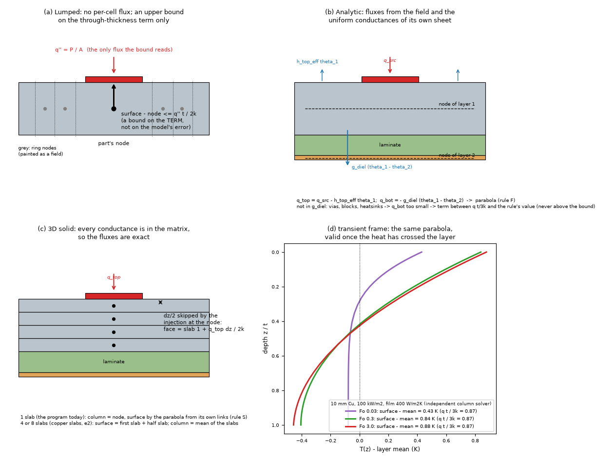
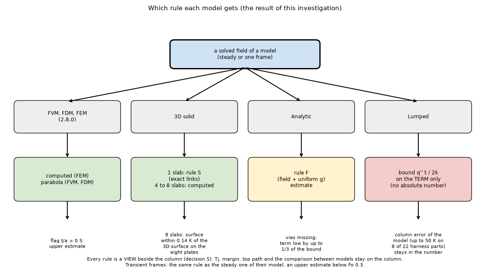
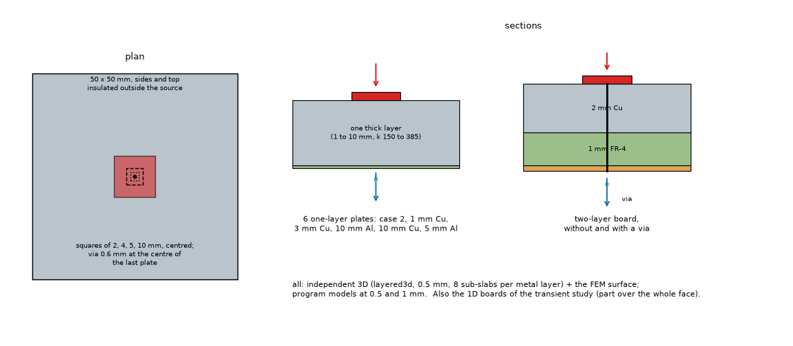
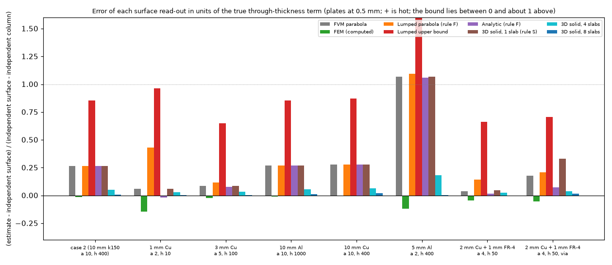
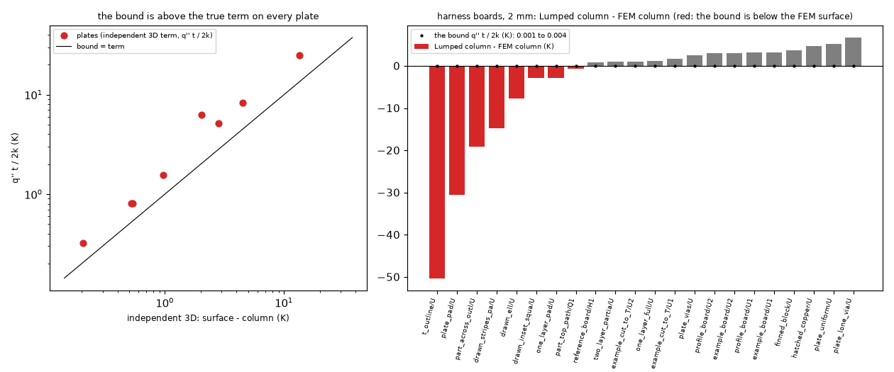
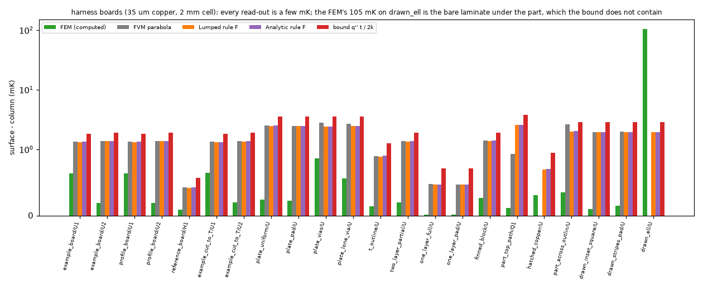
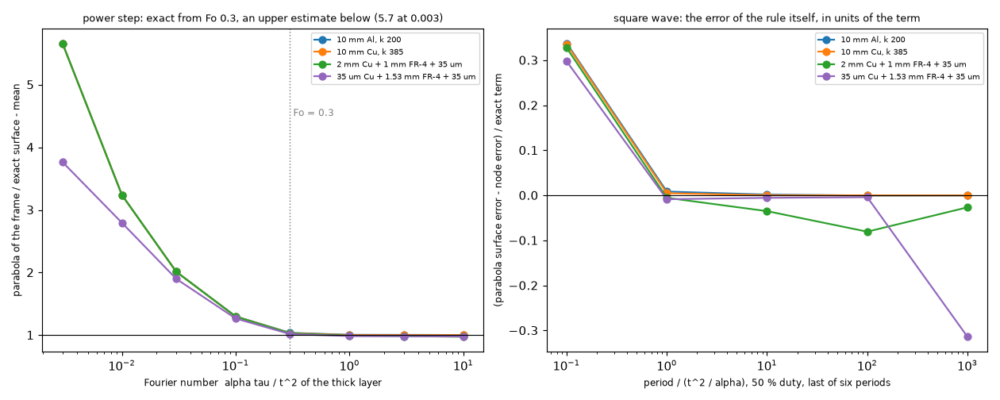

# The surface read-out in the Lumped, the Analytic, the 3D solid and the transient: which rule each model can carry, and what it costs

The FVM, the FDM (parabola of `pcbthermal/thickness.py`) and the FEM (computed) give a surface temperature beside the column mean since 2.8.0; the Lumped, the Analytic, the 3D solid and every transient frame show `n/a`. Item e1 of `releases/2.9.0/PLAN.md` asks how far the read-out can be extended to them, what is measurable and what is only an estimate, and frames two decisions (plan section 6): **4**, the Lumped as an upper bound only if it is never below the FEM surface on the plates and the harness boards; **5**, the headline of the transient and of the Difference view stays the column. The program is not touched: every rule here is written on a copy in `lib/`, run on the program's results, and proposed in `INTEGRATION.md`.

**Short answer** (the numbers are in sections 4 and 5):

| Model | Rule | Status of the number | Measured against the independent 3D surface |
| :-- | :-- | :-- | :-- |
| Lumped | **no absolute surface.** Only the bound on the through-thickness term, `q'' t / 2k` (`q''` the part's power over its footprint) | a bound on the TERM, not on the temperature; measured, not proved (section 6) | the bound is above the true term on 8 of 8 plates (1.5 to 3.1 times it) and on case 2; **but column + bound is below the FEM surface on 8 of 22 harness parts at 2 mm (9 at 1 mm), by up to 50 K at 2 mm (51 K at 1 mm)**: the Lumped's own column error, which the bound cannot contain. Decision 4's condition is **not met** |
| Analytic | rule F: the model's own temperature field, its uniform conductances (`g_diel`, `h_top_eff`, `h_bottom_eff`) and the parabola | estimate (flag `t/a > 0.5`) | within 0.02 K of the FVM parabola on the six one-layer plates and case 2, 0.06 K on the via plate; -0.02 to +1.06 of the true term (7 of 8 hot); 5 ms per result |
| 3D solid | 1 slab (today): rule S, the parabola fed with the solid's own links; 4 or 8 slabs through the copper (item e2): computed, face = first slab + half slab | estimate with 1 slab, computed with slabs | 1 slab = the FVM parabola to 0.001 K on the one-layer plates and case 2 (0.005 K and 0.083 K on the two-layer plates, the second with a via); **8 slabs: -0.00 to +0.13 K of the 3D surface** (4 slabs: +0.01 to +0.73 K) |
| Transient frame | the same parabola, read from the frame's node temperatures with the fluxes of the conductance matrix | exact from Fo = alpha tau / t^2 >= 0.3, an upper estimate below (parabola 5.7 times the exact term at Fo 0.003) | 1D boards, independent column solver; the rule changes the node error by at most 0.01 K once Fo >= 1 |

*Figure 1 (`figures/fig_01_models.png`): the section of each model, the nodes it keeps and the fluxes the rule reads. Panel (d) draws the real profiles of the independent column solver (10 mm copper, 100 kW/m2) at three Fourier numbers.*

*Figure 2 (`figures/fig_02_decision.png`): the decision chart of this investigation.*

## 1. The question, the frame and what would answer it

* **Question.** Can the surface read-out of `thickness.py` be extended, honestly worded, to the models that have no per-cell face flux (Lumped, Analytic), to the 3D solid (one slab through the copper today; item e2 will resolve the copper) and to the time-dependent results? What is computed, what is estimated, what error band?
* **Why it matters.** The thick-plate warning (`checks.check_thick_plates`) says the surface can be hotter than the column by 'up to' `q'' t / 2k`; the plan wants the same number everywhere a user reads a temperature, and a wrong 'upper bound' wording is the error pattern the audit found (the 'up to' of the warning was once read as a bound, `research/muzychka-case2-analytic` 8.2).
* **What answers it.** (1) A published case reproduced with an independent solver and then run in every model: case 2 of Muzychka, Culham and Yovanovich (2003). (2) Plates swept in thickness, source size, conductivity and film against the independent 3D solver and the FEM surface. (3) The harness boards, where the copper is 35 um, to see what the read-out is worth there and whether the Lumped bound holds. (4) The transient against an exact one-dimensional history. (5) The cost.
* **The frame (plan section 6).** Decision 4: offer the Lumped surface worded as an upper bound only if it is never below the FEM surface on the six plates and the harness boards. Decision 5: the transient and the Difference view stay on the column, the surface beside it. Both are tested here, not assumed.

## 2. References and the rules

* **Published case**: case 2 of [Muzychka2003]: a 50 x 50 x 10 mm plate, `k` 150, `h` 400, four 10 x 10 mm sources of 10 / 25 / 20 / 15 W at (12.5, 12.5), (37.5, 12.5), (12.5, 37.5), (37.5, 37.5) mm; centroid temperatures 97.40 / 103.82 / 101.28 / 99.94 degC (Table 4, journal page 184). Confirmed from the text layer of the open copy of the Waterloo group by the researcher, and **on the page images by the review** (the local copy of the journal paper, PDF pages 6 and 7 = journal pages 183 and 184: the case 2 paragraph, Tables 3 and 4, every number above read on the image).
* **Independent 3D solver**: `tests/helpers/layered3d.py` (imports nothing from the program), 0.5 mm in the plane, 8 sub-slabs through every metal layer, 4 through the laminate. It reproduces the paper's four centroids to 0.01, 0.03, 0.03, 0.01 K (97.41 / 103.85 / 101.31 / 99.95).
* **Second reference**: the FEM surface of 2.8.0 (`pcbthermal.fem`), the area mean over the cell of the top face.
* **Independent time reference**: `lib/column1d.py`, a one-dimensional finite-volume solver through the thickness with the thick layers resolved (80 cells graded towards the faces), BDF2 in time; checked against the series resistance and the half-space law `2 q sqrt(t / (pi k rho c))` (`tests/test_column1d.py`).
* **The parabola** (`thickness.py`, derived in `research/through-thickness-readout` 3): for a layer of thickness `t` and conductivity `k` with `q_top` and `q_bot` the fluxes entering through its faces, `T_top - T_m = t (2 q_top - q_bot) / (6 k)`. It is exact for a one-dimensional column and when the in-plane Laplacian is the same at every depth. **With storage the formula is unchanged**: the balance of the layer is `rho c t dT_m/dt = q_top + q_bot + k t laplace(T_m)`, so the right side of `k T_zz = rho c dT/dt - k laplace(T)` is, to lowest order, `(q_top + q_bot) / t`, whether the layer stores heat or spreads it. That is why one rule serves the steady state and a frame; the price is the depth dynamics (section 4.7).
* **Rule F (field)**, for a model with a temperature per layer and per cell but no per-cell face flux. On the top face of layer 1: `q_top = q_src - h_top_eff theta_1`, `q_bot = -g_diel[0] (theta_1 - theta_2)` (a one-layer board: `-h_bottom_eff theta_1`); on the bottom face of layer L: `q_top = g_diel[L-2] (theta_{L-1} - theta_L)`, `q_bot = q_src - h_bottom_eff theta_L`; `q_src` the power density of the parts on that face. The conductances are the uniform ones that the Analytic itself builds in `analytic._effective_sheet`. Not in them: the vias, blocks and heatsinks (`lib/rules.py` `field_rule`).
* **Rule S (solid links)**: the same parabola fed with the 3D solid's own conductance matrix (the heat leaving the copper slab through the z links, the film above); with `n` slabs through the copper, face = first slab + `q_top dz / 2k` and column = mean of the slabs (`solid_rule`).
* **The bound**: `q'' t / 2k` with `q'' = P / A` of the part: the heat all crossing the layer; spreading only lowers it. It reads no field.

*Figure 3 (`figures/fig_03_plates.png`): the plates: plan (50 x 50 mm, a centred square source of 2, 4, 5 or 10 mm, a via in the last) and the sections of the two kinds.*

## 3. Method

`scripts/study_case2_models.py` (case 2, four sources, 0.5 mm), `scripts/study_steady_plates.py` (eight plates, 0.5 and 1 mm), `scripts/study_harness_boards.py` (the boards of `releases/regression-harness`, 2 and 1 mm), `scripts/study_transient.py` (four 1D boards, step and square waves, plus the Analytic's own frames); figures by `make_diagrams.py` and `make_figures.py`; tests `tests/` (11 passed in about 2 s), and `scripts/study_fem_thin_source.py`, added by the review (4.6). Outputs go to the git-ignored `out/`. Every table below is a printed output of those scripts. The plates (`lib/plates.py`): case 2's plate with a single 25 W source, 1 mm Cu (a = 2 mm, h 10), 3 mm Cu (5, 100), 10 mm Al (k 200, 10, 1000), 10 mm Cu (10, 400), 5 mm Al (k 200, 2, 400), a two-layer board with 2 mm of top copper, 1 mm of FR-4 (k 0.3) and 35 um below (a = 4, h 50) without and with a 0.6 mm via at the centre (in the reference the via is a 2 x 2 block of cells whose laminate `k_z` carries the barrel copper in parallel: a lumped equivalent of the barrel, isotropic in the cell). The powers are 25, 1, 10, 100, 40, 2, 5, 5 W; the errors are linear in them, so the tables give errors, and the ratio to the true term, where it matters. The three numbers read in every model are the **column** (the part row: the hottest cell under the part), the **surface** (the hottest cell of the top face under the part; the FEM and the FVM arrays through `analysis.surface_stats`) and, for the reference, the same two from the 3D solution.

## 4. Results

### 4.1 Case 2 of Muzychka and others, four sources (`study_case2_models.py`, 0.5 mm)

Errors against the independent 3D surface at the four centroids (K, + hot); the reference surface is 97.41 / 103.85 / 101.31 / 99.95, its column mean 95.35 / 99.15 / 97.49 / 97.01, so the term is 2.06 / 4.70 / 3.82 / 2.94 K:

| read-out | S1 (10 W) | S2 (25 W) | S3 (20 W) | S4 (15 W) | its column error |
| :-- | --: | --: | --: | --: | :-- |
| FVM (the program's parabola) | +0.57 | +1.26 | +1.03 | +0.80 | +0.10 / +0.08 / +0.09 / +0.09 |
| FEM (computed) | +0.06 | +0.00 | +0.02 | +0.04 | +0.09 |
| Lumped, **upper bound** (column + `q'' t / 2k`) | +1.67 | +2.93 | +2.70 | +1.89 | column +0.40 / -0.70 / -0.14 / -0.16 |
| Lumped, parabola (rule F on its field) | +0.87 | +0.47 | +0.80 | +0.54 | (as above) |
| Analytic, rule F | +0.57 | +1.26 | +1.03 | +0.79 | +0.10 / +0.08 / +0.09 / +0.09 |
| 3D solid, 1 slab, rule S | +0.57 | +1.26 | +1.03 | +0.80 | +0.10 / +0.08 / +0.09 / +0.09 |
| 3D solid, 4 slabs | +0.16 | +0.28 | +0.24 | +0.20 | +0.09 |
| 3D solid, 8 slabs | +0.09 | +0.09 | +0.09 | +0.09 | +0.09 |

The numbers of the FVM, the Lumped bound (the earlier folder's 'B, Lumped, N = 1' row: +1.67 / +2.93 / +2.70 / +1.89), the 3D solid with slabs and the FEM agree with `research/through-thickness-readout` 4.1 and `releases/2.8.0/fem-model/REVIEW_BRANCH4.md`, derived there by other code. The case is `t/a` = 1: the parabola is an upper estimate there (the flag of `thickness.py`). The 8-slab solid reads the surface 0.09 K hot, which is its column offset (0.09 K) and no more.

### 4.2 Eight plates against the independent 3D surface (`study_steady_plates.py 0.5`)

Errors in K against the independent surface under the source (+ hot). `ref` is the independent surface in degC (ambient 25), `term` its surface minus its column mean. 'Lump bound' is the Lumped column plus `q'' t / 2k`.

| plate | ref | term | FVM | FEM | Lump bound | Lump parab. | Analytic F | solid 1 | solid 4 | solid 8 |
| :-- | --: | --: | --: | --: | --: | --: | --: | --: | --: | --: |
| case 2 plate, one 25 W source (t/a 1) | 58.45 | 4.504 | +1.201 | -0.062 | +3.850 | +1.196 | +1.197 | +1.201 | +0.231 | +0.033 |
| 1 mm Cu, a 2, h 10 (0.5) | 66.43 | 0.204 | +0.012 | -0.030 | +0.196 | +0.088 | -0.004 | +0.012 | +0.006 | +0.000 |
| 3 mm Cu, a 5, h 100 (0.6) | 68.81 | 0.966 | +0.082 | -0.023 | +0.627 | +0.113 | +0.074 | +0.082 | +0.031 | +0.004 |
| 10 mm Al, a 10, h 1000 (1.0) | 90.29 | 13.529 | +3.635 | -0.150 | +11.544 | +3.615 | +3.623 | +3.635 | +0.726 | +0.134 |
| 10 mm Cu, a 10, h 400 (1.0) | 70.27 | 2.805 | +0.782 | -0.006 | +2.438 | +0.779 | +0.779 | +0.782 | +0.177 | +0.053 |
| 5 mm Al, a 2, h 400 (2.5) | 29.96 | 2.019 | +2.153 | -0.240 | +4.289 | +2.211 | +2.141 | +2.153 | +0.365 | +0.001 |
| 2 mm Cu + FR-4, a 4, h 50 | 74.53 | 0.519 | +0.019 | -0.022 | +0.343 | +0.075 | +0.009 | +0.024 | +0.013 | -0.000 |
| the same with a via | 74.38 | 0.539 | +0.096 | -0.030 | +0.380 | +0.111 | +0.040 | +0.179 | +0.021 | +0.008 |

*Figure 4 (`figures/fig_04_plates.png`): the error of every read-out in units of the true term; the bound lies between 0.65 and 2.12 of it above, the parabolas up to 1.1 (a thick plate under a small source), the FEM within -0.14 and the 8-slab solid within +0.02.*

Summary of the run (printed by `study_steady_plates.py 0.5 --summary`, in units of the true term): FVM parabola +0.04 to +1.07, FEM -0.14 to -0.00 (0 of 8 hot), Lumped parabola +0.12 to +1.09, **Lumped upper bound +0.65 to +2.12 (8 of 8 above the reference)**, Analytic rule F -0.02 to +1.06, solid 1 slab +0.05 to +1.07, 4 slabs +0.03 to +0.18, 8 slabs -0.00 to +0.02. The column errors of the models on the plates: Lumped +0.02 to +0.11 K, Analytic -0.02 to +0.07, solid -0.00 to +0.08, FVM -0.01 to +0.08, FEM -0.03 to +0.12. `q'' t / 2k` is 1.51 to 3.10 times the true term. At a 1 mm cell (`study_steady_plates.py 1.0`): the same pattern, the Lumped bound +0.75 to +2.15 of the term (8 of 8 above), the Lumped column +0.10 to +0.73 K, the FEM -0.77 to -0.01 of the term (a 2 mm source on a 1 mm mesh), the 8-slab solid -0.09 to +0.02.

* The FVM, Analytic, Lumped and solid-1 rows are the **same parabola** and differ only by the column each model carries and the flux it feeds to it; on the six one-layer plates the Analytic reproduces the FVM within 0.016 K and the one-slab solid within 0.001 K (0.5 mm), since they feed it the same fluxes. On the two-layer plates they do not feed the same fluxes: without the via the Analytic is 0.010 K and the solid 0.005 K from the FVM; **with the via the Analytic is 0.056 K below the FVM and the one-slab solid 0.083 K above it** (+0.040, +0.096, +0.179 K against the independent surface): the three models carry the via differently (the uniform `g_diel` of the Analytic does not see it, the FVM and the solid couple it differently to the copper node). (An earlier version of this README said 'within 0.03 K' for every plate; the review corrected it.)
* The parabola overshoots when `t/a` is above 0.5 (the four plates with `t/a` of 1 or more: +0.78 to +3.64 K, up to 1.07 times the true term), as in `through-thickness-readout` 4.2; it is within 0.1 K of the independent surface up to `t/a` = 0.6.
* The FEM reads 0.006 to 0.24 K **below** the independent surface at 0.5 mm. Part of that is a definition: the FEM surface is the mean over the cell, the reference's is the extrapolated centre of the hottest cell; a 2 mm source on a 0.5 mm mesh is four cells.
* The via plate: the Analytic's uniform `g_diel` knows nothing of the via, so its `q_bot` is too small and its term low; measured, rule F is +0.040 K against the true term of 0.539 (the via's copper is 5 % of the cell: a small effect here, not an upper limit).

### 4.3 Decision 4: the Lumped as an upper bound (`study_steady_plates.py`, `study_harness_boards.py`)

**On the plates** the Lumped column + `q'' t / 2k` is above the independent surface on 8 of 8 (0.5 and 1 mm), by +0.196 to +11.544 K at 0.5 mm; in case 2 by +1.67 to +2.93 K. The reasons are two: the bound is above the true term (1.51 to 3.10 times it here, 54 more plates in the sweep of `through-thickness-readout` 4.2 gave a true term of 0.22 to 0.99 of it), and the Lumped column happens to be above the independent one on every plate (+0.02 to +0.11 K at 0.5 mm).

**On the harness boards it fails.** The boards of `releases/regression-harness` have 35 um copper: every term is milli-kelvin and the bound is 0.4 to 3.8 mK. The Lumped column differs from the FEM column by -50.3 to +6.7 K (2 mm), so (column + bound) - FEM surface is that column difference to within 4 mK (0.1 K on `drawn_ell`, where the FEM face is the bare laminate). Of the 22 parts that have a FEM surface (`round_outline` is refused by the FEM) at 2 mm:

| class of board | parts | Lumped column - FEM column (K) | bound below the FEM surface |
| :-- | --: | :-- | :-- |
| rectangle, no copper window under the part (the example boards, `reference_board`, `plate_uniform`, the two via plates, `one_layer_full`, `finned_block`, `part_top_path`) | 11 | -0.59 to +6.72 | 1 (`part_top_path`, -0.59 K, a part with a top path) |
| an outline (`example_cut_to_T` twice, `t_outline`, `part_across_outline`) | 4 | -50.27 to +1.68 | 2 (`t_outline`, `part_across_outline`) |
| a copper window or hatched / drawn copper (`plate_pad`, `one_layer_pad`, `two_layer_partial`, `hatched_copper`, the three `drawn_*`) | 7 | -30.48 to +4.76 | 5 (`plate_pad`, `one_layer_pad`, `drawn_inset_square`, `drawn_stripes_pad`, `drawn_ell`) |

At 2 mm the bound is below the FEM surface on **8 of 22 parts** (worst -50.27 K, `t_outline`), below the FVM surface on 11 of 23 (worst -54.03 K). At 1 mm: 9 of 22 (worst -50.98 K) and 11 of 23 (worst -51.18 K). The Lumped solves the rectangle of the same area of an outline and the effective sheet of a copper window (`lumped.py`, `blocks.require_rectangle`), which are documented limits (`docs/validation.md` 17), not defects of this study; but a surface number worded as an upper bound that reads 50 K under the reference on a board the program accepts is the error pattern the audit found. **Decision 4's condition is not met**: no absolute surface for the Lumped. What does hold on the harness is the bound on the TERM: `q'' t / 2k` is at or above the FVM surface-minus-column on all 23 parts (0.25 to 0.91 of it; `hatched_copper` 0.00) and at or above the FEM's on 21 of 22 (a weak check: the FEM under-reads the thin-copper term, 4.6); the exception is `drawn_ell`, where the FEM term is 104.7 mK at 2 mm (1029 mK at 1 mm) against a bound of 2.84 mK: the part overlaps the missing corner of the L (the copper fill under it has a minimum of 0, measured), so the FEM face there is the bare laminate (the 'thin-copper trap' of theory 1.2 and of `releases/2.8.0/fem-model/SURFACE_DECISIONS.md` 10), which the bound does not contain.

*Figure 5 (`figures/fig_05_bound.png`): left, `q'' t / 2k` against the independent true term on the plates (above the line on all eight); right, the Lumped column minus the FEM column on the 22 harness parts, in K, with the bound (0.001 to 0.004 K) as dots: the red bars are the parts where column + bound is below the FEM surface.*

**What can be said for the Lumped** without a number that can be wrong by 50 K: 'the surface under this part is at most `q'' t / 2k` (X K) above the column value of this model'; true on 8 of 8 plates and 21 of 22 parts (not where the part sits over absent copper), a statement about the through-thickness term only, **measured, not proved** (section 6 names the case where it can fail). The program's thick-plate warning already says it (`checks.check_thick_plates`), so the Lumped needs no new number; section 5 proposes only the wording of the Layer entry.

### 4.4 The Analytic: rule F (`study_steady_plates.py`, `study_harness_boards.py`)

* On the one-layer plates rule F equals the FVM parabola within 0.016 K (0.5 mm; 0.010 and 0.056 K on the two-layer plates without and with the via) because the Analytic's column is within 0.07 K of the independent one and `g_diel`, `h_top_eff` carry the whole flux path. Against the independent surface: -0.02 to +1.06 of the true term, 7 of 8 hot (table 4.2).
* On case 2 it reproduces the FVM's +0.57 / +1.26 / +1.03 / +0.79 K (table 4.1).
* On the harness boards rule F gives 0.42 to 2.57 mK on the Analytic field (0.41 to 2.57 on the Lumped's); the two are within 0.02 mK of each other on 15 of 22 parts (17 in the first version, which read every part on the footprint of all the parts of its layer: a defect of the study fixed in review, `tests/test_harness_rows.py`) and rule F on the Analytic is within 1 mK of the FVM's term on 20 of 22 (the exceptions: `part_top_path`, rule F 2.57 mK against the FVM's 0.93, a part with a top path whose heat does not all enter the board, and `drawn_ell`, 1.94 mK against the FVM's 0.00). The harness parts are 35 um copper, where nothing is at stake.
* Not covered by `g_diel`: vias, blocks, heatsinks. On a dense via array (`plate_vias`) the Analytic term is 2.39 mK, the FVM's 2.80, the FEM's 0.86: all milli-kelvin. A block under the part has no rule (the block face is one node in every layered model).
* The Analytic's own column keeps its documented limits (`plate_pad`: -168 K against the FEM at 2 mm, a copper window averaged in the effective sheet); the surface inherits them.

### 4.5 The 3D solid (`study_steady_plates.py`, `study_case2_models.py`)

* **One slab, today's rule** (copper `n_cu` = 1): rule S, the parabola fed with the matrix's own z links, equals the FVM parabola to 0.001 K on the six one-layer plates and case 2, and to 0.005 K and 0.083 K on the two two-layer plates (the second, with a via, reads +0.179 K against the FVM's +0.096: the via is coupled differently, 4.2); against the independent surface +0.012 to +3.635 K (the overshoot beyond `t/a` 0.5 is the parabola's, not the solid's).
* **Copper slabs** (item e2; the study uses the patched module of `research/through-thickness-readout/lib/solid3d_sublayers.py`): 4 slabs read +0.006 to +0.726 K, **8 slabs -0.000 to +0.134 K** against the independent surface on the plates (+0.09 K on case 2, which is the 0.09 K the solid's column carries), at the cost the earlier folder measured (1.6 / 2.4 times the unknowns at 4 / 8 slabs on case 2). A 35 um copper layer needs one slab (its term is milli-kelvin, 4.6) and the same code gives the surface by rule S.
* The heat enters the first slab at its node, not at the face, so the half slab `dz/2` is not conducted: the face is first slab + `q_top dz / 2k` (the 'half-slab rule'); that is what the 4 and 8 slab rows use. With one slab the same addition would be the bound `q t / 2k` (it overshoots, +1.4 to +3.7 K on case 2), so one slab keeps the parabola.
* A block over a board and the second face are not covered.

### 4.6 The harness boards: what the read-out is worth at 35 um (`study_harness_boards.py`)

*Figure 7 (`figures/fig_07_harness.png`): surface minus column on the 22 parts, in mK, per read-out; the FEM's 105 mK on `drawn_ell` is the bare laminate under the part.*

* Every through-thickness term on the harness is **0.00 to 2.8 mK** in the FVM, 0.01 to 0.86 mK in the FEM (except `drawn_ell`, below) and 0.42 to 2.57 mK by rule F; the bound `q'' t / 2k` is 0.57 to 3.79 mK. Nothing would be visible to a user: the read-out matters only on thick copper or a metal base. This is the earlier folders' finding, re-measured here with the FEM beside it.
* **The FEM's thin-copper terms are smaller than the FVM's on 20 of 22 parts, by 2.1 to 37 times** (0.01 to 0.86 mK against 0.42 to 2.80 mK; the two others are `hatched_copper`, where the FVM reads 0.00 by its laminate-trap rule, and `drawn_ell`; printed by `study_harness_boards.py`: FEM term / bound 0.02 to 0.35, FVM 0.25 to 0.91). Both are milli-kelvin and invisible to a user. **The cause was measured by the review** (`study_fem_thin_source.py`): on a copper layer of one slab (up to 105 um) the FEM puts a part's power as a volumetric source in the slab (`femmesh.build`; only a thicker outer layer takes it as a face flux), and the single linear element carries half of that load at its bottom node. On a one-dimensional board, where the exact term is `q t / 2k`, the FEM reads **0.50** of it at 2, 1 and 0.5 mm (the FVM 1.00); on a 4 x 4 mm, 1 W part, where heat entering the face gives 0.67 to 1.00 of the bound (all sideways to all down; the independent 3D of `through-thickness-readout` 4.3 gave 0.70 on its board), the FEM reads 0.05 and the FVM 0.69. So the **FEM under-reads the thin-copper surface term**, by the whole term in the worst case; the statement of `docs/theory.md` 4a that through 35 um the volumetric source and the face flux 'differ by micro-kelvin' holds for the column, not for the surface minus column (up to 2 mK on the harness). Not a defect of this study; a program finding, proposed in INTEGRATION.md 9 (decision D of 7) for the FEM work of 2.9.0.
* `drawn_ell`: the FEM term is 105 mK (2 mm) and 1029 mK (1 mm); the part overlaps the missing corner. This is the laminate under a part over absent copper, resolved by the FEM, not an error of the read-out.

### 4.7 The transient (`study_transient.py`, 1D boards, independent column solver)

The board is one-dimensional (a part over the whole face of an insulated board; 20 x 20 mm; 40 W, 100 kW/m2), so the independent column solver is exact. The program's FVM network (`fvm.Network`: `K`, `C`, `Q`) is integrated with BDF2 and **every** node is kept (the program's transient frames keep only the board layers: the laminate sub-nodes are dropped, so the fluxes cannot be read from the frames; see INTEGRATION). Rule T reads the fluxes of layer 1 at the middle cell exactly as `thickness.attach` does in the steady state (`tests/test_transient.py` holds this to 1e-6 K).

**Power step**, 10 mm copper (k 385, alpha 1.12e-4 m2/s, t^2/alpha = 0.896 s, h 400), read at the Fourier number Fo = alpha tau / t^2 (K; 'exact' is the surface minus the exact layer mean):

| Fo | exact term | parabola of the frame | parabola / exact | surface error | node error |
| --: | --: | --: | --: | --: | --: |
| 0.003 | 0.1529 | 0.8658 | 5.66 | +0.7129 | -0.0000 |
| 0.01 | 0.2675 | 0.8659 | 3.24 | +0.5984 | -0.0000 |
| 0.03 | 0.4303 | 0.8659 | 2.01 | +0.4356 | -0.0000 |
| 0.1 | 0.6681 | 0.8663 | 1.30 | +0.1981 | -0.0001 |
| 0.3 | 0.8397 | 0.8671 | 1.03 | +0.0266 | -0.0009 |
| 1 | 0.8697 | 0.8703 | 1.00 | -0.0034 | -0.0039 |
| 3 | 0.8785 | 0.8790 | 1.00 | -0.0120 | -0.0125 |
| 10 | 0.9078 | 0.9083 | 1.00 | -0.0394 | -0.0398 |

The other three boards (10 mm Al, 2 mm Cu + 1 mm FR-4 + 35 um, 35 um Cu + 1.53 mm FR-4 + 35 um) give the same ratios (5.66, 3.24, 2.01, 1.30, 1.03 to 1.04 at Fo 0.003 to 0.3; 0.97 to 1.01 above; the thin board 3.76 to 1.02) and, from Fo = 1 on, a surface error that differs from the node error by at most 0.0095 K (10 mm Al at Fo 1; 0.005 K or less on the 2 mm board): **the rule adds almost nothing to the error the node already carries** (the node errors are the known half-copper term of theory 1.2b and the laminate model's, not the read-out's). At early times the exact term grows as `sqrt(t)` and the parabola holds at `q t / 3k` (heat has not reached the bottom: `q_bot / q` = 0): an **upper estimate**: on the four boards the parabola is 1.27 to 5.66 times the exact term at Fo 0.003 to 0.1 and 1.02 to 1.04 at 0.3; from Fo = 1 it is within 3 % of it (0.97 to 1.01).

**Square waves** (50 % duty, six periods, the last one read), 10 mm copper, period in units of t^2/alpha:

| T / (t^2/alpha) | exact peak surface (K) | exact peak term (K) | parabola surface error (K) | node error (K) | bound `q t / 2k` (K) |
| --: | --: | --: | --: | --: | --: |
| 0.1 | 1.4270 | 0.6497 | +0.2168 | -0.0011 | 1.2987 |
| 1 | 8.4619 | 0.8746 | -0.0079 | -0.0122 | 1.2987 |
| 10 | 60.5862 | 0.9680 | -0.0758 | -0.0761 | 1.2987 |
| 100 | 158.4864 | 1.1363 | -0.0549 | -0.0550 | 1.2987 |
| 1000 | 251.4503 | 1.2962 | -0.0130 | -0.0130 | 1.2987 |

*Figure 6 (`figures/fig_06_transient.png`): left, the parabola of a frame over the exact term against the Fourier number (the four boards; exact from Fo 0.3, an upper estimate below); right, the rule's own error (parabola surface error minus node error) in units of the exact term for square waves. For the thin board the term is 2 to 4 mK, so a large ratio there is a negligible number of kelvin. Its node error is not: the periods of 1.1 us to 11 ms (0.1 to 1000 times its t^2/alpha of 11 us) give a node error of -0.0025 to -10.75 K on exact peaks of 0.005 to 13.10 K. That is the column's, not the read-out's, and it is the documented limit of `docs/theory.md` 10: the copper node carries half of the adjacent laminate's capacity (here about ten times the copper's), so a wave shorter than the laminate's diffusion time is read too small. (The first version of this caption gave 0.1 mK, 11 us and 'up to 0.27 K on 0.33 K', numbers no script printed, and called the cause not investigated; corrected by the review.)*

At a period below the diffusion time (T = 0.1 t^2/alpha) the parabola overshoots the term by +0.2168 K on 0.65 (33 %); from T = t^2/alpha up the surface error equals the node error. A drive with fast edges (a few times the diffusion time of the layer, 0.9 s for 10 mm of copper, 36 ms for 2 mm, 10 us for 35 um) is the only place where the estimate flag matters; for the 35 um copper of every harness board the flag is never raised in practice (10 us).

**The Analytic's own frames with rule F** (`analytic.solve_transient`, power step; surface error against the exact column solution, node error beside it): 10 mm Cu +0.1835 / -0.0027 / -0.0394 K at Fo 0.108 / 0.929 / 10 (node -0.0001 / -0.0032 / -0.0398), 10 mm Al +0.3555 / -0.0213 / -0.2416 (node -0.0012 / -0.0308 / -0.2459), 2 mm Cu board +0.0306 / -0.0488 / -0.3719 (node -0.0060 / -0.0473 / -0.3673): the same behaviour as the FVM frame (the overshoot of the upper estimate below Fo 0.3, then the node error), 1D boards only. (The first version quoted +0.0046 / -0.0001 / -0.0010 and the like, which `study_transient.py` does not print; the numbers above are its output, corrected by the review.) The Lumped frames (`_LumpedAdapter.frame`) were **not run**; rule F on a field applies to them in the same way but there is no number here.

### 4.8 Cost

Rule F on a full Analytic or Lumped result of the example board at 1 mm: 5 ms (about 0.6 % of the Analytic's 0.84 s solve; it includes rebuilding the effective sheet, which the real implementation would take from the solve). Rules S and T were not timed (a sparse row product of the solid's matrix, and one sparse product per kept frame on the rows of the outer layer); the frame memory of rule T grows by the share of 2 faces over the layers (not measured). The unknown count of the 3D solid with 4 and 8 slabs is the item e2's, measured in `through-thickness-readout` 4.1.

## 5. The answers

1. **Lumped (decision 4)**: the condition is not met; **do not offer an absolute surface**. Offer, if anything, the bound on the term worded as such. The reasons (4.3): the bound is above the true term on 8 of 8 plates and on case 2, but 'column + bound' is below the FEM surface on 8 of 22 harness parts at 2 mm (9 at 1 mm), by up to 50 K, because the Lumped column is itself off by that much on outlines and copper windows. A number labelled 'upper bound' on the temperature would be wrong on boards the program accepts.
2. **Analytic**: rule F, flagged an estimate, `t/a > 0.5` an upper estimate, vias, blocks and heatsinks named as not in it. It reproduces the FVM parabola within 0.02 K on the six one-layer plates and on case 2; on the via plate it is 0.056 K below it (the via is not in `g_diel`).
3. **3D solid**: with the copper slabs of item e2 the surface is **computed** (8 slabs within 0.14 K of the independent surface on the eight plates); with one slab (every ordinary board) rule S, the parabola, the same as the FVM. Do e2 first, then the read-out is the half-slab rule for `n` >= 2 and the parabola for `n` = 1.
4. **Transient (decision 5)**: the headline stays the **column**, the surface beside it, as decided; the surface of a frame is exact from Fo >= 0.3 and an upper estimate below it. The measurement supports decision 5: in every row of 4.7 from Fo = 1 on, the surface error equals the node error: a difference between two models in the transient is a difference of column, and putting the surface in the headline would add the (small) read-out term to the error of the column, not remove it.

**Read-outs per model** (the table the plan asked for; 'column' is the solved quantity, 'surface' the face of the outer copper, 'point' the hottest mesh node of the FEM; est. = estimate):

| model | column | surface, steady | surface, transient frame | point |
| :-- | :-- | :-- | :-- | :-- |
| FVM, FDM | computed | est. (parabola), flagged `t/a > 0.5`; computed copper only with sub-layers (not offered) | est. (rule T): proposed; the frames must keep every node | no |
| FEM | computed | computed | computed in 2.9.0's FEM transient | computed (`T_point`) |
| 3D solid, 1 slab | computed | est. (rule S) | not offered (steady only) | no |
| 3D solid, 4 to 8 slabs (e2) | computed | computed (face = first slab + half slab) | not offered (steady only) | no |
| Analytic | computed | est. (rule F), flagged | est. (rule F on the frame), 1D boards verified | no |
| Lumped | computed | none; the bound on the term `q'' t / 2k` only | none | no |

## 6. Limits of this study

* The plates are 50 x 50 mm with one centred square source; elongated or round parts, a source at an edge or a corner, several sources on a thick plate other than case 2, partly filled copper under a thick layer, a metal block over a board and the bottom face of a thick layer were not run (the code computes the bottom face; no number of it is quoted).
* The rules are tested with the program's own models, so the independent reference is the 3D solver and the exact column; no independent solver of the program's Lumped network exists.
* The transient is verified on 1D boards only. A local source in time (a part smaller than the layer is thick, under a square wave) has no independent 3D reference in the repository (`layered3d` is steady) and was not run; the spreading and the depth dynamics combine there. The Lumped frames and the profile / animation paths were not run.
* The FVM/FEM harness comparison is at 2 and 1 mm; neither is converged on the finest features (`drawn_ell`'s 105 and 1029 mK differ by ten times between the two). Per-board FEM-against-FVM column differences (up to 7 % on `plate_pad`) are the campaign's business and are not judged here.
* `q'' t / 2k >= true term` is **measured, not proved** (8 plates and case 2 here, 54 plates earlier: the true term is 0.22 to 0.99 of it; the FVM term on the 23 harness parts 0.25 to 0.91 of it). The argument behind it holds for a part whose heat enters its own face and leaves through the layer or sideways: in the parabola `T_top - T_m = t (2 q_top - q_bot) / 6k`, `-q_bot <= q_top` gives at most `q t / 2k`. It can fail where the column under the part also receives heat sideways from a hotter neighbour and passes it down (`-q_bot > q_top`), where the part sits over absent copper (`drawn_ell`, 4.3), and for a thick plate with a small part, where the parabola is itself not exact; none of those was swept. Every place this README or INTEGRATION.md states the bound means this measured statement.
* The via plate uses a lumped isotropic cell for the barrel in the reference; its absolute surface (-0.15 K against the plate without a via) is plausible but not independently checked against a resolved barrel.
* Memory and time: every run here used under 1.5 GB and under 5 minutes on an idle machine (load about 2.3).

## 7. Review

Independent review of the folder (the program at `development` 6f32b957, untouched). **Verdict: GO** for the merge once the whole battery is green on the merged tree; the proposals go to item e1 of 2.9.0 with the decisions of INTEGRATION.md 7.

* **Re-run** (one job at a time, a battery running beside): `study_case2_models.py`, `study_steady_plates.py 0.5` and `1.0`, `study_harness_boards.py 2.0` and `1.0`, `study_transient.py`, `make_figures.py`, the tests (11 passed). Every number of 4.1, 4.2, 4.3 (the 8 of 22 and 9 of 22, the three classes of the table, -50.27 / -54.03 / -50.98 / -51.18 K), 4.6 and of the step and square-wave tables of 4.7 is printed as quoted.
* **Defects of the study, corrected**: (1) `study_harness_boards.py` read the rule-F offset of a part on the footprint of every part of its layer (U1 and U2 of the example board both printed 1.37 mK); fixed per part, regression test `tests/test_harness_rows.py` (fails on the old script); the count 'within 0.02 mK on 17 of 22' became 15 of 22, the other harness numbers did not move; the counts of 4.4 and 4.6 are now printed by the script. (2) The Analytic-frame numbers of 4.7 (+0.0046 / -0.0001 / ... K) and the thin-board caption of figure 6 (0.1 mK, 'up to 0.27 K on 0.33 K', 'cause not investigated') were printed by no script; replaced by the output, and the cause named (the laminate capacity on the copper node, `docs/theory.md` 10). (3) 'The Analytic and the one-slab solid reproduce the FVM within 0.03 K / to 0.002 K on the plates' was wrong on the via plate (0.056 K and 0.083 K); corrected in the short answer, 4.2, 4.4, 4.5, 5 and INTEGRATION.md.
* **Independent references**: case 2 of [Muzychka2003] checked on the page images (journal pages 183 and 184): the dimensions, Table 3 and Table 4 as quoted, so the status R now rests on the image; the independent 3D solver reproduces Table 4 to 0.01 to 0.03 K (re-run). The bound on the term is checked against the independent 3D on the plates and against the FVM on the harness (all 23 parts); the check against the FEM is weak (next item).
* **The FEM's smaller thin-copper term** (4.6): tested directly, not left to the campaign. It is the FEM's volumetric source in a one-slab copper: on a one-dimensional board the FEM reads 0.50 of the exact `q t / 2k` (the FVM 1.00), on a 4 mm part 0.05 against a physical 0.67 to 1.00 (`study_fem_thin_source.py`). A program finding, not a defect of the study; milli-kelvin; INTEGRATION.md 9, for the FEM work of 2.9.0.
* **The bound** `q'' t / 2k` on the term is measured, not proved; said so wherever it is stated (short answer, 4.3, 6, INTEGRATION.md, the proposed wording, `docs/theory.md` of this folder), with the cases where it can fail.
* **The Lumped has no absolute surface**: confirmed. Its column + bound is below the FEM surface on 8 of 22 parts (re-run); the Lumped's own parabola is about as good as the Analytic's on the plates, so the refusal rests on its ring field and the wording risk, said in INTEGRATION.md 7.
* **Not verified by the review**: the 3D solid with slabs beyond what the scripts print; a converged reference for the thin board under the shortest square waves (the column solver's 20 laminate cells); the diagrams (`make_diagrams.py` not re-run, no number of them moved); real boards.

## 8. What was read and what was not verified

* **Read in full (R)**: [Muzychka2003], Tables 3 and 4 and the case 2 paragraph (journal pages 183 to 184), from the text layer of the open copy (`mhtl03-1.pdf`, downloaded to a scratch folder, nothing stored) and **checked by the review on the page images** of the local copy of the journal paper (PDF pages 6 and 7, journal pages 183 and 184): the dimensions a = b = 50 mm, k 150, t 10 mm, h 400 W/m2K, the four sources (10 / 25 / 20 / 15 W, 10 x 10 mm at the four centres) and the centroid and mean temperatures 97.40 / 103.82 / 101.28 / 99.94 and 96.85 / 102.33 / 100.10 / 99.07. Every one of those numbers is on the image as quoted (Table 4 columns: the centroid `T^` and the mean `T-bar`).
* **Read in this tree**: `pcbthermal/thickness.py`, `analytic.py` (`_effective_sheet`, `solve_steady`), `lumped.py` (`solve_steady`), `solid3d.py` (`Solid`, `solve_steady`), `fvm.py` (`transient_from_network`), `analysis.py` (`heater_stats`, `surface_stats`), `research/through-thickness-readout/README.md`, `research/readout-conventions/README.md`, `research/muzychka-case2-analytic/lib/case2.py`, `releases/2.8.0/fem-model/SURFACE_DECISIONS.md`, `docs/validation.md` 55.6, `releases/2.9.0/PLAN.md` 2.1 and 6.
* **Reproduced**: the independent 3D solver against the paper's Table 4 (0.01 to 0.03 K, section 2); the earlier folder's case 2 numbers (the FVM parabola, the Lumped B row, the solid with slabs) by different code (4.1); the column solver against the series resistance and the half-space law.
* **New here (derivations of this folder, not published formulas)**: rules F, S and T and the bound's wording; the storage argument of section 2 (a derivation, checked by section 4.7 only for 1D boards).
* **Not verified**: the Lumped transient frames; local sources in time; a block; the bottom face; partly filled copper under a thick layer (the harness has 35 um copper only); a fix of the FEM's thin-copper source (its cause is measured in 4.6, the fix is not tried); any real-board number (the real-board library was not used); the FEM at finer cells than 0.5 mm on the plates. The program's frozen numbers were not run (nothing of the program changed; the proposals are additive, argued in INTEGRATION.md 5, to be measured on the feature branch).

Reproduce (repository root, the program's `.venv`): `study_case2_models.py`, `study_steady_plates.py 0.5` and `1.0` (about 4 min each), `study_harness_boards.py 2.0` and `1.0` (about 3 min), `study_transient.py` (1 s), `study_fem_thin_source.py` (20 s, added by the review), `make_diagrams.py`, `make_figures.py`; tests `.venv/bin/python -m pytest -q research/surface-readout-models/tests`.
