# Pictures for the theory of every model and for what is planned

## 1. The question

`docs/theory.md` explains every equation of every model and `docs/roadmap.md` lists what is planned, but most sections have no drawing. A reader needs to see **what a method does and what a number is**, not only the algebra. This folder draws it: one picture for each theory section that had none, and one for each model or analysis that is planned, so the idea is clear before it is built. Nothing here changes the program.

### 1.1 Diagrams and illustrations

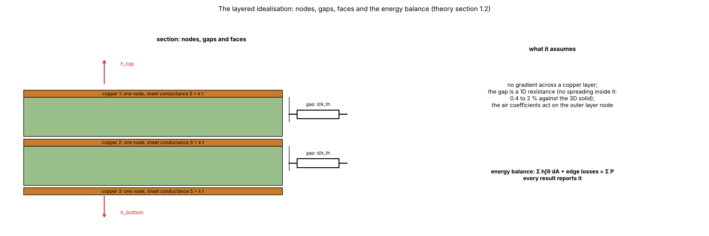

*Figure 1 (`figures/fig_01_layered_idealisation.png`, theory 1.2): The layered idealisation: one node per copper layer, the gap a 1D resistance, the air coefficients on the outer layers and the energy balance.*

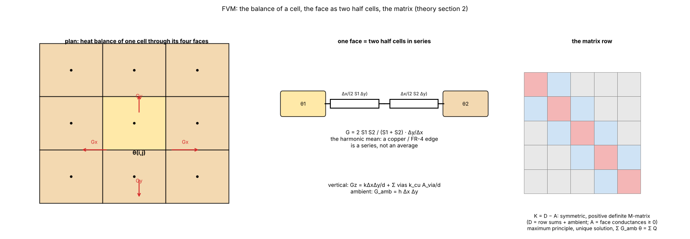

*Figure 2 (`figures/fig_02_fvm_cell.png`, theory 2): The finite volume: the balance of a cell through its four faces, a face as two half cells in series (harmonic mean), and the matrix row (symmetric M-matrix).*


*Figure 3 (`figures/fig_03_fdm_nodes.png`, theory 2 and 3): FVM cells against FDM control volumes: full inside, half on an edge, a quarter at a corner.*

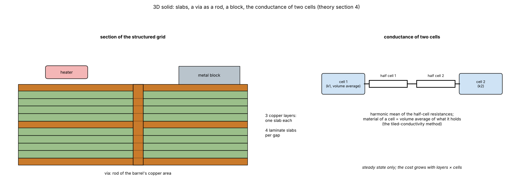

*Figure 4 (`figures/fig_04_solid3d_slabs.png`, theory 4): The 3D solid: real slabs, a via as a copper rod, a block, and the conductance of two cells.*

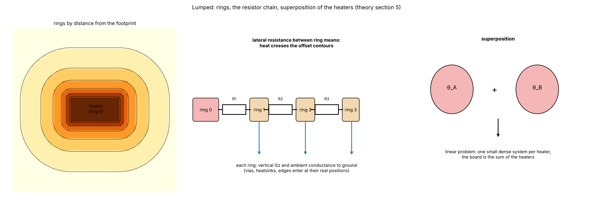

*Figure 5 (`figures/fig_05_lumped_rings.png`, theory 5): The Lumped model: rings by distance from the footprint (computed distance transform), the resistor chain with ambient conductances, superposition of heaters.*

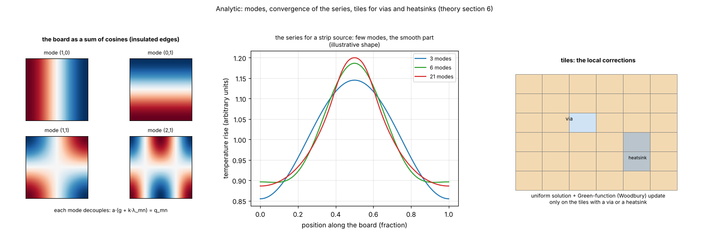

*Figure 6 (`figures/fig_06_analytic_modes.png`, theory 6): The Analytic model: cosine modes, convergence of the series for a strip source (illustrative shape), tiles of the via and heatsink corrections.*

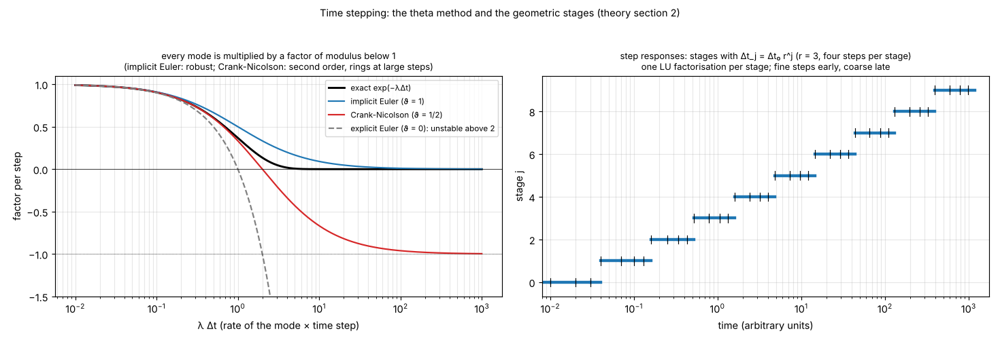

*Figure 7 (`figures/fig_07_theta_method.png`, theory 2 (transient)): The theta method: the factor per step against rate times step (exact, implicit Euler, Crank-Nicolson, explicit Euler) and the geometric stages of the step.*

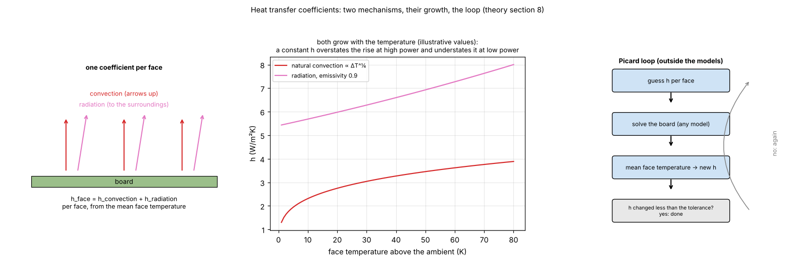

*Figure 8 (`figures/fig_08_heat_transfer.png`, theory 8): Convection and radiation on a face, their growth with temperature (illustrative values) and the Picard loop.*

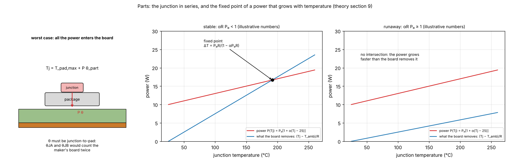

*Figure 9 (`figures/fig_09_part_runaway.png`, theory 9): The junction in series above the pad and the fixed point of a power that grows with temperature: stable and runaway (illustrative numbers).*

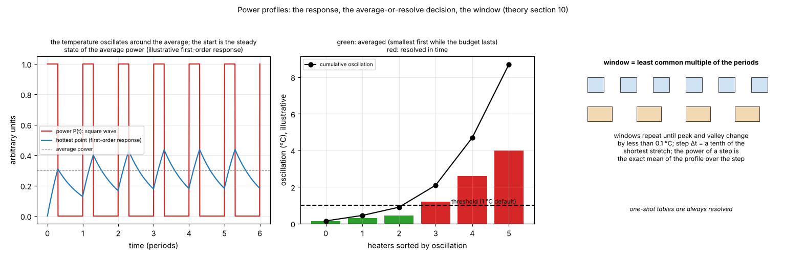

*Figure 10 (`figures/fig_10_profile_decision.png`, theory 10): A square wave and the response of the hottest point, the average-or-resolve decision against the shared threshold (illustrative oscillations) and the window.*

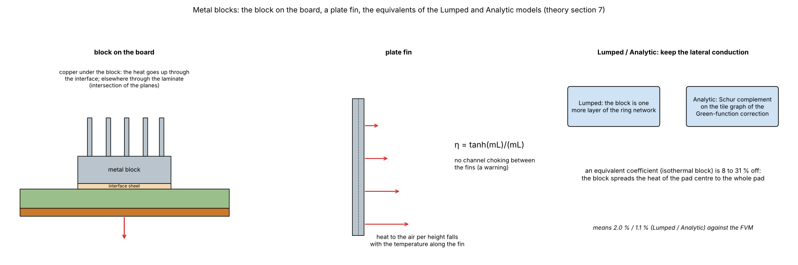

*Figure 11 (`figures/fig_11_metal_block.png`, theory 7): The block on the board, a plate fin and the equivalents of the Lumped and Analytic models.*


*Figure 12 (`figures/fig_12_foster_chain_planned.png`, roadmap 1.11 (planned)): The junction impedance Zth(t), the Foster chain that reproduces it and a pulse train read from it (illustrative values).*

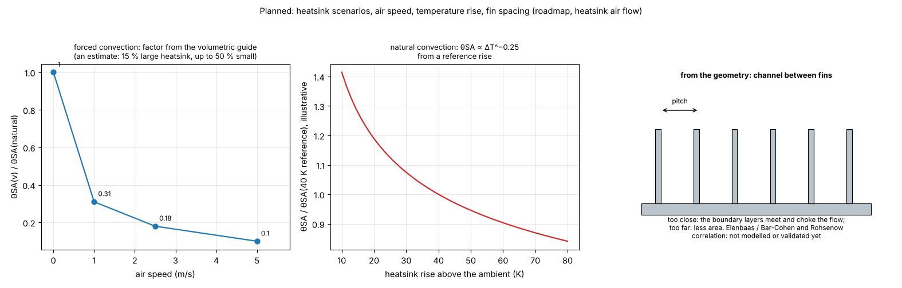

*Figure 13 (`figures/fig_13_heatsink_scaling_planned.png`, roadmap, heatsink air flow (planned)): Forced-convection factors (1, 0.31, 0.18, 0.10 at 0, 1, 2.5, 5 m/s), the natural-convection scaling with the rise and the channel between fins.*

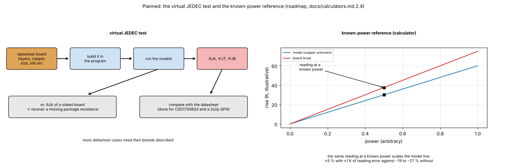

*Figure 14 (`figures/fig_14_virtual_jedec_planned.png`, roadmap, calculators 2.4 (planned)): The virtual JEDEC test (the datasheet's board built in the program) and the known-power reference of the Power calculator.*

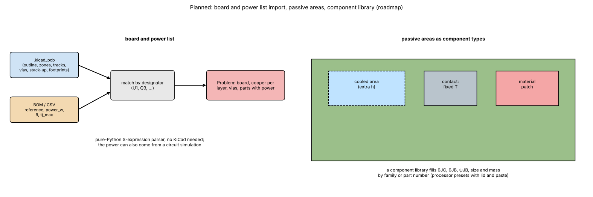

*Figure 15 (`figures/fig_15_import_to_power_planned.png`, roadmap, import (planned)): KiCad board plus a power list matched by designator, and passive areas as component types.*

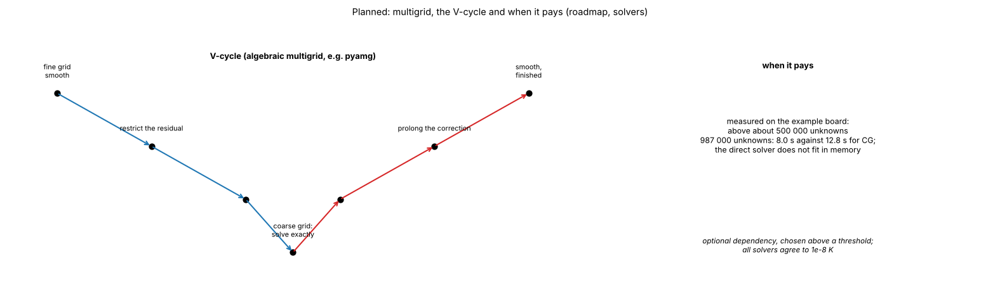

*Figure 16 (`figures/fig_16_multigrid_planned.png`, roadmap, solvers (planned)): The multigrid V-cycle and when it pays.*

## 2. How the pictures were made

`scripts/make_diagrams.py` draws all of them (no data and no program; shared shapes in `research/diagram_kit.py`). Pictures with curves use textbook formulas written in the script (the amplification factor of the theta method, the stable and runaway fixed point, the series of a strip source, the Foster sum); where the values are only illustrative the caption above says so, and no number of the pictures is a result. Numbers quoted in the text of a picture come from `docs/theory.md`, `docs/roadmap.md` and `docs/calculators.md`. The rings of figure 5 and the modes of figure 6 are computed in the script (a distance transform and cosines), not taken from the program.

```sh
.venv/bin/python research/theory-diagrams/scripts/make_diagrams.py
```

## 3. Folder layout

| File | What it is |
| :-- | :-- |
| `scripts/make_diagrams.py` | Draws the 16 figures. |
| `figures/` | `fig_01` to `fig_16` (figures 12 to 16 are for planned work). |
| `docs/theory-figures.md` | Which figure goes into which section of the project documents when the work is adopted. |

## 4. Still without a picture

The theory sections 1.1 (the continuum problem), 1.3 (sources and geometry), 11 (verification summary) and 12 (references) have no picture of their own; the planned items of `docs/research.md` (R2 to R8, E3 to E8) are covered by the pictures of `research/component-heatsink/`. The next time a theory section or a planned analysis is written, its picture is made in the same pass (`CLAUDE.md`, "Diagrams and illustrations").

## What was read and what was not verified

* Read: the sections of `docs/theory.md` named in the captions and the roadmap items, in full, from the files of the repository.
* Not verified: the pictures are explanations, not tests; the illustrative curves are not data of the program; the planned methods are not implemented, so the pictures show intended behaviour only.
