# Theory sources: opening the sources the models rest on, and reproducing their published cases

The program's formulas and the planned methods rest on sources that had been named, summarised or remembered but not opened (`research/theory/BIBLIOGRAPHY.md`, statuses M, N and S). This folder carries the roadmap row 16 (items F1 to F8; F9, the old rows of the removed program, is left out as agreed): it opens what can be opened, writes down the equations, tables and numbers with their pages, reproduces published cases with solvers that import nothing of the program, then runs the program's models on the same cases or on the closest version they can represent. Where a source could not be obtained it says so and lists it for the maintainer.

The program is untouched (`git diff origin/develop --stat -- pcbthermal tests examples ico` is empty); the findings are proposals in `INTEGRATION.md`, the text for the project documents is in `docs/`.

## 1. The questions

| Item | Question | Where |
| :-- | :-- | :-- |
| F3 | Which natural and mixed convection forms does the program use, and are they what the sources print? The `ht` Hollands discrepancy. | 3.1 to 3.4 |
| F4 | The 2D Bruggeman, Hashin-Shtrikman and Keller-Dykhne formulas, with page and equation. | 3.5 |
| F1 | Culham and Yovanovich (1998) above Biot 60: reopen pages 460 to 467, test the series truncation. | 3.6 |
| F2 | The cases of Muzychka and others (compound plate, heat-sink base) and of Lemczyk. | 3.7 |
| F8 | Yovanovich's Table 3 and Lee's equations 1 and 2, previously seen in part. | 3.11 |
| F7 | A grid convergence index with three grids on each reference. | 3.10 |
| F6 | One source and one reproduced case for each planned topic 12 to 16. | 3.8, 3.9, 3.12 |
| F5 | The remaining M, N and S sources, in the order the other items needed them. | 3 (each section), last section |

### 1.1 The situations that the sections explain

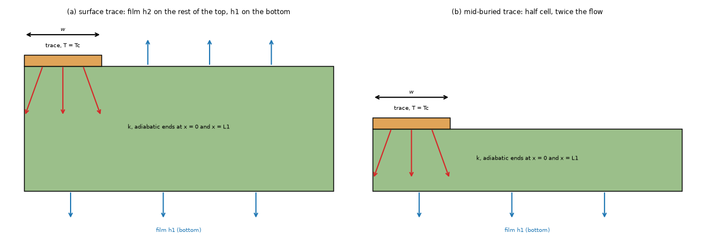

*Figure 6: `figures/fig_06_lemczyk_trace_cells.png`. Left, the surface trace (case a): the trace is held at the contact temperature Tc, the film h2 acts on the rest of the top face and h1 on the bottom; the ends are adiabatic. Right, the mid-buried trace (case b), solved as a half cell with twice the flow. Heat paths in red, films in blue. Section 3.7.*

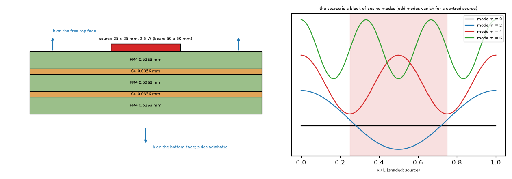

*Figure 7: `figures/fig_07_culham_coupon_and_modes.png`. Left, the five-layer coupon (FR4 0.5263 mm and copper 0.0356 mm, 50 x 50 mm, a centred 25 x 25 mm source of 2.5 W) with the films; right, the first cosine modes of the series solution and the shaded source (odd modes vanish for a centred source). Section 3.6.*

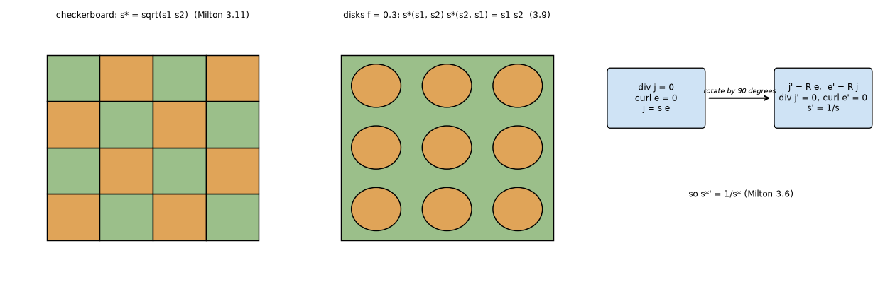

*Figure 8: `figures/fig_08_duality_and_effective_medium.png`. The checkerboard whose effective conductivity is sqrt(s1 s2), the array of disks used for the phase-interchange test, and the 90-degree rotation of Dykhne. Section 3.5.*

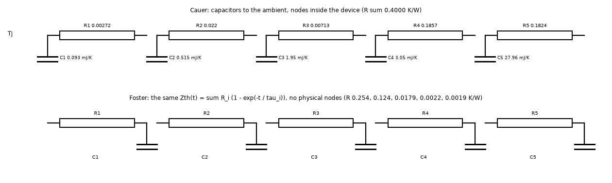

*Figure 9: `figures/fig_09_foster_and_cauer_networks.png`. The Cauer ladder of the BUK7S1R0-40H (AN11261, page 6) and its Foster equivalent computed here. Section 3.8.*

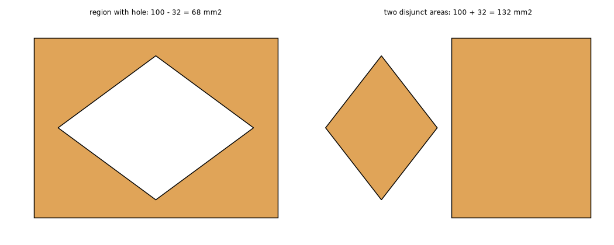

*Figure 10: `figures/fig_10_gerber_spec_regions.png`. The two contour examples of section 4.10.4.8 of the Gerber specification and the areas that follow from the coordinates (68 and 132 mm2). Section 3.9.*

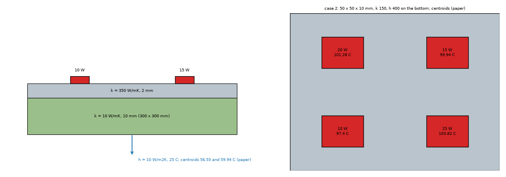

*Figure 11: `figures/fig_11_muzychka_cases.png`. Case 1 (b), a spreader of k 350 on a plate of k 10, and case 2, the baseplate of a heat sink with four sources. Section 3.7.*

## 2. Findings in short

* **The program's vertical-plate correlation is the printed one.** Both forms of Churchill and Chu are printed in the open textbook of Lienhard (equations 8.13a and 8.13b, book pages 419 and 420, PDF pages 433 and 434); Example 8.1 gives Nu 47.33 and the formula gives 47.34, and the program's function equals the formula at its own Rayleigh number (3.1). The 1975 paper itself is paywalled and still not read.
* **The `ht` documentation has the wrong exponent, the code is right.** The ISO 15099 / Rohsenow form printed on page 5 of an open ASHRAE preprint has `k2 = Ra^(1/3)/450.5`, the Prandtl 0.71 limit of the 1984 constants; the code form is within 0.3 % of it for Ra 2e3 to 1e7 and the documented form (fifth root inside the logarithm only) is 0.5 % low at Ra 1e6 and 3.0 % low at 1e7 (3.3; corrected by the review, section 6). The Hollands papers themselves are not obtained.
* **The program's horizontal-plate correlations differ from Raithby and Hollands (Lienhard 8.35 to 8.38) by 3 to 11 % of the total coefficient** on upward-facing boards of 100 mm and more (the program's coefficient is the larger, so with the source the board would be hotter). For the face looking down, Fujii and Imura's correlation (8.38) is written for a two-dimensional plate on its **width**: evaluated on a width (2 A/P or the shorter side) it is 5 to 49 % **below** the program's `0.27 Ra^(1/4)` where it is valid, so the program is not shown to be conservative there (an earlier version of this README evaluated it on A/P and said the opposite; section 6). No change is made; the impact is in 3.4 and `INTEGRATION.md`.
* **Mixed convection:** the cube-root blend is inside the range 1.73 to 3 that Jaffer and Jaffer find for a vertical plate in an aiding or opposing flow (2 for a level flow across it), but for a horizontal board in a level flow they find p = 2 over the face looking up and p = 5 under the face looking down: the program's p = 3 gives a convective coefficient 7 to 11 % lower on the top face and 0.5 to 8 % higher on the bottom face (3.4). Churchill (1977) is still not read.
* **The 2D Bruggeman, Hashin-Shtrikman and Keller-Dykhne formulas are now tied to page and equation** (Milton 2002: 3.1 to 3.11 on pages 47 to 50, 7.9 and 7.10 on page 116, 10.31 and 10.32 on pages 195 and 196). Equation 7.10 for d = 2 equals the repository forms to 1e-15; the 2D Bruggeman form follows from the same step Milton takes for spheres and equals the repository function to 4e-14; an independent periodic solver puts a disk array above the lower bound and converges the checkerboard to sqrt(s1 s2) (3.5).
* **Culham and Yovanovich (1998), above Biot 60: the plateau is still not explained, but part of the excess is.** A cosine-series solution of the coupon converged to 7.8 W/mK at the base case against the paper's 8.28 and the independent 3D solver's 7.81 of `research/effective-conductivity` 4.2 (the series and the solver agree to 0.1 %); truncating the series at 5 to 7 modes per direction gives 8.50 to 8.14, so the paper's value is consistent with a coarse truncation (not proved); with the 1.62 mm of the text the series gives 8.37 at 7 modes and 8.24 at 11 (paper 8.28; tested directly by the review). At Bi 625 the series gives 0.56 to 0.62 W/mK for every truncation: **truncation does not create the plateau of about 4.8** (3.6). The paper's equation 11 defines the effective conductivity through `A/L` that it does not quantify; the plateau remains unreproduced.
* **Muzychka and others:** case 1 (b) (compound plate) is reproduced by the independent solver within 0.03 K and by the FVM, 3D solid and Analytic within 0.06 K of it (the FDM 0.09 K); case 2 (heat-sink base with four sources) is reproduced by the solver within 0.03 K at the centroids (97.41, 103.85, 101.31, 99.95 against 97.40, 103.82, 101.28, 99.94), and the program's one-layer models are 2.9 to 5.6 K low there (the Lumped 2.7 to 6.3 K), 67 to 89 % of the bound `q'' t / (2 k)` of the through-thickness gradient (3.7). With 32 sub-slabs the solver's centroids move by 0.01 to 0.06 K and its means come within 0.06 K of the paper's (section 6).
* **Lemczyk, Mack, Culham and Yovanovich (1992):** an independent 2D solver reproduces all sixteen heat flows of Table 1 within 0.52 % (one at 1.15 %) and the dimensionless factors of Tables 2 and 3 typically within 0.1 to 2 %; the largest differences are 4.1 % (case a), 9.1 % (b), 9.8 % (c) and 8.2 % (d), for b and d at Bi 10 and 100 on the thinnest cell, where the solver is mesh-converged to 0.2 %. The paper's case c column at Bi 0.01 is not "a number that does not add up": it is reproduced within 0.1 to 0.9 % (the 1D limit 90.91 exactly) if the switched-off bottom film is Bi1 = 0.001 instead of 0, which looks like the paper's own regularisation (an explanation found by the review, section 6; not stated in the pages read) (3.7).
* **The Foster form is reproduced from a published model:** the Cauer ladder of AN11261 sums to 0.4000 K/W (datasheet 0.4), gives Zth(4 ms) = 0.264 K/W (paper 0.26), and its Foster equivalent equals it to 6e-15 K/W (3.8).
* **Grid convergence:** the Celik procedure is read and its Table 1 reproduced; the independent solver converges at order 1.99 to 2.00 in the plane, and through the thickness the sub-slab count matters more (case 2: 102.419, 102.525 and 102.875 K for 16, 8 and 4 sub-slabs, extrapolated 102.373 K against the paper's 102.33). The program's FVM and FDM show GCIs of 0.00 to 0.48 % in the cases run (3.10).
* **Lee's equations 1 and 2 and Yovanovich's Table 3 are read.** The example of Lee gives 0.6566 K/W (article 0.66) and the Bessel series reproduces Table 3's isoflux column to 1e-4 (3.11).

## 3. Results

How to run: from the repository root, `.venv/bin/python research/theory-sources/scripts/<script>.py`; the figures by `make_figures.py` and `make_diagrams.py`; the tests by `.venv/bin/python -m pytest -q research/theory-sources/tests` (14 pass after the review). Every number below was printed by the script named in its section.

### 3.1 The vertical plate: Churchill and Chu (`study_natural_convection_sources.py`, part 1)

Source (**read**): Lienhard, *A Heat Transfer Textbook* 6.00 (open), book page 419 (PDF page 433), equation 8.13a, `Nu = 0.68 + 0.670 Ra^(1/4) / [1 + (0.492/Pr)^(9/16)]^(4/9)` for Ra up to 1e9, and book page 420 (PDF 434), equation 8.13b, the all-range form `Nu = {0.825 + 0.387 Ra^(1/6) / [1 + (0.492/Pr)^(9/16)]^(8/27)}^2` ("can be used for all Ra and Pr, although 8.13a is more accurate for laminar conditions"). Example 8.1 (book page 421, PDF 435; air at 20 C next to a 0.30 m wall at 50 C): Pr 0.71, Ra 6.78e7, k 0.02672, L 0.30 m, Nu 47.33, h 4.22 W/m2K.

```
Churchill-Chu laminar form, Lienhard Example 8.1: book Nu 47.33 h 4.22 | formula Nu 47.34 h 4.22 | program Nu 49.7393 vs formula at the same Ra 49.7393 (Ra 8.315e+07)
```

The formula reproduces the book to 0.02 %; the program's `h_natural_vertical` equals the formula at its own Rayleigh number (its air properties differ from the book's, so its Ra differs). **Limit:** the original 1975 paper (Int. J. Heat Mass Transfer 18, 1323) is paywalled and was not opened; its conclusion about the all-range form is quoted in Jaffer (2023), page 3 ("provides a good representation ... over a complete range of Ra and Pr from 0 to infinity even though it fails to indicate a discrete transition"). Jaffer's Table 6 gives the root-mean-square relative errors of the form against the four data sets that Churchill and Chu used (King 13.5 %, Jakob 4.7 %, Cheesewright 16.4 %, Saunders 5.3 % for Jaffer's own formula, within 1 % of Churchill and Chu's).

### 3.2 The two forms against each other (Pr 0.71)

| Ra | laminar 8.13a | general 8.13b | laminar against general |
| --: | --: | --: | --: |
| 1e4 | 5.82 | 5.43 | +7.2 % |
| 1e5 | 9.82 | 9.21 | +6.6 % |
| 1e6 | 16.94 | 16.56 | +2.3 % |
| 1e7 | 29.60 | 31.21 | -5.2 % |
| 1e8 | 52.10 | 61.07 | -14.7 % |
| 1e9 | 92.13 | 122.86 | -25.0 % |

These repeat the numbers of `research/effective-conductivity` 4.7 from the printed equations, which now have a read source. The all-range form includes the turbulent rise, as Lienhard says.

### 3.3 The Hollands horizontal-layer equation: which exponent (`study_natural_convection_sources.py`, part 2)

Source (**read**, page 5 of the open ASHRAE preprint OR-05-4-3, as an image): equation 9, the Rohsenow et al. (1985) form `Nu = 1 + (1 - Ra_cr/Ra)* [k1 + 2 (k2)^(1 - ln k2)] + [(Ra/5830)^(1/3) - 1]* [1 - exp(-0.95 ((Ra_cr/Ra)^(1/3) - 1)*)]` with `k1 = 1.40`, `k2 = Ra^(1/3)/450.5`; equation 14, Hollands et al. (1976) for a wide layer, `Nu = 1 + 1.44 (1 - 1708/Ra)* + [(Ra/5830)^(1/3) - 1]*`.

```
Ra        | 1976 (eq 14) | ISO 15099 (eq 9) | ht code (1/3) | ht doc (1/5 in the log) | ht with 5830
2e+03     |  1.2102 |  1.2044 |  1.2045 |  1.2045 |  1.2045
1e+04     |  2.3911 |  2.3579 |  2.3604 |  2.3604 |  2.3585
1e+05     |  3.9944 |  3.9562 |  3.9610 |  3.9598 |  3.9570
1e+06     |  6.9937 |  6.9998 |  7.0115 |  6.9662 |  7.0029
1e+07     | 13.4102 | 13.9252 | 13.9621 | 13.5100 | 13.9435
```

* The **cube root** (the `ht` code) is the exponent of the printed ISO form (`k2` carries `Ra^(1/3)` explicitly); its constants are the Prandtl 0.71 values of the 1984 ones (75 exp(1.5/sqrt(0.71)) = 444.9 against 450.5; 1.44/(1 + 0.018/0.71 + 0.00136/0.71^2) = 1.40). The documentation's fifth root (inside the logarithm only: `2 (Ra^(1/3)/k2)^(1 - ln(Ra^(1/5)/k2))`, read in the `ht` 1.2.0 docstring) is a misprint: it is 0.5 % low at Ra 1e6 and 3.0 % low at 1e7 against the ISO form, while the code is within 0.3 % of it from 2e3 to 1e7. *(The first version of this section applied the fifth root to the base as well, a form printed nowhere, and quoted 3.7 % at 1e7, which is the 1976 form's difference; corrected by the review, section 6.)*
* The two printed forms differ from each other by 0.3 % up to Ra 1e5 and 3.8 % at 1e7; the 1976 equation has no logarithmic term.
* `ht` uses 5803 where the 1976 equation prints 5830 (a 0.03 % effect at Ra 1e4).
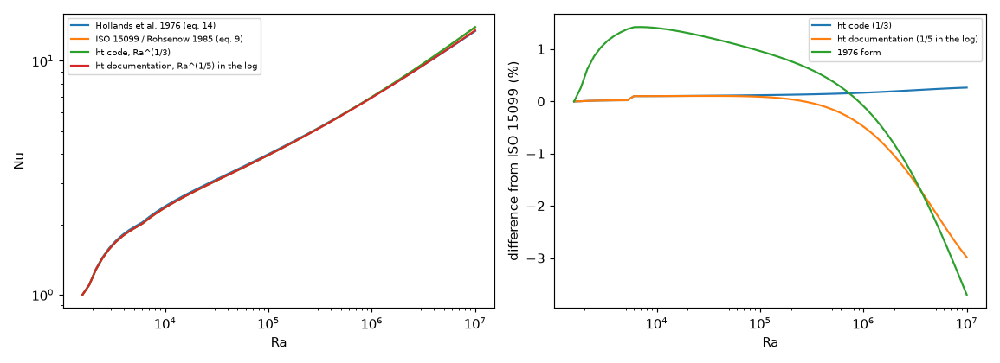

*Figure 1: `figures/fig_01_hollands_forms.png`. Left, the four forms at Pr 0.71; right, the difference of each from the ISO 15099 form (the documented fifth root inside the logarithm leaves it above Ra 3e5).*

* **Limit:** this decides the exponent by a secondary source that prints the Pr 0.71 form, not by Hollands (1984), which is not obtained. The program does not use the Hollands equation today (it is for the gap above 7 mm in `docs/research.md` R3).

### 3.4 Horizontal plates and the mixed-convection blend (`study_natural_convection_sources.py`, parts 3 and 4)

**Horizontal plates.** The program uses `Nu = 0.54 Ra^(1/4)` (up to 1e7) and `0.15 Ra^(1/3)` above for the face looking up, `0.27 Ra^(1/4)` for the face looking down, with `L = A/P` (McAdams, through `ht`; the original was not opened; the 0.54 form is usually quoted for Ra 1e4 to 1e7, from memory, so the 40 x 30 mm rows below are outside it). Lienhard (book pages 435 to 437, PDF 449 to 451) prints, for the same geometry, Raithby and Hollands: equation 8.37a `Nu = 0.560 Ra^(1/4) / [1 + (0.492/Pr)^(9/16)]^(4/9)` with the correction 8.37b `Nu = 1.4/ln(1 + 1.4/Nu)` when Nu is 10 or less (1 < Ra < 1e7, `L* = A/P`), equation 8.35 above Ra 1e7; for a hot face looking down, Fujii and Imura (8.38, book page 437) `Nu_L = 0.58 Ra_L^(1/5)` with L the **width** of the plate (Ra 1e6 to 1e9, a two-dimensional plate within 3 degrees of horizontal, "infinite breadth ... approximated by suppression of end effects").

```
a x b mm, dT, Ra (on A/P) | h up program, R&H, change of the total h (eps 0.9) | h down program, Fujii-Imura on 2 A/P, on the shorter side (Ra on it)
  40 x  30 dT   5 Ra 317     | up  6.891  7.401 ( +4.2 %) | down  3.446  4.206  3.363 (Ra 1.4e+04)
  40 x  30 dT  60 Ra 2.51e+03| up 12.513 12.092 ( -2.2 %) | down  6.256  6.886  5.505 (Ra 1.1e+05)
 100 x  80 dT  20 Ra 1.96e+04| up  7.628  6.870 ( -5.7 %) | down  3.814  3.787  2.994 (Ra 9.2e+05)
 100 x  80 dT  60 Ra 4.38e+04| up  9.861  8.692 ( -7.0 %) | down  4.930  4.704  3.718 (Ra 2e+06)
 160 x 100 dT  60 Ra 1.16e+05| up  9.090  7.846 ( -7.8 %) | down  4.545  4.130  3.401 (Ra 4e+06)
 300 x 200 dT   5 Ra 1.09e+05| up  4.237  3.666 ( -6.0 %) | down  2.118  1.931  1.574 (Ra 4e+06)
 300 x 200 dT  20 Ra 3.87e+05| up  5.950  4.734 (-10.4 %) | down  2.975  2.546  2.075 (Ra 1.4e+07)
 300 x 200 dT  60 Ra 8.62e+05| up  7.693  6.115 (-10.8 %) | down  3.846  3.162  2.577 (Ra 3.2e+07)
```

(the full table of twelve cases is printed by the script). For boards of 100 mm and more the program's up-face coefficient is 7 to 26 % above Raithby and Hollands' (the percentage in the third column is the change of the **total** h with radiation of emissivity 0.9 if the source were used: -3 to -11 %, so the board would be hotter).

**The face looking down.** Fujii and Imura's correlation is written on the width of a two-dimensional plate; a rectangle has no single width, so it is evaluated on 2 A/P (the width of a strip with the same A/P) and on the shorter side. Where it is valid (Ra on the shorter side of 1e6 or more: 100 x 80 mm at 60 K, 160 x 100 mm at 20 and 60 K, and 300 x 200 mm) the program's `0.27 Ra^(1/4)` on A/P is 5 to 22 % above it on 2 A/P and 28 to 49 % above it on the shorter side, so the bottom face would carry 2 to 12 % less total h with the source. Because Fujii and Imura suppressed the end effects, their h is expected to be below that of a finite plate whose edges are open, so this is not a proof that the program is optimistic either: **the down face is not shown to be conservative, and the comparison does not decide it**. *(The first version evaluated 8.38 on A/P, which inflated it by 30 to 80 %, and concluded that the program was 30 to 40 % below it and conservative; corrected by the review, section 6.)*

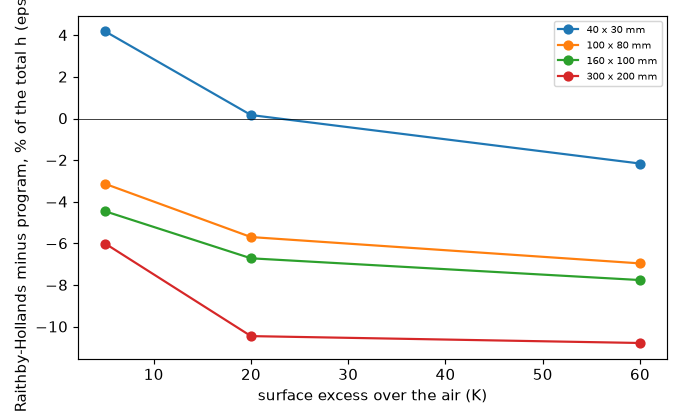

*Figure 2: `figures/fig_02_horizontal_plate_h.png`. The change of the total coefficient (with radiation of emissivity 0.9) if Raithby and Hollands replaced the program's up-face correlation, against the surface excess, for four board sizes.*

**Mixed convection.** Jaffer and Jaffer (arXiv 2401.09469, Table 4, page 18) combine natural and forced heat transfer as an l_p norm: `p` between sqrt(3) and 3 for a vertical plate in an aiding or opposing flow, `p = 2` for a vertical plate in a level flow and for a level flow over an upward-facing plate, `p = 5` for a downward-facing plate. The program uses `p = 3` for every orientation. For a hot 100 x 100 mm horizontal board (A/P 25 mm, 60 C in 20 C air, h_n 8.73 W/m2K up and 4.36 down; forced length 100 mm):

| air speed (m/s) | h forced | up: p = 3 (program) | up: p = 2 | p = 3 against p = 2 | down: p = 3 (program) | down: p = 5 | p = 3 against p = 5 |
| --: | --: | --: | --: | --: | --: | --: | --: |
| 0.2 | 5.54 | 9.42 | 10.34 | -8.9 % | 6.33 | 5.84 | +8.3 % |
| 0.5 | 8.76 | 11.02 | 12.37 | -10.9 % | 9.11 | 8.81 | +3.3 % |
| 1.0 | 12.39 | 13.69 | 15.16 | -9.7 % | 12.57 | 12.40 | +1.3 % |
| 2.0 | 17.52 | 18.22 | 19.58 | -6.9 % | 17.61 | 17.52 | +0.5 % |

On the top face the program's convective coefficient is 7 to 11 % lower (the board hotter) than with the exponent that Jaffer finds for this orientation; on the bottom face it is 0.5 to 8 % higher (the board cooler). The two partly cancel on a board cooled on both faces. *(The first version used A/P = 28.6 mm for the "100 mm board" and left the bottom face out; the top-face range is unchanged.)* **Limit:** Jaffer's exponents are fits to data of rough plates in rough or turbulent forced flow (Tables 6 and 7, RMS errors 1.3 to 3.8 %), combined with Jaffer's own natural and forced formulas, not with McAdams' and the laminar plate; Churchill (1977) is not obtained, so whether `Nu^3 = Nu_F^3 + Nu_N^3` is Churchill's rule is still not confirmed. The forced laminar form `Nu = 0.664 Re^(1/2) Pr^(1/3)` is read in Lienhard (book page 311); the turbulent `0.037 Re^(4/5) - 871` is not in that book (the Reynolds number of a board in a fan flow is below 5e5 in practice).

### 3.5 Effective-medium formulas, with page and equation (`study_effective_medium_sources.py`, `lib/cond2d.py`)

Sources (**read**, Milton, *The Theory of Composites*, the author's open PDF): chapter 3, section 3.1 and 3.2, pages 47 to 50: equations 3.1 to 3.6 (the pointwise 90-degree rotation, `s' = 1/s` and `s*' = 1/s*`), 3.9 (Keller: `s*(s2, s1) = s1 s2 s*(s1, s2) / det s*(s1, s2)`), 3.10 and 3.11 (a phase-interchange-invariant isotropic medium has `det s* = s1 s2`; the checkerboard has `s* = sqrt(s1 s2)`), Figure 3.1. Page 116: equation 7.9 (coated cylinders, `s* = s2 + 2 f1 s2 (s1 - s2) / (2 s2 + f2 (s1 - s2))`) and 7.10 (the Hashin-Shtrikman bounds for d = 2 or 3, phases labelled s1 > s2). Pages 195 and 196: equations 10.31 (`f1 (e1 - e*)/(e1 + 2 e*) + f2 (e2 - e*)/(e2 + 2 e*) = 0`) and 10.32 (its solution) for **spherical** grains; the book prints no two-dimensional form. For disks the same step applied to equation 7.9 (the dilute limit `s* = s0 + 2 f s0 (s1 - s0)/(s1 + s0)`) gives `f1 (s1 - s*)/(s1 + s*) + f2 (s2 - s*)/(s2 + s*) = 0`, whose positive root is `s*^2 - (s1 - s2)(2 f1 - 1) s* - s1 s2 = 0` (**derived here, not read**: the derivation is the step of Milton's section 10.5 with d = 2).

```
1. Milton 7.10 (d = 2) against the repository forms: lower 2.22e-16, upper 1.55e-15 (relative); 13/7 = 1.857143, 28/13 = 2.153846; Bruggeman d=3 against 10.32: 4.44e-16
2. Bruggeman d = 2 (derived from 7.9) against the repository function: max relative difference 3.79e-14
3. Square array of disks f 0.3, ratio 10, grids 48/96/192: 1.6856, 1.6699, 1.6608 ; HS bounds (lower = coated cylinders 7.9) 1.6506 2.7168
   random 8 x 8 blocks, p1 0.3: mean 1.8228 std 0.1628 ; Bruggeman 2D 1.8387
4. Keller product s*(10,1) s*(1,10) / 10 on the disk array at 48/96/192: 1.0179, 1.0089, 1.0042
   checkerboard at 8/16/32/64 cells per square: 2.7752, 2.9305, 3.0251, 3.0817 ; sqrt(10) 3.1623 ; extrapolated 3.1656 (difference ratio 0.597)
```

* The `conduction.py` Hashin-Shtrikman forms equal the printed bounds (7.10) and the 2D Bruggeman root equals the repository function: the formulas written from memory are right.
* The independent periodic solver (`lib/cond2d.py`, a finite-volume solution with a mean gradient) lies inside the bounds, approaches the lower bound (coated cylinders) from above as the grid is refined (the Maxwell value is 1.6506), reproduces the phase-interchange product to 4 % at 192 cells and **converges to the checkerboard value sqrt(s1 s2)** with the corner-singularity rate of a first-order cell scheme (difference ratio 0.6; Richardson 3.166 against 3.162).
* The random medium of 8 x 8 blocks, 30 % phase 1, gives 1.82 +- 0.16 against Bruggeman's 1.84 (a statistical agreement, not a proof; a pixel-by-pixel random medium gives -18 % because the pixel discretisation of a random cell medium is not self-dual).
* **Limit:** the originals (Bruggeman 1935, Hashin and Shtrikman 1962, Keller 1964, Dykhne 1970) and Torquato's book were not obtained; the 2D Bruggeman form is derived, not read.

### 3.6 Culham and Yovanovich (1998) above Biot 60 (`study_culham_truncation.py`, `lib/cosine_stack.py`)

Pages 465 and 466 were re-read as images: Table 2, equation 11 `k_e = 1/(R_solid A/L)` ("when the heat flow is one-dimensional the cross-sectional flow area and the flow length are clearly defined but in two-dimensional flow these values are difficult to quantify"), the convective boundary-condition section (the wall temperature of equation 8 is the mean over the solid-fluid interface; Bi = h l / k1, l the side of the source), and Figure 5 (the plateau, about 4.8 W/mK for Bi above 100, read from the plot). The text says the effective conductivity "approaches a constant value above Bi = 100".

An independent cosine-series solution of the coupon (`lib/cosine_stack.py`: 2 x 2 transfer matrices per mode, film applied over the whole top face, the only separable case) gives, for the base case and the single layer of the same thickness and the same number of modes:

```
modes per direction | h = 5 W/m2K: R_solid, k_e (paper 8.28) | h = 1e4 W/m2K: R_solid, k_e (paper plot about 4.8)
   3 |  3.9544   8.496 |  0.1222   0.559
   7 |  4.2038   8.143 |  0.1366   0.596
  11 |  4.2830   8.014 |  0.1419   0.609
  21 |  4.3423   7.913 |  0.1463   0.615
  41 |  4.3801   7.847 |  0.1496   0.611
 201 |  4.3967   7.818 |  0.1520   0.595
```

* **The excess over the converged value at the base case.** The paper's 8.28 lies between the 5-mode (8.50) and 7-mode (8.14) truncations, and 6 % above the converged 7.82; the independent 3D solver of `research/effective-conductivity` 4.2 gives 7.81 for the same layer order, so the converged series and the solver agree to 0.1 %. The paper's series stops at an unrecorded number of terms (the first pages describe a minimised, truncated series), so a coarse truncation is a possible explanation of the 2 to 6 % by which this project's reproductions sit below the paper, not a proved one.
* **Combined with the thickness.** The 1.62 mm of the text instead of 1.6501 mm gives 8.03 W/mK in the solver (`research/effective-conductivity` 4.2). The review tested the combination directly (the three FR4 layers thinned to 0.5163 mm, `study_culham_truncation.py`, second table): 8.73, 8.37, 8.24, 8.14 and 8.04 W/mK at 5, 7, 11, 21 and 201 modes, so a stack of 1.62 mm with 7 to 11 modes per direction gives the paper's 8.28 within 1 %. The two causes together account for the gap; that the paper used them is still a hypothesis (its number of terms is not printed in the pages read).
* **The plateau is not a truncation effect.** At Bi 625 the effective conductivity is 0.56 to 0.62 W/mK for every truncation from 3 to 201 modes; the series agrees with the FVM and the 3D solver (0.6) at the converged limit.
* The film under the source changes `R_solid` (4.40 against 5.12 K/W without it in the 3D solver) because it removes 0.4 of the 2.5 W at the 127 K rise, but little the effective conductivity (7.82 against the solver's 7.81 with no film under the source), because the single layer is computed the same way.
* **What stays open:** the plateau of Figure 5 (4.8 W/mK) is not reproduced by any definition, truncation or boundary treatment tried (see also `research/effective-conductivity` 4.9); the pages of the paper that define the series coefficients (equation 10, the spreading resistance as a function of Bi) are the next to read. The 1.62 mm of the text against 1.6501 mm of the stack explains about half of the shortfall of the base case.

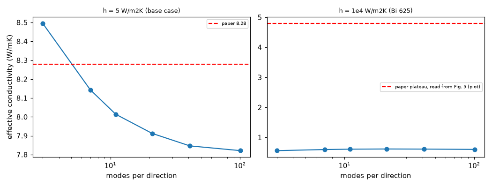

*Figure 3: `figures/fig_03_culham_series_truncation.png`. Effective conductivity against the number of series modes for h = 5 (left, the paper's 8.28 dashed) and 1e4 W/m2K (right, the paper's plateau read from Figure 5, dashed).*

### 3.7 Muzychka and others, and Lemczyk and others

**Muzychka, Culham and Yovanovich (2003), cases 1 (b) and 2** (`study_muzychka_more_cases.py`; Tables 2, 3 and 4 read in the text layer, pages 183 and 184). Case 1 (b): the plate of case 1 (a) (300 x 300 x 10 mm, k 10, h 10 on the bottom, 25 C, sources 10 W at (90, 90) and 15 W at (210, 210), 25 x 25 mm) with a 2 mm layer of k 350 on top. Case 2: a baseplate 50 x 50 x 10 mm, k 150, h 400 on the bottom, four 10 x 10 mm sources (10 W at (12.5, 12.5), 25 W at (37.5, 12.5), 20 W at (12.5, 37.5), 15 W at (37.5, 37.5) mm); the ambient is not in the extracted table and 25 C is assumed as in the other cases (the result reproduces the paper's centroids, which supports it).

```
Case 1b: paper centroid [56.55, 59.94], mean [56.05, 59.19]; Fourier series (Culham) centroid [56.63, 60.08]
  independent 3D solver: centroid [56.56, 59.97], mean [56.07, 59.23], bottom mean 52.78
  fvm: [56.52, 59.91] mean [56.03, 59.17]   fdm: [56.49, 59.88] [56.0, 59.14]   solid3d: [56.53, 59.92] [56.04, 59.18]   analytic: [56.52, 59.91] [56.05, 59.2]   lumped: [56.38, 58.77]
Case 2: paper centroid [97.4, 103.82, 101.28, 99.94], mean [96.85, 102.33, 100.1, 99.07]
  independent 3D solver: centroid [97.41, 103.85, 101.31, 99.95], mean [96.92, 102.53, 100.26, 99.19]
  fvm: centroid [94.46, 98.3, 96.62, 96.13]   fdm: [94.5, 98.26, 96.61, 96.14]   solid3d: [95.39, 99.23, 97.56, 97.07]   analytic: [94.46, 98.3, 96.63, 96.13]   lumped: [94.74, 97.56, 96.42, 95.88]
```

* The independent solver reproduces both cases (case 1 (b) within 0.03 K at the centroids; case 2 within 0.03 K; the means 0.07 to 0.2 K above the paper's, which section 3.10 explains by the sub-slab count: the review ran case 2 with 4, 8, 16 and 32 sub-slabs, and at 32 the centroids are 97.39, 103.80, 101.26, 99.92 C (within 0.03 K of the paper) and the means 96.87, 102.39, 100.15, 99.11 C (within 0.06 K), section 6). The first rows of case 2 were 102.53 K at 8 sub-slabs and extrapolate to 102.373 K against the paper's 102.33.
* The program's models reproduce the **compound plate** (case 1 (b)): the FVM, 3D solid and Analytic within 0.06 K of the independent solver, the FDM within 0.09 K (a copper layer of 2 mm k 350 over a dielectric gap of 10 mm k 10: 0.3 % of the rise at most), the Lumped within 1.2 K in the second source.
* In **case 2** the FVM, FDM and Analytic sit 2.9 to 5.6 K below the independent solver at the centroids (4 to 7 % of the rise), the Lumped 2.7 to 6.3 K, and the 3D solid 2.0 to 4.6 K (its slab is also one node thick). The bound `q'' t / (2 k)` of the through-thickness gradient (3.3, 8.3, 6.7 and 5.0 K for the four sources) is not exceeded: the observed shortfalls are 67 to 89 % of it. This is the effect measured in `research/effective-conductivity` 4.6; a 10 mm plate under 10 x 10 mm sources is where the thick-plate check applies.

**Lemczyk, Mack, Culham and Yovanovich (1992)** (`study_lemczyk_1992.py`, `lib/strip2d.py`): pages 414 to 417 read as images. The model is two-dimensional (Fig. 2 and 3): a cell of width L1 and thickness t, adiabatic ends, a trace of width w held at Tc on the top face (case a, film h2 over the whole top face, equation 27 `Q_a = k L2 Tc (Bi2 w/L1 + q_s/Tc)`), mid-buried (case b, half cell, `Q_b = 2 k L2 q_s`), with `h1 = 0` on the surface (case c) or on the bottom (case d); `Psi = k L2 R`. Table 1 gives dimensional heat flows (Tc 90 C above 20 C, h 10 W/m2K, L2 = 1 m).

```
Table 1: w t L1 (um), k | Q_a paper, solver (W) | difference
    10    10    20 0.2 | 0.036 0.0360 | -0.07 %      50  1000   100 0.4 | 0.178 0.1776 | -0.22 %
    10    10    50 0.2 | 0.089 0.0894 | +0.51 %      250 2000   500 0.4 | 0.884 0.8739 | -1.15 %
    50   100   100 0.2 | 0.179 0.1792 | +0.09 %      250 1000  1250 0.4 | 2.120 2.1243 | +0.20 %
```

(sixteen rows in all, 15 within 0.52 %). Tables 2 and 3, the `w/L1 = 0.1` rows: the solver differs from the paper by at most 4.1 % for case a, 9.1 % for b, 9.8 % for c and 8.2 % for d (typically 0.1 to 2 %); the larger values are at Bi 0.01 for c and at Bi 10 and 100 on the thinnest cell for b and d (the review refined the mesh from 150 to 1000 cells per direction: the solver moves by 0.2 %, so these are differences from the paper's approximate series, not from the mesh). **The case c column at Bi 0.01.** For a trace as wide as the cell (`w/L1 = 1`) case c with no bottom film is one-dimensional, `Q = h2 L1 Tc` and `Psi_c = 1/Bi2`: the solver gives 100.000 at Bi 0.01 and 10.0000 at Bi 0.1 against the paper's 90.91 and 9.901. The paper's two numbers are `1/(Bi2 + 0.001)` to four digits, which is what a residual bottom film `Bi1 = 0.001` gives; with that film the solver reproduces the whole case c column at Bi 0.01 (113.6, 90.91, 92.10, 92.19 against 114.7, 90.91, 92.19, 92.26: 0.1 to 0.9 %, against 7 to 10 % with no film) and stays within 1.8 % at Bi 0.1. So the paper's case c is most likely computed with a small bottom Biot number rather than zero (found by the review, section 6; the pages read do not say it, and the first version of this section called the numbers inconsistent).

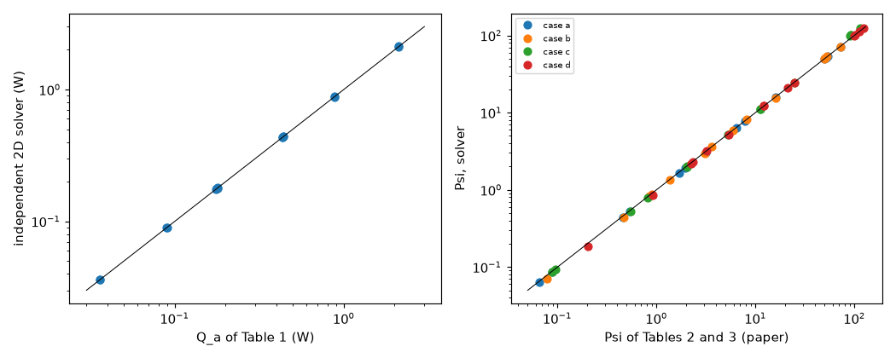

*Figure 4: `figures/fig_04_lemczyk_tables.png`. Left, the heat flows of Table 1 against the independent solver; right, the factors Psi of Tables 2 and 3 (cases a to d) against the solver, on logarithmic axes.*

**The program on the Lemczyk cells:** not run (the cells are 10 to 2000 micrometres; the program's smallest representable board and cell size make the thin-trace rows a different problem). The Muzychka and Culham reproductions of the earlier folder are the program-level test of the same physics.

### 3.8 The Foster chain (topic 12): Nexperia AN11261 (`study_foster_cauer.py`, `lib/rc_ladder.py`)

Source (**read**, Rev. 5.0, 18 March 2021, opened from a mirror because the vendor host refuses): page 4, equations 2 and 3, `Zth(t) = sum R_i [1 - exp(-t/tau_i)]`, `tau_i = R_i C_i`; the Foster values "are not geometrical" and the network cannot be connected to another; the Cauer network has its capacitors to the ambient and nodes of physical meaning; "an n-stage Cauer model can be derived from an n-stage Foster model and they will be equivalent". Page 6, Fig. 6: the Cauer netlist of the BUK7S1R0-40H (R 0.00272144, 0.0220255, 0.00713124, 0.185679, 0.182443 K/W; C 9.29451e-5, 5.14739e-4, 1.95047e-3, 3.05028e-3, 2.79554e-2 J/K); Table 1: Rth(j-mb) typical 0.35, maximum 0.4 K/W; example 2 (Table 3, Fig. 11 and 12): a 120 W pulse of 4 ms gives Zth = 0.26 K/W at Tmb = 125 C.

```
Sum of the Cauer resistances: 0.4000 K/W (datasheet Rth(j-mb): typical 0.35, maximum 0.4; Fig. 11 and 12: Rth = 0.4)
Foster equivalent: R_i [0.25439, 0.12357, 0.01792, 0.00218, 0.00194] K/W, tau_i [6.33e-3, 8.47e-4, 1.51e-5, 6.66e-6, 2.14e-7] s; sum 0.4000 K/W
Zth(t) of the ladder (matrix exponential) against the Foster form, largest difference 5.94e-15 K/W
First pulse of example 2: 120 W for 4 ms -> Zth(4 ms) = 0.2637 K/W (paper 0.26), rise 31.6 K, junction 156.6 C on the 125 C base
```

The ladder reproduces the published numbers, and the Foster form obtained by the pole decomposition equals the ladder to machine precision (the matrix exponential does not use the Foster formula). All Foster `R_i` and `tau_i` are positive. **The program's models** have no Foster chain (it is planned, topic 12); this is the check that a future implementation must pass. The rest of the note (examples 1 and 3, pages 12 and 13) was read for the SPICE set-up only.

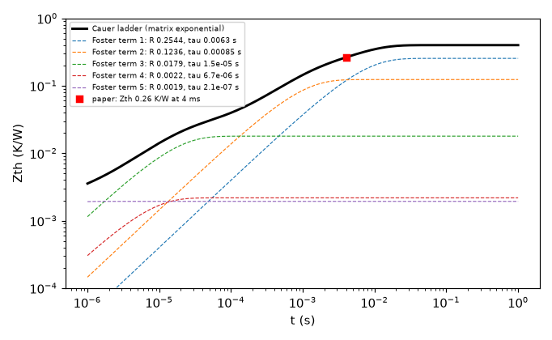

*Figure 5: `figures/fig_05_foster_cauer_zth.png`. The step response of the ladder, its five Foster terms and the published 0.26 K/W at 4 ms.*

### 3.9 Gerber import (topic 15) and multigrid (topic 16)

**Gerber specification, revision 2026.05** (**read** where cited: the contents, section 2.11 pages 25 and 26, section 4.10.4.8 pages 112 and 113; downloaded from the Ucamco downloads page, 219 pages; the revision number is the one the earlier open item asked to be read). `study_gerber_spec_examples.py` runs three of its examples through the project's independent reader (`research/gerber-import/lib/native_gerber.py`) and compares the area with what the coordinates give:

```
Two square boxes: expected 0.39996 mm2 (two rings of the round stroke), reader 0.39995 mm2 (-0.00 %)
Two disjunct areas: expected 132 mm2, reader 131.990 mm2 (-0.01 %)
Region with hole: expected 68 mm2, reader 68.004 mm2 (0.01 %)
```

The reader handles contours with fully-coincident segments (a cut-in that makes a hole or two regions), as the specification defines. **Limit:** three examples of 219 pages; the rest of the specification (apertures macros, step and repeat, X2 attributes) was not re-read, and the program's own import does not exist yet (the reader is a research prototype).

**Multigrid** (topic 16, McCormick and Tamstorf, arXiv:2605.17828, 11 pages; numbers printed by `study_multigrid_and_celik.py`, added by the review): the text around Algorithm 3 (the V-cycle) and the statement that iterative multigrid has "uniformly bounded convergence factors per cycle at a cost proportional to the number of degrees of freedom" were read. `lib/mg2d.py` writes Algorithm 3 for the five-point Poisson problem (red-black Gauss-Seidel V(2,1), full weighting, bilinear interpolation): the residual reduction per cycle is 0.06 at 15 points per side, 0.07 at 31, 63, 127 and 255 (independent of h), and the error of 63 points against the exact solution of `sin(pi x) sin(pi y)` is 2.0e-4 (second order). The primer prints no number to compare with, only the property, which is what is reproduced.

### 3.10 Grid convergence index with three grids (`study_gci_references.py`, `lib/gci.py`)

Source (**read**): Celik, Ghia, Roache and Freitas (2008), the open ASME copy, equations 3 to 7. `lib/gci.py` reproduces (printed by `study_multigrid_and_celik.py`) the three columns of its Table 1 (p 1.54, 0.75 and 1.51 against 1.53, 0.75 and 1.51; the extrapolated values to 4 digits; GCI 2.2, 1.1 and 0.5 %). It was then applied to the mean temperature of one source on three grids:

```
Case 2, mean temperature of the hottest source (25 W), 4 sub-slabs
  independent cells (0.125, 0.25, 0.5) mm: 102.863, 102.866, 102.875 K | p 1.99, extrapolated 102.863 K, GCI fine 0.00 % (0.001 K)
  fvm         cells (0.5, 1.0, 2.0) mm: 97.704, 97.814, 97.672 K | p 0.37, extrapolated 97.331 K, GCI fine 0.48 % (0.466 K)
  fdm         cells (0.5, 1.0, 2.0) mm: 97.716, 97.684, 97.685 K | p 5.91, extrapolated 97.717 K, GCI fine 0.00 % (0.001 K)
  independent, 0.5 mm cells, 16/8/4 sub-slabs through the thickness: 102.419, 102.525, 102.875 K | p 1.72, extrapolated 102.373 K, GCI fine 0.06 %
Case 3, mean temperature of the centre source
  independent cells (0.5, 1.0, 2.0) mm: 80.274, 80.276, 80.287 K | p 2.00, extrapolated 80.273 K, GCI fine 0.00 % (0.001 K)
  fvm         cells (0.5, 1.0, 2.0) mm: 79.111, 79.113, 79.123 K | p 2.01, extrapolated 79.110 K, GCI fine 0.00 % (0.001 K)
  fdm         cells (0.5, 1.0, 2.0) mm: 79.093, 79.076, 79.041 K | p 1.02, extrapolated 79.110 K, GCI fine 0.03 % (0.021 K)
```

* **The independent reference converges at second order in the plane (p 1.99 and 2.00), and the grid error of a source on cell edges is a thousandth of a kelvin.** The reference's uncertainty is in the **sub-slab count through the thickness**: 102.875 K (4), 102.525 K (8), 102.419 K (16); extrapolated 102.373 K, within 0.04 K of the paper's 102.33 K. The earlier "0.3 to 0.4 K overstatement of the 2.5 mm cells" of `research/models-comparison` and `research/effective-conductivity` 4.6 is at least partly this: a reference with few sub-slabs reads high by 0.1 to 0.5 K on a 10 mm plate.
* The program's FVM at case 3 converges at order 2.01 and the FDM at 1.02 (its node sampling), both to a thousandth of a kelvin at 0.5 mm; on case 2 the sources at 7.5 mm edges do not sit on cell edges of 1 or 2 mm, and the FVM series is not monotone (p 0.37, GCI 0.48 % = 0.47 K): for sources off the cell grid the order is not the formal one and the GCI is an upper estimate of the sampling noise.
* Run with `r = 2`; the guideline of the paper asks for `r > 1.3`.

### 3.11 Lee's equations and Yovanovich's Table 3 (`study_lee_yovanovich_check.py`)

Lee (Electronics Cooling, January 1998): the equation images (the page loads them lazily; the files were downloaded and read) give equation 1 `Rc = (sqrt(Ap) - sqrt(As)) / (k sqrt(pi Ap As)) (lam k Ap R0 + tanh(lam t)) / (1 + lam k Ap R0 tanh(lam t))` and equation 2 `lam = pi^(3/2)/sqrt(Ap) + 1/sqrt(As)`; the worked example (aluminium 100 x 100 x 1.3 mm, 25 x 25 mm source, R0 1.0 K/W) prints lam 95.68 1/m, tanh 0.124, `lam k Ap R0` 191.4 and Rc = 0.0846 x 7.743 = 0.66 K/W.

```
Lee 1998 example: lambda 95.68 1/m (article 95.68), Rc 0.6566 K/W (article 0.66 = 0.0846 x 7.743), total 1.657 K/W (article 1.66)
Yovanovich 2003 Table 3, isoflux column (m = 0): e | table | series | difference
  0.1 | 0.9401 | 0.9401 | -0.0000     0.5 | 0.4092 | 0.4092 | +0.0000
  0.2 | 0.8009 | 0.8010 | +0.0001     0.8 | 0.1008 | 0.1008 | +0.0000
```

The formulas are read and the example is reproduced; the program's plate model against the same example is `research/effective-conductivity` 4.4 (centre 0.668 against 0.66). Yovanovich (2003) Table 3 (page 174) was read in the text layer with all its columns (m = 1/2, 0, -1/2 and four reference solutions), and the isoflux column equals the Bessel series to 1e-4 at all eight radii.

### 3.12 Heatsink scenarios (topic 13) and the virtual JEDEC test (topic 14)

* **Topic 13.** Its source is the same as 3.11 (Lee, equations 1 to 4, the location factor `Cf` of the article's Figures 4 and 5, the corner and edge cases by the method of images) and Muzychka and others (2003) for the eccentric sources: the example of Lee (centre 0.66, edge midpoint 1.29, corner 2.38 K/W) was reproduced by the plate model in `research/effective-conductivity` 4.4 (0.668, 1.284, 2.275). Nothing new was run here.
* **Topic 14.** No open copy of JESD51-2A, -3, -7, -12 or -14 was found; the standards are the source of the planned virtual test, and the closest open material is the Nexperia note of 3.8 and the datasheet numbers already in `research/power-calculator`. **Not obtained, no case reproduced.**

## 4. Limits of the study

* Lienhard's page numbers are the book's (the PDF adds 14); the first version mixed the two for equations 8.13a and 8.13b.
* The originals paywalled or not reachable are listed at the end of `research/theory/BIBLIOGRAPHY.md` (section 19); statuses were raised only where a page or equation was read.
* Equation numbers and tables were read from text layers or from images at 100 to 190 dpi; digits of Tables 2 and 3 of Lemczyk were read from an image.
* The series solver treats the film over the whole top face; the paper's treatment of the film under the source is not recorded.
* The independent solvers are finite-volume or cosine-series codes of this folder with their own tests; they share no code with the program, but the 3D solver of `research/effective-conductivity/lib/layered3d.py` is used for 3.7 and 3.10.
* Runs are modest (the largest 3D solve has 1.3 million cells).

## 5. What this means for the program

See `INTEGRATION.md`: no change is made; the findings are (a) a citation text for `convection.py` and `docs/theory.md`, (b) the horizontal-plate and mixed-convection differences with their measured size, (c) the validation rows (cases 1 (b), 2, Lemczyk) for `docs/validation.md`.

## 6. Review

The independent review re-ran every study and test of this folder on `develop` at 2.4.4, compared every quoted number with the printed output, and re-opened four sources: Lienhard 6.00 (pages 419 to 421 and 435 to 437, text extracted), Jaffer and Jaffer (arXiv 2401.09469 v3, Table 4 on page 18 and Tables 6 and 7), Milton (2002) (pages 49, 50, 116, 195 and 196) and the docstring and code of `ht` 1.2.0 (`Nu_Nusselt_Rayleigh_Hollands`). The ASHRAE preprint, the Culham, Lemczyk and Muzychka scans, Lee's equation images, the Nexperia note and the Gerber specification were not re-opened.

**Confirmed:** Example 8.1 (47.34 against 47.33) and the program's vertical-plate function; equations 8.35, 8.37a/b and 8.38 as quoted (except the length of 8.38, below); Milton's equations and pages (3.9 to 3.11 on pages 49 and 50, 7.9 and 7.10 on page 116, 10.31 and 10.32 on page 196) and the 1e-15 agreement of 7.10 with the repository forms; the periodic solver, the checkerboard and the Keller product; the cosine series (7.818 at 201 modes) and the Bi 625 values; the Muzychka centroids and the five models; Table 1 of Lemczyk; the Cauer ladder (0.4000 K/W, Zth(4 ms) 0.2637 K/W, Foster equivalent to 6e-15); the three Gerber areas; Lee's example (0.6566 K/W) and Table 3 of Yovanovich; Celik Table 1; the GCI table; the V-cycle factors (0.060 to 0.074) and its second-order error. Every number in the tables above is printed by a script; the outputs are identical to the first version except where this section says otherwise.

**Corrected (defects in the studies, regression tests added):**

| What | Before | After | Test |
| :-- | :-- | :-- | :-- |
| Fujii and Imura (8.38) evaluated on A/P; Lienhard writes it on the width L of a two-dimensional plate | program 30 to 40 % below it, "conservative" | on 2 A/P and the shorter side the program is 5 to 49 % above it where it is valid; the down face is not shown to be conservative (3.4) | `test_fujii_imura_is_evaluated_on_the_plate_width` |
| The "documented" `ht` form applied the fifth root to the base and the logarithm; the docstring has it only inside the logarithm | 3.7 % low at 1e7 (that number was the 1976 form's) | 0.5 % low at 1e6 and 3.0 % at 1e7; the code is within 0.3 % of the ISO form from 2e3 to 1e7 (3.3, Figure 1 redrawn) | `test_hollands_documented_form_is_the_ht_docstring` |
| Mixed convection on a "100 mm board" used A/P = 28.6 mm; the bottom face (p = 5 in Jaffer's Table 4) was left out | top -7 to -11 % | top -6.9 to -10.9 %; bottom +0.5 to +8.3 % (the program is not conservative there) (3.4) | covered by the study output |
| Lemczyk case c called "a published number that does not add up" | paper inconsistent | the paper's case c column at Bi 0.01 is reproduced within 0.1 to 0.9 % with a residual bottom film Bi1 = 0.001 (3.7) | `test_lemczyk_case_c_with_a_residual_bottom_film` |

**Corrected (text):** Lienhard's page numbers (8.13a/b and Example 8.1 are on book pages 419 to 421; the first version gave PDF pages there and book pages elsewhere); the Lemczyk summary ("within 0.1 to 4 % for the cases a and b": case b reaches 9.1 %); case 1 (b) of Muzychka ("within 0.05 K": the FDM is 0.09 K off the solver); the case 2 range ("2.9 to 5.5 K": the FDM reaches 5.6 K and the Lumped 6.3 K); the test count (11, not 12, before the review; 14 now); the stale docstring of `study_lemczyk_1992.py` (it said the program was run on Table 1); the multigrid and Celik numbers had no script, now printed by `study_multigrid_and_celik.py`.

**Tested directly by the review (new evidence):** the Culham hypothesis "truncation plus the 1.62 mm of the text" (3.6: 8.37 at 7 modes and 8.24 at 11, against 8.28, now printed by the study); the sub-slab convergence of the case 2 reference (4, 8, 16 and 32 sub-slabs: centroids 97.475 / 97.407 / 97.391 / 97.387 C for the first source and 104.040 / 103.851 / 103.806 / 103.795 C for the second; the centroid agreement with the paper holds at every count, run once, not kept in a script); the mesh convergence of the Lemczyk solver on the thinnest cell (150 to 1000 cells per direction: 0.2 %).

**Not verified by the review:** the ASHRAE preprint's equation 9 (the host returned a page, not the PDF); the Culham, Lemczyk and Muzychka scans, Lee's equation images, AN11261 and the Gerber specification were not re-opened (the numbers taken from them are reproduced by the solvers, which supports the readings but does not prove each digit); whether the paper of Lemczyk really used Bi1 = 0.001 (the pages read do not say).

**What the review thinks of the proposals** (the decisions are the maintainer's): see `INTEGRATION.md` 2.1 and 2.2. In short: keep the McAdams up-face correlation and document the deviation (it is a choice between two textbook correlations, the spread is inside their usual scatter, and roadmap row 13c is the investigation that can decide it); do not call the down face or `p = 3` conservative (the down face is undecided, and `p = 3` is conservative on the top face only); the documentation corrections worth making are the citations (`INTEGRATION.md` 1), not a change of the physics.

**Review of the second pass (section 7).** The reviewer re-opened Lie (2019) 4.3.2, Koch and others 5.4, Dörfler and Bullo, the SuperLU and UMFPACK guides, Li (2013), George (1973), the ODB++ component records and the KiCad placement section, and re-ran the Peaceman script. Independent checks: the infinite five-point lattice (Fourier integral) against the printed Peaceman radius (exact to 2e-5 in ten cases; the 7 % rows of the finite rectangle are its boundary); `splu` against a symbolic Cholesky count on nine program matrices (equal; new `scripts/study_fill_prediction.py`). Wrong earlier claims, corrected in place: that the program uses COLAMD (it uses MMD on `A + Aᵀ`) and hence that the fill cannot be predicted before factorising; that UMFPACK is copyleft-free (it is GPL-2.0-or-later); that the program's cells are square; that the Kron statement covers the whole via treatment (only the star reduction); the attribution of the cell-size remark to both sources (Koch only). The per-topic consequences and next steps are in 7.6. Not verified by the review: Karpinski and others beyond the two numbers quoted, the XNC specification, Guenin's page, the Mondragon snippet, the IPC-2581 page.

## 7. Second pass: the documented base for the 2.5.0 topics

The maintainer asked for a documented base for four topics of the next version: what is published, what was opened and read, and where nobody has documented the thing so that the project has to establish it itself. Nothing in the program is changed. The sources are in `research/theory/BIBLIOGRAPHY.md` section 24 (status, pages, formulas); this section gives the verdicts. The sources were downloaded to a scratch folder, converted to text, searched and read at the places named; nothing of a third party is stored in the repository.

| Topic | Verdict | In one line |
| :-- | :-- | :-- |
| 7.1 Peaceman well, non-square cells and anisotropy; Kron reduction | **Base exists for the five-point lattice; partial for everything else; the thermal use is ours to establish** | the formula is printed in two open sources and is exact on the infinite lattice (to 1e-5, review); no source applies it to heat, to a footprint of several cells, to a well near an edge or to a 3D grid |
| 7.2 Memory and time of sparse direct solvers | **Base exists for the growth laws and for an exact count of the factor; the bytes per entry are ours to establish** | George 1973 and Li (2013) give N log N and N^(4/3) for the fill; SuperLU's guide says the fill cannot be known before the numeric phase when the row pivots are not known, but with the program's symmetric ordering no row pivot is taken and `splu`'s `nnz(L)` equals the symbolic Cholesky count of its ordering exactly (nine program matrices, review); how many bytes of resident memory an entry costs is the program's own measurement (`research/memory-guard/`) |
| 7.3 Exchange formats (ODB++, IPC-2581, Excellon/XNC, placement files) | **Partial** | ODB++ spec opened and its component records read (confidential licence, facts only); XNC spec read; KiCad placement options read; IPC-2581 not opened; the rotation and mirror conventions of centroid files are not documented anywhere seen |
| 7.4 Thermal-via models for the zonal Lumped | **Partial** | Shen 2019 is openly available (read by another researcher); Guenin 2004 is only a summary (equations are images); a 2025 conference paper is known only from a snippet |

### 7.1 Peaceman well-block, non-square grids, the via and the Kron reduction

**What was read (R in part):** Lie (2019), open textbook, section 4.3.2 (book pages 126 to 128) and the first page of 5.4.4; Koch, Helmig and Schneider (2019), arXiv:1907.12653, introduction, section 5.4 and appendix E; Karpinski and others (2010), the abstract and the second example; Dörfler and Bullo (arXiv:1102.2950), Lemma 2.1 and Theorems 3.4, 3.7 and 3.9 as stated. Peaceman 1978 and 1983 and Ding (1995) were **not obtained**.

**What the sources print (equation numbers of the books):**

* Square block, isotropic, five-point stencil: balance `p = p_E - q/(4 K h)` with the radial law at the neighbour gives `r_e = e^(-π/2) Δx = 0.2079 Δx` (Lie, about page 127; also the Ibraguimov paper already in the bibliography). The exact lattice value is `(e^(-γ)/2) sqrt(2)/2 Δx = 0.1985 Δx` (Koch's constant `e^(-γ)/2 = 0.2807`, Lie's "0.28"): the two printed constants differ by 4.7 % and the 0.2079 one is an approximation (the radial law is taken as exact at the first neighbour), which is what `research/point-via-convergence/` found.
* Non-square and anisotropic: `K_e = sqrt(Kx Ky)` (Lie 4.33) and `r_e = 0.28 [ sqrt(Ky/Kx) Δx² + sqrt(Kx/Ky) Δy² ]^(1/2) / [ (Ky/Kx)^(1/4) + (Kx/Ky)^(1/4) ]` (Lie 4.34, Koch 5.6, both attributed to Peaceman 1983), with the well law `q = 2π h K_e (p_R - p_w) / (μ B [ln(r_e/r_w) + S])` (Lie 4.35, S the skin factor).
* Validity, in the words of both sources: the radius is a property of the discretisation (Lie page 128: "strictly speaking only valid" for the discretisation it was derived for; Koch: "only valid for a cell-centered finite difference scheme with 5-point stencil", well along a grid axis and centred in the cell). Koch alone adds that cells "may have to be significantly larger than the well radius (depending on the degree of anisotropy)". Lie prints the square case as `0.20788 sqrt(Δx Δy)` and calls his derivation "somewhat simplified".
* Wells near a boundary or close to other wells: Karpinski and others measure, against a Green's-function reference, that the formulation is "not exact" for non-isolated wells and for partial penetration (22 % at the ends, 6 % in the centre of the vertical wells of their example 2); they do not give a corrected radius for a block next to a boundary. The thermal-via study of `research/via-real-board/` (a via within one cell of the edge, +12 to 15 %) is therefore the only measurement near an edge that the project has.
* Kron reduction: the Schur complement of a conductance (Laplacian) matrix with respect to the kept nodes is again a conductance matrix, with non-negative couplings, no new unknown, connectivity and effective resistance between the kept nodes unchanged (Lemma 2.1, Theorems 3.4, 3.7, 3.9). This is the exact statement behind the first step of `viawell.py`, the star of wells and barrel nodes reduced to the couplings `G_lm` between the plane means (`kron_barrel`); it does **not** cover the second step, where each coupling enters the cell matrix as `G_lm u uᵀ` with `u = e_l ⊗ w - e_m ⊗ w`: that term has positive off-diagonal entries between the footprint cells of one plane, so the cell matrix is symmetric positive semidefinite but no longer a conductance (Laplacian) matrix (measured by the review on the example board: 16 positive off-diagonal entries at 1 mm, 144 at 0.5 mm; `docs/theory.md` 2.3 already says that `K` is then not an M-matrix). The paper contains nothing about wells on finite-difference grids.

**Numerical check made here (L).** `scripts/study_peaceman_nonsquare.py` solves the five-point lattice (conductances `Kx Δy/Δx`, `Ky Δx/Δy`, 401 x 401 nodes, the outer ring at zero, a unit sink in the middle node), reads the equivalent radius from the potential at four nodes 10 steps from the sink and converts it from the stretched plane to the physical well radius (a circular well is an ellipse after the stretching `x/sqrt(Kx)`, `y/sqrt(Ky)`, and its equivalent circle has the mean semi-axis, so the factor is `2 sqrt(Kx Ky)/(sqrt(Kx)+sqrt(Ky))`). The review added a domain-free reference: the potential kernel of the **infinite** five-point lattice, a Fourier integral reduced to one dimension (the integral over the second wave number has a closed form) and evaluated by quadrature 800 nodes from the sink (`infinite_lattice_r0`; 400 and 800 nodes agree to 1e-5). Run in 5 s; `tests/test_theory_sources.py` checks the infinite-lattice column against the formula.

| Kx | Ky | Δx | Δy | rectangle r0 | infinite lattice r0 | printed r0 | rectangle - printed | infinite - printed |
| --: | --: | --: | --: | --: | --: | --: | --: | --: |
| 1 | 1 | 1 | 1 | 0.19868 | 0.19851 | 0.19851 | 0.09 % | 0.0000 % |
| 1 | 1 | 2 | 1 | 0.31485 | 0.31387 | 0.31387 | 0.31 % | 0.0000 % |
| 1 | 1 | 1 | 0.5 | 0.15742 | 0.15693 | 0.15693 | 0.31 % | 0.0000 % |
| 4 | 1 | 1 | 1 | 0.20990 | 0.20924 | 0.20924 | 0.31 % | 0.0001 % |
| 1 | 4 | 1 | 1 | 0.20990 | 0.20924 | 0.20924 | 0.31 % | 0.0000 % |
| 0.1 | 1 | 1 | 1 | 0.22576 | 0.22369 | 0.22369 | 0.93 % | 0.0000 % |
| 4 | 1 | 2 | 1 | 0.26490 | 0.26467 | 0.26467 | 0.09 % | 0.0000 % |
| 1 | 9 | 0.5 | 1 | 0.12672 | 0.12652 | 0.12652 | 0.16 % | 0.0000 % |
| 10 | 1 | 1 | 3 | 0.68977 | 0.64341 | 0.64340 | 7.21 % | 0.0018 % |
| 1 | 1 | 10 | 1 | 1.51909 | 1.41065 | 1.41065 | 7.69 % | 0.0000 % |

*Printed by the script. The rectangle (401 x 401 nodes, probe 10 nodes away) is 0.1 to 7.7 % above the formula; the infinite lattice equals it to 2e-5 in every row, the 1:10 stretched cases included, so every difference of the rectangle column is the effect of its boundary and of the probe distance, not of the formula (the earlier text gave this as an explanation without running a bigger domain; it is now tested). The last row (an isotropic 10:1 cell) was added by the review.* **Finding:** the printed anisotropic formula is, algebraically, the exact stretching of the isotropic non-square result (`0.14 sqrt(Δx'² + Δy'²)` with `Δx' = Δx/sqrt(Kx)`) times the elliptic-to-circular conversion, and the isotropic non-square result is itself exact on the infinite lattice (rows 2, 3 and 10, aspect ratios up to 10); so the formula is the lattice value, not an empirical fit. **Correction (review):** the earlier text said that the program's cells are square, so that only the constant 0.1985 is used. They are not always square: the FVM grid is `round(W/cell)` by `round(H/cell)`, so `dy ≠ dx` when the two sides do not round alike (60 x 41 mm at 2 mm: `dy = 2.05 mm`; `pcbthermal/fvm.py` line 136, `viawell.disc_weights`), and `viawell.footprint` uses the square kernel with the spacing `sqrt(dx dy)`. By the formula above, the point-sink radius of the program is then too small by the factor `sqrt(2 dx dy / (dx² + dy²))`: 0.015 % at `dy/dx = 1.025` (negligible in `ln(r_eff/r_t)`), 2 % at `dy/dx = 4/3` (a side of 1.5 cells rounded to 2). The non-square formula therefore gives the exact correction for the program's own grids, and matters fully for a future non-uniform grid (a Gerber-derived grid).

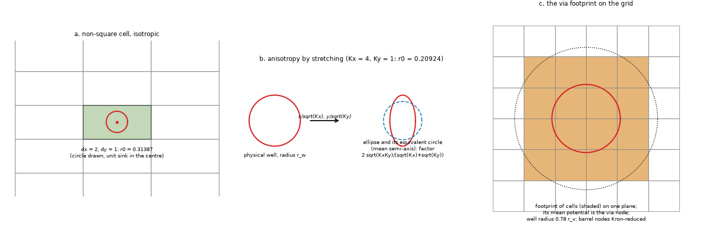

*Figure 12: `figures/fig_12_peaceman_well_block.png`. Left, a 2 x 1 cell with its equivalent radius 0.31387; middle, a circular well becomes an ellipse after the stretching and its equivalent circle has the mean semi-axis (Kx 4, Ky 1: 0.20924); right, the footprint of cells that the program uses for a via (mean potential, well radius 0.78 r_v). Schematic, drawn by `scripts/make_diagrams.py`.*

**Verdict: base exists for the five-point lattice** (two open sources that print the formulas, an infinite-lattice computation that confirms them to 1e-5, the Kron statement of Dörfler and Bullo for the star reduction). **Partial:** the footprint of several cells with a well of effective radius `0.78 r_v` (the program's treatment) rests on Peaceman's idea and on the project's own computations, not on a source; Ding's near-well transmissibility change is the closest published idea and was not obtained. **We must establish ourselves:** the Peaceman radius for heat conduction (nobody was found who applies it to a thermal via or a heat pipe: a search found only reservoir uses; the search was not exhaustive, and the models of geothermal borehole heat exchangers on coarse grids are the next place to look), for the 7-point 3D stencil of the 3D solid, for the constricted via in a two-layer board, and for a via next to a board edge or another via (the Karpinski result says the isolated-well assumption fails there in flow problems; for heat the edge case is measured only by the project).

### 7.2 Memory and time of sparse direct solvers on Laplace-type grids

**What was read:** George (1973), a scan of the whole paper (abstract, Theorems 4.1, 5.2, the closing remarks); the lecture slides of X. S. Li (2013), slides 19 and 20; the SuperLU Users' Guide (sections 1.4.4 and 2.8 and the space query); the UMFPACK User Guide v6.3.8 (the memory statistics, PDF pages 43 and 53); the abstract and introduction of Gilbert, Ng and Peyton (1994). **Read through a search or fetch summary only:** Martinsson's notes, the 2025 survey of fast direct solvers, the SciPy manual page of `splu`. **Not obtained:** Lipton, Rose and Tarjan (1979), Hoffman, Martin and Rose (1973), the Davis book, the Li 2005 article, the MUMPS guide.

**What the sources print.**

| Law | 2D grid (n unknowns) | 3D grid (n unknowns) | Source |
| :-- | :-- | :-- | :-- |
| Fill of the factor with nested dissection | O(n log n); for a k x k grid `(31/4) k² log₂ k + O(k²)` | O(n^(4/3)) | George 1973 abstract and Theorem 4.1 (k = n of the paper); Li 2013 slides 19, 20 |
| Operations | O(n^(3/2)) (George: O(k³), lower bound the same for every ordering, `> k³/6`) | O(n²) (George: O(k⁶)) | George 1973 Theorems 4.1, 5.2 and closing remark (3D lower bound **not** proved); Li 2013 slide 20 |
| Banded (row by row) order | storage O(k³), operations O(k⁴) | not given | George 1973 abstract |

The 3D laws are stated by George as an extension that is "straightforward, although a little tedious" with no lower bound proved; Li's slide gives them for "any well-shaped finite element mesh" (the Lipton-Rose-Tarjan 1979 generalisation, not read). A course note found by search warns that the constants of nested dissection are not small and that its cost is 2 to 10 times that of a lexicographical ordering in practice (search summary only).

**What the sources say about prediction before factorising.**

* SuperLU (the code behind SciPy's `spsolve` and `splu`): "we cannot determine the number and locations of these nonzeros before performing the numerical factorization" (guide section 1.4.4, printed page 12); it guesses `FILL * nnz(A)` with FILL = 20, reallocates by a factor `EXPAND = 1.5` with a copy when the guess is too small (so the peak holds both arrays and the extra space is kept), and reports the real memory only afterwards (`dQuerySpace`). SciPy's default column ordering is COLAMD (the SciPy manual, summary), **but the program does not use it**: every direct solve passes `permc_spec = ORDERING = "MMD_AT_PLUS_A"` (`pcbthermal/fvm.py` line 39; FVM, FDM, 3D solid, transients and profiles), a symmetric minimum-degree ordering of `A + Aᵀ`. The guide's sentence is conditional ("if Pr and Pc are not already known"): with partial pivoting the row order depends on the values. **Nothing in the guide predicts the memory of a given matrix.**
* UMFPACK: the symbolic phase "computes upper bounds on the nonzeros in L and U, the floating-point operations required, and the memory usage", reported as `Info[UMFPACK_PEAK_MEMORY_ESTIMATE]`; the estimate is normally an upper bound on the actual peak but "can be a very loose upper bound, particularly when the symmetric strategy is used", and the author says it is not guaranteed (never observed to fail in hundreds of matrices). SciPy uses UMFPACK only when the optional scikit-umfpack is installed, which the program does not require.
* Gilbert, Ng and Peyton (1994): the row and column counts of the Cholesky factor are computable from the pattern in almost linear time, which "makes storage allocation for sparse matrix factorizations more efficient"; for LU with partial pivoting the counts of `A^T A` bound the fill (a statement of a later paper known from a summary). The program's matrices are symmetric, so this gives a way to compute `nnz(L)` exactly for a symmetric ordering without factorising, **provided `splu` takes no row pivot**.

**Tested by the review (L, `scripts/study_fill_prediction.py`, about 30 s):** on nine program matrices (FVM at 0.5 mm, FDM at 1 mm and the 3D solid at 2 mm of the three example boards; six distinct, since the profile board gives the same matrices as the example board; 15 000 to 160 000 unknowns, with vias and their positive off-diagonal couplings), `splu(K, permc_spec="MMD_AT_PLUS_A")` returned `perm_r = perm_c` (no row pivot was taken: the matrices are diagonally dominant enough) and `lu.L.nnz` **equal to the entry, to the last digit**, to the symbolic Cholesky count of `K` in the elimination order `argsort(perm_c)` (elimination tree and row subtrees; for example 16 725 048 at 160 000 unknowns, example board FVM 0.5 mm). The ordering itself can be had without the numeric factorisation: `spilu(K, permc_spec=ORDERING, drop_tol=1e10, fill_factor=1)` returns the same `perm_c` (checked at 40 000 and 160 000 unknowns) at the memory of `K` and in 0.08 s against 1.04 s for `splu` at 160 000. So, for the program's matrices, **the fill of the factor is predictable exactly before factorising**; what is not predictable from any source is the number of resident bytes per entry (supernodal storage, the work arrays, the `FILL` and `EXPAND` policy of the guide) and the transient peak of the reallocations. The pure-Python count used here costs 2 to 4 times the factorisation; a production predictor needs the almost-linear column-count algorithm of Gilbert, Ng and Peyton (not implemented). Not tested: boards with laminate nodes (patterned copper) or metal blocks, the 3D solid with many slabs, matrices above 160 000 unknowns, and a matrix where a row pivot is taken (none was met).

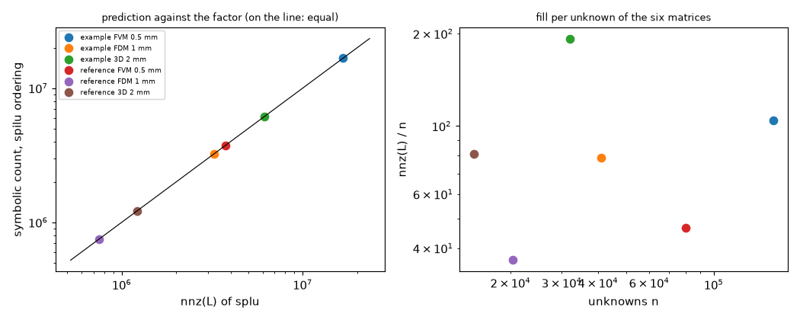

*Figure 13: `figures/fig_13_fill_prediction.png`. For the six distinct matrices of `scripts/study_fill_prediction.py` the symbolic count in the elimination order of `spilu` equals `lu.L.nnz` (for example 16 725 048 at 160 000 unknowns); right, the fill per unknown of the same matrices. Data, drawn by `scripts/make_figures.py`.*

**Relation to the project's own numbers.** The binned fit of `research/memory-guard/` 5.2 (replaced there after its review, 14.2, by one continuous law per model in `t_eff`) gives exponents of 1.0 to 1.1 for the plain layered boards with up to 4.5 nodes per plan cell, 1.36 above that, 1.41 for the FDM with laminate nodes and 1.23 to 1.28 for the 3D solid, and 2.4 to 18.6 KB per unknown depending on the class: the 2D N log N law would give an exponent slightly above 1 (consistent with the plain layered boards), and the 3D law 4/3 (the 3D solid and the many-node layered classes lie around it, below 4/3 at the sizes measured). George's laws are asymptotic bounds for a nested-dissection ordering; the program uses a multiple-minimum-degree ordering of `A + Aᵀ` (not nested dissection, and not COLAMD as the earlier text said), for which no source read gives a bound, so the constants and the crossover sizes are not given by any source. Treat the literature as the explanation of the exponents and the measurements as the law.

**Verdict (corrected by the review): base exists for the growth laws** (George 1973, Li 2013, read; the 3D laws only as an unproved extension) **and for an exact count of the factor** (Gilbert, Ng and Peyton for the symmetric count, which equals `splu`'s `nnz(L)` on the nine matrices tested here because the program's ordering is symmetric and no row pivot is taken). The earlier verdict ("no base exists for the prediction before factorising") read the SuperLU guide's conditional sentence as unconditional. **What we must establish ourselves** is the number of resident bytes per entry of the factor and the transient peak of SuperLU's reallocations as a function of `nnz(L)` (no source gives them), and the cost of a production column count. Other option a source supports: UMFPACK's peak-memory estimate, an extra dependency (scikit-umfpack, not in `requirements.txt`) whose UMFPACK library is **GPL-2.0-or-later** (SPDX line on the first page of the guide; the earlier text called it copyleft-free, which was wrong), so under the project's licence rules it could only be an optional, separately installed import, and its loose-bound warning applies.

### 7.3 Exchange formats and placement conventions

**ODB++ (Siemens).** The specification (Release 8.1 Update 4, August 2024, 515 pages) opened from `odbplusplus.com` without registration on this machine. It carries a notice that it contains Siemens trade secrets, that its use is limited by the reader's agreement with Siemens (the Universal Customer Agreement when there is none) and that it may not be copied or disclosed without written permission; Siemens's resources page says it is free after signing up. **Read (facts only, nothing copied):** the mandatory tree (`matrix/matrix`, `misc/info`, `fonts/standard`, `steps/<step>/stephdr`, `layers/<layer>/features`); the component layers `comp_+_top` and `comp_+_bot` with a `components` file linked to `eda/data`; units `UNITS=MM|INCH`; the records `CMP` (package index, x, y, **rotation in degrees clockwise**, mirror N/M, reference, part name, attributes), `PRP` and `TOP` (pin index, x, y, rotation, mirror, net, subnet, toeprint name); the BOM block and the component attributes (`.comp_mount_type`, `.comp_height`, `.no_pop`). This confirms the layout written from memory in `research/gerber-real-boards/lib/odb.py` (README 4.4 F there). **Not read:** `features` (symbols, arcs, surfaces), `eda/data` package definitions, the matrix, net lists, profile records and the attribute dictionary (515 pages). Whether the licence allows writing a reader from the specification, and the fact that it forbids reproducing it, is a question for the maintainer.

**IPC-2581.** Not opened. The standard is sold by IPC (Revision C, about 198 US dollars for a non-member, a search snippet); the consortium site offers free viewers and test cases but, on the page opened, no specification or schema; no licence is stated. The Ucamco fabrication examples contain two `.ipc` files that could be opened as samples. **We must find out ourselves** whether the XML schema is obtainable and under which terms.

**Excellon / XNC.** The Ucamco XNC specification (Rev 2021.11, 21 pages, free) was read in part: it exists because IPC-NC-349 is expensive, Excellon no longer publishes its manual, and the files in circulation are dialects with fixed-point coordinates and no statement of the decimal point; XNC fixes decimal coordinates, `METRIC|INCH`, finished tool diameters (after plating), `M48` ... `%` header, plating and span as `TF.FileFunction` attributes with plated and non-plated holes in separate files, and the same coordinate system as the Gerber copper layers. The legacy dialects (`LZ`/`TZ` zero suppression, `FMAT`) are described only by non-authoritative pages; the original Excellon manual is not obtained. The project's reader already reads the drill files of its open boards.

**Placement (pick-and-place, centroid) files.** KiCad 9's manual (section "Component placement files", read) lists the options of its `.pos`, CSV and Gerber X3 outputs: only SMD, exclude through-hole, exclude DNP, drill/place origin or page origin, **negate X for the bottom side**, one file or two. JLCPCB's page (summary) lists its columns (Designator, Mid X, Mid Y, Rotation, Layer, mm). IPC-7351 defines a zero orientation per component family so that CAD and machine agree (vendor blogs only). **Not documented in anything opened:** the direction in which the rotation is counted in a KiCad or JLCPCB file (the KiCad manual states counter-clockwise only for the IDF export, while ODB++ counts clockwise, so the sense differs between formats), the sign of Y when the page origin (upper left corner, Y growing down on the screen) is used, whether the rotation of a bottom part is mirrored, and the rotation offsets between a CAD library and an assembler's convention (JLCPCB speaks of "automatic translations" without saying what they are); the Altium page tried does not exist at the address used. The project's own finding stands: the sign of the bottom side was found from the names against the paste layer (`research/gerber-real-boards/`), not from a specification. **We must establish the conventions ourselves** from sample files of each tool, as detection rules.

### 7.4 Thermal-via models for the zonal Lumped

Another researcher reads Shen and others (2019) in full for `research/lumped-zones-adoption/`, so this pass only records availability: the accepted manuscript opens as a PDF at the Aalborg repository (checked: HTTP 200, `application/pdf`) and an accepted version is listed in the Cambridge repository. Guenin (Electronics Cooling, August 2004), the circular-fin unit-cell model (a via as a circular fin, a one-dimensional substrate path in parallel, the plates of the width of the pitch): the page was read again through the fetch summary, and **its two equation tables are images that were not read**, so its equations are not recorded; the validation figures are (against a finite element reference of a 10 mm die with 35 µm planes, the 1D model underestimates by up to 27 %, the circular fin overestimates by up to 22 %, with the die spreading by up to 6 %). A 2025 conference paper of Mondragon University on through-hole and blind vias (7 % from CFD) is known only from a search snippet. **Verdict: partial.** The published zonal models (inner and outer zone, radial component in the outer zone; circular fin) exist and one is open; none of them was used here, and whether any matches the program's layered, per-ring construction is a question for the lumped-zones folder.

### 7.5 What the maintainer has to decide or provide

* The licence question of the ODB++ specification (a reader written from it) and whether to obtain the IPC-2581 standard (paid) or only use its sample files.
* Whether the project wants a Peaceman radius for heat conduction, for the 3D solid and near edges as a study of its own (no source exists; the lattice solve of 7.1 shows the method and takes seconds).
* Which prediction of memory is acceptable: the program's own fitted law (`research/memory-guard/`) or an exact count of the factor (ordering from `spilu`, then the symbolic count; equal to `splu`'s fill on the nine matrices of 7.2) times a measured number of bytes per entry. The review recommends keeping the fitted law for the 2.5.0 guard and running the cheap test of 7.6 first.
* The ODB++ question, worded for the maintainer: the specification opened freely but says it is Siemens-confidential, limited by an agreement and not to be copied. This pass copied nothing and recorded only facts of the format (file names, record fields, units, rotation sense), which also appear in open parsers. **No ODB++ reader is to be written from the specification until the maintainer decides** whether (a) facts of a format read from it may be used, (b) only open parsers and sample archives are used, or (c) Siemens is asked. The existing `research/gerber-real-boards/lib/odb.py` was written from memory and checked on archives, not from the specification.

### 7.6 What each topic means for the plan (review)

| Topic | Consequence | Cheapest next step |
| :-- | :-- | :-- |
| Memory guard (`feature/memory-guard`) | The fill of the factor is exactly predictable for the program's matrices; the unknown is bytes per entry and the reallocation peak. The fitted law stays the guard until the test below says whether `nnz(L)` predicts the resident peak better. | Add `lu.L.nnz + lu.U.nnz` to the memory-guard ladder runs (the numbers are free in the same child process that measures `ru_maxrss`) and fit `peak = a nnz(L) + b n`; if the scatter of `a` across the classes (FVM thin and thick, FDM with laminate nodes, 3D solid) is below the scatter of the per-class laws, the guard can predict from `spilu` + count. Also confirm `perm_r = perm_c` on boards with laminate nodes and metal blocks. No new heavy run beyond the ladder. |
| Peaceman for heat, 3D and near edges | The five-point radius is settled (sources plus the exact lattice); the program's non-square grids have a known small correction (`sqrt(2 dx dy / (dx² + dy²))`, 2 % at worst for a side rounded from 1.5 to 2 cells). For the 7-point stencil of the 3D solid and for a via near an edge there is no source. | Two lattice computations of seconds each with the method of `study_peaceman_nonsquare.py`: the infinite 7-point lattice with the layered conductances of the 3D solid (does its tuned footprint match its own lattice radius?), and the image of a via in an adiabatic and a convective edge (does an image term remove the +12 to 15 % of the edge warning?). |
| Zonal Lumped vias | No published zonal model was read with its equations (Shen 2019 is with `research/lumped-zones-adoption/`, Guenin's equations are images), so the zonal Lumped is validated only against the project's FVM and 3D solid. | Read Shen 2019's equations and one numerical case in the lumped-zones folder and reproduce it; open the Mondragon 2025 paper if it can be had. |
| KiCad / centroid conventions | Rotation sense, Y sign with the page origin, bottom mirroring of X and of the rotation, and library-to-assembler offsets are undocumented; they must be detection rules. | Make sample `.pos` and CSV files with `kicad-cli pcb export pos` from an own test board (asymmetric parts rotated by 0, 90, 180, 270 degrees on both sides, with and without the drill/place origin and the negate-X option) and write the rules against them; the same board exported to JLCPCB format through the plug-in shows its offsets. |

## 8. Reading pass, batch 1: the sources behind the formulas of the five models

The question: for each source that a formula, a correlation or a check of the five models rests on, what was read (pages, equations), does the program agree with it, and is there a discrepancy (a published number that does not add up, a unit, an assumed layout). The program was read (`convection.py`, `docs/theory.md` sections 1.5, 5, 6, 8, 12) and **not edited**; every discrepancy below is a proposal, with the measured size. The statuses are in `research/theory/BIBLIOGRAPHY.md`, section "Reading pass, batch 1" and the entries marked "Update (research/theory-sources/ 8.x)". The sources of the batch that had been read in full by an earlier folder were not re-read and are listed at the end of that section.

### 8.1 Vias: Shen and others (2019), Gezala and others (2025), Rodero and others (2025), Lee and others (1992)

**Read.** Shen, Wang, Blaabjerg, Zhao, Long: pages 1 to 17 of 20 (the via unit equations 2 to 7 and the printed Table I conductivities; the outer-zone network equations 8 and 9; the thin-pad condition Bi < 0.1 and equations 11 to 13; the circular pad two-port equations 14 to 27 with modified Bessel functions; the heat-transfer boundary r_e correlation 28; the fixed-point loop 29 to 36; Table II of measured top-case temperatures). Gezala and others: the whole paper (9 pages): equations 1 to 16, the outer-zone isotherm counts 12 and 13, validation text. Rodero and others: pages 1 to 14 (equations 1 to 24, Tables I, III, VI, VII). Lee, Lemczyk, Yovanovich: pages 55 to 60 as images (equations 1 to 14, Tables 1 and 2, Figures 9 and 10).

**Reproduced (new, independent scripts).** `scripts/study_via_array_sources.py` part 1 evaluates the three parallel vertical paths (filler, barrel, laminate) with the printed equations and the Table I conductivities (s = 0.2 mm, plating 25 um, 4 layers of 35 um, t = 1.6 mm, a choice of the script where the paper's Figure 4 values are plots):

```
air    : optimum phi 0.249 mm (paper "about 0.25"); phi = 0.8 mm costs +43.4 % (paper +44 %); pattern II / pattern I 0.8671 (paper 0.866 = sqrt(3)/2)
solder : optimum phi 0.778 mm (paper "about 0.8");  phi = 0.2 mm costs +22.4 % (paper +23 %);  pattern II / pattern I 0.8668
references [15], [17], [18] of Shen (air filled): the optimum lowers the resistance by 39.2 / 88.2 / 38.5 % (paper 47 / 89.5 / 46.4 %)
```

The optimum diameters, the two penalties and the pattern ratio are reproduced within 1 point (the paper's 44 and 23 are rounded and the optimum is read from a plot). The 47 % and 46.4 % against two earlier designs are **not** reproduced (39 and 38.5 %); the third (89.5 %) is (88.2 %). The paper does not give the filler, the thickness or the copper of those references; the difference is a published number that does not add up with the stated parameters.

`scripts/study_lee_lemczyk_vias.py` evaluates equations 1 to 3 and 7 of Lee and others with the Bessel-root series. The paper's printed R_vias is 0.196 K/W at 20 % routing and 0.342 K/W at 40 % (page 60, nine islands, Tables 1 and 2):

```
routing | printed | N vias per layer, f2 = 1 | N per layer, f2 = 1/4 | N total (the 4/N of equation 7), f2 = 1
 20 %   | 0.196   | 0.293 (+50 %)             | 0.172 (-12 %)         | 1.658 (+746 %)
 40 %   | 0.342   | 0.548 (+60 %)             | 0.321 (-6 %)          | 3.100 (+806 %)
ratio 40/20: printed 1.745; 1/4 reading 1.872
```

**This case is not reproduced.** The paper does not say what area a unit cell of the intermediate pads has nor whether N counts the vias of one layer or of the four; the readings tried are the only two consistent with the text, one is 6 to 12 % from the printed numbers with the quarter cell (an assumption, not a finding) and the other, the literal 4/N with N the island total, is 5.6 to 9.5 times too high. The thick-limit check of equation 3 passes (a disc source in a thick plate gives 0.85 of the half-space constriction 0.27/(k b)), and equation 2 is the tube formula, so the formulas as read are right; what is missing is the layout.

**The program's models on the closest case** (`study_via_array_sources.py` part 2): 12 x 12 open vias of 0.25 mm at 0.45 mm pitch on a 5.6 mm square of four layers of 35 um, 1.6 mm, FR4 0.29 / 0.81 W/mK, plating 25 um, a heater over the whole top, the bottom held by h = 1e6 W/m2K, the quantity the top-to-bottom mean copper temperature per watt. The paper's unit-cell sum is 1.5886 K/W (144 units of (phi + s)^2; the board is 7 % larger than the units).

```
model     cell 0.2 mm   cell 0.1 mm     difference from 1.5886
fvm       1.5145        1.5066          -4.7 / -5.2 %
fdm       1.5242        1.5117          -4.1 / -4.8 %
solid3d   1.5282        1.5356          -3.8 / -3.3 %
analytic  1.5712        1.5712          -1.1 %
lumped    1.6578        1.6578          +4.4 %
```

All five models are within 5.2 % of the one-dimensional parallel sum, on the board that the sum describes (heat leaves each unit vertically). The unit-cell sum is a lower-resistance bound on the area it covers only if no heat spreads in the copper planes; the program's planes let the heat equalise, which is the 3 to 5 % in the FVM, FDM and 3D solid. The Gezala and Rodero via unit (their equations 1 to 7) is the same formula as Shen's (Rodero cites its reference [6], a fixed vias-and-pads analytical model, most likely this paper); neither paper has a constriction term, which the program's `viaconstriction.py` adds for the reduced models only.

**Observations on the publications** (not defects of the program).
* Gezala and others: the radial resistance of a via cell is the rule of mixtures printed as a **parallel average** (equation 10, k_e = sum V_i k_i / V_t) while Rodero and others print the **series** form (equation 12, 1/K_e = sum V_i/(V_t K_i)) for the same purpose; the two differ by orders of magnitude for copper and FR4, and the in-plane flow in the layered board is parallel, so the Gezala form is the one that is consistent with a sheet of copper layers in a laminate.
* Gezala and others: the abstract says "deviation of only 7 %", the text says "maximum relative error of 7 %" and refers to Fig. 9, which is the COMSOL model; the comparison is Figures 10 and 11. No table is printed, so the 7 % could not be re-derived.
* Rodero and others: equation 21 prints h_c = 0.52 C [(T_s - T_amb)/L]^0.25 with C = 0.56 (vertical), 0.52 (up), 0.26 (down). Read literally the vertical coefficient is 0.29, 5 times smaller than the textbook 1.42; the program's general form gives 5.10 W/m2K for a 0.1 m plate at 20 K, the textbook 5.34, the literal formula 1.10 (`study_plate_asymptotes_sources.py`). The ratio up/down of the paper's Table II (2) is the program's (2.00).
* Rodero and others: "the experimental power had to be nearly doubled" (page 12) to make the board lose the heat that the model sends only through its faces: the 3 to 8 % errors of Table VII are against a measurement that was adjusted to the model's power.
* Shen and others: Table II (measured top-case temperatures) and the pad figures are the only measured numbers; the Shen via models are compared with the program only through the unit-cell sum above, and the CFD numbers of the zonal Lumped study (`research/lumped-zones-adoption`) were not reproduced from this paper's data.

**Does the program agree.** Yes within 5 % for the case above. The model of Shen and others of the pad (equations 14 to 27) is the radial fin solution with `I0`, `I1`, `K0`, `K1`, i.e. the same equation (17) that the program's Analytic uses for a layer with a loss coefficient (theory 6, `K0` Green function); the paper's thin-pad condition Bi = h t_eff / k < 0.1 (equation 12, Figure 10: for h = 16 W/m2K the thickest all-FR4 board is 2.2 mm) is the same statement as the layered idealisation (one node through the thickness).

### 8.2 Spreading, flux tubes and the Fourier series: Yovanovich and others (1998), Culham and Yovanovich (1998), Culham, Yovanovich, Lemczyk (2000), Muzychka and others (2004)

**Read.** Yovanovich, Culham, Teertstra (1998): pages 168 to 173 (file pages 1 to 6) as images and text, equations 1 to 39. Culham and Yovanovich (1998): page 462 (file page 3), equations 7 to 10 (new). Culham, Yovanovich, Lemczyk (2000): pages 233 to 235 (equations 1 to 15). Muzychka, Yovanovich, Culham (2004): pages 45 to 50 (equations 1 to 50).

**Reproduced.** `scripts/study_flux_tube_sources.py` evaluates the paper against itself and against the Table 3 of Yovanovich (2003) (page 174, read before):

```
isoflux flux tube psi = 4 k a Rc: series (eq. 22) vs correlation (eq. 24), eps 0.01 .. 0.9: differences 1e-5 to 1.5e-4; eps -> 0: 32/(3 pi^2) = 1.08076 (the constant of eq. 24)
 eps 0.5: series 0.40921 (Table 3 isoflux 0.4092) ; eps 0.9: 0.03312
m = -1/2 (equivalent isothermal flux) series (eq. 21): 0.8594 / 0.5853 / 0.3342 / 0.1262 / 0.0483 at eps 0.1 / 0.3 / 0.5 / 0.7 / 0.8 (Table 3, Roess column: 0.8592 / 0.5853 / 0.3342 / 0.1262 / 0.0483)
eq. 23 (printed as the correlation of the "equivalent isothermal" series) = the Negus-Yovanovich ISOTHERMAL column of Table 3 (0.3396 at 0.5, 0.1403 at 0.7, 0.0672 at 0.8), not the series of eq. 21: they differ by 1.6 % of the value at 0.5, 11 % at 0.7
Song and Lee closed form (eqs. 27 to 30) against the series of eq. 22 (Bi = 1e6): +2.5, -0.6, -2.5, -2.2 % at eps 0.1, 0.3, 0.5, 0.7 (the paper says within 10 %)
Dryden thick layer (eq. 39) against the integral (eq. 34): +0.1 to +0.7 % for t/a 2 to 5 at k1/k2 10, 100, 1000
Dryden thin layer (eq. 38, printed for 0 < t/a <= 0.10): exact only to first order: -0.0 % at t/a 0.001 but -8 % (k1/k2 2) and -146 % (k1/k2 10) at t/a 0.1
```

* **A printed range that is not general:** equation 38 is the correct first-order term (the slope matches the integral) but the paper's range "0 < t/a <= 0.10" holds only for modest conductivity ratios; the expansion parameter is (k1/k2)^2 t/a. For k1/k2 = 10 and t/a = 0.1 the formula returns a negative resistance. Nothing in the program uses it; the Seri Lee form (equation 1 of Lee 1998, reproduced in section 3.11) is the closed form that the program's plate check uses.
* The equivalent-isothermal-flux series (21) goes negative at eps 0.9 (-0.0023): the paper itself says the flux distribution is an isothermal substitute only for eps < 0.6.
* Song and Lee's constant delta_c = pi + 1/(sqrt(pi) eps) (equation 30) is the lambda of Lee's equation 2 (lambda = pi^(3/2)/sqrt(Ap) + 1/sqrt(As)) in the paper's variables, so the program's plate check (theory 7.5) rests on equations 27 to 30 of this paper through Lee (1998).
* **Culham, Yovanovich, Lemczyk (2000) prints "typical values of m and n in the range 10-30"** for the truncation of its series, and Culham and Yovanovich (1998) says its simulations used that series (page 462). Section 3.6 found that the paper's 8.28 W/mK for the base coupon lies between the 5-mode (8.50) and 7-mode (8.14) truncations of the converged 7.82; 10 modes per direction (the lower end of the printed range) gives about 8.0, so the printed truncation range is consistent with the 2 to 6 % by which this project's reproductions sit below the paper (the hypothesis of 3.6 is strengthened, not proved: the number of terms of the 1998 run is still not printed).
* **Side boundary conditions.** The series of Culham and others has a film on each of the four side faces of every layer (equations 5 to 14: X(x) = cos(e x/L1) + (Bi1/e) sin(e x/L1), the roots from a transcendental equation); the program's Analytic uses cosine modes with insulated sides and corrects the edge with its edge coefficient only through the uniform mode (theory 6, limits: "slightly warm on a uniform board"). A series with Robin sides would remove that difference. **Proposal A1 (idea, not measured):** a version of the Analytic with film sides, in the roots of equations 13 and 14, to be measured on the boards where the edge coefficient matters (small boards, h_side 10 W/m2K); no impact figure was measured in this pass.
* **Orthotropic layers (Muzychka 2004).** The transformation xi = z/gamma, gamma = sqrt(kz/kxy), k_eff = sqrt(kxy kz), t_eff = t/gamma reduces an orthotropic flux channel to an isotropic one (equations 41 to 49), and the composite conductivities are the parallel in-plane sum and the series through-plane sum (equations 39 and 40). The program's layered model has exactly those two (copper sheets in parallel, gaps in series) and FR-4 anisotropy 0.3 / 0.9; the transformation is the independent route to test a thick anisotropic gap, and its numerical figures are plots. **Proposal A2 (idea):** one anisotropic-gap case against equation 50 of the paper with an independent solver; not run.

**Does the program agree.** The formulas that the program uses (Seri Lee's closed form, the Fourier series, the series/parallel conductivities) agree with what the sources print; the two places where the program differs from the source on purpose are the insulated sides and the 300 terms, both documented.

### 8.3 Convection: Yovanovich (1993), Martin, Raithby, Yovanovich (1991), Teertstra and others (2004), Ostrach (TN 2635)

**Read.** Yovanovich (1993, AIAA-93-2750): all 7 pages (pages 5 to 7 new). Martin and others: pages 1 to 6 of 7 (page 6 new). Teertstra, Yovanovich, Culham (2004): pages 1 to 3 (model) and the list of tables and figures. Ostrach TN 2635: page 14.

**Reproduced / compared.** `scripts/study_plate_asymptotes_sources.py`:

```
Natural, coefficient of Ra^(1/4): Yovanovich eq. 25 vs the laminar Churchill-Chu coefficient 0.670/[1+(0.492/Pr)^(9/16)]^(4/9): -0.29 (Pr 0.01), -0.39 % (Pr 0.71), -0.45 % (Pr 7), -0.49 % (Pr 100)
Forced, mean, coefficient of Re^(1/2): Yovanovich eq. 26 vs Pohlhausen 0.664 Pr^(1/3): -10.2 % (Pr 0.1), -3.1 % (Pr 0.71), -2.4 % (Pr 1), -0.4 % (Pr 7), +0.3 % (Pr 100)
Program, vertical 0.1 m at 20 K: Ra 1.659e6, Nu (laminar form, with the +0.68) 19.12 ; Yovanovich eq. 25: 18.37 (-3.9 %)
Program, 1 m/s over 0.1 m: Nu 46.09 ; Yovanovich eq. 26: 44.65 (-3.1 %)
```

* The natural interpolation of Yovanovich (1993) is the same construction as the laminar Churchill-Chu form (a Churchill-Usagi blend of the small- and large-Pr asymptotes, m = 9/4) and lands within 0.5 % of its Ra^(1/4) coefficient for every Pr: an independent support for the coefficient 0.670 of equation 8.2. The 3.9 % at Ra = 1.7e6 is the additive 0.68 of the program's laminar form, a leading-edge term that Yovanovich's form does not have (its meaning is in `research/plate-h-level` 3.4).
* The forced interpolation (26) is a scaling-based approximation with the large-Pr constant 3/2; it is 3.1 % below the Pohlhausen value at air. The paper prints no accuracy. The program's 0.664 Pr^(1/3) is the Pohlhausen value from memory (status M for the source), which the paper's own large-Pr asymptote (error +0.3 % at Pr 100) is consistent with. **No change proposed**; the difference is a statement for `docs/theory.md` 8: "0.664 Pr^(1/3) is Pohlhausen's mean value (M); Yovanovich's general expression, which has no exact status, is 3 % below it at Pr 0.71".
* **Martin and others (1991), page 904.** Their Summary says that the Elenbaas low-Rayleigh asymptote "will not be observed except under extremely special conditions": with upstream conduction and a finite plenum the heat transfer at low Ra is larger than the fully developed value (equation 28, a blend with n = 1.9). This bears on `checks.check_fin_channels` and on the proposal B of `research/fin-channel` (a channel correction `phi`): the composite form `[(24/Ra_b)^2 + (0.59 Ra_b^(1/4))^(-2)]^(-1/2)` that the warning uses gives the fully developed limit, which for a finite array is the **lower** bound of the coefficient; a correction built on it would be on the safe (hot) side, and the warning's threshold Ra_b < 90 is therefore conservative. **Proposal C1:** say so in the text of the warning and of proposal B (words, no number: the size of the effect for the finned blocks of the program is not measured here).
* **Teertstra and others (2004)**: the enclosure model (equation 6, shape factor plus a Churchill-Usagi blend with exponent n) is not in the program; the program's mixed convection is Churchill's cubic blend of natural and forced. The paper is context for a planned enclosure view factor.
* **Ostrach TN 2635, page 14:** the eight Prandtl numbers (0.01, 0.72, 0.733, 1, 2, 10, 100, 1000), the 0.733 check against Schmidt and Beckmann to three digits. Consistent with the Report 1111 Table I reproduced to 0.02 % in `research/plate-h-level`; the tables of TN 2635 were not compared digit by digit.

### 8.4 Citations corrected, statuses changed

| Source | Was | Now |
| :-- | :-- | :-- |
| Shen and others, TPEL | status S (abstract), citation "(2019)" | **R pages 1 to 17**; IEEE TPEL 35 (1) (2020) 882-900 (2019 early access) |
| Gezala and others (Mondragon2025) | N, then S (search snippets); authors unknown | **R (9 pages)**; IET Conf. Proc. 2025 (9) 97-104, doi 10.1049/icp.2025.2012, authors Gezala, Garrido, Baraia-Etxaburu, Aizpuru |
| Rodero and others | not in the bibliography | **R pages 1 to 14**; IEEE TPEL, doi 10.1109/TPEL.2025.3626813 (accepted manuscript) |
| Lee, Lemczyk, Yovanovich | not in the bibliography (a topic mention only) | **R pages 55 to 60**; SEMI-THERM 8 (1992) 55-60; not reproduced |
| Yovanovich, Culham, Teertstra | S, pages "168-178" in one entry and "168-176" in another | **R pages 168 to 173**; **168-176** (file of 9 pages) |
| Culham, Yovanovich, Lemczyk (2000) | not in the bibliography | **R pages 233 to 235**; JEP 122 (3) 233-239 |
| Culham and Yovanovich (1998) | R 460 to 466 | unchanged, page 462 (equations 7 to 10) added |
| Yovanovich (1993) | R pages 1 to 4 | **R all 7 pages** |
| Martin, Raithby, Yovanovich | R pages 1 to 5 | **R pages 1 to 6** |
| Muzychka and others (2004) | abstract | **R pages 45 to 50** (equations 1 to 50) |
| Teertstra and others (2004) | abstract | **R pages 1 to 3** (model), validation numbers S |
| Ostrach TN 2635 | S (same as 1111 by title) | **R page 14**, tables not compared |
| Fish (2017) | R chapter 6 | chapter 7 formulation R (equations 58 to 83, 177 to 182), series S |

### 8.5 What was not read in this pass, and what is left

* Lemczyk and others (1992), pages 413, 418, 419; Muzychka and others (1999, 2003) and Teertstra and others (2006) were not re-read (their earlier statuses stand); the Teertstra review was not re-read; Schulenberg (1984) and Jaffer (2023, 2025) are read by earlier folders and were not opened again.
* Shen and others pages 18 to 20; Rodero and others pages 15 to 21; Fish chapter 5 and the series solution of chapter 7 (equations 84 to 176); the second half of Yovanovich, Culham, Teertstra (pages 174 to 176); the validation numbers of Teertstra (2004).
* The Lee, Lemczyk, Yovanovich R_vias and Shen's two reductions (47 and 46.4 %) are published numbers that this pass could **not** reproduce; the cause is the unrecorded layout (Lee) and the unrecorded parameters of the references (Shen). The program was not run on the Lee case (a polyamide HDI island is outside the representable range of a PCB model).
* No heavy run was made; every script finishes in seconds.

### 8.6 Proposals (none edits the program)

| | Proposal | Evidence | Measured impact |
| :-- | :-- | :-- | :-- |
| A1 | An Analytic variant with film side faces (Robin roots, Culham and others eqs. 13, 14) | the series of the source has them; the program's insulated sides are the whole of its difference on a uniform small board (theory 6) | not measured |
| A2 | One anisotropic-gap case against Muzychka (2004) eq. 50 | the transformation of eqs. 41 to 49 | not run |
| B1 | `docs/theory.md` 8: state that 0.664 Pr^(1/3) is Pohlhausen's value (M) and that Yovanovich's general expression (a scaling-based interpolation) is 3.1 % below it at Pr 0.71 | 8.3 | none (text) |
| C1 | `checks.check_fin_channels` and the proposal B of `fin-channel`: say that the Elenbaas low-Ra branch is the fully developed (lower) bound, after Martin and others (1991) page 904 | 8.3 | none (text) |
| D1 | `docs/theory.md` 12 and the validation text: the via unit of Shen and others / Gezala and others (a 1D parallel sum) agrees with the five models to within 5.2 % on the 12 x 12 board of 8.1; quote it as an independent check of the vertical via conductance of the program | 8.1 | none (text) |

## What was read and what was not verified

**Read in full or at the pages named (R):** Lienhard, *A Heat Transfer Textbook* 6.00 (book pages 311, 419 to 421 and 435 to 437, plus search of the whole text); ASHRAE preprint OR-05-4-3, page 5 (equations 9 to 14); Jaffer (arXiv 2201.02612, searched; page 5) and Jaffer and Jaffer (arXiv 2401.09469 / `blend.pdf`, searched and the passages quoted read); Milton, *The Theory of Composites*, pages 47 to 50, 116, 195 and 196; Culham and Yovanovich (1998), pages 465 and 466 as images; Lemczyk and others (1992), pages 414 to 417 as images (Tables 1 to 3 digits read at 190 dpi); Muzychka and others (2003), examples and Tables 1 to 4 (text layer); Yovanovich (2003), page 174 (Table 3) and the page of the series; Lee (1998), the article text and its two equation images; Celik and others (2008), pages 4 to 9; Nexperia AN11261 Rev. 5.0, pages 1 to 12; Ucamco Gerber specification 2026.05, contents and pages 25, 26, 112, 113; McCormick and Tamstorf (arXiv 2605.17828), the text around Algorithm 3 and section 8.

**Reproduced with an independent solver:** the vertical-plate Example 8.1 (formula); the ISO 15099 and `ht` Hollands forms (formula, no solver needed); the Hashin-Shtrikman bounds, the 2D Bruggeman equation, the checkerboard and the phase interchange (periodic finite-volume solver); the Culham coupon's `R_solid` and effective conductivity (cosine series, base case within 6 % of the paper's 8.28, plateau not reproduced); Muzychka and others cases 1 (b) and 2 (3D solver, centroids within 0.03 K); Lemczyk Tables 1 to 3 (2D solver); the Cauer and Foster forms of AN11261 (matrix exponential); three Gerber examples (the project's reader); a V-cycle (the property, no number); Celik Table 1; Lee's example and Yovanovich's Table 3 (series).

**Run on the program's models:** the Churchill-Chu form and the horizontal and mixed correlations of `convection.py`; the five models on Muzychka cases 1 (b) and 2; the FVM and FDM in the GCI study. Not run on the program: Lemczyk (scale), topics 12 to 16 (not in the program).

**Not verified, or from memory:** the original Churchill-Chu, Churchill, Hollands, Keller, Dykhne, Bruggeman, Hashin-Shtrikman papers and Torquato's book (not obtained); the 2D Bruggeman equation is derived, not read; Jaffer's p = 2 is a fit to a rough plate; the ambient of Muzychka's case 2 (25 C) is assumed; the plateau of the Culham figure 5 is not explained; the film treatment of the paper's series is not known; the exponent of `ht`'s fifth-root form is called a misprint from a secondary source; JEDEC, IPC, ASTM and ASME standards were not obtained (listed in the bibliography).

**Second pass (section 7), read in part (R):** Lie 2019 section 4.3.2 (book pages 126 to 128); Koch and others, arXiv:1907.12653, section 5.4 and appendix E; Karpinski and others 2010 (abstract, example 2); Dörfler and Bullo, arXiv:1102.2950 (Lemma 2.1, Theorems 3.4, 3.7, 3.9 as stated, no proofs); George 1973 (whole scan, constants of Theorem A.6 unreadable); Li 2013 slides 19 and 20; the SuperLU Users' Guide (sections 1.4.4 and 2.8); the UMFPACK User Guide 6.3.8 (memory statistics); Gilbert, Ng and Peyton 1994 (abstract, introduction); the ODB++ specification 8.1 Update 4 (copyright page, tree, units, the component records, PDF pages 22, 24, 150 to 153; 515 pages, the rest unread); the XNC specification 2021.11 (preface, 2.5, 2.6, 3.2 to 3.5, 4.1); the KiCad 9 manual section on placement files. **Seen through a summary only (S):** Martinsson's notes and the 2025 survey of fast direct solvers (the complexity lines), the SciPy `splu` page, JLCPCB's centroid page, the IPC-2581 consortium page, Guenin 2004 (equations are images), the Mondragon 2025 paper (snippet), IPC-7351 (vendor blogs). **Not obtained (N):** Peaceman 1978 and 1983, Ding 1995, Lipton-Rose-Tarjan 1979, Hoffman-Martin-Rose 1973, the Davis book, Li 2005, the MUMPS guide, IPC-2581, IPC-NC-349 and the Excellon manual, Altium's pick-and-place page. **Reproduced (L):** the printed Peaceman radius for non-square cells and anisotropic conductivity against a finite five-point lattice (`scripts/study_peaceman_nonsquare.py`, 0.09 to 7.7 %, all of it the effect of the finite rectangle) and, added by the review, against the infinite lattice (within 2e-5 in all ten cases; regression test in `tests/test_theory_sources.py`); the exact fill prediction of `splu` on nine program matrices (`scripts/study_fill_prediction.py`, review). **Re-opened by the review** (own download and text extraction): Lie chapter 4 pages 126 to 128 (4.33 to 4.35 and the caution), Koch and others section 5.4 (5.5, 5.6, the validity and "superior" passages), Dörfler and Bullo Lemma 2.1 and Theorems 3.4, 3.7 and 3.9, the SuperLU guide 1.4.4, 1.3.5 and 2.8, the UMFPACK guide (symbolic phase, PDF pages 43 and 53, licence line), Li 2013 slides 19 to 21, George 1973 abstract, the ODB++ component records and notice, the KiCad placement section; the statements of 7.1 to 7.3 match them except where corrected (the program's ordering, the UMFPACK licence, the cells of the program, the scope of the Kron statement, the attribution of the cell-size remark). **Not done:** the Peaceman radius for a 7-point 3D stencil, for heat with a constricted barrel or near an edge; any run of the program; any opening of Shen 2019 (another researcher). The text of the third-party documents is not stored in the repository; the ODB++ specification is confidential and was only read.

**Reading pass, batch 1 (section 8), read (R):** Shen and others pages 1 to 17; Gezala and others (whole paper); Rodero and others pages 1 to 14; Lee, Lemczyk, Yovanovich pages 55 to 60 (images); Yovanovich, Culham, Teertstra pages 168 to 173 (images); Culham and Yovanovich (1998) page 462; Culham, Yovanovich, Lemczyk pages 233 to 235; Muzychka and others (2004) pages 45 to 50; Yovanovich (1993) all 7 pages; Martin and others pages 1 to 6; Teertstra and others (2004) pages 1 to 3; Ostrach TN 2635 page 14; Fish chapter 7 (formulation and limits). **Reproduced:** Shen's optimum diameters, penalties and pattern ratio (within 1 point, two of five printed percentages not reproduced); the flux-tube series against its printed correlations and against Table 3 of Yovanovich (2003); the program's five models against the via unit cell (within 5.2 %). **Not reproduced:** the R_vias of Lee and others (layout not printed), Shen's 47 and 46.4 % reductions, Rodero's equation 21 (a misprint as printed). **Not read:** see 8.5.
