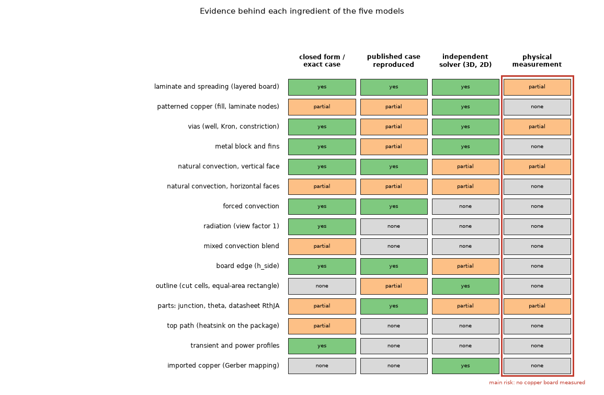
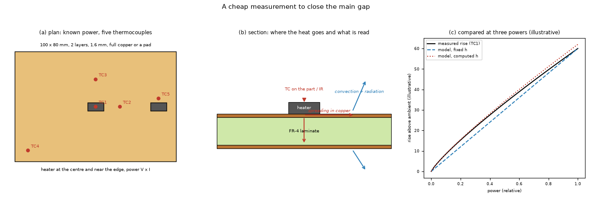

# Models: evidence, gaps and what to do next

The reviewer's answer to the maintainer's question, after the Gemini transcriptions of the local library were compared with the page images: **(1)** is there anything the literature says that the program must implement or change; **(2)** are the five models well modelled, and can the simulations we have prove it, ingredient by ingredient; **(3)** which contradictions or gaps against the sources remain, and which statements of `docs/theory.md` still rest on sources not opened; **(4)** a prioritised list (MUST for 2.5.0 with acceptance tests, SHOULD for 2.6.0, CAN WAIT) and the cheap measurements that would close the main gap.

Nothing of the program was edited and nothing heavy was run (peak under 1 GB). The numbers below are either read from the page images named, computed in a few lines with the program's own functions (said so where it happens), or quoted from the documents and research folders named; a quoted number was not re-run unless the text says so. Papers are data: nothing in them was run.

## 1. The OCR verification (what was compared with the page images)

The library of papers (`papers/`, outside the repository) holds 191 pages of 31 files transcribed online. The rule of `CLAUDE.md` is that a transcription counts as read only after the reviewer compares it with the page image. In this pass:

* **44 pages were compared with their images** (rendered with PyMuPDF at 70 to 200 dpi; every equation, table value and number that `docs/theory.md` or the program uses on those pages): Lienhard pp 323, 325, 433, 434, 435, 449, 450, 451, 769 (book pp 309 to 755, printed = PDF - 14); Yovanovich and Jafarpur (1993, bounds) pp 11, 13, 14, (cuboids) pp 11, 12, 13, 16; Muzychka, Culham, Yovanovich (2003) Part 1 pp 2 to 6, Part 2 pp 3, 4, 5; Muzychka (1999, coated surfaces) pp 4, 5; Muzychka (2004, orthotropic) pp 5, 6; Muzychka (2003, eccentric) p 5; Culham, Yovanovich, Lemczyk (2000) pp 5, 6; Culham and Yovanovich (1998) p 4; Teertstra review p 5 (journal p 83); Soleymani Koohbanani pp 76, 77, 78; Lee and Yovanovich (1989) p 5; Lemczyk (1992) p 4; Yovanovich (2003) pp 6, 7; Yovanovich (1995) pp 3, 4; Shen p 6 (structure only).
* **Every page was screened automatically**: the numbers of each transcription were compared with the PDF text layer (where the file has one) and every file was checked for degenerate output. For born-digital files (Lienhard, Rodero, Shen, Soleymani, Saad, Teertstra 2004 and 2006) every number of the transcription is in the text layer, except the pages listed below; that is a check of the numbers, not of the equations.
* **Independent checks of printed numbers** (a few lines, no program run except where said): Yovanovich (2003) Table 3, column mu = 0, by the Bessel series over the roots of J1 (0.9401, 0.8010, 0.6649, 0.5337, 0.4092, 0.2936, 0.1896, 0.1008 for eps 0.1 to 0.8: the printed digits; 0.8009 printed at 0.2); the Bessel roots printed on its p 5; Yovanovich (1995) `G_s(0) = 4/(3 pi^(3/2)) = 0.2394` (printed 0.23945); Lienhard Example 8.1 by the program's laminar form (`convection.h_natural_vertical`, 4.233 W/m2K against the printed 4.22; Ra 6.72e7 against 6.78e7); Lienhard Example 6.5 by `convection.h_forced` (21.39 against 21.4 W/m2K); the program's air properties against Table A.6 (250 to 400 K: nu -0.2 to -0.9 %, k -1.4 to +0.5 %, alpha -1.4 to +1.3 %, Pr +1.1 to -2.2 %).

**Errors found in the transcriptions** (10 of the 44 pages compared; none of them had been used by the program or a study, which took their numbers from the page images):

| File, PDF page | Error |
| :-- | :-- |
| Lienhard2024 p 433 | degenerate output: after equation 8.12 the file is 160 KB of `\quad`; the laminar Churchill-Chu equation 8.13a and the text on the data are lost (the page itself confirms the program's laminar form) |
| ShenWang2019Vias p 6 | degenerate output: truncated after the description of Fig. 3 (190 KB of `\quad`); the caption of Fig. 4 and the text are lost |
| Muzychka2003 p 5 | empty: refused with RECITATION, nothing transcribed |
| Muzychka2003Part1 p 4 | equation 17, numerator: `+ alpha e^(2 zeta (t1 + t2))` on the page, `-` in the transcription |
| Muzychka2003Part1 p 5 | equation 21: `4/(sqrt(pi) eps)` on the page, `4/sqrt(pi eps)` in the transcription; equation 22: both `tanh` carry `tau` on the page (`tanh(delta eps sqrt(pi) tau)`), dropped in the transcription. Equation 25 keeps the paper's own misprints (`eps_s` for `eps_b`, the double index m) faithfully |
| Muzychka2003Part1 p 6 | omission: the sentence "for which the error is less than +-10 percent. The accuracy increases as Bi increases and as tau decreases for all values of eps considered" (the support of the equal-area equivalence) and the rest of the summary are missing |
| Muzychka2003Part2 p 4 | equation 18, denominator: `beta_mn t tanh(beta_mn t)` on the page, `beta_mn tanh(beta_mn t)` in the transcription (dimensionally wrong) |
| MuzychkaMultilayered1999 p 4 | equations 29 and 30: the factor `rho_n` inside the sum is dropped |
| Muzychka2004Orthotropic p 6 | equation 46: `(h_e b / k_r)` on the page, `h_eff` in the transcription |
| Lemczyk1992 p 4 | Table 3, row Bi 1.0, t/L 0.01, w/L 1.0: `Psi_d` 1.010 on the page, 1.000 in the transcription |

**Reading**: about one page in four of those compared carries a material error, almost all in equations (a dropped factor, a sign, a misplaced root) and the rest in degenerate or refused output. The tables of numbers were right in 8 of 9 tables compared. **A machine transcription of an equation must not be used without the image.** Three notes on the sources themselves (not transcription errors): Yovanovich and Jafarpur (1993) print 0.571 in equation 25 (p 11) and 0.570 in the legends of their Figs. 3 to 6 (pp 13, 14); the scan of Lee and Yovanovich (1989) p 5 carries a pen stroke through "q_p = 3875 W/m2" (the value is legible and is the one the paper uses); Saad PDF p 454, listed as "the SOR page", is the multigrid Fig. 13.4 (the SOR theorem is on PDF pp 146-147, read earlier). The per-file verdicts are in the column "checked by reviewer" of `papers/notes/OCR_TO_VERIFY.md` (outside the repository); the statuses that moved are in `research/theory/BIBLIOGRAPHY.md`, section "OCR verification pass".

## 2. Question 1: what the literature says that the program does not do

Checked against the pages now compared (section 1) and against the earlier readings of this folder. **No formula or constant of the program was found wrong.** What the sources give that the program does not do:

| # | What the source says | What the program does | Class | Measured impact |
| :-- | :-- | :-- | :-- | :-- |
| L1 | Lienhard 6.00 pp 435-437 (PDF 449-451, image): face up, Raithby-Hollands `0.560 Ra^(1/4)/[1+(0.492/Pr)^(9/16)]^(4/9)` on `A/P` with the thick-layer correction `1.4/ln(1 + 1.4/Nu)`, **for 1 < Ra < 1e7**; face down, Fujii-Imura `0.58 Ra^(1/5)` (1e6 to 1e11, 2D plates) and Kadambi-Drake `0.82 Ra_D^(1/5) Pr^0.034` (discs) | face up `0.54 Ra^(1/4)` (Lloyd-Moran, range 2.2e4 to 8e6, used down to Ra 3e2); face down `0.27 Ra^(1/4)` (exponent 1/4, no published form in the board range has it) | correlation used outside its range | up face: -7 % at Ra 3e2, -1 % at 1e3, +9 % at 1e4, +15 % at 1e5 against 8.37a/b with its correction at Pr 0.71 (computed in this pass, coefficient only); down face: the published forms disagree with each other in the board range (against the mean Goldstein-Lau laminar law `0.475 Ra^(1/5)`, read second hand in Yovanovich-Jafarpur p 8, the program is -20 % at Ra 1e3 and -10 % at 1e4, computed in this pass; against Jaffer's square it is equal at 1e3 and +16 to +43 % from 1e4, `research/horizontal-plate-h` 3.3); board maximum -1.1 to +1.0 % with both faces on the Yovanovich-Jafarpur bound (theory 8). **The up-face limit is documented, the down-face one is not.** |
| L2 | Lienhard p 436: for an inclined plate, the larger of the vertical law with `g cos(theta)` and the horizontal law with `g sin(theta)` | horizontal or vertical only | missing feature (tilted boards) | not measured; boards are mounted flat or vertical in most products |
| L3 | Teertstra, Culham, Yovanovich (1997) p 83 (image): channel properties at the film temperature except at small `Ra_b`, where the mean wall temperature is used; `beta = 1/T0` (inlet) | film temperature always (`checks.fin_channel_fraction`) | text of a warning | moves the gap of the close-fin warning by about 4 to 5 % (earlier estimate, not re-run); warning only |
| L4 | Lee and Yovanovich (1989) with Zinnes (1969): on a poor conductor the local coefficient varies along the plate (conjugate problem) | one mean coefficient per face | limit of the model | glass plate (1 W/mK): the program's strips +10.3 % (mean), up to +14.3 %, too hot; ceramic (28 W/mK): -2.0 % (`research/paper-case-studies` 13.3, on its branch) |
| L5 | Muzychka (2003) Part 2 eq 29: the edge loss can be moved to the faces when the edge is near the base temperature | the Analytic now carries the convective edge in its eigenfunctions (better than the transfer) | done | 135 uniform boards within 0.3 % of the FVM (`validation.md` 4.1) |
| L6 | Clausing and Berton (Lienhard p 436): properties at `T_w - 0.83 (T_w - T_inf)` for an up-facing plate at high Ra in a gas | film temperature | outside the board range (high Ra) | none for boards |
| L7 | Churchill's mixed-convection blend (n = 3) | used as `(h_n^3 + h_f^3)^(1/3)` | rule from an unopened source (S) | not measured; matters only at low air speed |

So the literature asks for **one change to consider** (the horizontal-face laws, L1, after the study S4 of `PLAN-PAPER-STUDIES.md`) and for **text** (the down-face limit, L3, L4); L2 is a feature, L6 and L7 can wait.

## 3. Question 3: contradictions and statements that rest on sources not opened

### 3.1 Found in this pass (documents of `develop`, to correct on a `docs/` branch)

* **C1 (still open)**: `docs/theory.md` 8 says of the horizontal laws "[IncroperaDeWitt] (M; the same forms are read in [Lienhard2024])". The pages 435-437 (PDF 449-451, now compared with the images) print other laws (L1 above). The sentence is wrong.
* **C8 (new)**: `docs/theory.md` 8 says "The general form reproduces the worked example of [Lienhard2024] (Example 8.1, Nu 47.33)". Example 8.1 (PDF 435, image) uses **the laminar form 8.13a**; the program's laminar form reproduces it (4.233 against 4.22 W/m2K), the general form gives 4.86 W/m2K (+15 %). The example checks the laminar form, not the general one.
* **C9 (new)**: the down-face limit (L1) is not written anywhere in `docs/` (the 2.5.0 entry "Sources of the theory and the limit of the horizontal faces" documents the up face only).
* **Confirmed against the images**: Churchill-Chu 8.13a and 8.13b (coefficients identical to `convection.py`; film temperature, uniform wall temperature or flux); the forced mean value 0.664 (p 311); Bar-Cohen and Rohsenow eq 21 (C = 24, 0.59; `checks.fin_channel_fraction`); the Culham-Yovanovich coupon (p 463); Muzychka (2003) Part 2 eqs 12 to 31 (the Robin basis and eq 29); Muzychka (2004) eqs 39, 40 (series and parallel sums of the layered board) and 41 to 56; Yovanovich (2003) Table 3 (the 3D solid's benchmark); Soleymani eqs 27 to 29 and Tables 9, 10; Lee and Yovanovich (1989) inputs; Culham (2000) Tables 1 to 5 (with the paper's own inconsistent row, 32.1 against 28.5 C printed as 6.0 %).

### 3.2 Statements of `docs/theory.md` that still rest on sources not opened (N), from memory (M) or from a summary (S)

| Source | Status | What rests on it | Risk |
| :-- | :-- | :-- | :-- |
| Churchill (1977), mixed blend [ChurchillBlend] | N (rule S) | `h_c = (h_n^3 + h_f^3)^(1/3)` | low: the blend is standard; the exponent matters only when the two are similar |
| Churchill and Chu (1975) [ChurchillChu1975] | N; the equations R through Lienhard (images) | (8.1), (8.2) | none: the equations are read |
| Incropera and DeWitt [IncroperaDeWitt] | M | the horizontal laws 0.54 / 0.15 / 0.27, the fin efficiency, the turbulent forced form `0.037 Re^0.8 - 871` | the horizontal laws (L1) are the only part that matters; the fin is validated by a 2D solution to 0.08 % (`validation.md` 15); the turbulent form is never reached on a board (Re < 5e5 needs more than 70 m/s on 0.1 m) |
| Lloyd and Moran (1974) [LloydMoran1974] | N; range read second hand in Yovanovich-Jafarpur p 7 | range of the up-face law | as L1 |
| Goldstein and Lau (1983) | N; laws read second hand in Yovanovich-Jafarpur pp 7-8 | the down-face comparison (C9) | as L1 |
| Elenbaas (1942), Bar-Cohen and Rohsenow (1984) | N; composite R through the Teertstra review (image) | close-fin warning | low: warning only |
| JEDEC JESD51 family | N (JESD15-3 R through a mirror) | definitions of theta and psi used by the parts and the calculator | low: the definitions are standard; the datasheet check (`calculators.md` 1.2) is the evidence |
| Peaceman (1978) | S; the radius read second hand in Ibraguimov, Lie, Durlofsky | 2.6 (the constant 0.1985 is computed on the lattice, own L) | none: the program's value is the exact lattice value |
| Krogh (1919) | M; formula (1.8) own derivation L | 1.5 | none: checked numerically to 3e-16 |
| Young (1950, 1971) | N; formula through Saad (R) | 2.3 | none |
| Patankar (1980), Carslaw and Jaeger | M | finite volumes, harmonic mean, Fourier series | none: standard and checked against closed forms |
| LeFevre (1956) | M | the laminar check of (8.2) | low: superseded by Ostrach (R) and Lienhard Example 8.1 (this pass) |

## 4. Question 2: the evidence for each model and each ingredient

*Figure 14 (`fig_14_evidence_matrix.png`, `scripts/make_diagrams.py`): the kind of reference behind each ingredient; green reproduced within a few per cent, amber partial or indirect, grey none. The last column is the main risk.*

**How to read the table.** "Reference" is something that does not share the program's assumptions. "Agreement" is the measured difference with its source (a document section or a research folder; not re-run in this pass). "Remaining error" is what is known to be left. "Warning" is what the user is told.

### 4.1 By model

| Model | Strongest independent evidence | Measured agreement | Remaining error (known) | No independent evidence |
| :-- | :-- | :-- | :-- | :-- |
| FVM (reference) | finite-element 3D solid (scikit-fem), independent `layered3d.py`, closed forms (Seri Lee, Muzychka cross, Muzychka 2004 eq 50, Yovanovich 2003 via the 3D solid), exact RC transient | -0.4 to -0.7 % on four boards and blocks within 1.8 % of the FEM (`validation.md` 3); published cases within 1 % (22.1); thick laminate -0.3 to -6 % for sources of 5 mm and more (21.2) | small source on thick bare laminate -16.6 to -19.8 % (warned, `check_small_part_laminate`); edge film on the copper node -13 to -17 % at h_side 200 (Planned); imported copper +7.2 to +9.6 % at 2 mm (warned, Auto capped at 1 mm) | convection itself (borrowed correlations), real measurements |
| FDM | the same references | within 1 % of the FVM on full copper; -2.4 % on a 20 mm pad (3) | 1 mm checker of copper -55 %; 3 to 15 points below the 3D solver on patterned copper (21.2); 10 % below the FVM at 1 mm on separate zones (Planned) | as the FVM; it is a comparison model |
| 3D solid | Yovanovich (2003) Table 3 (+0.7 / +0.8 %, of which 0.3-0.4 is the square tube), GCI 1.14 %, FEM (-0.1 to +1.6 %) | 16, 3 | +20 / +27 % on thick laminate from its four slabs per gap (`research/paper-case-studies` 16.4, on its branch, Planned); memory-bound | convection, vias as rods (checked against the layered models only) |
| Lumped | the FVM at fine cells, the 3D solid | -4.6 to +1.7 % on four boards (3); via effect mean 8 % (29 boards), 20 % on 17 unseen boards (18.1) | lone via -22 to +65 %; arrays across a footprint edge up to +221 % of the effect, the part 8 to 26 % too cool (warned); outline near the edge -10 % (warned) | everything is tuned or checked against the FVM; one-layer bare pad -11 to -36 % (Planned) |
| Analytic | closed forms (it is the exact solution of the layered model on a uniform sheet), Muzychka eq 21, the FVM | 135 uniform boards within 0.3 % of the FVM, Muzychka eq 21 within 1.1 % (4.1); vias 1.8 % mean (18.1) | 20 mm pad -24 % against the FEM (3; warned as a copper-spread limit); unequal copper with a high edge h up to 8.6 % (warned); vias and heatsink together in time +28 to +49 % on the time to 63 % (Planned) | partial copper is its known weakness |

### 4.2 By physical ingredient

| Ingredient | Published case or independent reference | Measured agreement | Honest remaining error | Warning the user gets |
| :-- | :-- | :-- | :-- | :-- |
| Laminate and spreading in a layered board | Seri Lee plate, Muzychka cross of five sources, Culham-Yovanovich coupon, Muzychka (2004) eq 50 (orthotropic), Yovanovich (2003) Table 3, FEM | -4.4 to +1.2 % on Lee's plate (centre 0.668 against 0.66, corner 2.275 against 2.38), 0.01 K on the cross, 0.07 to 1.15 % on eq 50 (extrapolated reference) | one node through a thick plate: at most `q'' t/(2k)` | thick-plate warning above 5 % of the rise |
| Patterned copper, laminate nodes | `layered3d.py` (independent), Lemczyk (1992) Tables 1-3 (2D) | -3.07 % on a 6 mm window of 1.6 mm (was -18.44 %), about -7.7 % on 3.2 mm against a converged reference (21.2) | small parts over thick cut gaps -16.6 to -19.8 % | `check_small_part_laminate`; part on bare laminate (model limits) |
| Vias | TI AN-2020 (+0.06 %), Soleymani eqs 28/29 (unit cell, 1e-15), an axisymmetric barrel, the 3D solid | FVM, FDM, 3D solid within 0.4 to 2.2 % of the unit-cell solver on the nine Soleymani samples (paper-case-studies 12.1); copper-fill gain within 0.1 K across models (18.1) | a via within one cell of the edge +12 to 15 % at 1 mm; partial copper under a footprint: cold spot (Planned); Shen's CFD number not reproduced (21 %) | edge and coarse-cell via warnings; Lumped via warnings |
| Metal block and fins | FEM (block), 2D fin solution | block within 1.8 % (3); fin formula within 0.08 % on 24 cases (15) | the channel effect between close fins is not in the result (+ up to the loss of the channel); fin end faces 0.7 to 0.9 % | close-fin warning (`Ra_b < 90`) |
| Natural convection, vertical | Churchill-Chu (Lienhard, image), Ostrach, Lienhard Example 8.1 (laminar form, this pass), a 2D numerical plate (`research/plate-h-level`) | laminar coefficient -0.3 % against Ostrach; Example 8.1 +0.3 %; laminar form 0.98 against the 2D plate at Ra 1e3-1e4 | no 3D reference of the convection (air drawn in at the sides of a small board); the uniform coefficient on poor conductors (L4) | laminar above Ra 1e9; low-Ra warning below 1e3 |
| Natural convection, horizontal | correlation bounds and bracket (Yovanovich-Jafarpur, Jaffer, Raithby-Hollands, Schulenberg), own 2D Boussinesq solver | the published levels bracket the up face; the down face has the wrong exponent against every published form | board maximum -1.1 to +1.0 %, mean -2 to +4 % with the bound (theory 8); not proven conservative on either face | none (the limit is in theory 8 for the up face only) |
| Forced convection | Lienhard Example 6.5 (this pass: 21.39 against 21.4 W/m2K), Yovanovich (1993), Yovanovich-Teertstra (2001) | -3 to +4 % between the published forms | the flat-plate laminar law on a board with parts (tripped flow, wakes) is not checked | none |
| Radiation | exact linearised gray-body form | exact | view factor 1 (an enclosure, a neighbouring board or a heatsink reduce it) | none (stated in theory 8) |
| Mixed convection | Churchill's blend (S) | not checked | unknown at low speed | none |
| Board edge | Muzychka (2003) Part 2 eq 21, the 3D solver with side films | Analytic -0.03 to -1.1 % against eq 21; the Analytic follows the FVM (0.3 %) | FVM and Analytic -13 to -17 % against the 3D solver at h_side 200 on thick boards (edge film on the copper node; Planned) | Analytic edge-share warning |
| Outline | 1/24 mm FVM and 1/8 mm 3D references (`rotated-square-3d`), Muzychka (2003) Part 1 (equal-area equivalence within about 10 %, image) | cut-cell scatter 1.47 K, mean bias +1.4 K on the small T at 1 mm (23); reduced models within 0.2 to 3 % away from the edge (13) | near the edge or in a T arm the reduced models 10 to 18 % cool | outline warning for the Lumped and Analytic |
| Parts, junction | datasheet RthJA on the datasheet board (a measured number of the manufacturer, JEDEC conditions) | CSD17308Q3 -3.2 %, JESD51-7 2s2p QFN +3.9 % (via array assumed) (`calculators.md` 1.2) | theta is worst case (the hottest point under the footprint); the layout of the datasheet board is partly assumed | Tj max margin, power limit, runaway |
| Top path | own algebra (root of the split), checked against a node prototype (0.4 to 0.8 K) | | no independent reference; steady state only | split-not-converged warning |
| Transient, profiles | exact RC solutions (first and second order confirmed), the periodic RC | Euler first order, CN 0.005 K at dt/8; periodic peak within 0.3 to 0.4 % | no reference with spatial spreading in time other than the models against each other (FVM-FDM 0.7 K, FVM-Analytic 2.2 K) | none |
| Imported copper (Gerber) | the program's own pixel network and the independent 3D solver on real windows; the reader against exact vector areas | faces mapping 0.7 % mean at 0.5 mm, 2.6 % at 1 mm, 8.2 % at 2 mm (27.3); copper areas -0.026 to +0.18 % on 109 files | +7.2 to +9.6 % at a 2 mm cell; Lumped and Analytic 1 to 16 % cool | coarse-cell warning (above 1 mm), Auto capped at 1 mm, Lumped and Analytic always warn |

### 4.3 Can we prove the models with the simulations we have?

**Yes for the conduction, no for the whole board.** The conduction of the layered models (laminate, copper, vias, blocks, fins, edges) reproduces published closed forms and published numerical cases within a few per cent, and two independent solvers (the finite-element solid and `layered3d.py`) put the FVM within 0.1 to 2 % on full copper and within a few per cent on patterned copper, with the known exceptions above, each warned. The reduced models (Lumped, Analytic) are proved only against the FVM and the 3D solid; their remaining errors are measured and warned.

**What is not proved**: the heat that leaves the board. Every coefficient (natural, forced, radiation, the blend) is a published correlation of an isothermal plate in open air; the program has never been compared with a measurement of a copper printed-circuit board of its own. The physical measurements that exist in the studies are indirect: a homogeneous glass or ceramic plate with strip sources (Zinnes 1969 through Lee and Yovanovich 1989, read from a plot; glass +10.3 %, ceramic -2.0 % against the conjugate solution; the program's ceramic 47.0 K against Zinnes' 36 to 43 K, which the paper's own model also overestimates), the through-plane conductivity of via samples (Soleymani, through the closed form that brackets three of the four measured markers; the program matches the closed form within 2.2 %), and two datasheet RthJA values (-3.2 %, +3.9 %, the board layout partly assumed). Shen's measured case temperatures (Table II) could not be used: the heatsink and the extent of the array are not given, and the paper's own CFD misses the measured contrasts by 2.2 to 6.3 times. **The convection is where the error of a real board will come from**: on the example board radiation is 43 % (top) and 60 % (bottom) of the computed coefficient, and the published horizontal laws spread by 10 to 40 % in the board range.

## 5. Question 4: what to do

### 5.1 MUST for 2.5.0 (small, text and warnings; no result changes)

| # | Item | Branch | Acceptance test |
| :-- | :-- | :-- | :-- |
| M1 | Correct `docs/theory.md` 8: remove "the same forms are read in [Lienhard2024]" (C1); say that Example 8.1 checks the **laminar** form (C8); name 8.13b as (8.1) and 8.13a as (8.2) | `docs/` | a string check in `tests/test_docs.py` that the false sentence is absent; the reviewer reads the paragraph against Lienhard pp 419-421 and 435-437 |
| M2 | Write the down-face limit (C9) in `docs/theory.md` 8 and `docs/models.md` 2: exponent 1/4 against the 1/5 of every published form, the spread of the published levels in the board range (Goldstein-Lau -10 to -20 %, Jaffer square +16 to +43 %), not proven conservative | `docs/` | the paragraph quotes the numbers of `research/horizontal-plate-h` 3.3 and this file; the reviewer checks them against those folders |
| M3 | The user guide and the Results summary say once, for computed coefficients, that the convection is a correlation of an isothermal plate in open air and has not been compared with a measured board (the main risk of section 4.3) | `fix/` (text) | `tests/test_help.py` holds the sentence; a warning or note appears in the summary when `h_mode` is computed |
| M4 | Merge the reviewed `research/paper-case-studies` (S3 is the only comparison of the program with a measurement, and it is not in `develop`) with its rows of `validation.md` 21.2 | the research branch, then `develop` | research tests pass; the program-untouched check is empty |

None of these moves a number; they make the documents true and tell the user where the evidence ends.

### 5.2 SHOULD for 2.6.0 (move numbers; each after its study)

| # | Item | Evidence needed first | Acceptance |
| :-- | :-- | :-- | :-- |
| S1 | Horizontal faces: adopt Raithby-Hollands 8.37a/b for the face up (1 < Ra < 1e7) and a 1/5 law for the face down, or keep the laws with the bracket written | study S4 of `PLAN-PAPER-STUDIES.md` (the board-level impact of each published law, both faces) and, better, the measurement of section 6 | the chosen law within the published bracket over Ra 3e2 to 5e5; frozen numbers moved on purpose with a pending file |
| S2 | Laminate rule local to small parts and the 3D solid slabs by thickness | `research/paper-case-studies` 16.3, 16.4 | the 2 mm source on 3.2 mm within 5 %; full-copper boards bit-identical |
| S3 | Edge film of the laminate in the FVM and FDM (the edge film hangs on the copper node) | `research/analytic-edge-spatial` 8.4 | within 2 % of the 3D solver at h_side 200 on 3.2 mm boards |
| S4 | A local coefficient along a vertical board (or a warning) for poor conductors with concentrated sources (L4) | `research/paper-case-studies` INTEGRATION | the glass plate within 5 % of the conjugate solution, or a warning that fires on it and not on a board with planes |
| S5 | Close-fin warning: properties at the wall temperature at small `Ra_b` (L3) | none (text) | the warning threshold moves by the measured few per cent; text quotes the source page |
| S6 | Via footprint weights on a plane with copper under part of the footprint (cold spot) | the investigation already in Planned | no cold spot below the ambient-side neighbours; via effect within 20 % of the 3D solid |

### 5.3 CAN WAIT

Inclined boards (L2); a 3D reference of the convection around a small board (the air drawn in at the sides); the view factor of an enclosure (Teertstra 2004, 2006, not image-checked); Churchill (1977) obtained and read for the blend (L7); the Clausing-Berton reference temperature (L6, high Ra only); Culham (2000) Lasance module and MCM as published cases (study S8; the MCM lid and seal ring probably cannot be represented); a transient reference with spreading (a published step response of a board).

## 6. Closing the "no measurement" gap cheaply

*Figure 15 (`fig_15_measurement_test_board.png`, `scripts/make_diagrams.py`): (a) the test board with a heater of known power and five thermocouples; (b) the section with the heat paths and where the sensors sit; (c) the comparison at three powers (illustrative curves, no data).*

The cheapest experiment that tests what the studies cannot: **the heat leaving a real copper board.**

1. **Boards** (a fabricator's standard 2-layer, 1.6 mm, 1 oz; about the price of a prototype order): (A) 100 x 80 mm with full copper on both faces; (B) the same with only a 20 x 20 mm pad under the heater and bare laminate elsewhere; (C) the same as B with a 3 x 3 array of 0.3 mm vias under the pad. Same outline as the program's example board, so `examples/` holds the model already.
2. **Heater of known power**: a power resistor in an SMD package (a 2512 or a TO-252 resistor) soldered to the pad, or a MOSFET used as a heater; power `P = V I` read with two multimeters (better than 1 %). Three powers (about 0.5, 1.5 and 3 W) so that the convection (which grows with the rise) and the conduction (which does not) can be told apart.
3. **Sensors**: five fine thermocouples (type K or T, 0.1 to 0.2 mm wire, glued with a dot of thermal epoxy) at the heater, 15 mm from it, 20 mm across, at a corner and at the edge heater position; one in the air 0.3 m away. An infrared camera (or a phone camera) on a board sprayed matt black (emissivity about 0.95, so the radiation term is known) gives the map.
4. **Conditions**: still air in a closed room or a cardboard box of 0.5 m with a hole (no draught), the board horizontal on four thin standoffs, then vertical; wait 20 to 30 minutes per power (the time constant of the example board is minutes); record the ambient.
5. **What to compare** (the scripts exist): the five models with computed coefficients, both orientations, the emissivity of the paint and of bare solder mask (0.9); the measured rise at the heater and on the ring against `T_max` and the ring mean of the program; the transient rise against the step response (`transient`). Board A tests the convection and the radiation with the conduction almost exact; board B adds the laminate under a pad (the weakest model case); board C adds the vias. The calibration multiplier (`calibrate_convection`) fitted on board A at one power, then predicting the other powers and boards B and C, is the honest test: if B and C are predicted within 5 to 10 % with A's multiplier, the conduction is confirmed by a measurement and the convection's error is known.
6. **Cost and time**: three boards, a few resistors, six thermocouples and a logger; a day of measurement. The result would be the first measured copper board of the program and would settle S1 (the horizontal laws) on a real board.

A cheaper partial check, without hardware: a published measured board with full geometry. The candidates read so far: Culham (2000) MCM (Table 5, measured `Tj - Ta` 36 to 43 K; lid, seal ring and heatsink hard to represent), Shen Fig. 24 (four measured 2-layer pad boards at 0.5 and 1 W; outline and thickness not stated in the pages read), and the thermal test boards of the JEDEC standards (not held).

## 7. What was read and what was not verified

* **Read on the page images in this pass**: the 44 pages of section 1.
* **Screened automatically only** (numbers against the text layer; equations not compared): Lienhard pp 233, 324, 444 to 448; Rodero (15 pages); Shen pp 4, 5, 7 to 11, 13, 16, 18 to 20; Teertstra (1995) pp 3-7, (2004) pp 2-7, (2006) pp 1-6; Muzychka (2003) pp 1-4, 6, 7; Muzychka (2004) pp 2-4, 7; Muzychka (2006) pp 2-7; Muzychka (1999) pp 2, 3; Yovanovich-Culham-Teertstra (1998) pp 4-9; Yovanovich (2003) pp 2-5; Culham (2000) pp 1-4, 7; Culham-Teertstra-Yovanovich (2000) pp 3-5; Muzychka (2003) Part 1 p 1 and Part 2 pp 1, 2, 6, 7; Jafarpur-Yovanovich (1997) pp 4, 7; the fin-channel paper p 6; Yovanovich-Muzychka-Culham (1999) p 2; Soleymani pp 60-63, 68-70, 73, 80, 81, 83; Saad p 454.
* **Not checked** (scans without a text layer, not compared): Culham-Yovanovich (1998) pp 1, 2, 5-8; Culham-Wake (2000) p 6; Lee (1992) p 10; Lee-Lemczyk-Yovanovich (1992) pp 5, 6; Lee-Yovanovich (1989) pp 1-4, 6, 7; Lemczyk (1992) pp 1-3, 5-7; Yovanovich (1995) pp 1, 2, 5, 6; Teertstra review pp 6-10; Muzychka (2003) Part 1 pp 7-9, Part 2 pp 8, 9; Soleymani figure pages 71, 72, 74, 75, 79, 82; Rodero p 11.
* **Quoted, not re-run**: every agreement of section 4 (from `docs/validation.md`, `docs/calculators.md` and the research folders named); the Jaffer percentages of L1 (from `research/horizontal-plate-h` 3.3); the up-face and Goldstein-Lau ratios of L1 were computed in this pass (coefficients only, no board run); the `research/paper-case-studies` numbers are on its branch (`c2faab5`) and not in `develop`.
* **Computed in this pass** (seconds, with the program's functions or SciPy): the air properties against Table A.6, Examples 6.5 and 8.1, the Bessel series of Yovanovich (2003) Table 3, `G_s(0)` of Yovanovich (1995), the ratio of the up-face law to Raithby-Hollands 8.37a/b.
* **Not obtained**: Churchill (1977), Churchill and Chu (1975) in the original, Lloyd and Moran (1974), Goldstein and Lau (1983), Elenbaas (1942), Bar-Cohen and Rohsenow (1984), Peaceman (1978) beyond the abstract, Incropera and DeWitt, the JESD51 standards, Krogh (1919), Young.
