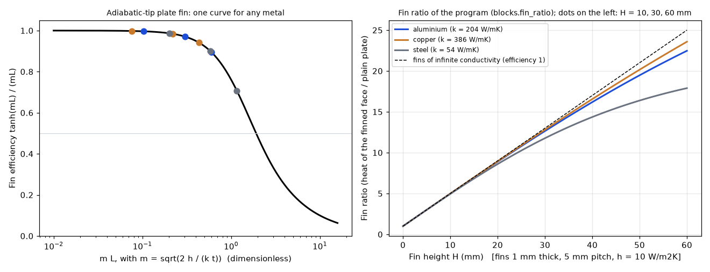
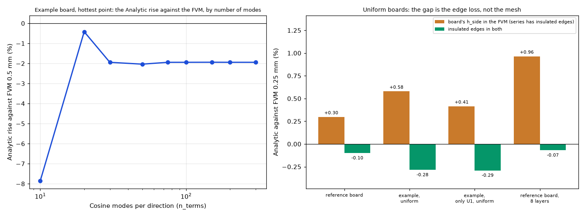
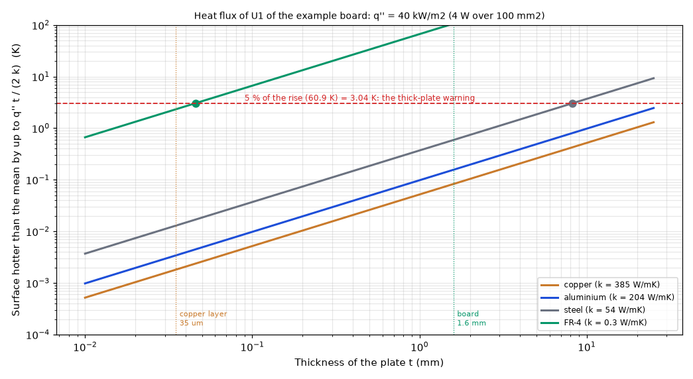

# Theory: what each model, equation and method is, with pictures and sources

## 1. The question

`docs/theory.md` states every equation the program solves, but as a dense text; the planned work lives in `docs/versions.md` "Planned" and `docs/research.md`; the evidence is spread over a dozen investigations. A reader needs one place that explains **what each method is, what its symbols mean, how the program does it, where it fails, where it is tested and what it is based on**, with a picture of the idea. This folder is that place: one file per topic in `topics/`, one bibliography for all of them, and the pictures drawn here or reached by a path into the investigation that made them. It changes nothing in the program and in the project documents.

## 2. How to read it

| Start with | If you want |
| :-- | :-- |
| the table in section 3 | the list of topics, what each is based on, the code and the document section behind it |
| `topics/NN-*.md` | one topic: picture, formulation, limits, tests, related topics, sources |
| `BIBLIOGRAPHY.md` | the citation of every source, its address, **whether it was read**, and which topics use it |

Every topic file has the same layout: the picture with an italic line saying what it shows; what it is; the formulation (symbols, equations); what it assumes and where it fails; how the program does it (modules and document sections); where it is tested (paths into `docs/validation.md` and the investigations); related topics; sources by key; and a closing line "What was read and what was not verified". Topics for planned work say **Status: planned** at the top, give the idea and the tests that would accept it, and make no claim of results.

## 3. The topics

Code and documents are those of `develop`; "inv." is the investigation that holds the evidence (paths from `research/`).

| # | Topic | Status | Picture | Code | `docs/` | Evidence |
| --: | :-- | :-- | :-- | :-- | :-- | :-- |
| 01 | [Layered idealisation](topics/01-layered-idealisation.md) | in program | fig. 1 | `model.py` | theory 1.2 | inv. `solid3d-verification`, `stackup` |
| 02 | [Finite volumes (FVM)](topics/02-finite-volume.md) | in program | fig. 2 | `fvm.py` | theory 2 | inv. `models-comparison` |
| 03 | [Finite differences (FDM)](topics/03-finite-difference.md) | in program | fig. 3 | `fdm.py` | theory 3 | inv. `models-comparison` |
| 04 | [3D solid](topics/04-solid-3d.md) | in program | fig. 4 | `solid3d.py` | theory 4 | inv. `solid3d-verification` |
| 05 | [Lumped rings (LPTN)](topics/05-lumped-rings.md) | in program | fig. 5 | `lumped.py` | theory 5 | inv. `models-comparison`, `outline` |
| 06 | [Analytic series](topics/06-analytic-series.md) | in program | fig. 6 | `analytic.py` | theory 6 | inv. `models-comparison`, `block-and-fins` |
| 07 | [Time stepping](topics/07-time-stepping.md) | in program | fig. 7 | `fvm.py` | theory 2 | `validation.md` 7 |
| 08 | [Heat transfer coefficients](topics/08-heat-transfer-coefficients.md) | in program | fig. 8 | `convection.py`, `api.py` | theory 8 | `validation.md` |
| 09 | [Parts and the junction](topics/09-parts-junction.md) | in program | fig. 9 | `analysis.py`, `api.py` | theory 9 | inv. `component-heatsink` |
| 10 | [Power profiles](topics/10-power-profiles.md) | in program | fig. 10 | `profiles.py` | theory 10 | `validation.md` 7 |
| 11 | [Metal blocks and fins](topics/11-metal-blocks-fins.md) | in program | fig. 11 | `blocks.py` | theory 7 | inv. `block-and-fins` |
| 12 | [Foster chain](topics/12-foster-chain-planned.md) | **planned** | fig. 12 | - | Planned, Component element | - |
| 13 | [Heatsink scenarios](topics/13-heatsink-scenarios-planned.md) | **planned** | fig. 13 | - | Planned, research R3 R6 | inv. `component-heatsink` |
| 14 | [Virtual JEDEC test, known-power reference](topics/14-virtual-jedec-and-known-power-planned.md) | partly planned | fig. 14 | `inverse.py` | calculators 2.1, 2.4 | inv. `power-calculator` |
| 15 | [Import and power list](topics/15-import-and-power-list-planned.md) | **planned** | fig. 15 | - | Planned, import | inv. `gerber-import` |
| 16 | [Multigrid](topics/16-multigrid-planned.md) | **planned** (optional) | fig. 16 | - | Planned, solvers | `models-comparison` solver study |
| 17 | [Copper to cells, the tensor](topics/17-copper-mapping-and-tensor.md) | researched | `gerber-models` figs 22, 23 | research `lib/conduction.py`, `diagonal.py` | Planned, import | inv. `gerber-models` |
| 18 | [Spreading resistance](topics/18-spreading-resistance.md) | verification | `solid3d-verification` fig. 6 | `solid3d.py` | validation 16 | inv. `solid3d-verification` |
| 19 | [Nets, current, Joule heat](topics/19-nets-current-and-joule-heat.md) | researched | `gerber-nets` figs 8, 6, 5 | research `lib/joule.py`, `pdn.py` | Planned idea 1 | inv. `gerber-nets` |
| 20 | [Board outline](topics/20-board-outline.md) | rectangle rule in program; reader researched | `outline` fig. 4, `gerber-import` fig. 16 | `model.py` | validation 13 | inv. `outline`, `gerber-import` |
| 21 | [Vias and fills](topics/21-vias-and-fills.md) | in program | `via-fill` fig. 4 | `model.py` | validation 18 | inv. `via-fill` |
| 22 | [Stack-up](topics/22-stack-up.md) | in program | `stackup` fig. 4 | `model.py`, `data/stackups.json` | validation 12, 14 | inv. `stackup` |
| 23 | [Power calculator](topics/23-power-calculator.md) | in program | `power-calculator` fig. 4 | `inverse.py` | calculators | inv. `power-calculator` |
| 24 | [Thermal interfaces and metals](topics/24-thermal-interfaces-and-metals.md) | in program | `component-heatsink` fig. 4 | `model.py` (`METALS`, `INTERFACES`) | research R2, models 15, 16 | inv. `component-heatsink` |
| 25 | [Contact area, air gap, chain of levels](topics/25-contact-area-gap-and-chain.md) | contact area in program; gap and chain researched | figs. 17, 18 | `blocks.py` | research R3, R5 | inv. `component-heatsink` |
| 26 | [Plate spreading on a component](topics/26-plate-spreading-on-a-component.md) | decided (K/W only) | fig. 19 | - | research R3, R8 | inv. `component-heatsink` |
| 27 | [Datasheet numbers and compact models](topics/27-datasheet-numbers-and-compact-models.md) | `theta` and top path in program; node not | `component-heatsink` figs. 6, 2 | `analysis.py` | research E3 to E8 | inv. `component-heatsink` |
| 28 | [Continuum problem and sources](topics/28-continuum-and-sources.md) | in program | figs. 20, 21 | `model.py`, `geometry.py` | theory 1.1, 1.3 | `validation.md` |
| 29 | [Verification ladder](topics/29-verification-ladder.md) | in program | fig. 22 | `tests/` | theory 11, validation | inv. `models-comparison`, `solid3d-verification` |
| 30 | [Board orientation](topics/30-board-orientation.md) | in program | fig. 23 | `convection.py` | models 18 | `tests/test_orientation.py` |
| 31 | [Program architecture and API](topics/31-program-architecture-and-api.md) | in program | fig. 24 | `api.py`, `cli.py`, `jobs.py` | models 7, 8 | `tests/` |
| 32 | [The removed program against the current one](topics/32-legacy-program-against-current.md) | history | fig. 25 | tag `legacy-wxpython-1.0.0` | validation 6 | inv. `models-comparison` |
| 33 | [Time-dependent results](topics/33-time-dependent-results.md) | in program | fig. 26 | `fvm.py`, `profiles.py` | validation 7 | `tests/test_fvm.py`, `test_profiles.py` |
| 34 | [Input checks](topics/34-input-checks.md) | in program | fig. 27 | `checks.py` | models 3 | `tests/` |
| 35 | [Curved boards](topics/35-curved-boards.md) | in program | fig. 28 | `geometry.py` | models 14 | `tests/test_templates.py` |
| 36 | [Prepreg and sheets in a gap](topics/36-prepreg-and-sheets-in-a-gap.md) | in program | fig. 29 | `model.py` (`combine_sheets`) | models 17 | inv. `stackup` |
| 37 | [Why the FVM and the Analytic model agree](topics/37-why-fvm-and-analytic-agree.md) | explanation | fig. 30 | - | validation 4 | inv. `models-comparison` |

### 3.1 Diagrams and illustrations

The 33 pictures of this folder are in `figures/`: 30 diagrams (figures 1 to 30, `scripts/make_diagrams.py`, shared shapes in `research/diagram_kit.py`) and three data figures (31 to 33, `scripts/make_figures.py`, section 3.1.1). The diagrams are embedded in topics 01 to 16, 25, 26 and 28 to 37. Topics 17 to 24 and 27 embed the pictures of the investigations that made them, by relative path, so a picture exists once and is not copied.

| File | Drawn in | Topic |
| :-- | :-- | :-- |
| `figures/fig_01_layered_idealisation.png` | this folder | 01 |
| `figures/fig_02_fvm_cell.png` | this folder | 02 |
| `figures/fig_03_fdm_nodes.png` | this folder | 03 |
| `figures/fig_04_solid3d_slabs.png` | this folder | 04 |
| `figures/fig_05_lumped_rings.png` | this folder | 05 |
| `figures/fig_06_analytic_modes.png` | this folder | 06 |
| `figures/fig_07_theta_method.png` | this folder | 07 |
| `figures/fig_08_heat_transfer.png` | this folder | 08 |
| `figures/fig_09_part_runaway.png` | this folder | 09 |
| `figures/fig_10_profile_decision.png` | this folder | 10 |
| `figures/fig_11_metal_block.png` | this folder | 11 |
| `figures/fig_12_foster_chain_planned.png` | this folder | 12 |
| `figures/fig_13_heatsink_scaling_planned.png` | this folder | 13 |
| `figures/fig_14_virtual_jedec_planned.png` | this folder | 14 |
| `figures/fig_15_import_to_power_planned.png` | this folder | 15 |
| `figures/fig_16_multigrid_planned.png` | this folder | 16 |
| `figures/fig_17_air_gap.png` | this folder | 25 |
| `figures/fig_18_level_chain.png` | this folder | 25 |
| `figures/fig_19_plate_spreading.png` | this folder | 26 |
| `figures/fig_20_continuum.png` | this folder | 28 |
| `figures/fig_21_coverage.png` | this folder | 28 |
| `figures/fig_22_verification_ladder.png` | this folder | 29 |
| `figures/fig_23_orientation.png` | this folder | 30 |
| `figures/fig_24_architecture.png` | this folder | 31 |
| `figures/fig_25_legacy_vs_current.png` | this folder | 32 |
| `figures/fig_26_time_results.png` | this folder | 33 |
| `figures/fig_27_input_checks.png` | this folder | 34 |
| `figures/fig_28_curved_boards.png` | this folder | 35 |
| `figures/fig_29_prepreg.png` | this folder | 36 |
| `figures/fig_30_why_fvm_analytic_agree.png` | this folder | 37 |
| `figures/fig_31_fin_efficiency_and_ratio.png` | this folder (data) | 11 |
| `figures/fig_32_analytic_modes_and_edges.png` | this folder (data) | 06, 37 |
| `figures/fig_33_thick_plate_correction.png` | this folder (data) | 34, 01 |

Curves that are only illustrative (the shape of a series, a fixed point with arbitrary numbers, a pulse train) say so in their italic line; no number of these pictures is a result. The numbers quoted in the topics come from the project documents and the READMEs of the investigations and are marked with the source.

### 3.1.1 Data figures

Three figures are computed, not drawn: every number in them comes from a closed form or from the program (`scripts/make_figures.py`, about 3 minutes; the printed tables are the source of the numbers in the captions). They do not change the program or the project documents.



*Figure 31 (`figures/fig_31_fin_efficiency_and_ratio.png`): left, the efficiency `tanh(mL) / (mL)` of a plate fin against `mL` (closed form; the dots are the fins of the right panel at `H` = 10, 30 and 60 mm, `h` = 10 W/m2K, 1 mm thick, 5 mm pitch: `mL` 0.10 to 1.16, efficiency 0.996 to 0.706); right, the fin ratio of the program (`pcbthermal.blocks.fin_ratio`) against the fin height for aluminium (204 W/mK), copper (386) and carbon steel (54) of the program's metal library, with the line of fins that conduct perfectly. At 60 mm the ratio is 22.5 (aluminium), 23.6 (copper) and 17.9 (steel) against 25.0 for perfect fins. Computed by `scripts/make_figures.py`.*



*Figure 32 (`figures/fig_32_analytic_modes_and_edges.png`): left, the rise of the hottest point of the example board in the Analytic model against the FVM at 0.5 mm cells (60.87 K) as the number of cosine modes grows: -7.85 % with 10 modes, -0.42 % with 20, then -1.94 % at 30 modes and from 75 to 300 (-2.04 % at 50); the curve is flat from 75 modes on, so the remaining -1.9 % is not truncation of the series; its cause on this board (vias, heatsink, partial copper) and why 20 modes is closer were not traced. Right, the four uniform scenarios of `docs/validation.md` 2: the Analytic against the FVM at 0.25 mm is +0.30 to +0.96 % with the board's `h_side` and -0.07 to -0.29 % with insulated edges in both (the study of topic 37). Computed by `scripts/make_figures.py`.*



*Figure 33 (`figures/fig_33_thick_plate_correction.png`): the through-thickness correction `q'' t / (2 k)` against the thickness of the plate for copper (385 W/mK), aluminium (204), carbon steel (54) and FR-4 (0.3 through the thickness), for the flux of U1 of the example board (4 W over 100 mm2, 40 kW/m2), with the limit of the thick-plate check, 5 % (`checks.THICK_PLATE_LIMIT`) of the 60.87 K rise: 3.04 K. The thickness at the limit is 58.6 mm for copper, 31 mm for aluminium, 8.2 mm for steel and 0.046 mm for FR-4; the 35 um copper layer is 3 orders of magnitude below the limit. The rise here is that of the hottest point of the board (FVM, 0.5 mm), a stand-in for the rise of the heater that the check uses. Computed by `scripts/make_figures.py`.*

### 3.2 Coverage of the project documents

Every section that explains a model, an equation or a method has a picture, in this folder or in an investigation. Result sections are covered by the data figures of the investigations. Nothing was left without a picture except what is listed under "No picture needed".

| Document, section | Topic (picture here) | Or the investigation's figures |
| :-- | :-- | :-- |
| theory 1.1, 1.2, 1.3 | 28, 01, 28 | |
| theory 2, 3, 4, 5, 6 | 02, 03, 04, 05, 06 | |
| theory 7, 8, 9, 10 | 11, 08, 09, 10 | |
| theory 11, 12 | 29, bibliography | |
| models 1 | 01, 28 | |
| models 2 (the five models) | 02 to 06 | `models-comparison` fig. 8 |
| models 3 input checks | 34 | |
| models 4 power profiles, 5 heat transfer, 6 parts | 10, 08, 09 and 27 | `component-heatsink` figs. 1, 5, 6 |
| models 7 API and command line, 8 the application, 11 the calculation process | 31 | screenshots of the application in `docs/images/` (project documents) |
| models 8 stack-up, 12 typical stack-ups, 17 prepreg | 22, 22, 36 | `stackup` figs. 1 to 5 |
| models 9 outline, 14 curved boards | 20, 35 | `outline` figs. 1 to 5 |
| models 10 power from a temperature | 23 | `power-calculator` figs. 4, 5 |
| models 13 where the heat goes, 15 block and fins, 16 paste and package body | 09, 25, 27; 11, 24; 24, 27 | `component-heatsink`, `block-and-fins` |
| models 18 orientation | 30 | |
| validation 1, 2 scenarios | 29 | `models-comparison` figs. 1, 2, 9 |
| validation 3 and 3.1 the 3D solid and the outer copper | 04, 18, 29 | `solid3d-verification` figs. 1 to 4, 8 |
| validation 4 FVM and Analytic agree | 37 | |
| validation 5 solvers | 02 | `models-comparison` fig. 3 |
| validation 6 the removed program | 32 | |
| validation 7 time | 33, 07 | |
| validation 8 computed `h`, 9 parts | 08, 09 | |
| validation 12 to 14 stack-up, outline, calculator, process, typical stack-ups | 22, 20, 23, 31 | `stackup`, `outline`, `power-calculator` |
| validation 15, 17 fins and the block in Lumped and Analytic | 11 | `block-and-fins` figs. 1 to 5 |
| validation 16 the 3D solid verified | 04, 18 | `solid3d-verification` figs. 1, 2, 6 |
| validation 18, 19 via fill, power from the top of the package | 21, 23 | `via-fill`, `power-calculator` |
| calculators 1 to 5 | 23, 14 | `power-calculator` figs. 1 to 5 |
| Planned chapter: planned items | 12 to 16, 19, 15 | `gerber-nets`, `gerber-models` |
| research R2 to R6, R8, E3 to E8 | 24 to 27, 13 | `component-heatsink` |

**No picture needed:** `validation` 10 (literature) and 11 (how to reproduce: commands), `docs/versions.md` "Planned" "Ideas from similar projects and tools" (a table of tools, no method of ours), `research` R7 (presentation notes) and the open questions for the maintainer, `calculators` 4 and 5 (commands and sources), the `models.md` and `theory.md` sections that are only lists of parameters.

## 4. Folder layout

| Path | What it is |
| :-- | :-- |
| `README.md` | this index |
| `BIBLIOGRAPHY.md` | every source: key, citation, address, reading status, topics that use it; the list of what to read next |
| `topics/` | the 37 topic files |
| `figures/` | `fig_01` to `fig_33`; 1 to 30 diagrams, 31 to 33 data figures |
| `scripts/make_diagrams.py` | draws the 30 diagrams (no data, no program) |
| `scripts/make_figures.py` | draws the three data figures 31 to 33 from closed forms and the program (about 3 minutes) |
| `scripts/check_mapping_formulas.py` | numerical check of the properties of the 2D effective-medium formulas |
| `scripts/check_correlations.py` | numerical checks of the correlations quoted by the compilation: 2D Hashin-Shtrikman and the Keller-Dykhne product, Bar-Cohen and Rohsenow, Elenbaas, Churchill-Chu against the worked example of the `ht` library, Hollands (with the correction found), the printed-board conductivities |
| `scripts/study_fvm_analytic_edges.py` | the review's test of the explanation of topic 37: the Analytic model against the FVM at 1, 0.5 and 0.25 mm on the uniform scenarios, with and without the edge coefficient (under a minute) |
| `docs/reference-compilation.md` | the maintainer's reference compilation, as received, with what this repository checked of it |
| `docs/for-the-project-documents.md` | corrections for `docs/theory.md`, `docs/validation.md` and `docs/models.md` found by the review of this folder |
| `docs/theory-figures.md` | where each topic goes in the project documents when it is adopted |
| `tests/test_theory.py` | the checks of this folder: every figure and link exists, every bibliography key used in a topic is defined, every topic has the sections |

```sh
.venv/bin/python research/theory/scripts/make_diagrams.py        # the diagrams
.venv/bin/python research/theory/scripts/make_figures.py         # the data figures
.venv/bin/python -m pytest -q research/theory/tests              # the checks
```

## 5. Still to write

* Every section of `docs/theory.md`, the sections of `docs/models.md` that explain a model (7 API, 18 orientation included) and the sections 6 and 7 of `docs/validation.md` now have a topic; the other result sections of `docs/validation.md` are covered by the figures of the investigations named in the table (models-comparison, solid3d-verification, block-and-fins, via-fill, stackup, outline, power-calculator). Every section of `docs/theory.md` has a topic (1.1 and 1.3 are topic 28, 11 is topic 29, 12 is the bibliography). The items of `docs/research.md` R2 to R8 and E3 to E8 are topics 24 to 27, R4 and the open questions about the heater as a source or a component are in topic 27; R7 (vertical information and presentation) and the open questions for the maintainer are design notes without physics and have no topic.
* The topics of the planned work (12 to 16) say what would be built; they become formulation and results when the work is done, and their text moves into `docs/theory.md` with the picture.

## 6. Adoption

A topic is adopted when the maintainer decides: its text is folded into `docs/theory.md` (or `docs/versions.md` "Planned" for planned work), its picture copied to `docs/images/`, its sources into the bibliography of the document that uses them. The folder stays as the record. Until then the project documents are not edited from a research branch (`CLAUDE.md`, "Research branches").

## What was read and what was not verified

* **Read in full**: `docs/theory.md` (all sections), the parts of `docs/models.md`, `docs/versions.md` "Planned", `docs/calculators.md` and `docs/validation.md` named in the topics, and the READMEs and literature notes of the investigations named in topics 17 to 23. The topic files restate them; they add structure, the pictures, the paths and the bibliography, not new results.
* **Not opened in this work**: every textbook and standard of `BIBLIOGRAPHY.md` marked M or N; the statements taken from them are marked "(memory)" or "(from the project documents)" there. Sources marked S were seen as search summaries, by the earlier work that cites them or by the later round of checks described at the top of the bibliography (web search worked, page fetch and downloads were blocked, only the package index was readable).
* **Read in this work**: the source of the Python `ht` package (version 1.2.0, MIT: the Hollands and Churchill-Chu functions and their worked examples), which showed that its documentation and its code differ in the Hollands formula. The maintainer's reference compilation (kept in `docs/reference-compilation.md`) is a second-hand source: what it read, it read; this repository only checked its numbers.
* **Checked numerically here**: the properties of the Bruggeman and Hashin-Shtrikman formulas (`scripts/check_mapping_formulas.py`), the correlations of `scripts/check_correlations.py`, the area loss of a polygon corner (topic 35, figure 28), the coverage sum against the polygon area (topic 28, figure 21), and the explanation of topic 37 (`scripts/study_fvm_analytic_edges.py`: it was wrong). Everything else in the topics is copied from the project documents and the READMEs of the investigations; the review of this folder compared those numbers with the current READMEs and `docs/` of `develop` (section 7).

## 7. Review

The folder was reviewed against `develop` at `3e90a7f` (the program, `docs/theory.md`, `docs/validation.md`, `docs/models.md`, `docs/calculators.md`) and against the current READMEs of the investigations it cites. What changed:

* **An explanation tested and found wrong** (topic 37, `docs/validation.md` 4): the 0.3 to 1.0 % between the Analytic and the FVM on the uniform scenarios is not the FVM mesh error (0.03 to 0.08 points from 1 to 0.25 mm) but the edge loss (`h_side` 10 W/m2K) that the cosine series leaves out; with insulated edges in both the gap is -0.04 to -0.29 % (`scripts/study_fvm_analytic_edges.py`, the same digits on this branch and on `develop`). Topics 06 and 37 and figure 30 corrected.
* **Stale against the corrected program**: the 3D size limit (2 million -> 250 000 unknowns, topic 04), the block coefficients (one `h_face + h_extra` for face and sides -> `h_exp = h_face r_fin + h_extra` on the face, `h_wall` on the side walls; topics 04, 11), the top path (a fixed-point loop -> the root of one scalar equation per part, regula falsi or Broyden; topic 09), the laminate nodes of a one-layer board (topics 01, 05, 06), the merged Lumped rings (topic 05), the outline edge on grid lines (topic 02), `Board.natural_form` (topic 08: "nothing is changed in the program"), the inner copper option and the dielectric findings (topic 22), the design term of the calculator (topic 23).
* **Stale or contradicted numbers**: FDM "jumps of +-0.5 C" and "within about 1 %" (topics 03, 32, figure 25: -2.4 % at 1 mm), solvers "1e-8 K" (2e-8), "20 scenarios" (19), "3 to 30 times faster" (6 to 15), node vs offset "about 3 K" (1.3 to 3.4 K), bare mould "about 3 K" (0.4 to 0.8 K against the same node), forced-air heatsink 65.7 / 64.5 / 63.6 C (64.1 / 63.3 / 62.8), heatsink base table (half-cell defect of the study; topic 26 and figure 19), block summary 2.0 / 4.8 % (1.9 / 4.7), no-via JEDEC board 67.4 K/W (68.1), default paste "0.6 to 1 K" (0.1 to 0.6 K), fin and block-thickness temperatures (0.5 K high), the Analytic within "2 C" in time (2.2 C), other fabricators' splits "0.1 to 1.7 C" (0.1 to 1.5 C).
* **Wrong cross-references**: `roadmap 1.11` and `docs/roadmap.md` section 2 (that document had no numbered sections; its content is now the chapter "Planned" of `docs/versions.md`), `models-comparison` fig. 4 and fig. 5 (the schematic is fig. 8, "where models fail" fig. 9), `solid3d-verification` fig_05 for the heat spreading (fig_08).
* **Re-derived and confirmed**: the Lumped factors `f_R` and `f_P` from the disc solution (topic 05), the top-path closure and its root equation (topic 09), the fixed point of the power coefficient and the stable/runaway pictures of figure 9, the theta-method factor and the explicit-Euler limit of figure 7, the series and parallel conductivities of the 1998 article and the correlations (`scripts/check_correlations.py`, same digits), the laminate construction of `laminate.py` (topic 01).
* **Figures** (all 30 read with the image reader): redrawn 1 (`S = k t` -> the sheet conductance of the model), 2 (arrows off the cell faces, `k` for `k_th`), 4 (no pad slab although the caption said so; the heater floating), 6 (the mode equation `a(g + k lambda_mn) = q_mn` was not the equation of the model), 11 (2.0 %), 12 and 16 (the roadmap, 1e-8), 18 (resistors drawn like capacitors, theta_SA not joined to the air), 19 (stale table), 21 ("the cell at the lower right": the dotted cell is in the middle), 22 (1e-8, 20 scenarios), 23 ("half of face up" only up to Ra 1e7), 25 ("within about 1 %"), 26 (2 C), 27 (the block of item 7 sat on copper while the item says "no copper under it"; checks missing from the list), 30 (overlapping text, a duplicate arrow, the wrong explanation). The figure audit's redraws of 1, 4, 5, 8, 14, 15, 18, 22, 23, 24 and 27 were checked; 4, 18, 22, 23 and 27 needed the further corrections above.
* **Bibliography**: [EC1998Spreading] said the edge and corner cases were not compared (they are: +0.6 / -0.8 / -4.6 %); [Lee1995] quoted the old +4.5 %; section 14 listed Culham and Yovanovich (1998), Lush (2004) and Milton as not opened while their entries say they were; the sources opened by later reviews were added ([Muzychka2003] worked cases in full, the datasheets of [Datasheets], the via pages of [ViaGuides], the new [IsolaPrepreg]); no status was raised without a record of the reading.
* **Not verified**: the numbers of the Gerber investigations in topics 15, 17, 19 and 20 (their folders have their own reviews); the residual -0.1 to -0.3 % of the Analytic with insulated edges; the multigrid timings (quoted from `docs/versions.md` "Planned", printed by no script).
* **Not verified**: the planned topics (12 to 16) describe intended behaviour; the formulas of topic 12 and 16 are general textbook knowledge written without a source; the pictures are explanations, not tests.
