# Theory: the problem, the models and how we know they are right

This folder explains the physics behind PCB Thermal Lab, one topic per file (picture, formulation, limits, tests, sources). It adds no results of its own and changes nothing in the program. The equations are in [`docs/theory.md`](../../docs/theory.md); this page is the overview.

## 1. The problem

A printed circuit board is a stack of thin copper planes in a poor conductor (the laminate), with parts that dissipate power on its faces, vias that join the planes, and air that takes the heat away by convection and radiation from both faces and the edges. The question is where the temperature ends up: the map over the board, the hottest points and the junction temperature of each part, in steady state and in time (power profiles).

It is hard for three reasons. The copper planes are thin, so they spread heat sideways, but the laminate between them conducts little, so the planes are coupled mostly through the vias. The heat of a small part meets a large, thin spreader, so the temperature changes quickly under the part and slowly far away. And boards have any outline, copper pattern and stack-up, so there is no single formula.

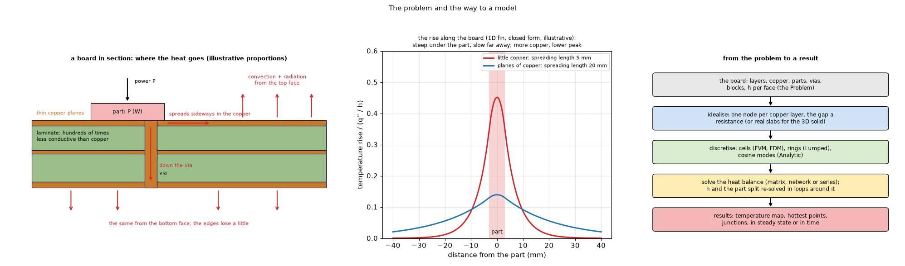

*Figure 45 (`figures/fig_45_problem_to_model.png`): left, a section of a board with a part, three copper planes, a via and the paths of the heat to the air; right, the chain from the board to the temperature map. Schematic.*

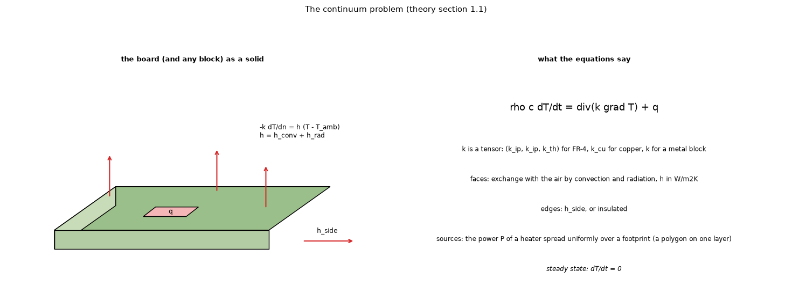

*Figure 20 (`figures/fig_20_continuum.png`): the equation the program solves: conduction in the board and in any metal block, exchange with the air on every face, a part as a power over a footprint. Theory section 1.1.*

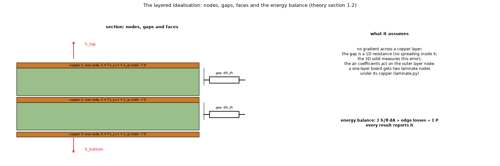

*Figure 1 (`figures/fig_01_layered_idealisation.png`): the idealisation of four of the five models: one temperature per copper layer and plan position, the gap between layers a one-dimensional resistance. Theory section 1.2.*

## 2. What we implemented

The same board goes into five models, so that each checks the others. The **finite volume model (FVM)** is the reference; the others are compared with it and with the independent 3D solid.

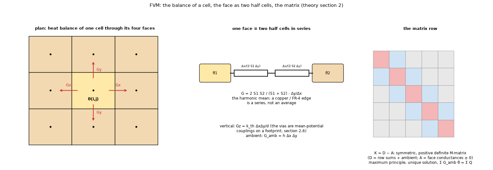

*Figure 2 (`figures/fig_02_fvm_cell.png`): the FVM balances the heat of each cell through its faces; the matrix is symmetric and has a unique solution. Theory section 2.*

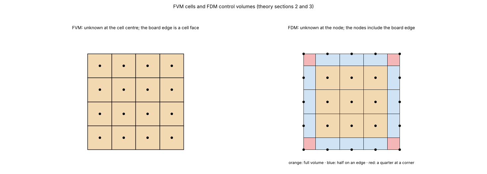

*Figure 3 (`figures/fig_03_fdm_nodes.png`): the **finite differences model (FDM)**, a comparison model of the same physics, puts the unknowns on nodes (the board edge is a node) instead of cell centres. Theory section 3.*

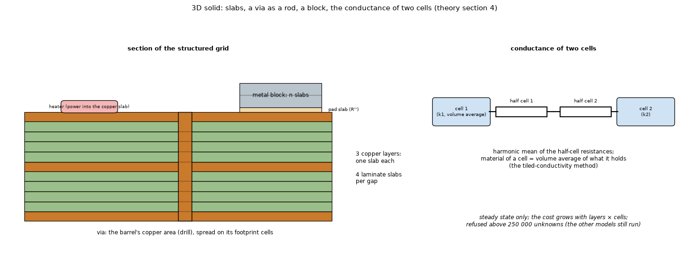

*Figure 4 (`figures/fig_04_solid3d_slabs.png`): the **3D solid** has real slabs for every copper layer and gap and no idealisation; steady state only, limited in size. It checks the layered models. Theory section 4.*

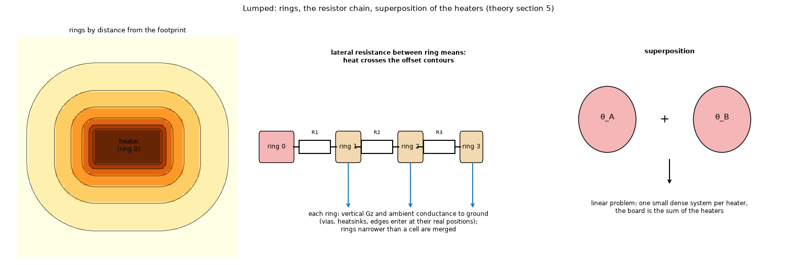

*Figure 5 (`figures/fig_05_lumped_rings.png`): the **Lumped thermal network** (LPTN) cuts the board into rings by distance from each part, joins them by resistors and adds the heaters by superposition; very fast. Theory section 5.*

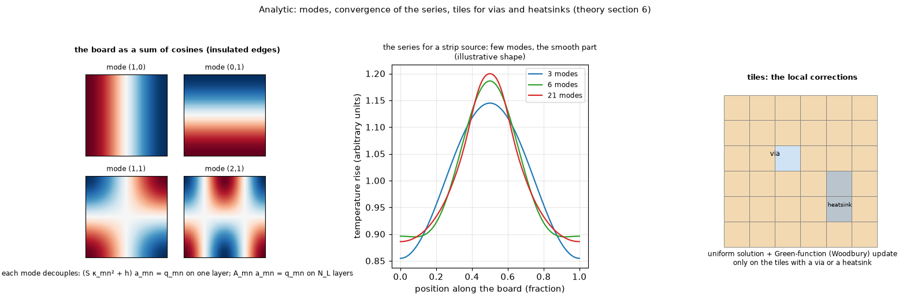

*Figure 6 (`figures/fig_06_analytic_modes.png`): the **Analytic model** writes the temperature of each layer as a cosine series and corrects locally for vias and heatsinks; exact on a uniform board. Theory section 6.*

Around the models are the pieces they share:

* **Metal blocks and fins** (heatsinks with thickness, plate fins) are extra node layers (theory section 7).

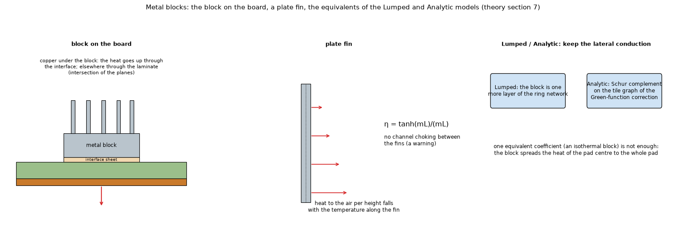

*Figure 11 (`figures/fig_11_metal_block.png`): a block on the board, a plate fin, and how the Lumped and Analytic models keep the lateral conduction of the block.*

* **Heat transfer coefficients** are computed per face, convection plus radiation, in a loop around any model (section 8).

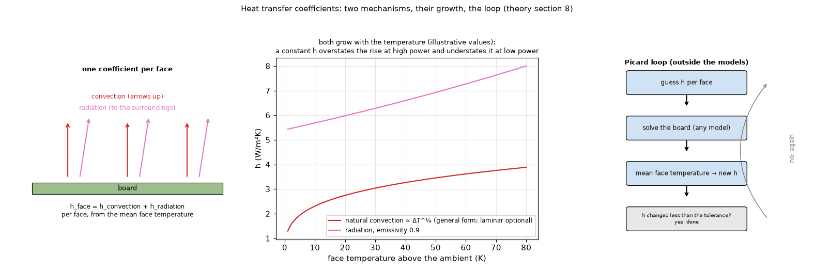

*Figure 8 (`figures/fig_08_heat_transfer.png`): convection and radiation both grow with the temperature, so a constant h is wrong at high and at low power; the loop re-solves until h settles (illustrative values).*

* **Parts and the junction temperature**: a part has a junction-to-pad resistance and, on a component, a top path to the air; the split of the power between the two paths is a root, not a loop (section 9).

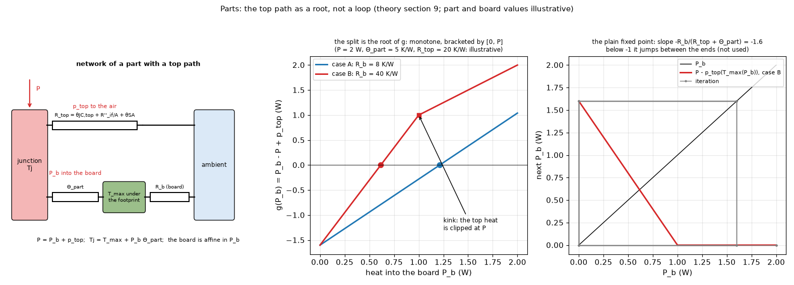

*Figure 42 (`figures/fig_42_top_path_split.png`): the network of a part with a top path and the root of its split (illustrative values).*

* **Power profiles in time**: square waves and CSV tables; each heater is averaged or resolved in time according to the size of its oscillation (section 10).

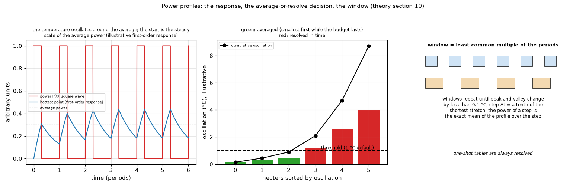

*Figure 10 (`figures/fig_10_profile_decision.png`): the temperature oscillates around the response to the average power; heaters with a small oscillation are averaged, the others resolved (illustrative).*

* **Input checks and warnings** report what a model cannot do well, before and after the run (section 11, topic 34).

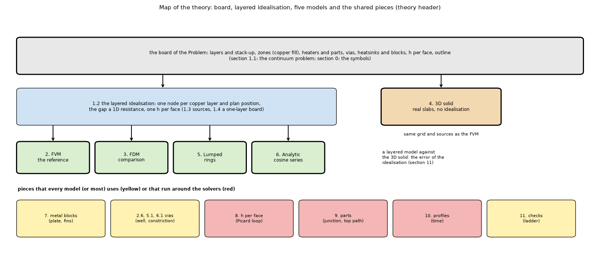

*Figure 38 (`figures/fig_38_document_map.png`): the board, the layered idealisation, the five models and the pieces they share. Schematic.*

## 3. How we know it is right

Every model is checked against something more independent than itself: energy balance and closed forms on every board, the direct, CG and SOR solvers against each other, published solutions (Yovanovich, Seri Lee, Culham and Yovanovich, Muzychka), an independent 3D solver written for the tests, and the five models against each other on 19 scenarios (`docs/validation.md`). **No model has been compared with measurements of a physical board yet.**

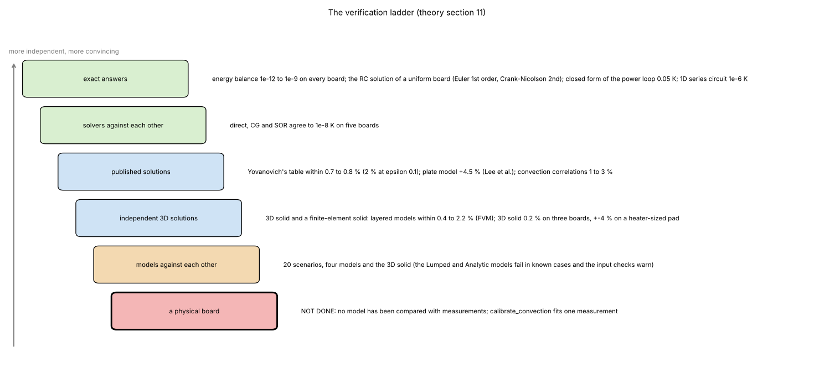

*Figure 22 (`figures/fig_22_verification_ladder.png`): the ladder, from exact answers to a physical board (not done). Theory section 11.*

The models have limits, and the program says so: the Lumped and Analytic models are rectangles with a coarse treatment of vias and of partly absent copper, the 3D solid is steady state and size-limited, one node through a thick layer hides a gradient. Where a limit is known, an input check or a warning after the run quotes it.

## 4. The topics of this folder

Each topic file has the same order: picture, what it is, formulation, assumptions and limits, how the program does it, where it is tested, related topics, sources, and a closing line on what was read. Planned topics say **Status: planned** and claim no results. Sources are cited by key; [`BIBLIOGRAPHY.md`](BIBLIOGRAPHY.md) gives the address and the reading status of each (R read, S summary, M memory, N not obtained). The figure inventory, with where each picture goes in the project documents, is [`docs/theory-figures.md`](docs/theory-figures.md). Code is the module in `pcbthermal/`; the research folder holds the evidence.

| # | Topic | Status | Code | Research folder |
| --: | :-- | :-- | :-- | :-- |
| 01 | [Layered idealisation](topics/01-layered-idealisation.md) | in program | `model.py`, `laminate.py` | [stackup](../stackup/README.md), [solid3d-verification](../solid3d-verification/README.md), [effective-conductivity](../effective-conductivity/README.md) |
| 02 | [Finite volumes (FVM)](topics/02-finite-volume.md) | in program | `fvm.py` | [models-comparison](../models-comparison/README.md) |
| 03 | [Finite differences (FDM)](topics/03-finite-difference.md) | in program | `fdm.py` | [models-comparison](../models-comparison/README.md) |
| 04 | [3D solid](topics/04-solid-3d.md) | in program | `solid3d.py` | [solid3d-verification](../solid3d-verification/README.md) |
| 05 | [Lumped rings (LPTN)](topics/05-lumped-rings.md) | in program | `lumped.py` | [models-comparison](../models-comparison/README.md), [outline](../outline/README.md) |
| 06 | [Analytic series](topics/06-analytic-series.md) | in program | `analytic.py` | [models-comparison](../models-comparison/README.md), [block-and-fins](../block-and-fins/README.md) |
| 07 | [Time stepping](topics/07-time-stepping.md) | in program | `fvm.py` | - |
| 08 | [Heat transfer coefficients](topics/08-heat-transfer-coefficients.md) | in program | `convection.py`, `api.py` | [effective-conductivity](../effective-conductivity/README.md) |
| 09 | [Parts and the junction](topics/09-parts-junction.md) | in program | `analysis.py`, `api.py` | [component-heatsink](../component-heatsink/README.md) |
| 10 | [Power profiles](topics/10-power-profiles.md) | in program | `profiles.py` | - |
| 11 | [Metal blocks and fins](topics/11-metal-blocks-fins.md) | in program | `blocks.py` | [block-and-fins](../block-and-fins/README.md), [fin-channel](../fin-channel/README.md) |
| 12 | [Foster chain](topics/12-foster-chain-planned.md) | **planned** | - | - |
| 13 | [Heatsink scenarios](topics/13-heatsink-scenarios-planned.md) | **planned** | - | [component-heatsink](../component-heatsink/README.md) |
| 14 | [Virtual JEDEC test, known-power reference](topics/14-virtual-jedec-and-known-power-planned.md) | partly planned | `inverse.py` | [power-calculator](../power-calculator/README.md) |
| 15 | [Import and power list](topics/15-import-and-power-list-planned.md) | **planned** | - | [gerber-import](../gerber-import/README.md) |
| 16 | [Multigrid](topics/16-multigrid-planned.md) | **planned** (optional) | - | [models-comparison](../models-comparison/README.md) |
| 17 | [Copper to cells, the tensor](topics/17-copper-mapping-and-tensor.md) | researched | - | [gerber-models](../gerber-models/README.md) |
| 18 | [Spreading resistance](topics/18-spreading-resistance.md) | verification | `solid3d.py` | [solid3d-verification](../solid3d-verification/README.md) |
| 19 | [Nets, current, Joule heat](topics/19-nets-current-and-joule-heat.md) | researched | - | [gerber-nets](../gerber-nets/README.md) |
| 20 | [Board outline](topics/20-board-outline.md) | in program; Gerber reader researched | `model.py`, `geometry.py` | [outline](../outline/README.md), [gerber-import](../gerber-import/README.md) |
| 21 | [Vias and fills](topics/21-vias-and-fills.md) | in program | `model.py` | [via-fill](../via-fill/README.md) |
| 22 | [Stack-up](topics/22-stack-up.md) | in program | `model.py`, `data/stackups.json` | [stackup](../stackup/README.md) |
| 23 | [Power calculator](topics/23-power-calculator.md) | in program | `inverse.py` | [power-calculator](../power-calculator/README.md) |
| 24 | [Thermal interfaces and metals](topics/24-thermal-interfaces-and-metals.md) | in program | `model.py` | [component-heatsink](../component-heatsink/README.md) |
| 25 | [Contact area, air gap, chain of levels](topics/25-contact-area-gap-and-chain.md) | contact area in program; gap and chain researched | `blocks.py` | [component-heatsink](../component-heatsink/README.md) |
| 26 | [Plate spreading on a component](topics/26-plate-spreading-on-a-component.md) | decided (K/W only) | - | [component-heatsink](../component-heatsink/README.md) |
| 27 | [Datasheet numbers and compact models](topics/27-datasheet-numbers-and-compact-models.md) | `theta` and top path in program; junction node not | `analysis.py` | [component-heatsink](../component-heatsink/README.md) |
| 28 | [Continuum problem and sources](topics/28-continuum-and-sources.md) | in program | `model.py`, `geometry.py` | [rotated-square-3d](../rotated-square-3d/README.md) |
| 29 | [Verification ladder](topics/29-verification-ladder.md) | in program | `tests/` | [models-comparison](../models-comparison/README.md), [solid3d-verification](../solid3d-verification/README.md) |
| 30 | [Board orientation](topics/30-board-orientation.md) | in program | `convection.py` | [horizontal-plate-h](../horizontal-plate-h/README.md) |
| 31 | [Program architecture and API](topics/31-program-architecture-and-api.md) | in program | `api.py`, `cli.py`, `jobs.py` | - |
| 32 | [The removed program against the current one](topics/32-legacy-program-against-current.md) | history | tag `legacy-wxpython-1.0.0` | [models-comparison](../models-comparison/README.md) |
| 33 | [Time-dependent results](topics/33-time-dependent-results.md) | in program | `fvm.py`, `profiles.py` | - |
| 34 | [Input checks](topics/34-input-checks.md) | in program | `checks.py` | [effective-conductivity](../effective-conductivity/README.md) |
| 35 | [Curved boards](topics/35-curved-boards.md) | in program | `geometry.py` | - |
| 36 | [Prepreg and sheets in a gap](topics/36-prepreg-and-sheets-in-a-gap.md) | in program | `model.py` | [stackup](../stackup/README.md) |
| 37 | [Why the FVM and the Analytic model agree](topics/37-why-fvm-and-analytic-agree.md) | explanation | - | [models-comparison](../models-comparison/README.md) |

## 5. The studies that shaped the program

One row per question that changed the program or confirmed it; the full list is [`../README.md`](../README.md) and the review register [`../REVIEW.md`](../REVIEW.md). Versions are those of `CHANGELOG.md` (2.4.5 is in `develop`, not released).

| Question | What it found | What changed in the program | Folder |
| :-- | :-- | :-- | :-- |
| Do the layered models match an independent 3D solution? | FVM within 0.4 to 2.4 % of the 3D solid; the 3D solid reproduces Yovanovich's table to 0.7 to 0.8 % | the 3D solid as the check, with a size limit (250 000 unknowns) | [solid3d-verification](../solid3d-verification/README.md) |
| Where does one node through the thickness stop being valid? | published plate and laminate cases reproduced; the error is at most `q'' t / (2 k)` | thick-plate warning, laminar natural-convection form, independent 3D solver in the tests | [effective-conductivity](../effective-conductivity/README.md) |
| Do the five models agree, and where not? | 19 scenarios; the Lumped and Analytic models fail in known cases | the table of `docs/validation.md`, input warnings | [models-comparison](../models-comparison/README.md) |
| How is a part with a heatsink on the package modelled? | the top path matters on a component; the fixed-point loop failed on small pads | `theta` and top path on a component, the split as a root | [component-heatsink](../component-heatsink/README.md) |
| What do a metal block and fins do? | fin formula validated; the block as one more layer works in the Lumped and Analytic models | the block in all five models; side walls without the fin ratio | [block-and-fins](../block-and-fins/README.md) |
| How much does the air gap between close fins matter? | the channel effect is real for fins up; not all originals were obtained | a warning after the run (2.4.4); the correction is not implemented | [fin-channel](../fin-channel/README.md), [fin-channel-sources](../fin-channel-sources/README.md) |
| Which natural-convection level for a vertical or a horizontal face? | the program's forms sit within the spread of the sources read | closed, no change (the choice is the maintainer's) | [plate-h-level](../plate-h-level/README.md), [horizontal-plate-h](../horizontal-plate-h/README.md) |
| Which rectangle stands for a board with an outline? | the rectangle of equal area is within 0.2 to 3 % away from the edge | equal-area rectangle for the Lumped and Analytic models; the outline edge on grid lines | [outline](../outline/README.md) |
| How does a part across the outline heat the cut cells? | the full-cell power was up to 4 K too hot on a T | part weights normalised to the board cover (2.4.5) | [rotated-square-3d](../rotated-square-3d/README.md) |
| Which stack-ups are typical? | fabricators' builds; 0.5 oz inner copper default, 1 oz option | stack-up templates and the inner-copper option | [stackup](../stackup/README.md) |
| What fills a via, and does the via converge with the cell? | copper fill matters, a resin plug does not; the point via drifted below 0.5 mm | via fills; the point via as mean-potential couplings (2.4.5); via warnings | [via-fill](../via-fill/README.md), [point-via-convergence](../point-via-convergence/README.md) |
| Why do the Lumped and Analytic models overstate vias? | the constriction at the barrel was missing (35 to 60 %) | the Krogh well and the self-terms (2.4.5) | [lumped-analytic-vias](../lumped-analytic-vias/README.md), [lumped-via-groups](../lumped-via-groups/README.md) |
| Why was the SOR slow, and wrong with vias? | the relaxation factor was the optimum of fixed edges; the via blocks were not seen | Young's omega estimate and a block SOR (2.4.5) | [young-omega-tiles](../young-omega-tiles/README.md), [sor-with-via-couplings](../sor-with-via-couplings/README.md) |
| How does a gap or a spot without copper behave? | two laminate nodes were 5 to 14 % cool on patterned copper | laminate nodes cut where copper is absent in the FVM and FDM (2.4.5); Lumped and Analytic only warn | [gap-subdivision](../gap-subdivision/README.md), [bare-spot-under-source](../bare-spot-under-source/README.md), [laminate-nodes](../laminate-nodes/README.md), [analytic-partial-copper](../analytic-partial-copper/README.md) |
| How are the zones of a layer combined in a cell? | the larger share lost the copper of the other zone | the union of the points of the zones (2.4.3) | [zone-union](../zone-union/README.md) |
| What power does a measured temperature mean? | the band of numbers alone missed drawing errors | the Power Calculator and its design-uncertainty band | [power-calculator](../power-calculator/README.md) |
| Can the copper come from Gerber files? | an independent reader, the mapping to cells and the nets work on real boards | nothing yet: prepared for 2.5.0 (import, with the memory guard) | [gerber-import](../gerber-import/README.md), [gerber-models](../gerber-models/README.md), [gerber-nets](../gerber-nets/README.md) |
| Vias near an edge, boards with 100 or more vias? | the edge image is missing; fill-in and memory of the matrix grow | warnings only; the rest is for the memory guard (2.5.0, prepared) | [via-real-board](../via-real-board/README.md) |

## Adoption

A topic is adopted when the maintainer decides: its text goes into `docs/theory.md` (or `docs/versions.md` "Planned" for planned work), its picture into `docs/images/`, its sources into the bibliography of that document. Corrections for the project documents found here are in [`docs/for-the-project-documents.md`](docs/for-the-project-documents.md).

## What was read and what was not verified

* **Read in full**: `docs/theory.md`, the sections of `docs/models.md`, `docs/versions.md` "Planned", `docs/calculators.md` and `docs/validation.md` named in the topics, and the READMEs of the investigations they cite. The topics restate them; the numbers in a topic come from those documents and are marked with their source.
* **Sources**: the reading status of each is in `BIBLIOGRAPHY.md`; statements from sources marked M or N are marked "(memory)" there. The Python `ht` package (1.2.0) was read: its documentation and its code differ in the Hollands formula. The maintainer's compilation (`docs/reference-compilation.md`) is second-hand; only its numbers were checked.
* **Checked numerically here**: the Bruggeman and Hashin-Shtrikman properties (`scripts/check_mapping_formulas.py`), the correlations (`scripts/check_correlations.py`), the area loss of a polygon corner (topic 35), the coverage sum against the polygon area (topic 28) and the explanation of topic 37 (`scripts/study_fvm_analytic_edges.py`: the first explanation was wrong).
* **Not verified**: the residual -0.1 to -0.3 % of the Analytic with insulated edges; the multigrid timings (quoted from `docs/versions.md`, printed by no script); the formulas of the planned topics 12 and 16 (textbook knowledge, no source opened).

## Review

* **Status**: topics reviewed against `develop` `3e90a7f` and the READMEs of the investigations they cite; the figures were read one by one. Status in [`../REVIEW.md`](../REVIEW.md).
* **Independent checks**: the Lumped factors `f_R` and `f_P` re-derived from the disc solution (topic 05); the top-path closure and its root (topic 09); the fixed point of the power coefficient (figure 9); the theta-method factor and the explicit-Euler limit (figure 7); the laminate construction (topic 01); the explanation of topic 37 (the 0.3 to 1.0 % between the Analytic and the FVM is the edge loss the cosine series leaves out, not mesh error).
* **Limits**: the numbers of the Gerber topics (15, 17, 19, 20) are those of their folders, reviewed there; the pictures explain, they are not tests.
* **Program defects**: none open. The one found here (`Heater.top_resistance()` with `theta` against `junction_theta()` in `analysis.part_split`) is closed: since 2.4.3 the top path exists only on a component (`Heater.has_top_path()`), where the two are the same value (`tests/test_top_path_role.py`).
