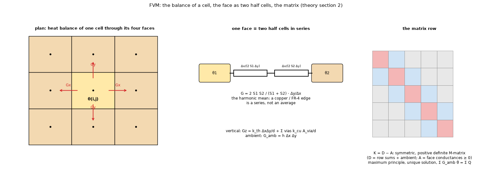

# 02. Finite volumes: the reference model (FVM)

*Figure 2 (`figures/fig_02_fvm_cell.png`): left, the heat balance of one cell through its four faces; middle, one face as two half cells in series, which gives the harmonic mean of the two sheet conductances; right, the row of the matrix that the cell produces (a symmetric M-matrix).*

## 1. What it is

The reference model of the program. The plan of the board is cut into rectangular cells; the unknown is the mean temperature rise `theta_{l,i,j}` of the copper layer `l` in the cell `(i, j)` of size `dx * dy`, stored at the cell centre. The heat equation (topic 01, equation (1)) is integrated over each cell and the heat through its faces is balanced, so the discrete energy balance is **exact in every cell**, not only in total.

## 2. Face conductances (all in W/K)

* **Lateral**, between two neighbouring cells: the heat crosses the two half cells in series,
  `R = dx / (2 S1 dy) + dx / (2 S2 dy)`, hence

      G_x = (2 S1 S2 / (S1 + S2)) dy / dx            G_y = (2 S1 S2 / (S1 + S2)) dx / dy

  the **harmonic mean** of the two sheet conductances (a copper / FR-4 edge is a series, not an average). It is zero when both are zero.
* **Vertical**, between layers `l` and `l + 1` in a cell: `G_z = k_th dx dy / d + sum over the vias in the cell of k_cu A_via / d`. A via belongs to the cell that contains its centre (it is a point feature: 0.5 % from the 3D rods on the example board at 0.5 mm, `docs/validation.md` 3; but it does not converge with the cell: on a via-array board the gain of a copper fill is -4.78, -4.38, -3.98 and -3.34 K at 1, 0.5, 0.25 and 0.0625 mm against -4.45 K of an independent solver with resolved barrels, `research/via-fill/README.md` 7.3).
* **Ambient**: `G_amb = h dx dy` on the outer layers (`h_top` or `h_bottom`), plus `h_extra dx dy c_hs` under a plain heatsink, plus `h_side` times the edge length times the slab on edge cells. On a board with an outline the edge length of a cell is the length of the outline inside it (`geometry.edge_length_on_board`): the outline is sampled at a tenth of a cell, every sample is moved a thousandth of a cell towards the board (a side on a grid line belongs to the cell on the board) and a sliver that falls in a cell off the board goes to the nearest board cell, so the lengths add up to the perimeter (`research/outline/README.md` 4.6; before this, sides on grid lines lost their edge loss). When a metal block covers a face the board coefficient is multiplied by `1 - c` (topic 11).

## 3. The system

`K theta = Q`, with `K = D - A`. `A` is the symmetric matrix of non-negative face conductances and `D` is its row sums plus the ambient conductances. `K` is symmetric, weakly diagonally dominant (strictly where there is an ambient path) and irreducible: a symmetric positive definite **M-matrix**. Consequences: the solution exists and is unique, and the **maximum principle** holds (`theta >= 0`: no temperature below the ambient). The sum of the rows of `K` is the ambient conductance, hence `sum G_amb theta = sum Q`, the energy balance.

The source of a heater is `Q_i = P c_i / sum c` with `c_i` the sub-sampled coverage of the footprint in cell `i` (8 x 8 samples per cell for heaters, 4 x 4 for zones, heatsinks and blocks), so the **power is exact** whatever the grid; a footprint smaller than a sample sends all the power to the centroid's cell.

## 4. Solvers

| Solver | What it does | Note |
| :-- | :-- | :-- |
| direct | sparse LU (SuperLU) with the symmetric minimum-degree ordering | half the fill and about 40 % less time than the default ordering; relative residual about 1e-13 |
| conjugate gradients | Jacobi (diagonal) preconditioner, tolerance 1e-12 | |
| red-black SOR | `theta_new = (sum G_m theta_m + Q) / D`, `theta <- theta + omega (theta_new - theta)`, `omega = 2 / (1 + sin(pi / n_max))` | stopped on the **residual** (1e-9). The step-change stopping rule of the removed program can stop 2.7 to 16 K from the solution (`docs/validation.md` section 5) |

## 5. Accuracy

Second order in the cell size for smooth fields, first order at features (a via, a copper edge, a thin heater). The example board converges monotonically (within 0.25 % of the 0.25 mm value from 1 mm, `docs/validation.md` 2.1). The layered idealisation of topic 01 is the model error (0.4 to 2.2 % against the 3D solid). Direct, CG and SOR agree to 2e-8 K on five boards (1.7e-8 K on the 8-layer board, `docs/validation.md` 5; `docs/theory.md` 11 says 1e-8).

## 6. How the program does it

`pcbthermal/fvm.py` (`Network`, `solve_steady`, `solve_sor`, `transient_from_network`, `step_responses_from_network`), `docs/theory.md` section 2. The transient part is topic 07.

## 7. Where it is tested

`docs/validation.md` sections 2 (scenarios), 5 (solvers), `research/models-comparison/` (figure 2 grid convergence, figure 3 solver equivalence), `research/solid3d-verification/`.

## 8. Related topics

01 (the model), 03 (the node-centred comparison), 07 (time), 16 (a faster solver for very large boards), 17 (what goes into `S` per cell).

## 9. Sources

* Finite-volume discretisation, harmonic means at interfaces: [Patankar1980]. A balance on every cell conserves energy locally and globally: [EymardGallouetHerbin], [SpringerFVHeat], [Khouider].
* Direct sparse solver: [SciPySuperLU].
* The rest is own computation: [L-validation].

*What was read and what was not verified:* the formulas come from `docs/theory.md` section 2 (read in full); [Patankar1980] was not opened here.
