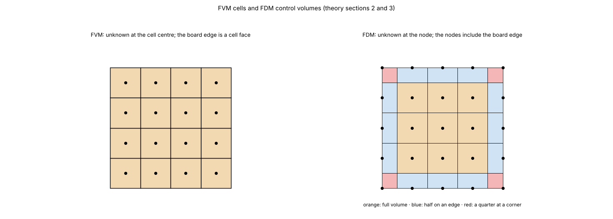

# 03. Finite differences: the node-centred comparison (FDM)

*Figure 3 (`figures/fig_03_fdm_nodes.png`): the same board with the two layouts of the unknowns. FVM: the unknown is at the cell centre and the board edge is a cell face. FDM: the unknown is at the node, the nodes include the board edge, and each node owns a control volume that is full inside, half on an edge and a quarter at a corner.*

## 1. What it is

A correct node-centred finite-difference model of the **same layered physics** as the FVM (topic 01). It exists as a comparison model (key `fdm`): the removed wxPython program was also called FDM and had modelling errors, so a correct FDM shows that those errors were modelling and not the choice of method. It does steady state, the power-step animation, step responses and power profiles.

## 2. Formulation

* **Unknown**: the temperature at the nodes of a grid that includes the board edges, `(nx + 1) x (ny + 1)` per layer. Each node owns a control volume `dxc x dyc`, with `dxc = dx` inside and `dx / 2` at the edge nodes (a quarter at a corner). A convective edge is thus the standard half-cell balance (equivalent to a ghost node, second order). Written as the balance of a control volume the scheme is conservative too; what differs from the FVM is **where the data live**.
* **Sheet conductance at the nodes**: either the coverage of the control volume around the node (`sampling = "area"`, the default: the four surrounding cell coverages weighted by the shared area) or the classic point test (`"point"`: left and bottom edge in, right and top edge out).
* **Between two nodes**: the mean of the two nodal values, arithmetic `(S1 + S2) / 2` (default) or harmonic, times `width_of_face / d`.
* **Vertical**: `G_z = k_th A_c / d` with `A_c` the control area, plus the via at the **nearest node** (spreading it over neighbours was tried and removed the constriction: temperatures 2 % too low).
* **Sources**: the unit weights of a heater are the coverage of the footprint shared among the four nodes of each cell (area) or one for each node inside (point), normalised to 1: the power is exact.

The transient machinery of the FVM is reused unchanged (`fvm.transient_from_network`), because the FDM network exposes the same `K, C, Q`.

## 3. How it compares

On boards without vias the FDM and FVM agree to about 0.1 %. With a via array the FDM is 2 to 3 % low at 1 mm (a point feature on the nearest node), closing with the grid. The FDM jumps by about +-0.5 C with the grid while the FVM converges monotonically; both stay within about 1 % of each other. Over the whole step response of the example board the FDM is within 0.7 C of the FVM.

## 4. How the program does it

`pcbthermal/fdm.py` (`Network` with the attributes of `fvm.Network`), API `models=("fdm",)`, command line `--model fdm|compare`, `docs/theory.md` section 3.

## 5. Where it is tested

`docs/validation.md` section 2, `research/models-comparison/` (figures 1 and 2), `docs/models.md` ("FDM or FVM").

## 6. Related topics

02 (the reference), 07 (time).

## 7. Sources

* The idea of a control volume at a node and the half-cell balance at an edge: [Patankar1980]. The distinction "finite volume balances on cells, finite differences work on point values": [EymardGallouetHerbin]. A comparison of FD and FV on 1D steady conduction exists ([FDvsFVSpringer]) and was **not read** (login).
* The numbers (0.1 %, 2 to 3 %, 0.7 C) are own computation: [L-validation].

*What was read and what was not verified:* the formulation is from `docs/theory.md` section 3 (read in full).
