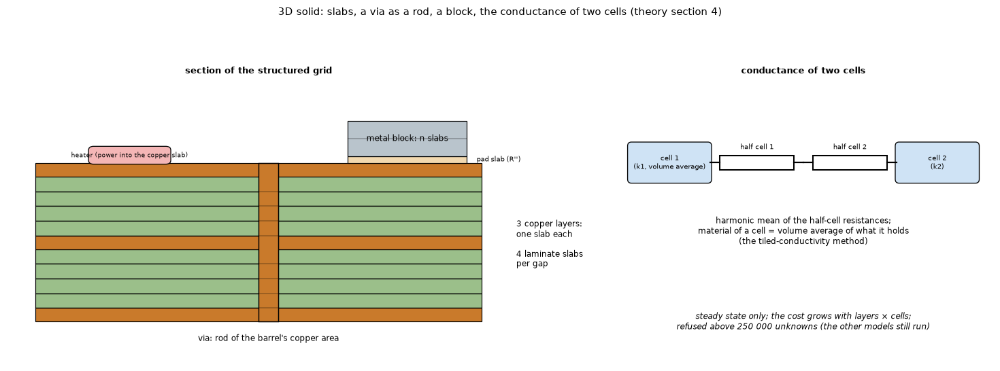

# 04. The 3D solid: finite volumes with real slabs (the check of the layered models)

*Figure 4 (`figures/fig_04_solid3d_slabs.png`): left, a section of the structured grid: one slab for each copper layer, four slabs for each laminate gap, a via as a rod of the barrel's copper area, a pad slab and metal slabs for a block; right, the conductance of two neighbouring cells as the harmonic mean of the half-cell resistances. The note on the size limit (250 000 unknowns, `solid3d.MAX_CELLS`) was added.*

## 1. What it is

A steady-state model that drops the "one node per copper layer" idea (topic 01). The plan grid is the FVM's (same cells); across the thickness the stack is cut into **real slabs** from the top face down. It measures **the error of the layered idealisation on your board** and is the independent check of the other four models. Key `solid3d`, steady state only, refused above 250 000 unknowns (`solid3d.MAX_CELLS`, counted by `solid3d.unknowns` before anything is built; the limit was 2 million, which let a run go on for hours); the other models of the run still run.

## 2. Slabs

* a copper slab of thickness `t_cu,l` for each layer;
* `n_diel = 4` equal slabs of `d / 4` in each dielectric gap; a one-layer board has no gap, and its laminate (the slab of the layered models minus the copper) is cut into four FR-4 slabs under the copper (before a review found it, the one-layer board was its copper alone: `research/solid3d-verification/README.md` 4.4);
* for a block under (or over) the board: a **pad slab** (the interface, thickness `R'' * 1 W/mK`, conductivity 1 W/mK so that its resistance per area is exactly `R''`) followed by `n` metal slabs (`n = round(thickness / 1 mm)`, 1 to 6).

## 3. Cell materials (volume averages)

The "tiled conductivity" method of PCB thermal models:

* copper slab with fill `f`: in-plane `k_x = f k_cu + (1 - f) k_ip`; through `k_z = f_eff k_cu + (1 - f_eff) k_th` with `f_eff = min(1, f + a_via)`;
* dielectric slab: `k_x = k_ip`, `k_z = a_via k_cu + (1 - a_via) k_th`;
* `a_via = sum A_via / (dx dy)` over the vias whose centre is in the cell: the **real copper area of the barrel**, in parallel in every slab;
* block slabs: `k = k_metal c` (`c` the block coverage of the cell), pad slab `k = 1 c`; cells with no material get `k = 1e-9 W/mK` and a leak of `1e-9 W/K` to the ambient to keep the matrix regular.

## 4. Conductances (each pair of neighbouring cells, harmonic mean of the half-cell resistances)

    lateral:   G = min(dz1, dz2) dy  2 k1 k2 / ((k1 + k2) dx)         (x; the same for y with dx <-> dy)
    vertical:  G = dx dy / (dz1 / (2 k_z1) + dz2 / (2 k_z2))
    face:      G = A / (1/h + dz / (2 k_z))                           (the film in series with the half cell)
    edge:      G = 1 / (1 / (h_side D dz) + (D_n / 2) / (k_x D dz))

A block hides the board face under it (factor `1 - c`), loses heat on its exposed face with `h_exp = h_face r_fin + h_extra` (the fin ratio of topic 11) and on the side walls of every block slab with `G = h_wall dz L_edge`, `h_wall = h_face + h_extra` (no fin ratio: the fins stand on the face; `L_edge` the block outline inside the cell). The heater power goes to the copper slab of its layer with the weights of topic 02.

## 5. Convergence and limits

Four slabs per gap are within 1 % of eight even on a heater-sized pad (the hardest case, where the finite-volume and finite-element solids bracket the limit by about +-4 %). **Limits**: the barrel is a lumped area (the lateral effect of the thin wall is neglected), copper is one slab thick, a block contact is perfect over the pad, the cost grows quickly with layers and cells (the direct solve of 160 000 unknowns takes about 12 s; on a square 4-layer board of 16 slabs the memory is 2.2 GB at 160 000 unknowns and 4.4 GB at 254 000, `docs/theory.md` 4 and `research/solid3d-verification/` `study_solve_cost.py`), steady state only.

## 6. How the program does it

`pcbthermal/solid3d.py`, `docs/theory.md` section 4, `docs/models.md` section 2.7.

## 7. Where it is verified

* Against an exact solution: Yovanovich's spreading resistance of an isoflux circular source (0.7 to 0.8 % at epsilon 0.2 and 0.3; 2 % at 0.1), a grid-convergence study (observed order 1.68, GCI of the fine mesh 1.14 %), and a third solver (axisymmetric finite volumes) that brackets the table from the other side: `research/solid3d-verification/README.md` 4.1 and 4.3, figures 1, 2 and 6. See topic 18.
* Against the layered models and an independent finite-element solid: the same README 4.2.
* A one-layer board against an independent 3D finite-volume solver with patterned copper (`research/effective-conductivity/` 4.11): 0.0 % with full copper (0.8 to 3.2 mm) and +0.2 % with a 20 mm pad, where the 3D solid before the correction was +40 %; `research/solid3d-verification/README.md` 4.4 for the five models.

## 8. Related topics

01, 18 (spreading resistance), 11 (block slabs), 21 (via as a rod).

## 9. Sources

* The tiled conductivity map of a PCB: [EC2010Tiled], [Blackmore2010].
* Exact solution used for the check: [Yovanovich2003] (Table 3). Grid convergence index: [Roache] with the summaries [Roache].
* The decision to write the solid with SciPy instead of adding scikit-fem as a dependency, and scikit-fem as the offline cross-check, are in `CLAUDE.md`, Decisions Log. Own computation: [L-solid3d].

*What was read and what was not verified:* the formulas are from `docs/theory.md` section 4 (read in full). The finite-element script needs scikit-fem, which is not a dependency.
