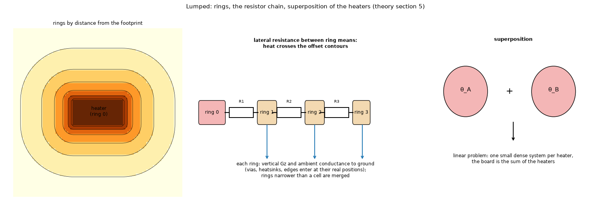

# 05. Lumped: a thermal network of rings (LPTN)

*Figure 5 (`figures/fig_05_lumped_rings.png`): left, the rings of a rectangular footprint (the distance of every cell to the footprint, computed with a distance transform, cut at geometric edges; ring 0 is the footprint); middle, the chain of lateral resistances between the ring means with the vertical and ambient conductances of each ring; right, the superposition of the fields of two heaters. The note that rings narrower than a cell are merged (`RING_MIN_WIDTH`) was added.*

## 1. What it is

`lumped.py` reduces the FVM network, **per heater**, to a few unknowns per layer, using the fact that the temperature field of a heater depends mostly on its **distance from the footprint**. The result is a handful of thermal resistances and capacities that a person can read, solved exactly, and the board is the sum of the heaters.

## 2. The rings

The distance `delta(x, y)` of every cell to the footprint is computed (Euclidean distance transform, 0 inside). Ring 0 is the footprint; rings `k = 1..R` hold the cells with `delta` in `(E_{k-1}, E_k]`, with geometric edges

    E_k = rho_1 (rho_max / rho_1)^((k-1)/(R-1))     rho_1 = min(max(1.5 min(dx,dy), 0.04 rho_max), 0.5 rho_max)     rho_max = max delta

(rings with no cell are dropped). Any footprint shape and the real board outline are followed; there is no circular approximation. For layer `l` and ring `k` the real cells are aggregated: the mean sheet conductance `S_{l,k}`, the sums of the ambient conductance by path, of `G_z` (dielectric and vias) and of the capacity `C`, the ring **thickness** `Delta_k` (distance span) and its **contour length** `L_k = N_k dx dy / Delta_k`.

## 3. The resistances

Between the area-mean temperatures of consecutive rings (the heat crosses the offset contours):

    R_{k,k+1} = Delta_k / (2 S_k L_k) + Delta_{k+1} / (2 S_{k+1} L_{k+1})                 (k >= 1)

**Inside the footprint** the resistance from its mean temperature to its boundary comes from the logarithmic potential of a uniformly heated region on a sheet: `theta = -(Q / (2 pi S)) phi + const` with `phi_i` the mean of `ln |r_i - r_j|` over the footprint cells `j` (the self term of a square cell is `ln(0.447 sqrt(dx dy))`; at most 900 cells, evenly decimated). Then

    R_{0,1} = f_R (phi_boundary - phi_mean) / (2 pi S_0) + Delta_1 / (2 S_1 L_1)

which is `1 / (8 pi S)` for a disc. When the layer also loses heat vertically under the footprint (loss conductance `g_eff` per area, fin length `lambda = sqrt(S / g_eff)` not much larger than the footprint radius `a`), the disc solution `theta(r) = q / g_eff + A I0(r / lambda)` gives the correction factors (`x = a / lambda`, `I0, I1` modified Bessel functions)

    f_R = 4 (I0 - 2 I1 / x) / (x I1)          f_P = 4 (2 / x^2 - 1 / (x I1))        (both -> 1 as x -> 0)

`g_eff` is taken from the solution itself (heat leaving the footprint of the layer towards its neighbours and the ambient, divided by its rise and the footprint area) and the network is re-solved, three passes.

**Vertical and ambient**: `G_z` between layers and the ambient conductances of every ring are added exactly as in the FVM, so vias, heatsinks and edges enter by their real positions.

## 4. Solution and superposition

Each heater gives a small dense system `K_h theta = Q_h` (`L R` unknowns, `Q` at ring 0 of the heater's layer), solved exactly. The problem is linear, so the field of heater `h` at a cell is its ring profile interpolated at the distance `delta_h` of the cell (constant beyond the ends), and the board field is the **sum over the heaters**: the mutual heating is the other heater's radial profile read at the distance of the footprint.

**Peak** inside a footprint: `theta_peak = theta_ring0 + Q_lat f_P (phi_mean - phi_min) / (2 pi S_0)` (`Q_lat` the lateral outflow of ring 0, `phi_min` the hottest point), plus the rises of the other heaters at its centroid.

**Transient**: `C d theta / dt + K_h theta = Q` per heater network with the ring capacities, solved with the same theta method (topic 07); the profile and animation tools superpose the heaters.

## 5. Where it fails

* When a copper edge crosses the footprint: the network assumes the ring-mean `S` describes the heat flow (27 % low).
* At board corners (-8.7 %) and for thin heaters (+9.5 %).
* One-sided copper pads without vias: up to +107 % (`docs/validation.md` 3.1).

The input checks (`checks.py`) warn before the run. On a board with an outline the model runs on the rectangle of the same area (topic 20). With a metal block it adds one layer of unknowns per ring (topic 11).

## 6. How the program does it

`pcbthermal/lumped.py`, `docs/theory.md` section 5.

## 7. Where it is tested

`docs/validation.md` sections 2, 3, 13; `research/models-comparison/` (figure 5, "where models fail"), `research/outline/` (the rectangle of the same area), `research/block-and-fins/` (the block as a ring layer).

## 8. Related topics

01, 06 (the other reduced model), 11, 20.

## 9. Sources

* Bessel-function disc solution and the logarithmic potential of a heated region: [CarslawJaeger] (disc sources, I0 and I1).
* Constriction and spreading resistance of a small source (the same physics seen as a resistance): [Lee1995], [EC1998Spreading], topic 18.
* The ring construction, the corrections and the error table are the project's own work (the program was tuned against the FVM, and the 3D solid is the independent check): [L-validation].

*What was read and what was not verified:* the formulas are from `docs/theory.md` section 5 (read in full); no published ring-network method is recorded in the repository.
