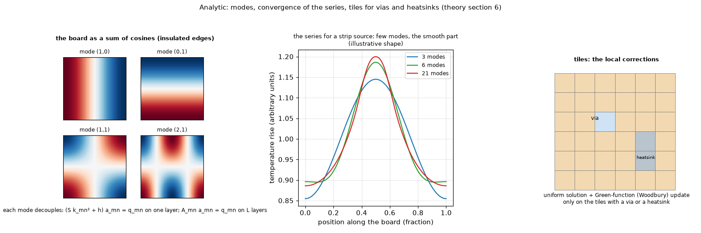

# 06. Analytic: a multilayer Fourier series with local corrections

*Figure 6 (`figures/fig_06_analytic_modes.png`): left, four of the cosine modes of a board with insulated edges; middle, the partial sums of the series for a strip source (the shape only: the curves are illustrative); right, the tiles on which the Green-function correction acts: only the tiles with a via or a heatsink.*

*Figure 32 (`figures/fig_32_analytic_modes_and_edges.png`): left, the rise of the hottest point of the example board in the Analytic model against the FVM at 0.5 mm cells (60.87 K) as the number of cosine modes grows: -7.85 % with 10 modes, -0.42 % with 20, then -1.94 % at 30 modes and from 75 to 300 (-2.04 % at 50); the curve is flat from 75 modes on, so the remaining -1.9 % is not truncation of the series; its cause on this board (vias, heatsink, partial copper) and why 20 modes is closer were not traced. Right, the four uniform scenarios of `docs/validation.md` 2: the Analytic against the FVM at 0.25 mm is +0.30 to +0.96 % with the board's `h_side` and -0.07 to -0.29 % with insulated edges in both (the study of topic 37). Computed by `scripts/make_figures.py`.*

## 1. What it is

On a **uniform** board with insulated edges the multilayer fin equation (topic 01, equation (1)) is solved exactly by cosines. The model adds, on top of that exact solution, an influence-weighted copper fill and a Green-function (Woodbury) correction for vias and heatsinks, which are local. It is fast (milliseconds), exact for what it assumes, and honest about where it fails.

## 2. The series

Expand each layer as `theta_l(x, y) = sum over m, n >= 0 of a_{l,mn} cos(m pi x / W) cos(n pi y / H)`. The Laplacian becomes `-k_mn^2`, `k_mn^2 = (m pi / W)^2 + (n pi / H)^2`, and the layers decouple by mode into a tridiagonal `L x L` system

    A_mn a_mn = q_mn            A_mn = diag(S_l k_mn^2 + h_l) + g Lambda                (2)

where `Lambda` is the graph Laplacian of the layer chain (`Lambda_ll` = number of neighbours, `Lambda_{l,l+-1} = -1`) and `h_l` the surface coefficient of the layer (zero for inner layers; on a one-layer board `h_bottom` is in series with the laminate, `1/(1/h_bottom + t_lam/k_th)`, topic 01). The **mode (0,0)** is the uniform-board limit `P / (h_tot W H)`: it integrates each layer exactly, so the heat out of the faces is read from it.

**Source**: the heater is replaced by the axis-aligned rectangle `[x1, x2] x [y1, y2]` with the same area and centroid; its cosine coefficients are

    q_mn = P eps_m eps_n I_x(m) I_y(n) / (W H area)         eps_0 = 1, eps_{m>0} = 2
    I_x(0) = x2 - x1,   I_x(m) = (sin(k x2) - sin(k x1)) / k,   k = m pi / W

(300 modes per direction by default). The field is `theta_l = cos_y a_l^T cos_x^T` at the cell centres, two matrix products.

## 3. Copper that is not uniform

Each layer gets an **effective copper fill** averaged with the influence of the heaters, `f_eff,l = sum w f_l / sum w`, with `w(x, y) = sum_i P_i K0(r_i / lambda_l)` (`K0` the modified Bessel function of the second kind: the Green function of the fin equation), and the layer's own fin length `lambda_l = sqrt(S_l / (h_surface + n_neighbours g))` for a layer that carries a heater (about 5 mm; the 34 mm of the whole stack would let distant copper count too much). A warning is raised when the fill varies strongly (weighted spread above 0.25).

## 4. Vias and heatsinks: the local correction

The board is cut into tiles of size `min(max(lambda / 4, 2.5 mm), 5 mm)`. A tile with a via has the conductance `c_via = k_cu A_via / d` between adjacent layers; a tile under a heatsink has `g_hs = h_extra dx dy c` to the ambient. With `y0` the tile-averaged temperatures of the uniform solution and `G` the modal response of the uniform board between tiles (first 64 modes), the tile temperatures `y` and the heat `f = -C y` that the local elements extract or move satisfy

    (I + G C) y = y0,        f = -C y,        a_mn <- a_mn + A_mn^(-1) (projection of f)

the exact solution for the tile-lumped model (a dense system of `N_tiles L` unknowns, small). A **metal block** adds a Schur complement to `C` (topic 11).

## 5. Time

Each mode obeys `C a' + A_mn a = q(t)`, `C = diag(c_l)`. With `C^(-1/2) A_mn C^(-1/2) = V Lambda V^T` and `b = V^T C^(1/2) a` the modes decouple, `b' = -Lambda b + g`, and a constant power over a step has the **exact propagator** `b+ = exp(-lambda dt) b + (1 - exp(-lambda dt)) g / lambda`. The transient cannot use the local corrections, so vias and heatsinks are smeared over the board and their conductance is scaled per heater by bisection until the steady maximum equals that of the locally corrected model (a single global factor cooled the distant heater by 18 %).

## 6. Where it fails

Copper that is not uniform near a heater (24 % low with a 20 mm pad, 25 % when an edge crosses the footprint), edge convection (the edges are assumed insulated), a one-sided copper pad (down to -63 %). The edges matter even on the default board: on the four uniform scenarios of `docs/validation.md` 2 the Analytic is +0.3 to +1.0 % above the FVM at 1 mm, and this is **not** the mesh error of the FVM (refining to 0.25 mm moves the gap by 0.03 to 0.08 points) but the edge loss (`h_side` 10 W/m2K) that the series leaves out: with insulated edges in the FVM too the gap is -0.04 to -0.29 % (measured in the review of this folder, `scripts/study_fvm_analytic_edges.py`; the -0.1 to -0.3 % left with insulated edges was not traced). The input checks warn. On an outline the model runs on the rectangle of the same area (topic 20).

## 7. How the program does it

`pcbthermal/analytic.py`, `docs/theory.md` section 6.

## 8. Where it is tested

`docs/validation.md` sections 2, 3, 7, 13, 17; `research/models-comparison/`; `research/block-and-fins/` (the block as a Schur complement, 1.1 % mean error); `research/outline/`.

## 9. Related topics

01, 05, 11, 20.

## 10. Sources

* Fourier-series solutions and the Green function of the fin equation (K0): [CarslawJaeger].
* A Fourier-series solution for the insulating layers combined with a lateral finite-volume discretisation of the metal layers, 1.8 to 2.5 % against COMSOL and 4 to 5 % against measurements: [PMC11410250] (text read). Multilayer Fourier models against finite elements, 1 to 4 %: [FourierMultilayerJCU] (a search summary).
* Static condensation and Kron reduction behind the block's Schur complement: [MFEMStaticCond], [Kron2022].
* Error tables: [L-validation], [L-block].

*What was read and what was not verified:* the formulas are from `docs/theory.md` section 6 (read in full).
