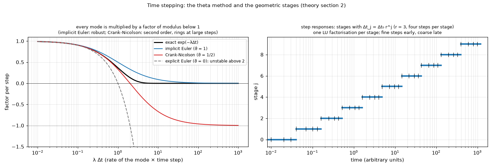

# 07. Time stepping: the theta method and the geometric stages

*Figure 7 (`figures/fig_07_theta_method.png`): left, the factor by which one step multiplies a mode of rate `lambda`, against `lambda dt`, for the exact solution, implicit Euler, Crank-Nicolson and explicit Euler; right, the stages used for the step responses: the step grows geometrically (ratio 3) with four steps per stage, so one factorisation serves each stage. Textbook formulas, no program data.*

## 1. What it is

The transient models (FVM, FDM, Lumped, Analytic) advance `C d theta / dt + K theta = Q(t)` in time. The FVM scheme is shared by the FDM and by the Lumped networks.

## 2. The theta method

    (C / dt + vartheta K) theta^(n+1) = (C / dt - (1 - vartheta) K) theta^n + Q^(n+1/2)

with `vartheta = 1` (implicit Euler: first order, robust) or `vartheta = 1/2` (Crank-Nicolson: second order). An eigenmode of rate `lambda` is multiplied per step by

    (1 - (1 - vartheta) lambda dt) / (1 + vartheta lambda dt)

of modulus below 1 for every `lambda dt` when `vartheta >= 1/2`: both schemes are **unconditionally stable** for diffusion. Explicit Euler (`vartheta = 0`) is not (stable only below `lambda dt = 2`). Crank-Nicolson's factor tends to -1 for stiff modes (it rings when the step is large against a fast mode); implicit Euler damps them.

## 3. Geometric stages

One LU factorisation is needed for each distinct `dt`, so the steps are built in stages.

* **Animation**: ten stages with `dt_j = dt_0 2^j`, `dt_0 = t_end / (m (2^10 - 1))`, `m` steps per stage.
* **Step responses**: `dt_j = dt_0 r^j`, `r = 3`, four steps per stage, 18 stages, `dt_0 = t_end (r - 1) / (4 (r^18 - 1))`, `t_end = 10 tau`, `tau = sum C / sum G_amb` (the uniform-board time constant; the hottest point reaches 63 % much sooner). `sum G_amb` leaves out the 1 W/K that pins the cells off a board with an outline (`fvm.board_time_constant`): counted, it made a round board 0.02 s instead of 107 s and the step responses stopped at 12 % of the steady resistance (`research/outline/README.md` 4.4).

The **step response** `Z_i(t)` is the rise of the hottest point of heater `i` per watt; `R_th,i = Z_i(infinity)`. Topic 10 builds the power profiles from it.

## 4. The Analytic model

Does not step: each mode has the exact propagator (topic 06).

## 5. How the program does it

`pcbthermal/fvm.py` (`transient_from_network`, `step_responses_from_network`), shared by `fdm.py` and `lumped.py`; `docs/theory.md` section 2 ("Transient").

## 6. Where it is tested

`docs/validation.md` section 7: an exact RC solution of a uniform board (Euler first order, Crank-Nicolson second order); the FDM within 0.7 C of the FVM over the whole step response.

## 7. Related topics

02, 06, 10.

## 8. Sources

* The theta method and unconditional stability for diffusion: [Patankar1980] (named in `docs/theory.md` section 12 for it).
* The amplification factor is a one-line derivation of the formula above (own).
* Validation: [L-validation].

*What was read and what was not verified:* the formulas are from `docs/theory.md` section 2 (read in full); the curves are computed from them in `scripts/make_diagrams.py`.
