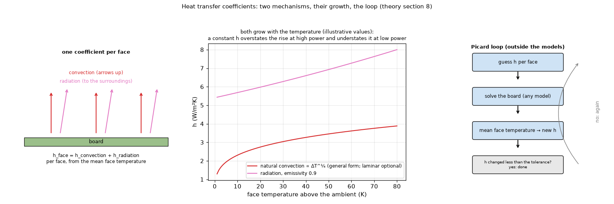

# 08. Heat transfer coefficients: convection and radiation

*Figure 8 (`figures/fig_08_heat_transfer.png`): left, a board face that loses heat by convection and by radiation, `h = h_c + h_r`; middle, how both grow with the temperature of the face (illustrative values: a constant `h` overestimates the rise at high power and underestimates it at low power); right, the fixed-point loop that finds them, outside the models.*

## 1. What it is

In **computed** mode each outer face gets `h = h_c + h_r` from the mean temperature of that face, instead of a typed number. Because `h` depends on the temperature, the program iterates: solve, take the mean temperature of each face, recompute `h`, until both change by less than 0.01 W/m2K (three or four solves). Measured on the example board: a constant `h` overestimates the rise by 10 % at 22 W and underestimates it at low power (`docs/roadmap.md` section 2).

## 2. The correlations (`convection.py`, air at the film temperature `(T_s + T_a) / 2`)

* **Air** (dry, 1 atm, Sutherland-type fits, 250 to 450 K): `mu = 1.458e-6 T^(3/2) / (T + 110.4)`, `k = 2.648e-3 T^(3/2) / (T + 245.4 10^(-12/T))`, `rho = p / (R T)`, `nu = mu / rho`, `alpha = k / (rho c_p)`, `Pr = mu c_p / k`, `beta = 1 / T`.
* **Rayleigh number**: `Ra = g beta |dT| L^3 / (nu alpha)`, with `L = area / perimeter` for a horizontal plate and the height for a vertical one.
* **Natural convection, horizontal plate**: hot face up `Nu = 0.54 Ra^(1/4)` (`Ra <= 1e7`), `0.15 Ra^(1/3)` above; hot face down `Nu = 0.27 Ra^(1/4)` (the roles swap for a face colder than the air). **Vertical plate** (Churchill and Chu): `Nu = (0.825 + 0.387 Ra^(1/6) / [1 + (0.492 / Pr)^(9/16)]^(8/27))^2`. `h_n = Nu k / L`.
* **Forced convection**, flat plate along the flow: `Nu = 0.664 Re^(1/2) Pr^(1/3)` (`Re < 5e5`), `(0.037 Re^(4/5) - 871) Pr^(1/3)` above, `Re = u L / nu`, `h_f = Nu k / L`.
* **Mixed** (Churchill's rule): `h_c = C_cal (h_n^3 + h_f^3)^(1/3)`, with `C_cal` the calibration multiplier of the convection.
* **Radiation** to surroundings at the air temperature, linearised: `h_r = eps sigma (T_s^2 + T_a^2)(T_s + T_a)` (absolute temperatures, view factor 1; emissivity 0.9 by default, per face).

`calibrate_convection` finds `C_cal` by bisection on `ln C_cal` so that the model reproduces one measured temperature. The orientation is horizontal (layer 1 faces up), top-down or vertical; tilted boards and the facing-down option were dropped for simplicity.

## 2b. The laminar form of the vertical plate

Churchill and Chu also give a form for the laminar range (Rayleigh up to about 1e9), `Nu = 0.68 + 0.670 Ra^(1/4) / [1 + (0.492/Pr)^(9/16)]^(4/9)`, said to be slightly more accurate there; the program uses the all-range form above. Compared at Pr 0.71 (`scripts/check_correlations.py`) the laminar form is +6.6 % at Ra 1e5, -5.2 % at 1e7 and -25 % at 1e9 (the all-range form includes the turbulent rise), so for a vertical board with Rayleigh numbers of 1e5 to 1e6 the choice moves `h_n` by a few percent. Nothing is changed in the program; the all-range form reproduces the worked example of the textbook to the digit (Nu 147.16 at Pr 0.69, Gr 2.63e9).

## 3. Limits

Correlations of isothermal plates (20 to 30 % on a board with hot spots), the edge coefficient is typed, there are no enclosure view factors, the time simulation and the animation keep the steady-state coefficients. No model has been compared with a physical board yet.

## 4. How the program does it

`pcbthermal/convection.py` (properties, correlations, `board_h`), the Picard loop in `pcbthermal/api.py` (`_solve_computed_h`), `docs/theory.md` section 8.

## 5. Where it is tested

Textbook air properties and closed forms, 1 to 3 % (`tests/`); `docs/validation.md`; the orientation study in `docs/models.md` section 18; the effect on the example board in `docs/roadmap.md` section 2.

## 6. Related topics

09 (a part's top path uses the same `h`), 13 (heatsink natural convection scales like `dT^(1/4)`), 14 (the known-power reference also corrects `h`).

## 7. Sources

* Correlations, properties and radiation: [IncroperaDeWitt].
* Vertical plate: [ChurchillChu1975] (citation and the form of the expression, with 0.825, 0.387 and 8/27, confirmed by secondary sources; the paper not opened). Blending of natural and forced convection: [ChurchillBlend] (the paper of 1977 exists; that the program's cube-root rule is the one of that paper is **not confirmed**).
* Property fits: [AirProperties]. The laminar form and the general rule for blending asymptotes (the structure of Churchill's mixing rule): [ChurchillUsagi]; a software implementation read for the worked example: [HtLibrary].

*What was read and what was not verified:* equations are from `docs/theory.md` section 8 (read in full); the original publications were not opened. The curves of the figure are illustrative: natural convection drawn as `1.3 dT^(1/4)` (only the shape of the growth, not a correlation of the program) and radiation from the linearised formula with emissivity 0.9.
