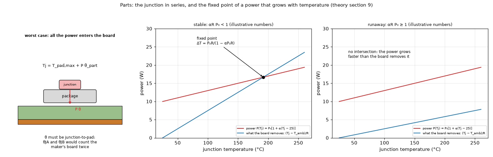

# 09. Parts: the junction temperature, the top path and the power that depends on temperature

*Figure 9 (`figures/fig_09_part_runaway.png`): left, the worst case: all the power enters the board and the junction sits a series resistance `theta` above the hottest pad point; middle and right, the power that grows with temperature, `P(Tj) = P0 [1 + alpha (Tj - 25)]`, against what the board removes, `(Tj - T_amb) / R`: they cross at the fixed point (stable, `alpha R P0 < 1`) or never cross (thermal runaway, `alpha R P0 >= 1`). The numbers of the curves are illustrative.*

See also the sections of the package drawn from the real section: `research/component-heatsink/figures/fig_05_part_and_top_path_schematic.png` and `fig_06_package_sections.png`.

## 1. What it is

A **part** is a heater with a junction-to-pad resistance `theta_part` (and optionally a top path). The board is solved with the part's power and the junction temperature is read from it. The convention is **worst case first**: all the power reaches the board; if a top path is defined, the share that leaves through the top is found as the root of one scalar equation per part (section 3).

## 2. The series chain

    Tj = T_max,footprint + P theta_part              (the hottest board point under the footprint is the pad temperature)

A junction node joined to the board by a uniform conductance would be 1.3 to 3.4 K lower on the chips of the component study and 0.2 K on a 0603 resistor (`research/component-heatsink/README.md` 4.10); the worst case keeps the hottest point. Derived quantities, for the same board response `R = (Tj - T_amb) / P` (linear for constant coefficients):

    margin = Tj,max - Tj                 power limit P_lim = (Tj,max - T_amb) / R = P (Tj,max - T_amb) / (Tj - T_amb)
    psi_JB estimate:   Tj = T_ring + psi_JB P,   T_ring = mean board temperature in the ring 0.5 to 1.5 mm outside the outline of the footprint

**Why `theta` must be a junction-to-pad number**: `theta_JA` includes the manufacturer's board and air, and `theta_JB` the spreading in the manufacturer's board; the program computes the spreading in **your** board, so those would be counted twice (JESD15-3 and the package notes in the sources).

## 3. The top path (heatsink on the package)

`analysis.part_split` closes the series-parallel network: a junction node joined to the board by `theta` and to the ambient by

    R_top = theta_JC(top) + interface / A + theta_SA

(`interface / A` the paste or pad resistance per area over the contact area, or the footprint). With `P_b` the heat into the board and `T_max(P_b)` the hottest board point under the footprint,

    Tj - T_amb = (T_max - T_amb + P theta) / (1 + theta / R_top)          P_top = (Tj - T_amb) / R_top, clipped to [0, P]

and the operating point is the root of `g(P_b) = P_b - P + P_top(T_max(P_b)) = 0`, monotone with `g' = 1 + R_b / (R_top + theta) >= 1` (`R_b = dT_max/dP_b`), bracketed by `[0, P]`. `api._top_path_split` finds it by regula falsi with the Illinois rule for one part (three board solves when the board is affine and the top heat is not clipped) and by a Broyden iteration projected on `[0, P]` for several parts; it stops when every `|g_i| / P_i < 1e-5` and warns otherwise. A plain fixed point `P_b <- P - P_top(T_max(P_b))` has the slope `-R_b / (R_top + theta)`: it was the method until a review found it diverging on small pads (8 mm pads: ratio 1.3 to 2.4, `Tj` reported 17 to 58 K too low with a false "thermal runaway", `docs/validation.md` 9). The power coefficient stays a fixed point around the whole solve (its slope is the physical runaway condition). FVM, FDM, Lumped, Analytic and the 3D solid all get the top path. On 25 mm pads the program is 0.4 to 0.8 K above a uniform-conductance node prototype (the worst-case convention). Against the same junction node without a top path, a bare mould lowers `Tj` by 0.4 to 0.8 K (about 1 % of the heat) and a 12 K/W clip-on heatsink with paste by 14 to 38 K (41 to 51 % of the heat; `research/component-heatsink/README.md` 4.10). Steady state only; without `theta_SA` nothing changes.

## 4. A power that depends on temperature

    P(Tj) = P0 [1 + alpha (Tj - 25 C)]

The program iterates `P_(k+1) = P0 [1 + alpha (Tj(P_k) - 25)]` around the board solve until the powers change by less than 1e-5 (relative). For a linear board (constant `R`, ambient 25 C) the fixed point is

    delta T = P0 R / (1 - alpha P0 R)

and in general `delta T = R P0 [1 + alpha (T_amb - 25)] / (1 - alpha R P0)`. The iteration converges when `alpha P0 R < 1`; **thermal runaway** (no stable point) is reported when the device passes 1500 C or the power grows 50 times. The closed form is reproduced within 0.05 K.

## 5. The datasheet numbers

| Number | What it is | Use here |
| :-- | :-- | :-- |
| `theta_JA` | junction to ambient on the maker's JEDEC board | not used (board counted twice) |
| `theta_JB` | junction to board, measured on the maker's board | not used directly (board dependent) |
| `theta_JC(top)` / `theta_JC(bottom)` | junction to the case top or, for exposed-pad packages, the pad | `theta_JC(bottom)` is the usable junction-to-pad value |
| `psi_JT`, `psi_JB` | characterisation parameters (not resistances) | consistency checks and the calculator (topic 23) |

JESD15-3: for a two-resistor model `theta_JB` and `theta_JC(top)` are the two resistances; `psi_JB` can substitute `theta_JB`; `psi_JT` is not allowed; accuracy "30 % or less". 75 to 95 % of the heat of a package goes through the PCB. A table of typical `theta` by package family is a library (Preferences), and the heater panel offers it.

## 6. How the program does it

`pcbthermal/analysis.py` (`heater_stats`, `part_split`), `api.py` (`_solve_with_tc`, `_top_path_split`), `model.py` (`Heater.theta`, `tj_max`, `psi_jb`, `power_tc`, `role`, `junction_theta`), `docs/theory.md` section 9, `docs/models.md` sections 6 and 13.

## 7. Where it is tested

`docs/validation.md` section 9; `research/component-heatsink/` (prototype: the offset reproduces the CSD17308Q3 datasheet RthetaJA within 2 %, 46.7 against 46 K/W; the top-path root against Brent's method and the node prototype, `study_top_path_convergence.py`, `tests/test_top_path.py`); the closed-form fixed point to 0.05 K.

## 8. Related topics

08 (the same `h`), 11 (a block as the heatsink), 12 (the Foster chain for pulses), 13 (`theta_SA` scenarios), 14 and 23 (datasheet boards, the calculator).

## 9. Sources

* JESD15-3 two-resistor guideline: [JESD15-3] (text read). NIST report on 2R, DELPHI: [NISTIR7648]. TI definitions and the 75 to 95 % figure: [TI-SPRA953B]. Renesas: [Renesas-Thermal]. Richtek: [RichtekAN061]. Compact modelling accuracy: [SemiDigest2007], [EC2007Compact]; `R_JB` scatter: [EC1999RJB]; JESD51-14: [EC2024JESD5114]; the standards family: [EC2019JEDEC], [JESD51family].
* The 2R model lacks thermal capacity (RC ladders from transient measurements add it): [Siemens-CTM].
* ROHM's "two-resistor" note is **not** the JESD15-3 definition and is not used: [ROHM-2R-not-used].
* Datasheets read for the parts: [Datasheets]; MOSFET datasheet quantities: [Infineon-AN2012-03]; copper and via resistances: [TI-AN2020].
* Own computation: [L-parts].

*What was read and what was not verified:* equations from `docs/theory.md` section 9 (read in full); the sources marked R were read per `docs/research.md`; the standards were not opened (JESD51 family).
