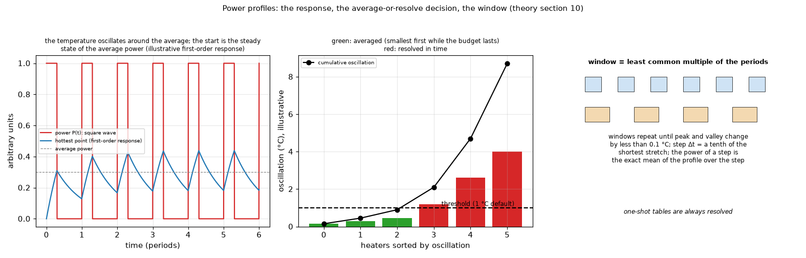

# 10. Power profiles in time: the response, the decision and the window

*Figure 10 (`figures/fig_10_profile_decision.png`): left, a square wave and the response of the hottest point (first-order response, illustrative): the temperature oscillates around the value of the average power; middle, the average-or-resolve decision: heaters sorted by oscillation, averaged while the cumulative oscillation stays under the shared threshold (illustrative oscillations); right, the window is the least common multiple of the periods.*

## 1. What it is

A heater may carry a repeating profile (`SquareWave`, `TableProfile` from a CSV) or a one-shot table. The program decides, per heater, whether the oscillation matters (**resolve** it in time) or not (**average** the power), and runs all heaters in one time-stepping run.

## 2. The unit step response and superposition

With the unit step response `Z(t)` of the heater's own hottest point (topic 07), the response to a piecewise-constant periodic power `P(t)` of period `T` is, by superposition of delayed steps,

    T(u) = sum_j P_j [G(sigma_2,j) - G(sigma_1,j)]            G(sigma) = sum_(m >= 0) [Z(sigma + mT) - Z(mT)] + (sigma / T)(R_th - Z(MT))

(`[sigma_1, sigma_2]` the part of the period whose impulse falls on stretch `j`; the tail beyond `M` exact terms is the remaining response taken flat; `G(T) = R_th`). For a square wave, `peak = P_off R_th + delta P G(t_p)`. The **oscillation** is peak minus valley, in C.

## 3. The decision

Heaters are sorted by oscillation and **averaged** (smallest first) while their cumulative oscillation stays within the threshold (default 1 C: a shared error budget); the others are **resolved**. One-shot tables are always resolved (from the steady state of their first power). The decision uses the periodised step response for any periodic table.

## 4. The run

One time-stepping run with all heaters (the problem is linear). The step `dt` is a tenth of the shortest stretch; the power of a step is the **exact mean** of the profile over the step, `(1/dt) integral P dt`; the window is the least common multiple of the periods; windows repeat until peak and valley change by less than 0.1 C. Start: the steady state of the average power (or a typed temperature). The duration is until the cycle repeats, N cycles or a fixed time; a 200,000-step cap protects the memory. Analytic transients smear vias and heatsinks (warned).

## 5. How the program does it

`pcbthermal/profiles.py` (decision, window runner `run_windows` shared by the FVM, FDM, Lumped and Analytic models through one adapter each), `profile_io.py` (CSV), GUI "Power profile" tab, command line options of `run`; `docs/theory.md` section 10, `docs/models.md` section 4. The CSV format has a documented example in `examples/csv_profiles/`.

## 6. Where it is tested

`docs/validation.md` section 7; the stress tests of the application (`tests/test_gui_stress.py`: every profile control and bad CSV files).

## 7. Related topics

07 (the step response), 12 (a junction Foster chain would read the pulses at the junction).

## 8. Sources

* Superposition of delayed steps (Duhamel): standard linear-systems theory; no single source is recorded in the project documents.
* The repetitive-pulse form `D + (1 - D) z(t)` of a thermal impedance: [TI-SLUAAT8]. RC networks from the thermal impedance: [Nexperia-AN11261] (both search summaries).
* Own computation: [L-validation].

*What was read and what was not verified:* equations from `docs/theory.md` section 10 (read in full).
