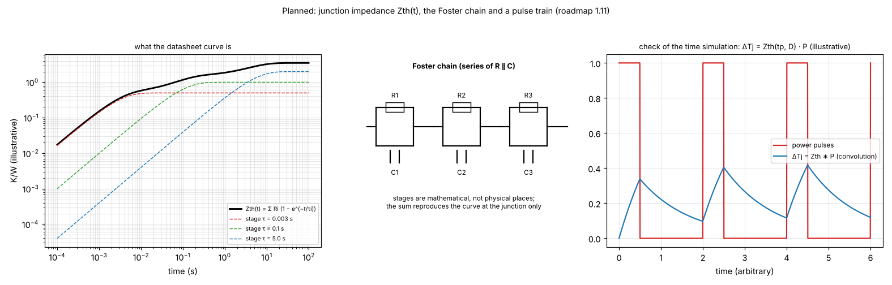

# 12. Planned: the thermal impedance of the package and the Foster chain

*Figure 12 (`figures/fig_12_foster_chain_planned.png`): left, a thermal impedance curve `Zth(t)` as the sum of three exponential stages (illustrative values); middle, the Foster chain, a series of resistor-capacitor pairs, that reproduces it; right, a pulse train and the junction rise read from it, the check of the time simulation `delta Tj = Zth(tp, D) P` (illustrative).*

**Status: planned, not implemented** (`docs/versions.md` "Planned", "Component element (the part of the plan not done)"; no Foster or Cauer network exists in `pcbthermal/`). Today the part is quasi-static: its junction follows the board temperature plus `P theta` at once.

## 1. The problem

A datasheet gives the transient thermal impedance `Zth(t)` of the package on a stated board (single pulse and duty-cycle curves). Under a pulsed load the junction rises faster than the board: milliseconds against seconds. A part without thermal capacity (a pure resistance, topic 09) cannot show it; the standard 2R and DELPHI models lack it too, and RC ladders from transient measurements are what adds it.

## 2. Formulation (to be built)

A **Foster chain** is the series of `n` pairs `R_i` in parallel with `C_i`:

    Zth(t) = sum_i R_i (1 - exp(-t / tau_i))         tau_i = R_i C_i          Zth(infinity) = sum_i R_i

Its stages are mathematical, not physical places: it reproduces the curve at the junction only (the vendor note says the same: the values do not correspond to geometrical locations). A **Cauer** chain (a ladder of resistors with capacitors to ground) has one stage per physical layer, gives access to internal nodes and can be joined to an external heatsink or board network, which is why it is the one to use if the junction chain must be connected to the program's board; it is harder to obtain from a curve. For repetitive pulses of width `tp` at duty `D = tp / T`, the peak junction rise over a steady average is

    delta Tj = P [ D R_th + (1 - D) z(tp + T) + z(tp) - z(T) ]            (superposition of delayed steps; the repository records the compact form D + (1 - D) z(t) of the application note)

which is the same superposition that topic 10 already uses for the board. The Foster chain would sit **between the junction and the pad** of the part, and its capacity `C_hs` (J/K) can be given to a heatsink on the package.

## 3. What the picture is for

To fix the idea before it is built: where a datasheet curve comes from, why a sum of exponentials is enough, why the stages are not layers, and how a pulse train is read from it.

## 4. Proposed acceptance tests

* A one-stage chain against the exact RC solution (the exponential).
* `delta Tj = Zth(tp, D) P` against the time simulation of the same board, on a heater with a junction chain and a square wave.
* The 75 to 95 % share of the heat into the board as a sanity check of the stages.

## 5. Open questions (for the maintainer)

How many stages to accept from the user (the datasheet curve, a fit, or a few typed `R, tau` pairs); whether the chain is a field of the part or a library entry by family; how the profile decision (topic 10) measures the oscillation at the junction instead of at the board.

## 6. Related topics

09 (the quasi-static part today), 10 (the same superposition), 13 (the heatsink capacity).

## 7. Sources

* Foster and Cauer networks, how to use RC thermal models: [Nexperia-AN11261] (seen through a search summary: a Foster model is a curve fit whose stages are not places in the device; a Cauer model maps to physical layers, gives access to internal nodes and connects to external heatsink or board networks; the vendor's own device models use a Foster network). Repetitive pulses with `D + (1 - D) z(t)`: [TI-SLUAAT8] (a search summary). `ZthJC` of MOSFETs: [Infineon-AN2012-03] (read). Standard 2R and DELPHI lack capacitance; RC ladders add it: [Siemens-CTM] (read).
* The sum-of-exponentials form is textbook linear-system theory; no source recorded.

*What was read and what was not verified:* nothing here is implemented or measured. The pictures are explanations; the curves are illustrative.
