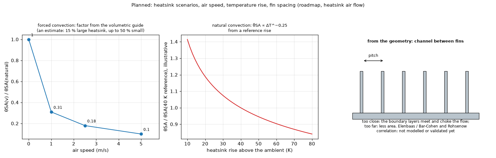

# 13. Planned: heatsink scenarios (air speed, temperature rise, fin spacing)

*Figure 13 (`figures/fig_13_heatsink_scaling_planned.png`): left, the forced-convection factors on a catalogue `theta_SA` (1, 0.31, 0.18, 0.10 at 0, 1, 2.5 and 5 m/s; an estimate: about 15 % for a large heatsink, up to 50 % for a small one); middle, natural convection, `theta_SA` falling as `dT^(-0.25)` from a reference rise (illustrative); right, a fin array seen from the side: the channel between fins and the spacing that chokes or wastes the flow.*

Where it fits in the section of a part: `research/component-heatsink/figures/fig_03_heatsink_convection_scenarios.png` and `fig_05_part_and_top_path_schematic.png`.

**Status: planned, partly researched** (`docs/roadmap.md` "Heatsink air flow", `docs/research.md` R3 and R6). Implemented today: a typed `theta_SA` or a typical heatsink from an eleven-entry library with its test conditions; metal block with plate fins and a uniform coefficient.

## 1. The problem

A catalogue `theta_SA` is given for a flow condition (natural convection at a stated rise, or a fan). On a board it changes with the temperature rise, the air speed and the fin geometry. One number cannot cover the scenarios.

## 2. Ideas, each with the formula to be tested

* **Other air speed (estimated)**: `theta_SA(v) = theta_SA(natural) f(v)` with `f` from the volumetric guide (1, 0.31, 0.18, 0.10 at 0, 1, 2.5, 5 m/s), always marked as an estimate. Default: linked to the board air speed, with an override for a heatsink that has its own fan.
* **Natural convection with the rise**: `theta_SA proportional to dT^(-0.25)` from a reference rise (the same exponent as the natural-convection correlation of topic 08).
* **From the geometry** (fin height, thickness, pitch, metal): the channel effect between fins, the Elenbaas / Bar-Cohen and Rohsenow composite correlation, compared with the catalogue `theta_SA`. The constants of the composite correlation could not be read in the sources found, so none is used yet; the fins of topic 11 assume a uniform coefficient and are validated only for that.
* **Heatsinks with a fan** (catalogue assemblies, for example 40 mm sets of about 1.1 K/W) as library entries; pin fins; orientation.

## 3. What the picture is for

To place the three effects on one heatsink: the air speed shifts the whole curve, the rise tilts it, the spacing sets the channel. It also shows what is **not** modelled today (the choking of a closed fin array).

## 3b. What the research simulated (MOSFET, top chain `theta_JC(top)` 30 K/W assumed + paste 4.6 + `theta_SA`, constant board `h`)

With a 12 K/W catalogue value at a 75 K rise, the natural scaling gives 17.8 K/W at 2 W and Tj 70.4 C against 68.1 C with the fixed number (+2.3 K; at 4 W +2.8 K: 113.9 against 111.1 C, because the sink still runs below the 75 K of the catalogue); the same heatsink at 1, 2.5 and 5 m/s, with the forced-air factor on the catalogue value held fixed (3.7, 2.2 and 1.2 K/W), gives 64.1, 63.3 and 62.8 C (`research/component-heatsink/README.md` 4.6; an earlier version scaled the forced values with the rise too and gave 65.7, 64.5 and 63.6 C). The scenarios change Tj by -5.3 to +2.8 K against the fixed value because `theta_JC(top)` limits the path: a better heatsink or more air buys little on a plastic package and a lot on a part with a low `theta_JC(top)` (metal lid, bare die). That is why the scenario is worth a switch and the fixed value a good default. Proposed scenarios: *fixed* (default), *natural* (`theta_SA = theta_ref (dT_ref / dT)^0.25`, solved in the loop of topic 08), *forced* (`theta_natural f(v)`). Altitude and a finer fin pitch are noted: the 0.80 at 3000 m of one source is ambiguous between a resistance and a factor and was not used.

## 3c. The channel between fins: the correlations that exist (not used by the program)

For isothermal vertical plates in a symmetric channel of spacing `S` and height `L` (air), with `Ra* = Ra_S (S/L) = g beta dT S^4 / (nu alpha L)`:

    Elenbaas:                  Nu = (Ra*/24) [1 - exp(-35/Ra*)]^(3/4)         (0.1 < Ra* < 1e5)
    Bar-Cohen and Rohsenow:    Nu_S = [576/Ra*^2 + 2.873/Ra*^(1/2)]^(-1/2)     (a Churchill-Usagi blend, n = -2)

Both tend to the fully developed value `Ra*/24` at small `Ra*` (closely spaced fins: the boundary layers meet and choke the flow) and to the single-plate value (about `0.62 Ra*^(1/4)` for Elenbaas, `0.590 Ra*^(1/4)` for the composite) at large `Ra*` (widely spaced fins: no interaction, but less area). The optimum spacing is where the two meet: a channel Rayleigh number of about 50 (Elenbaas, quoted by Simons), `S_opt about 2.714 L / Ra_L^(1/4)` in the composite (`2.714^4 = 54.3`, written from memory and to confirm). These formulas were checked for internal consistency (`scripts/check_correlations.py`); they are **not** in the program, whose fins assume a uniform coefficient, and none has been validated against a catalogue `theta_SA`.

**Checked numerically** (`research/effective-conductivity/` 4.10, figure 13): Elenbaas (1942), as written by [MartinRaithbyYovanovich1991] (`Nu_b = (Ra*_b/3)[1 - exp(-35/(16 Ra*_b))]^(3/4)`, which is the form above with `El = 16 Ra*_b`), the blend of Raithby and Hollands (`m = -1.9`, `Nu_fd = Ra*_b/3`, `Nu_bl = 0.62 Ra*_b^(1/4)`) and the composite quoted above agree within 5.5 % over `0.1 < El < 1e4`; the spacing that dissipates the most heat per unit of base area is at `El` = 46, 59 and 54.4 (the composite: a spacing coefficient of 2.716 against the 2.714 quoted). The fully developed limit `El/24` and the boundary-layer limits (0.60 for Elenbaas, 0.62 for the blend, 0.59 for the composite) are the ones the paper recalls; [MartinRaithbyYovanovich1991] also warns that the fully developed asymptote should not be expected except under very special conditions.

## 4. Proposed acceptance tests

Catalogue values of `theta_SA` against the geometry model within the scatter of the catalogue; the factors against the volumetric guide; the non-linearity checked by the Picard loop of topic 08.

## 5. Related topics

08 (`h` and its temperature dependence), 09 (the top path), 11 (fins and block).

## 6. Sources

* Factors 1, 0.31, 0.18, 0.10 and the spread of the estimate: [VolumetricGuide] (as recorded in `docs/research.md` R3). Catalogue values and test conditions: [HeatsinkCatalogues].
* Channel effect: Elenbaas (1942), Bar-Cohen and Rohsenow (1984): [ElenbaasBCR] (the forms above come from secondary sources, not the originals); optimum channel Rayleigh number and the Elenbaas form as reported by Simons: [Simons2002]; the blending structure: [ChurchillUsagi].
* Natural-convection scaling `W = beta dT^1.25`, orientation and finish: [AlphaNovatech]; the chain `Rja = Rjc + Rcs + Rsa` and the volumetric performance of a heatsink: [ECHowToSelectHeatsink]; the `Ra^(1/4)` law: [IncroperaDeWitt].

*What was read and what was not verified:* the two channel correlations of Martin and others were read (pages 1 and 2 of that paper), the composite of Bar-Cohen and Rohsenow only as quoted; the factors are quoted from the project documents; the natural-convection curve of the figure is illustrative; nothing of this is validated against a datasheet.
