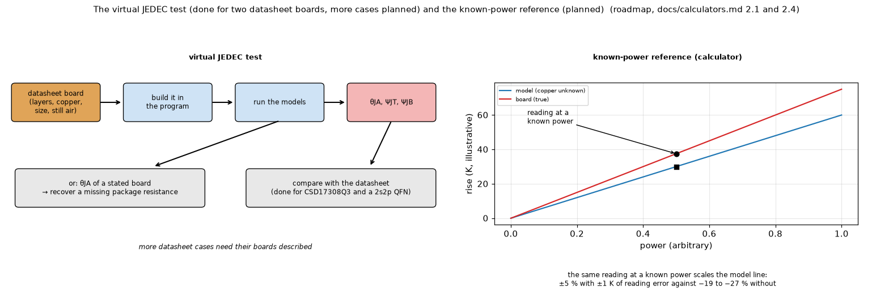

# 14. Planned: the virtual JEDEC test and the known-power reference

*Figure 14 (`figures/fig_14_virtual_jedec_planned.png`): left, the virtual JEDEC test: the datasheet's own board is built in the program, the models run, and the predicted `theta_JA`, `psi_JT`, `psi_JB` are compared with the datasheet (or a missing package resistance is recovered from a `theta_JA` on a stated board); right, the known-power reference: the same reading at a known power scales the model line so that the unknown power is found without knowing the copper (illustrative lines). The virtual JEDEC test is done for two datasheet boards (`docs/calculators.md` 2.1); the known-power reference is still planned.*

Existing pictures of the calculator: `research/power-calculator/figures/fig_04_calculator_schematic.png` and `fig_05_reading_points_and_copper.png`.

**Status: partly implemented, partly planned.** The virtual JEDEC test is done for two cases (`docs/calculators.md` 2.1); more cases need their boards described. The known-power reference is **not implemented** (decision: `docs/calculators.md` 2.4).

## 1. The virtual JEDEC test

A datasheet gives `theta_JA` for a **stated** board. Built in the program, that board must return the datasheet's resistance, and the calculator must give 1 W when the junction is `theta_JA` above the ambient.

| Case | datasheet | model | error |
| :-- | --: | --: | --: |
| TI CSD17308Q3, its own board (38.1 x 38.1 mm, 1.52 mm FR-4, 71 um copper, 1 in2 pad) | 46 K/W | 46.8 K/W | -1.7 % |
| JESD51-7 2s2p, exposed-pad QFN with 9 thermal vias (TPS7A47-like; package data assumed) | 32.5 K/W | 31.6 K/W | +3.0 % |
| the same without the vias | - | 67.4 K/W | the exposed pad needs the vias (JESD51-5) |

The JEDEC board follows ROHM's note: 114.3 x 76.2 x 1.6 mm, 70 um top and bottom traces, two 74.2 mm planes of 35 um, thermal vias of 0.30 mm diameter at 1.2 mm pitch. Planned: more datasheet cases, the prediction of `psi_JT` and `psi_JB` (needs the junction node, topic 09), and recovering a missing package resistance.

## 2. The known-power reference

The board resistance `R` (K/W at the measured point) of the drawn board is not the real one, mostly because of the copper. Reading the **same** thermocouple once with the part at a **known power** (a dummy load, or a state whose dissipation is known) lets the program scale the model before looking for the unknown power:

* drawn copper 0.5 x the real: plain calculator -22.9 %, with the reference 0.0 %;
* with readings off by 1 K: -19 to -27 % plain, **-4.7 to +5.7 %** with the reference.

It needs only that the board answers linearly (constant heat transfer; with computed convection a few percent of non-linearity remain), and it also corrects errors in the air flow. It fits only parts whose dissipation can be fixed (resistors, LEDs, diodes, LDOs, MOSFETs at a known current), and its main benefit (a wrongly drawn copper) disappears when the copper comes from Gerber or KiCad files (topic 15), which is why it was left for later. The two-point fit of power and copper is badly conditioned (+-1 K moves the copper multiplier from 1.05 to 3.9) and stays a study.

## 3. What the picture is for

Left: the chain datasheet board -> program -> predicted numbers -> comparison. Right: why one extra reading at a known power fixes a model whose slope is wrong.

## 4. Related topics

09 (`theta`, `psi`), 23 (the calculator), 15 (copper from files removes the main error).

## 5. Sources

* Datasheet boards and the JEDEC board: [ROHM-64AN113E], [Datasheets] (TI CSD17308Q3, TPS7A47), [JESD51family] through [EC2019JEDEC].
* `psi_JT`, `psi_JB` and their estimates: [TI-SPRA953B], [RichtekAN061], [Renesas-Thermal].
* Calibration with a heater of known input (about 10 % in the studies): [Chen-style], [ArXiv2307.08354]. K-factor and a junction measurement: [JESD51family] (JESD51-1, index pages only).
* Own computation: [L-calc].

*What was read and what was not verified:* the numbers are those of `docs/calculators.md` 2.1 and 2.4 (read in full); the JESD standards were not opened; the TPS7A47 package data used in the second row are assumptions (an indication, not a proof).
