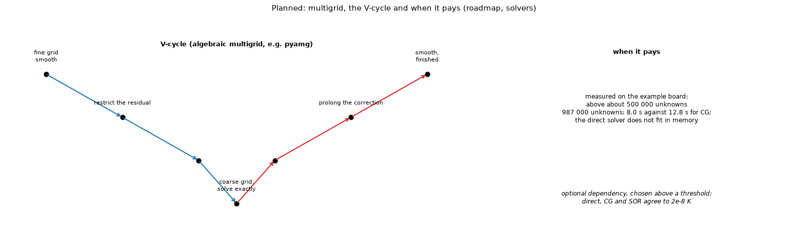

# 16. Planned (optional): multigrid for very large boards

*Figure 16 (`figures/fig_16_multigrid_planned.png`): the V-cycle of a multigrid solver: smooth on the fine grid, restrict the residual to coarser grids, solve exactly on the coarsest, prolong the correction back up and smooth again; and the measured size above which it pays.*

**Status: planned, low priority** (`docs/roadmap.md`, "Solvers and validation").

## 1. The problem

The direct sparse solver is the program's default (3 to 30 times faster than SOR on the test boards), but its memory grows faster than linearly: the 987,000-unknown example does not fit. Conjugate gradients with a diagonal preconditioner converge slowly on fine grids because smooth error components decay slowly.

## 2. The idea

Simple iterations (Jacobi, Gauss-Seidel, SOR) remove the oscillating part of the error fast and the smooth part slowly. A smooth error on a fine grid looks oscillating on a coarser one, where it is removed cheaply. One **V-cycle**:

1. smooth on the fine grid (a few sweeps);
2. compute the residual and **restrict** it to a coarser grid;
3. repeat down to a coarsest grid that is solved exactly;
4. **prolong** the correction back up, add it, and smooth again.

The cost per cycle is proportional to the number of unknowns and the error drops by a roughly constant factor per cycle, so the total work grows linearly. **Algebraic** multigrid (the library named in the roadmap is pyamg) builds the coarse levels from the matrix itself, no geometry needed, which suits the program's cell networks with vias, blocks and outlines.

## 3. What was measured

On the example board, algebraic multigrid pays only above about **500,000 unknowns**: 987,000 unknowns took 8.0 s against 12.8 s for CG, and the direct solver did not fit in memory. It would stay an **optional dependency**, chosen above a threshold. All the solvers agree to 1e-8 K.

## 4. Proposed acceptance tests

Agreement with the direct solver to 1e-8 K on the five boards of the solver study; a convergence factor per cycle independent of the grid; a graceful fall back to CG when the library is missing.

## 5. Related topics

02 (the solvers it would join).

## 6. Sources

* The measurement is own computation (`docs/roadmap.md`; the solver study `research/models-comparison/scripts/solver_equivalence.py`).
* The library: [Pyamg] (MIT licence, version 5.3.0, needs only NumPy and SciPy). The standard introduction: [Briggs2000]; a primer with the cost statement (a convergence factor per cycle bounded independently of the grid at a cost proportional to the unknowns): [McCormickTamstorf] (both seen through search summaries, not opened).

*What was read and what was not verified:* the description of the V-cycle matches the course notes found by a search (pre-smoothing, restriction of the residual, a coarse-grid correction, prolongation, post-smoothing; the smoother damps the high-frequency error and the coarse grid handles the smooth error), which were not opened; only the timing is measured in this project.
