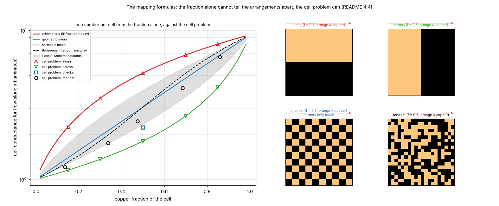
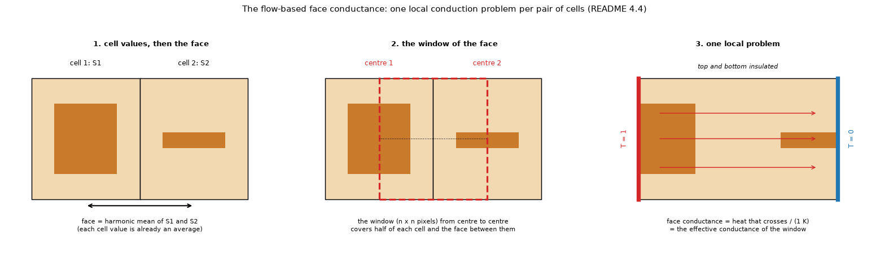

# 17. From copper to cells: fill fraction, mappings, flow-based faces and the conductance tensor

*Figure 22 of `research/gerber-models` (`research/gerber-models/figures/fig_22_mapping_formulas.png`): the cell conductance against the copper fraction for the arithmetic, geometric and harmonic means, Bruggeman and the Hashin-Shtrikman bounds, with the numerical cell problem of four arrangements as points.*

*Figure 23 of `research/gerber-models` (`.../fig_23_flow_window_schematic.png`): how the flow-based face conductance is made: one local conduction problem on the window from the centre of a cell to the centre of its neighbour.*

More pictures of this topic, all in `research/gerber-models/figures/`: `fig_15_same_fill_different_copper.png` and `fig_12_clearance_cell.png` (the same fraction, different copper), `fig_17_gap_detour.png` (a clearance), `fig_18_cell_flow_lines.png` (the heat flow through a window), `fig_09_diagonal_faces.png` (five-point and nine-point links), `fig_20_cell_tensor.png` and `fig_21_tensor_in_use.png` (the tensor), `fig_19_diagonal_gate.png`. The investigation is `research/gerber-models/README.md` (sections 4.4 to 4.7, 4.42 to 4.44, 4.48, 4.49); the reader that feeds it is `research/gerber-import/`.

**Status: researched on the research branch, not in the program.** The program takes the fill fraction of a zone (`f`, topic 01). Everything below is a proposal with measured impact.

## 1. The problem

A layer of the layered model (topic 01) has one sheet conductance `S` per cell, `S = f k_cu t + (1 - f) k_ip (slab - ...)`. With a Gerber file the copper is known at 0.05 to 0.1 mm, much finer than the 0.6 to 1 mm cell. **What one number per cell, or per cell face, represents the fine copper?** The copper has a contrast of about 9.4 against the laminate in sheet conductance (`S_CU / S_LAM`: 385 x 35 um against 0.9 x 1.6 mm), so the arrangement matters, not only the amount.

## 2. The fill fraction and why it is biased

The usual mapping is the **fill fraction**: the arithmetic mean `f S_cu + (1 - f) S_lam`. It is exact only for stripes along the flow (parallel conductors). Across the stripes the series (harmonic) value applies; at `f = 0.5` the two differ by a factor of 2.9. A clearance across a cell is invisible to the fraction: the fill-fraction cell of the figure with a 0.2 mm gap conducts 8.0 laminates against 5.3 for the cell problem, so the board runs **cool**: 5 to 15 % on the real boards of the study, 5.7 % (18 um) to 14.9 % (140 um) for a clearance at 0.6 mm cells.

## 3. The mappings

For a cell with copper fraction `f`, phase conductances `a = S_cu`, `b = S_lam`:

| Mapping | Formula | Comment |
| :-- | :-- | :-- |
| arithmetic (fill fraction) | `f a + (1 - f) b` | exact along the flow; upper Wiener bound |
| harmonic | `(f/a + (1 - f)/b)^(-1)` | exact across the flow; lower Wiener bound |
| geometric | `a^f b^(1-f)` | self-dual isotropic structure at `f = 1/2` gives `sqrt(a b)` (Keller, Dykhne) |
| Bruggeman (2D) | root of `k^2 - (a - b)(2f - 1)k - a b = 0`, which is the d = 2 case of `sum_i f_i (s_i - k)/(s_i + (d - 1) k) = 0` | random mixture; self-dual: `sqrt(a b)` at `f = 1/2` and `k(f) k(1 - f) = a b` |
| Hashin-Shtrikman | lower `b + f / (1/(a - b) + (1 - f)/(2b))`, upper `a + (1 - f) / (1/(b - a) + f/(2a))` (the d = 2 case of `s_1 + f_2 / (1/(s_2 - s_1) + f_1/(d s_1))`) | the tightest bounds from the fraction alone for an isotropic mixture |
| directional `lambda` | `low^(1 - lambda) up^lambda`, `lambda = 0.5` is the geometric mean of the two Wiener bounds from the pixels | `lambda = 0` is Blackmore's tile formula |
| **cell problem** | solve conduction on the cell with an affine boundary condition | numerical upscaling; exact for the cell |
| **flow-based faces** | one local problem per **pair** of neighbouring cells on the window from centre to centre; the face conductance is the heat flow per kelvin | Sampson's method; transmissibility upscaling of reservoir grids |

Results (`gerber-models` 4.38 and 4.43, error of the mean heater rise against the 0.1 mm pixel grid through the program's FVM, 1 mm cells): on four boards the mean absolute error is 7.2 % for the fill fraction (the program today; -15.1 % on the Stormduino board and -4.8 % on our IC board), 2.9 % for the flow-based faces, 4.3 % for `lambda = 0.5` and 3.0 % for the cell problem; on eleven boards 7.4 % against 2.3, 2.4 and 2.4 % (numbers of the program with its laminate nodes, re-run by the review of `gerber-models`; before them 6.5 / 1.9 / 2.5 / 1.7 % on four boards and 6.2 / 1.5 / 1.3 / 1.4 % on eleven). On our IC board the fill fraction (-4.8 %) is closer than every pixel-based mapping (+7.3 to +11.0 %). The mappings that use only the fraction (geometric, Bruggeman, Hashin-Shtrikman) are right on regular copper and wrong in sign and size on real boards (-11 to +32 % on the four boards), because they cannot know whether clearances cut the paths; the Wiener upper bound is 3.7 % on the four boards and ties with the best on the eleven (2.3 %) but is -7.4 % on the Stormduino board (lucky, not a method). The three pixel-based mappings are equivalent within what the boards can resolve. The reference, the program's own pixel run, is itself 5.5 to 13.6 % cool on patterned one-layer copper against an independent 3D solution, and against that solution the fill fraction is 24 to 26 % cool (`gerber-models` Review R2).

## 4. The conductance tensor

A cell may conduct better along a diagonal track than along x or y. The **cell tensor**

    K = [[kxx, kxy], [kxy, kyy]]

comes from two cell problems with an affine boundary condition (the potential on the whole boundary is `x`, then `y`), normalised so that a uniform cell gives `(S, S, 0)`. Its **conductance ellipse** shows the dominant direction; its **coherence** `|kxy| / mean(kxx, kyy)` is 0 for a uniform cell, for two crossing diagonals (the cross terms cancel) and for an axis-aligned conductor, and large when one diagonal conductor dominates. The cell's tensor is the physical analogue of the image-analysis **structure tensor**, but it measures the conduction, not the edges, and needs no smoothing scale. A **nine-point stencil** carries the cross term: axial links `kxx - |kxy|` and `kyy - |kxy|`, diagonal links `|kxy|`. The five-point stencil cannot carry it and gives strong grid-orientation effects: only 38 to 53 % of the cooling of a 45-degree track is reproduced. The **hybrid** keeps the flow-based axial faces and adds the missing diagonal conduction, switched by a **gate** on the coherence (a ramp between two thresholds), reproducing 99 % of the cooling of the 45-degree track in the example of figure 21 of `gerber-models`. **That gate did not hold up on held-out data** (`gerber-models` 4.50: on 60 new windows 1.76 % against 1.86 % with no diagonals at 1 mm, no gain on a board never used, worse at 0.5 mm; the best diagonal share depends on the cell size), so the tensor is a diagnostic and the thresholds are not a method. A linear, monotone, second-order nine-point scheme does not exist for anisotropic diffusion, so overshoots of the diagonal faces are expected, not a bug.

## 5. Limits

The held-out test of the gate was done and the gate failed it (section 4); the share of the diagonal conduction that would be right depends on the ratio of the cell to the track width, which is not yet modelled. Nothing of this is in the program. The whole chain is validated against a pixel-by-pixel reference and a 3D solid, never against a physical board.

## 6. Related topics

01, 15 (the import that feeds it), 18 (spreading near a source), 20, 21.

## 7. Sources

* The flow-based faces are Sampson's method: [Sampson2017] (converted text); tile formulas by pixel counting: [Blackmore2010]; strategies for traces and the local copper near the package: [Guenin2015]; mapping copper to anisotropic conductances per element, without a numerical validation: [Lush2004] (opened through a page converter). The effective conductivity of a laminate and why no mean of it works: [CulhamYovanovich1998] (pages 460 to 466 read as images; reproduced within 2 to 6 % by `research/effective-conductivity/`).
* Upscaling and transmissibility: [Durlofsky2005]. Power-law averaging: [PowerLawAveraging]. Duality in 2D: [KellerDykhne]. The conductivity bounds are in Hashin and Shtrikman, J. Appl. Phys. 33 (1962) 3125-3131 (the 1963 paper in J. Mech. Phys. Solids is the elastic-moduli one); in 2D at equal fractions the two bounds multiply to `a b` and `lower(f) x upper(1 - f) = a b` for every `f` (checked to 1e-15), consistent with the Keller-Dykhne relation `k(f) k(1 - f) = a b`; Milton's book has the bounds in chapter 23 and exact relations in chapter 17 (not opened). Bruggeman and Hashin-Shtrikman closed forms (written from memory, then **checked by their properties** in `research/theory/scripts/check_mapping_formulas.py`: the Bruggeman root satisfies its defining equation to 2e-16, gives sqrt(ab) at one half and obeys the duality `k(f) k(1 - f) = ab`; the Hashin-Shtrikman bounds bracket it and lie between the Wiener bounds; the upper bound is the dual of the lower to 1e-15; not compared with a textbook): [HashinShtrikman], [Milton2002] and [Torquato2002] (to check), [Wiener1912], [KellerDykhne]. The series and parallel conductivities of a whole board: [EC1998Conduction]; earlier work on the effective conductivity of boards: [Lemczyk1992], [Teertstra1995].
* Structure tensor and coherence: [StructureTensor]. Nine-point cell-centred schemes: [AgelasEymardHerbin2009]; the non-existence of a monotone linear scheme: [Positivity9pt].
* Own computation: [L-gerber].

*What was read and what was not verified:* from the READMEs of `gerber-models` (read in full) and its `docs/literature.md`; the 2D Hashin-Shtrikman bound is the d = 2 case of Milton's equation (23.5) (read, see [Milton2002]); the 2D Bruggeman form was not confirmed by any text read. The numbers of `gerber-models` quoted here were checked against its README only (11-board means 7.4, 2.3, 2.4, 2.4 %, updated after the review of `gerber-models`; 38 to 53 % at 45 degrees; 1.76 against 1.86 % held out), not re-run: that folder has its own review.
