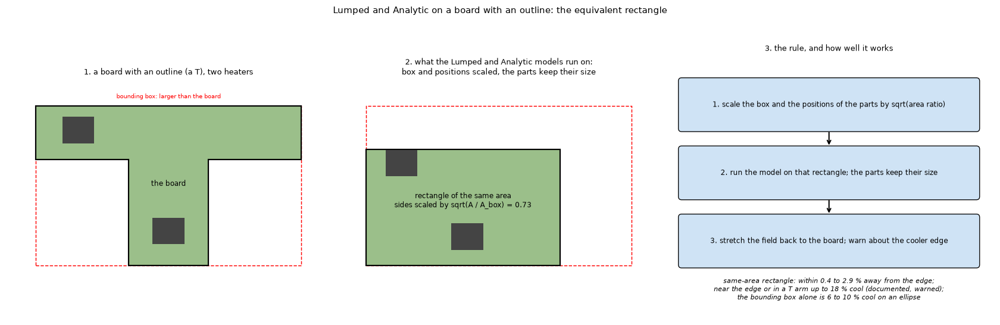
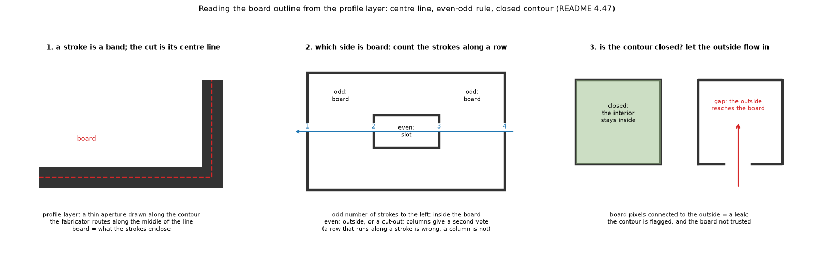

# 20. The board outline: from the profile layer to the cells, and the rectangle of the same area

*Figure 4 of `research/outline` (`research/outline/figures/fig_04_outline_to_rectangle_schematic.png`): a T-shaped board with its bounding box, the rectangle of the same area on which the Lumped and Analytic models run, and the three steps with the accuracy found.*

*Figure 16 of `research/gerber-import` (`research/gerber-import/figures/fig_16_outline_how.png`): reading the outline from the profile layer: the stroke is a band and the cut runs along its centre line; the even-odd rule along rows and columns; a closed contour against a gap.*

Also `research/outline/figures/fig_05_cells_on_an_outline.png` (cells off the board, full cells and cut cells with their cover fraction). Investigations: `research/outline/README.md` and `research/gerber-import/README.md` 4.47. **Status: the rectangle rule is implemented; the profile-layer reader is researched on the research branch.**

## 1. The outline in the models

* **FVM, FDM and 3D solid** handle any outline: every cell has a **cover** (the fraction of the cell inside the board, from the same sub-sampling as topic 02); cells outside are pinned to the ambient; cut cells carry the cover as a factor on conductance, capacity and ambient exchange.
* **Lumped and Analytic** are built on a rectangle (rings, cosine series). They run on the **rectangle of the same area**: width `s W`, height `s H`, `s = sqrt(A_outline / (W H))`, positions `x -> s x`, parts keep their size, the field is stretched back by `1/s`. This keeps the area (hence the total convective conductance `h A`) and the aspect ratio of the box. The bounding box has too much area and a box larger than it is worse (10 to 20 % cool): the same-area rectangle is within 0.2 to 3 % away from the edge, 10 to 18 % cool near an edge or in the arm of a T (warned). No time simulation for these two models on an outline.

## 2. The outline from a Gerber file

The outline is a layer of its own, the **profile** (X2 `TF.FileFunction,Profile,NP`), drawn as **strokes**, not a filled polygon; the board is cut along the **centre line** of the stroke; the contour must be closed. The reader (`research/gerber-import/lib/outline.py`):

1. draws the strokes as a mask (a zero-width aperture is widened to 1.5 pixels);
2. finds the board by the **even-odd rule** with rows and columns voting (a row that runs along a stroke is wrong, a column is not);
3. checks that the contour is closed by flooding from the outside: a leak above 1 % of the board means a gap, the contour is flagged;
4. extracts the polygon with `contourpy` and Douglas-Peucker simplification.

Results: the board of the Stormduino project 3606.7 mm2 against 3605.1 mm2 of the vector reference with nine vertices; slots and cut-outs found; a gap of 0.05 to 0.5 mm flagged. Failure honestly documented: a file that mixes stroke widths (pcbrnd, -3.6 %), zero-width apertures. **No source gave a rule for how large a gap a reader should close**, so none is closed.

## 3. Related topics

05 and 06 (the rectangle), 02 (cover), 15 (import).

## 4. Sources

* The profile layer, strokes and centre line, closed path, practice of fabricators: [ProfileLayer] (search snippets); the Gerber format owner: [UcamcoGerber] (not read). Reader and reference: [Gerbonara].
* The rectangle of the same area: **no published method was found**; it is a modelling choice tested in this project against the FVM on the real shape (`research/outline/scripts/outline_rectangle_study.py`, `docs/validation.md` section 13): [L-outline].

*What was read and what was not verified:* from the READMEs of the two folders (read in full); the source pages were seen as search snippets.
