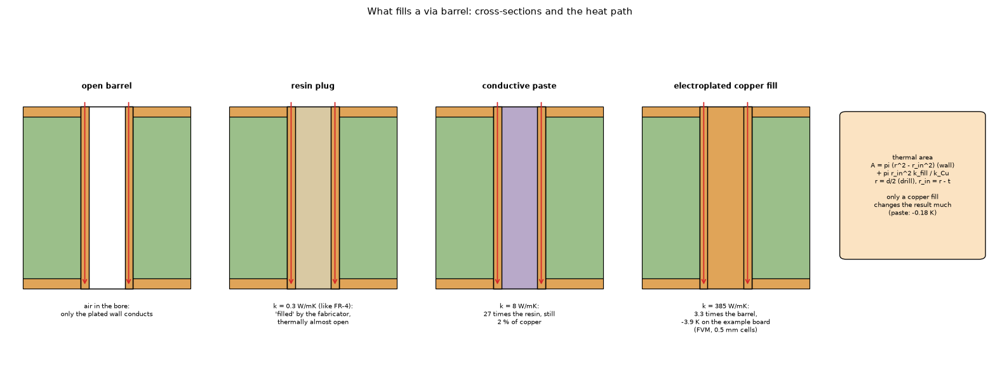

# 21. Vias: the barrel, the fill and arrays under a part

*(audit 2.7.0: this topic predates the barrel length `d + 0.5 t_cu` and the rim rule of 2.6.0 (a copper layer the drilled hole does not touch is uncoupled) and the mirror image of a board edge in the via well of 2.5.0; the reference is `docs/theory.md` 1.5 and 2.6.)*

*Figure 4 of `research/via-fill` (`research/via-fill/figures/fig_04_via_fills_schematic.png`): the via fills as cross-sections: an open barrel, a resin plug (0.3 W/mK), conductive paste (8 W/mK) and an electroplated copper fill, with the heat path down the barrel and the thermal area it gives.*

Also `research/via-fill/figures/fig_05_via_array_under_a_part.png` (nine vias in parallel under a part). Investigation: `research/via-fill/README.md`. **Status: implemented** (the via fill, `Via.fill_k`, library `VIA_FILLS`).

## 1. What it is

A via connects the layers of the board through a copper-plated barrel. In the layered models (topic 01) it is a conductance in parallel with the dielectric gap; in the 3D solid (topic 04) it is a rod of the same copper area.

## 2. The thermal area

Along the axis `R = L / (k_cu A_eq)` with

    A_eq = A_plating + min(k_fill / k_cu, 1) pi r_in^2           (open barrel: k_fill = 0)

and `A_plating = pi [(D/2)^2 - (D/2 - t_plating)^2]`, `r_in = D/2 - t_plating`, `D` the **drill** diameter (`Via.thermal_area`; the tooltip and the docstring of `add_via` call it the finished hole, which would make the resistance 15 to 27 % lower than the model's if a finished-hole number were typed, `research/via-fill/README.md` 7.5). An electroplated copper fill is the whole disc, `pi (D/2)^2`. Inside the layered models the barrel counts only across the dielectric gaps (one open via of the example board: 175.6 K/W over 1.46 mm, not the 192.4 K/W of 1.6 mm). In the FVM and FDM the barrel is a **mean-potential coupling** between the plane temperatures averaged over a footprint of cells (topic 02, section 6), not a conductance of the cell that holds the centre; in the Lumped and Analytic models the barrel conductance is in series with a constriction resistance (topics 05 and 06).

## 3. What the fill does

The usual fabricator "filled via" is an **epoxy resin plug** (IPC-4761 types V to VII of its seven types I to VII: tenting, plugging, filling, capping): it keeps the hole closed and the surface flat, and conducts like FR-4 (192.1 against 192.4 K/W, no gain). A conductive paste helps a little (about -5 %). Only an **electroplated copper fill** is a real heat path: the resistance of one 0.3 mm via falls by 69 %, and on the example board the maximum temperature falls by 3.9 K in the FVM at 0.5 mm (4.5 K at 1 mm; an independent solver with resolved barrels puts the value between the two); the Lumped and Analytic models give 6.3 to 7.0 K on the example board, 40 to 75 % more than the FVM, and overstate the gain by 35 to 52 % against the independent reference on a similar via-array board (`research/via-fill/README.md` 7.2, 7.3). Fabricator guides give roughly 4 thermal vias about 40 K/W and 16 vias about 10 K/W (JLCPCB and RayPCB as recorded in `docs/versions.md` "Planned", search summaries; Atlas PCB gives 12 K/W for 16 open vias of the geometry above, 192 K/W each).

## 4. Limits

The barrel is a lumped area, the lateral effect of the wall is neglected, the answer of the point via depended on the cell (the point-via history, `research/via-fill/README.md` 7.3, is why the footprint treatment of topic 02 exists); a via within one cell of a board edge is clipped and warned (`checks.check_via_limits`); the 3D solid clips `a_via` at 1 per cell, so a 0.5 mm copper fill below 0.44 mm cells loses the excess copper. The 185 K/W an article gives for an epoxy-filled via is not a model of the fill.

## 5. Related topics

01, 04, 06, 09 (vias under a package), 23 (the copper dominates the calculator's error).

## 6. Sources

* Fill types and materials: [ViaGuides] (JLCPCB, ALLPCB, Atlas PCB; the standard IPC-4761 not read: [IPC4761]). Copper, via thermal resistances and board area: [TI-AN2020]. Via arrays and pads, analytical models checked by CFD and measurements: [Shen2019] (abstract and structure).
* Own computation: [L-via].

*What was read and what was not verified:* from `research/via-fill/README.md` (read in full); the fabricator pages as recorded; IPC-4761 itself was not read.
