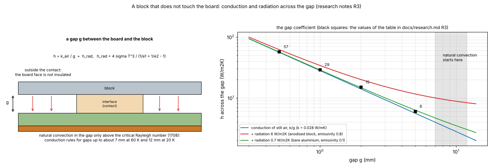
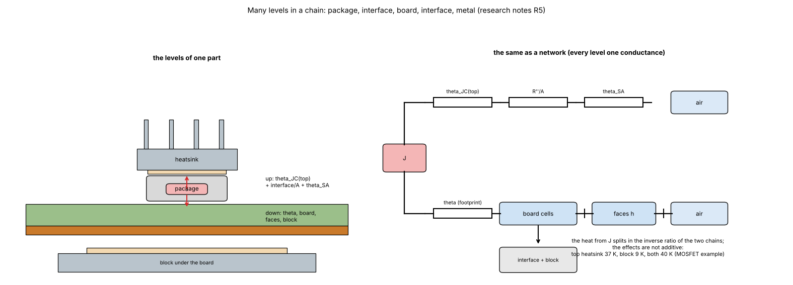

# 25. A heatsink larger than its contact, the air gap, and many levels in a chain

*Figure 17 (`figures/fig_17_air_gap.png`): left, a block that touches the board only over an interface patch, with a gap `g` elsewhere; right, the coefficient across the gap, conduction of still air plus radiation, with the values of the research table (black squares) and the gap above which natural convection starts.*

*Figure 18 (`figures/fig_18_level_chain.png`): the levels of one part (junction, package top, interface, heatsink on top, board, interface, block under the board) as a section and as a network; the heat from the junction splits in the inverse ratio of the two chains.*

Investigation: `research/component-heatsink/` (`block_contact_study.py`, `chain_study.py`); text: `docs/research.md` R3 and R5. **Status: the contact area and the interface sheet are implemented; the air gap outside the contact and the full chain with a junction node are researched, not built.**

## 1. The question

A big plate touches the copper (or a part) only on a small area. Today the block conducts to the board through the interface over copper and, in series with the FR-4, over bare laminate. A real heatsink on standoffs, on a pad or on one component touches only there.

## 2. The contact area as an interface with an area

A thermal interface is a layer with its own **area** (a polygon, default the whole contact face), material and thickness. Where it exists the two sides are joined by `G = A / R''`; where it does not, there is an air gap. A surface in full contact is an interface of very high `k`; a partial contact is a smaller polygon. This replaced a separate "contact polygon": one object, one place for the numbers.

## 3. What a smaller contact costs (MOSFET 2 W, 25 mm pads, aluminium block 40 x 40 x 3 mm)

| Contact patch | Tj (C) |
| :-- | --: |
| whole block (the program today) | 87.8 |
| 25 x 25 mm (the copper pad) | 96.6 |
| 12 x 12 mm | 97.0 |
| 6 x 6 mm | 99.5 |
| none (floating block, face insulated) | 124.3 |

Most of the gain comes from the copper pad; touching the bare laminate around the pad is worth 9 K in today's model (through the FR-4), optimistic if the real heatsink only touches the pad; with no contact and an insulated face the board gets **hotter than without the block** (124 against 107.6 C) because the model hides the board face under the block from the air.

## 4. The air gap

Across a thin air gap the heat goes by **conduction of still air**, `h = k_air / g` (k about 0.028 W/mK at 55 C: 28 W/m2K for 1 mm), plus **radiation between parallel faces**, `h_r = 4 sigma T^3 / (1/e1 + 1/e2 - 1)` (6 W/m2K for an anodised block of emissivity 0.8, 0.7 for bare aluminium of 0.1, against the board's 0.9). Natural convection inside the gap starts only above the critical Rayleigh number of a horizontal layer (1708): conduction rules for gaps up to about 7 mm at 60 K and about 12 mm at 20 K; above that the Hollands correlation raises `h = Nu k / g`. With the gap instead of an insulated face (MOSFET, bare aluminium, tj in C):

| Gap | patch 25 mm | 12 mm | 6 mm | none |
| :-- | --: | --: | --: | --: |
| insulated face | 96.6 | 97.0 | 99.5 | 124.3 |
| 0.5 mm (h = 57) | 92.2 | 93.2 | 95.7 | 101.7 |
| 1 mm (29) | 93.7 | 94.5 | 97.3 | 106.1 |
| 2 mm (15) | 94.8 | 95.5 | 98.2 | 110.5 |
| 5 mm (6) | 95.7 | 96.3 | 98.9 | 115.6 |

The insulated face was too pessimistic. **Proposed rule**: outside the interface the board face is coupled to the block through `h = k_air / g + h_r` (default gap 1 mm, board emissivity 0.9, block emissivity a parameter, default 0.5); above 7 mm the block is taken as not covering the face. Under the interface the face is covered, as now.

## 5. Many levels in a chain

Every level adds one conductance in series and, where heat can leave, one parallel branch; the program solves one sparse matrix, so more levels make the description longer, not the mathematics harder. MOSFET of 2 W (junction node, constant board `h`, pad 25 mm, paste 0.5 K cm2/W, heatsink 12 K/W on top, aluminium block 30 x 30 x 3 mm under the board):

| Case | Tj (C) | through the top | through the block |
| :-- | --: | --: | --: |
| board only | 105.0 | 0 % | 0 % |
| + block under the board | 95.6 | 0 % | 27 % |
| + top heatsink with paste (chain 46.6 K/W) | 68.1 | 46 % | 0 % |
| + both | 65.2 | 43 % | 16 % |

The effects are **not additive**: the block alone lowers Tj by 9 K and the top heatsink by 37 K, both together by 40 K, because the top heatsink takes 43 to 46 % of the heat and the block's share falls from 27 to 16 %.

## 6. Limits

The junction node of the chain study is a prototype outside the program; the gap rule is a proposal; the gap emissivities are assumptions. Open: how much of the board's own convection to keep under a block outside the interface.

## 7. Related topics

09, 11 (the block layer), 13, 24, 26.

## 8. Sources

* Conduction of still air, radiation between parallel faces, Rayleigh criterion for a horizontal layer: heat-transfer handbooks, the `ht` documentation and a university course note, as named in the research notes: [GapHandbooks]; the correlation for a larger gap: [Hollands].
* Spreading resistance of a plate and the 5 % correlation: [YovanovichMuzychkaEllison], [Lee1995], [EC1998Spreading], [ECSimpleSpreading2004].
* Own computation: [L-parts].

*What was read and what was not verified:* the tables are from `docs/research.md` R3 and R5 (read in full); the gap sources were read by the earlier work, with no addresses recorded.
