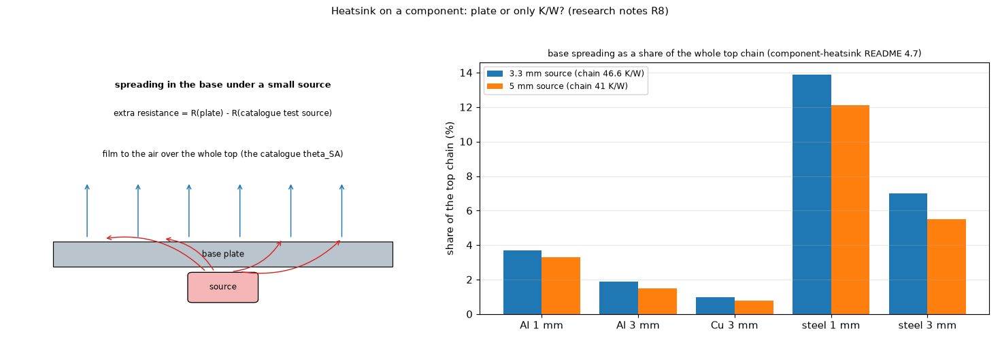

# 26. The base of a heatsink on a component: plate or only K/W?

*Figure 19 (`figures/fig_19_plate_spreading.png`): left, the base plate under a small source: the heat spreads sideways in the base before it reaches the film to the air; right, the extra resistance of the base as a share of the whole top chain for five bases and two source sizes (the table of the research notes).*

Investigation: `research/component-heatsink/` (`base_spreading_study.py`, `block_contact_study.py`); text: `docs/research.md` R3 and R8. **Status: decided: K/W only on top of a component; the plate model stays under the board.**

## 1. The question

Is a plate model of the heatsink base (spreading in the metal) needed on top of a component, or is the catalogue `theta_SA` in K/W enough? The catalogue value already contains the spreading of the catalogue's own test source; a small component adds the conduction through the base under it and the spreading in the plate.

## 2. The physics

A small source on a larger plate has `R = R_0 + R_c`: the average sink resistance plus the maximum constriction (spreading) resistance, accurate to about 5 % when the aspect ratio is below 2.5 and the plate is square-ish (topic 18). The plate layer of the program (the lateral `k t` conductance of the block with a uniform film coefficient) reproduces the published example of [EC1998Spreading] (aluminium 100 x 100 x 1.3 mm, catalogue 1.0 K/W, source 25 x 25 mm, `R_c` = 0.66 K/W): `R_c` = 0.664 K/W, total 1.664 against 1.66 K/W, +0.6 % (`research/effective-conductivity/` 4.8 A: the +4.5 % quoted before was a 24 mm source, `round()` on 1 mm cells; the edge midpoint and corner values are within -0.8 % and -4.6 %).

## 3. The simulation (3D finite-volume plate 40 x 40 mm, catalogue 12 K/W)

Extra resistance on the mean temperature of the source, and its share of the whole top chain (`theta_JC(top)` + paste + `theta_SA` = 46.6 K/W for the 3.3 mm MOSFET, 41 K/W for the 5 mm LDO):

| Base | 3.3 mm source | Lee's closed form | 5 mm source | Lee's closed form |
| :-- | --: | --: | --: | --: |
| aluminium 1 mm | 1.73 K/W (3.7 %) | 1.85 | 1.33 (3.3 %) | 1.48 |
| aluminium 3 mm | 0.87 (1.9 %) | 0.89 | 0.60 (1.5 %) | 0.64 |
| copper 3 mm | 0.46 (1.0 %) | 0.47 | 0.32 (0.8 %) | 0.34 |
| carbon steel 1 mm | 6.46 (13.9 %) | 6.97 | 4.97 (12.1 %) | 5.56 |
| carbon steel 3 mm | 3.28 (7.0 %) | 3.38 | 2.25 (5.5 %) | 2.41 |

(`research/component-heatsink/README.md` 4.7, which also has the 6 mm bases. The table quoted here before, 1.69, 0.75, 0.40, 6.31, 2.83 K/W, read the temperature half a cell above the face that carries the source; the corrected numbers are 0 to 13 % below the closed form of Seri Lee and others, and the thick bases still move by 7 % with the mesh, so read them to about 10 %.) For an aluminium or copper base the spreading is 1 to 4 % of the top chain; it matters (5.5 to 14 %) only for a base of a poor conductor such as steel.

## 4. The decision

First version: **K/W only** (`theta_JC(top)` + interface + `theta_SA`), with a note that a thin steel or stainless base adds more. The plate model stays where it exists (a metal block under the board, where the geometry of contact and copper matters) and comes back for the component top only if a case needs it.

## 5. Limits

The 5 to 30 % of the catalogue literature applies to sources much smaller than the base and a low `theta_JC(top)`; the study covers two sources, two base sizes and uniform film coefficients.

## 6. Related topics

11 (the block layer), 13 (convection scenarios), 18 (spreading), 24, 25.

## 7. Sources

* Spreading resistance of a source on a plate: [EC1998Spreading] (its numerical example, aluminium 100 x 100 x 1.3 mm, source 25 x 25 mm, read), [YovanovichMuzychkaEllison], [ECSimpleSpreading2004] (errors -2 to +5 %); [Lee1995] was cited for it and has not been located. The closed form of the table (equivalent discs) is used by `base_spreading_study.py` from memory (`research/component-heatsink/README.md`, "What was read").
* Own computation: [L-parts].

*What was read and what was not verified:* from `docs/research.md` R3 and R8 (read in full); the correlation sources were summarised by the earlier work, not read here.
