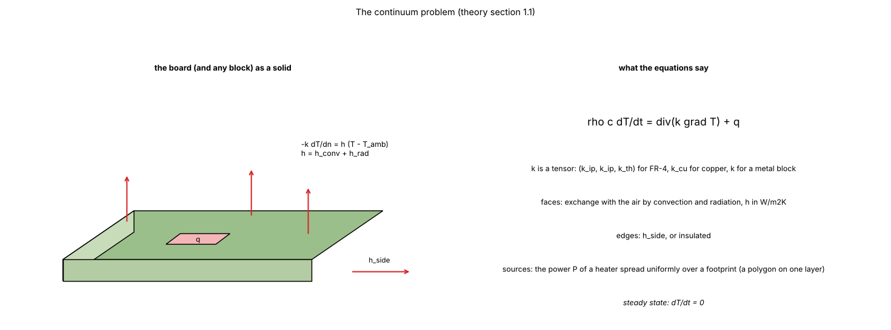
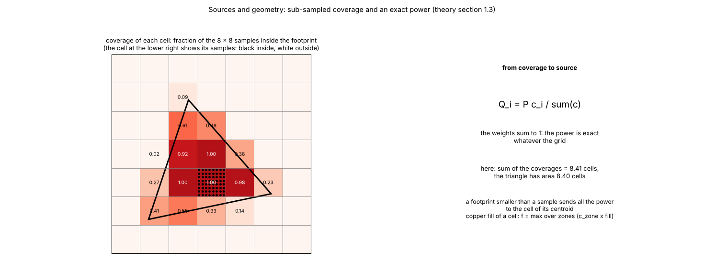

# 28. The continuum problem and the sources: from a footprint to a power vector

*Figure 20 (`figures/fig_20_continuum.png`): the board (and any block) as a solid with the heater as a power over a footprint, the exchange with the air on every face, the edges and the equation.*

*Figure 21 (`figures/fig_21_coverage.png`): a triangular footprint on a grid of cells; each cell is sampled on an 8 x 8 lattice and its coverage is the fraction of samples inside the polygon (computed here); the sum of the coverages (8.41 cells) equals the area of the triangle (8.40 cells), so the power shared in proportion is exact.*

**Status: in program** (`docs/theory.md` sections 1.1 and 1.3).

## 1. The continuum problem

Heat conduction in the board (and in any metal block) is

    rho c dT/dt = div(k grad T) + q

with `k` a tensor (diagonal: `k_ip, k_ip, k_th` for FR-4, `k_cu` for copper, `k` for a metal block). Every outer face exchanges heat with the air, `-k dT/dn = h (T - T_amb)` with `h = h_conv + h_rad` (topic 08); the board edges use `h_side` or are insulated. The sources are the heaters: a power `P` spread **uniformly over a footprint** (a polygon on one layer). In steady state `dT/dt = 0`. Topic 01 turns this into the layered model.

## 2. From a polygon to a source vector

A footprint polygon is rasterised on the grid by **sub-sampling**: every cell is sampled on an `s x s` lattice (`s = 8` for heaters, 4 for zones, heatsinks and blocks), and the fraction of samples inside the polygon (even-odd ray test) is the **coverage** `c` of the cell, 0 to 1. A heater's source vector is

    Q_i = P c_i / sum(c)

so the power is **exact** whatever the grid (the weights sum to 1); if the footprint is smaller than a sample, all the power goes to the cell (or node) of the centroid. The copper fill of a cell is `f = max over the zones of the layer of (c_zone fill)`: the zone with the largest covered share wins in a cell. The research found that this maximum per cell loses half of the copper of two zones that abut inside one cell (it keeps one of the two coverages), and that an additive rule would double count zones that overlap; the proposed correction takes the maximum **per sample point** and then the mean (`research/gerber-models/README.md` 4.39, figure 11), which is right in both cases. It is measured on a copy outside the program and not applied.

## 3. Why sub-sampling and not the cell centre

A centre test turns a 1 mm heater on a 0.6 mm grid into 0 or 4 cells depending on the position, so the power, the peak and the mean footprint temperature would jump with the grid. Sub-sampling gives a coverage that changes smoothly with position and keeps the total power exact; the price is the first-order behaviour at features (topic 02).

## 4. Where it is used

The same coverage is the **cell cover** of an outline (topic 20), the coverage of a block (topic 11) and the weights of the junction-to-pad resistance (topic 09).

## 5. Related topics

01, 02, 08, 09, 11, 20.

## 6. Sources

* The continuum equation and boundary conditions: [IncroperaDeWitt], [CarslawJaeger].
* The sub-sampling rule and its exactness are own design (`docs/theory.md` 1.3); the figure computes the coverage of an example.

*What was read and what was not verified:* from `docs/theory.md` 1.1 and 1.3 (read in full); the centre-test remark is an explanation of why, not a measured comparison in this repository.
