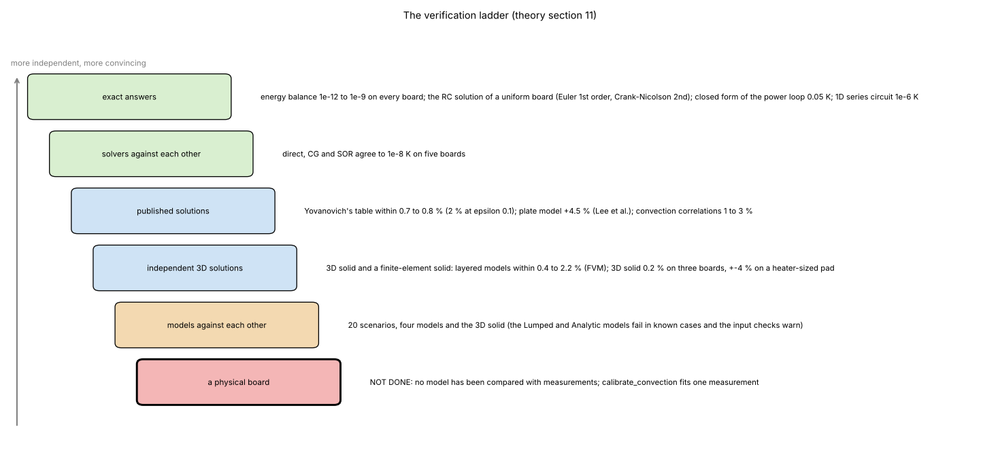

# 29. How the models are verified: the ladder from exact answers to a physical board

*Figure 22 (`figures/fig_22_verification_ladder.png`): the checks in order of independence, from exact solutions to the comparison between models, with the results of `docs/theory.md` section 11, and the rung that is still missing: a physical board. The independent-solutions rung now also names the independent 3D solver used in the test suite (`tests/test_layered_vs_3d.py`).*

**Status: in program** (`docs/theory.md` section 11, `docs/validation.md`).

## 1. The idea

A model can be right or wrong in ways that agree with itself. The checks are ordered by how independent they are of the code being tested:

| Piece | How it is checked | Result |
| :-- | :-- | :-- |
| Energy balance of every model | `power_out` against the injected power on every test board | 1e-12 to 1e-9 |
| Linear solvers | direct, CG and SOR on five boards | agree to 2e-8 K (`docs/validation.md` 5; `docs/theory.md` 11 says 1e-8) |
| Time stepping | exact RC solution of a uniform board | Euler first order, Crank-Nicolson second order |
| Layered idealisation | the 3D solid and an independent finite-element solid | 0.4 to 2.2 % (FVM) |
| 3D solid | finite-element solid, convergence in slabs and cells; Yovanovich's table | 0.2 % on three boards, +-4 % on a heater-sized pad; 0.7 to 0.8 % |
| Plate (block) model | published spreading resistance (Seri Lee, 1998) | +0.6 % centre, -0.8 % edge, -4.6 % corner (the +4.5 % of `docs/theory.md` was a 24 mm source) |
| Convection correlations | textbook air properties, closed forms | 1 to 3 % |
| Parts | closed form `delta T = P0 R / (1 - alpha P0 R)` | 0.05 K |
| Mesh and model comparison | 19 scenarios, four models and the 3D solid (`docs/theory.md` 11 says 20) | `docs/validation.md` 2 |

## 2. What each rung can and cannot tell

* **Exact answers** show the arithmetic and the discretisation are right (an energy balance can still be closed by a wrong model).
* **Solvers against each other** show the answer is the solution of the linear system, not of the algorithm.
* **Published and independent solutions** show the physics of the idealisation: the 3D solid and the finite-element solid share two choices (the via as a rod of the barrel's copper area and the fins as an extra surface coefficient), so they do not test vias and fins independently; the fins are checked against a 2D fin instead (topic 11).
* **Models against each other** show where the reduced models (Lumped, Analytic) fail and that the input checks warn.
* **A physical board**: **not done**. No model has been compared with a measurement; `calibrate_convection` fits one. This is the largest gap of validity: every error figure above is against another calculation. The disclaimer that the results are a design aid, to be validated by measurement, belongs in the About box, the user guide and every report (`docs/versions.md` "Planned").

## 3. Where each is in the repository

Energy balance and solvers: `tests/` (with `tests/test_layered_vs_3d.py`: the independent 3D solver, `tests/helpers/layered3d.py`, a copy of `research/effective-conductivity/lib/layered3d.py` that imports nothing from the program), `research/models-comparison/` (figure 3). Time: `docs/validation.md` 7. 3D and finite-element solids, Yovanovich, GCI: `research/solid3d-verification/`. Models against each other: `research/models-comparison/` (figures 1, 2, 9). Datasheet boards: `research/power-calculator/`.

## 4. Related topics

02, 04, 07, 14, 18.

## 5. Sources

* Verification and validation practice (grid convergence index): [Roache]; the standard that frames a comparison with data as an error `E = S - D` with a validation uncertainty and not as pass or fail: [ASMEVV20]. The exact solution used: [Yovanovich2003]. The numbers: [L-validation], [L-solid3d].

*What was read and what was not verified:* the table is from `docs/theory.md` section 11 (read in full); there is no measurement of a physical board.
