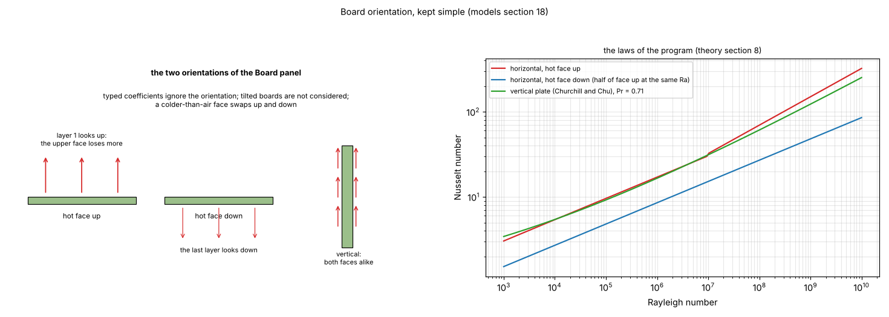

# 30. Board orientation, kept simple

*Figure 23 (`figures/fig_23_orientation.png`): the two orientations of the Board panel (horizontal with layer 1 facing up, and vertical) and the three natural-convection laws against the Rayleigh number; at the same Rayleigh number the facing-down coefficient is half the facing-up one. Constant air properties (Prandtl 0.71) for the vertical law.*

**Status: in program** (`docs/models.md` section 18, `tests/test_orientation.py`).

## 1. What it is

The mounting follows from the layer numbering: **layer 1 is the top face and looks up**, the last layer looks down. The Board panel has only two orientations, **horizontal** (layer 1 faces up) and **vertical** (on its edge). The orientation changes the computed natural convection only; typed coefficients ignore it; tilted boards and the facing-down option of an earlier version were dropped for simplicity. A heatsink's own orientation is inside its `theta_SA` (topic 13).

## 2. The laws (topic 08 has the full set)

* Horizontal plate, hot surface **facing up**: `Nu = 0.54 Ra^(1/4)` (Ra from 1e4 or 1e5 to 1e7), `0.15 Ra^(1/3)` above.
* Hot surface **facing down**: `Nu = 0.27 Ra^(1/4)` (Ra 1e5 to 1e10).
* Characteristic length `L = A / P` (area over perimeter), which collapses circular, square, rectangular and triangular plates.
* A surface **colder** than the air swaps up and down.
* Vertical plate: Churchill and Chu, `Nu = (0.825 + 0.387 Ra^(1/6) / [1 + (0.492/Pr)^(9/16)]^(8/27))^2`.

So the upper face of a horizontal board takes more of the heat than the lower one, a vertical board treats both faces alike, a cold board swaps the faces.

## 3. Limits

Measured PCB studies show the orientation effect also depends on the components on the board (ribs and protrusions change the flow): the correlations are for a bare plate and the uncertainty stays at 20 to 30 %.

## 4. Where it is tested

`tests/test_orientation.py`: the program against these numbers and against the behaviour they imply (upper face takes more, vertical symmetric, cold board swaps, facing-down half of facing-up at the same Rayleigh number, agreement with the formulas written out by hand, typed coefficients indifferent).

## 5. Related topics

08 (all the correlations), 13.

## 6. Sources

* The correlations: [IncroperaDeWitt] (horizontal plate laws), [ChurchillChu1975] (vertical plate), the characteristic length of a plate: [LloydMoran1974] (cited by `docs/models.md` section 18; not opened).
* Own computation (the tests).

*What was read and what was not verified:* from `docs/models.md` section 18 (read in full); the "uncertainty 20 to 30 %" is the document's statement of measured PCB studies, not re-read.
