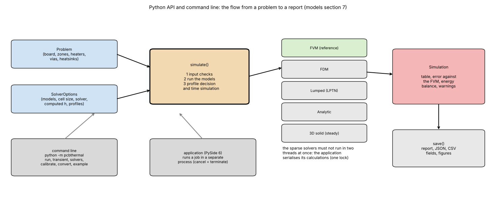

# 31. How the program is organised: from a problem to a report (API and command line)

*Figure 24 (`figures/fig_24_architecture.png`): the builder of a problem and the solver options enter `simulate()`, which runs the input checks, the selected models and the profile decision and time simulation, and returns a `Simulation` that can be saved; the command line and the application sit on top, the application running its jobs in a separate process.*

**Status: in program** (`docs/models.md` sections 7 and 8, `CLAUDE.md` project structure).

## 1. The layers

* **Physics core** (`pcbthermal/`, no GUI imports): `model.py` (Board, Zone, Heater, Via, Heatsink, Problem with the mm builder and JSON), `geometry.py`, the five models (`fvm.py`, `fdm.py`, `lumped.py`, `analytic.py`, `solid3d.py`), `blocks.py`, `convection.py`, `profiles.py`, `analysis.py`, `inverse.py`, `checks.py`, `api.py`.
* **Numerics separate from the GUI** so the solvers can be tested without Qt.
* **Command line** `python -m pcbthermal {run, transient, solvers, convergence, calibrate, convert, gui, example}`.
* **Application** (PySide 6): document with undo, canvas, panels, results views; calculations run in one `spawn` process (cancel = terminate; a watchdog makes the process exit when the parent dies).

## 2. The call

    p = Problem.new(width_mm=100, height_mm=80, layers=4)
    p.add_zone(1, rect=(15, 15, 85, 65)).add_full_copper([2, 3, 4])
    p.add_heater(1, 4.0, rect=(30, 35, 40, 45), name="U1", theta=6.0)
    sim = simulate(p, SolverOptions(models=("fvm", "fdm", "lumped", "analytic"), cell_mm=suggest_cell_mm(p)))
    print(sim.to_markdown())      # models, error against the FVM, energy balance, warnings
    sim.save("results")           # report, JSON, CSV fields, figures

`simulate` runs the selected models, the input checks, the power-profile decision and time simulation, and returns a `Simulation` (table, report, `save`).

## 3. Rules that follow from the design

* Units: SI inside, mm and K cm2/W only at the user boundary.
* The sparse solvers of SciPy must not run in two threads at once: the application serialises its background calculations with one lock; do the same in your own code (found when a stress test aborted the process).
* A result arriving after an edit made during a run is marked outdated (found by the stress test).
* Defaults and libraries come from `data/defaults.json` plus the user's `user_defaults.json` (only the differences); `model.new_problem()` and `api.default_options()` apply them, the physics API (`Problem.new`) is unchanged.

## 4. Where it is tested

`tests/` (about 300 tests, the GUI offscreen), `tests/test_docs.py` (Doxygen on every function), `tests/test_gui_stress.py` (every example with every model and results view, bad CSV files, edits during a run, random actions).

## 5. Related topics

all of them: every model topic (02 to 06, 11) is one box of the figure.

## 6. Sources

Own design; no external source. The file layout is recorded in `CLAUDE.md` (Project Structure).

*What was read and what was not verified:* from `docs/models.md` sections 7 and 8 and `CLAUDE.md` (read in full); the figure is a diagram of the call, not a UML of every module.
