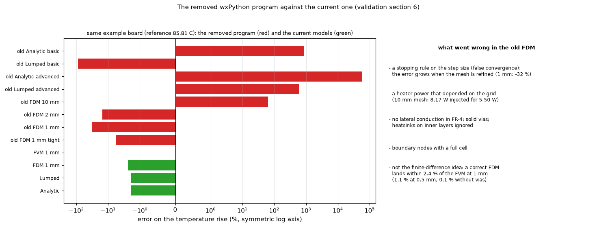

# 32. The removed wxPython program against the current one

*Figure 25 (`figures/fig_25_legacy_vs_current.png`): the error on the temperature rise of the old program (red) and of the current models (green) on the same example board, on a symmetric logarithmic axis (the table of `docs/validation.md` section 6).*

**Status: history and verification** (`docs/validation.md` section 6; the code is at tag `legacy-wxpython-1.0.0` and commit `641da87`).

## 1. What was compared

The same example board, reference 85.81 C (the current FVM at 1 mm), with the original code run from the tag:

| Program | Model | Tmax (C) | Error on the rise | Power used (W) |
| :-- | :-- | --: | --: | --: |
| old | Analytic, basic | 603.95 | +851 % | 5.50 |
| old | Lumped, basic | 32.24 | -88 % | 5.50 |
| old | Analytic, advanced | 34081 | +55,845 % | 5.50 |
| old | Lumped, advanced | 449.00 | +597 % | 5.50 |
| old | FDM, 10 mm (defaults) | 124.93 | +64 % | **8.17** |
| old | FDM, 2 mm | 76.94 | -15 % | 5.50 |
| old | FDM, 1 mm | 66.56 | **-32 %** | 5.50 |
| old | FDM, 1 mm (tight tolerance, omega 1.9) | 82.50 | -5.5 % | 5.50 |
| new | FVM, 1 mm | 85.81 | 0 | 5.50 |
| new | FDM (area sampling), 1 mm | 84.38 | -2.4 % | 5.50 |
| new | Lumped | 84.66 | -1.9 % | 5.50 |
| new | Analytic | 84.65 | -1.9 % | 5.50 |

## 2. What went wrong in the old program

* a **stopping rule on the step size** (false convergence): the error grew when the mesh was refined; the SOR with the residual criterion fixes it (topic 02);
* a **heater power that depended on the grid** (8.17 W injected for 5.50 W at 10 mm): the coverage sub-sampling gives an exact power (topic 28);
* no lateral conduction in FR-4, solid vias, heatsinks on inner layers ignored, boundary nodes with a full cell;
* a dimensionally wrong analytic term and an invalid lumped network.

All were fixed (conservative cell balance, exact power, anisotropic FR-4, hollow vias). **It was not the finite-difference idea**: a correct FDM (topic 03) lands within 2.4 % of the FVM on this board at 1 mm and 1.1 % at 0.5 mm, within 0.1 % where there are no vias. *(An earlier version said "within about 1 %" next to the -2.4 % of the same table.)*

## 3. Related topics

02, 03, 05, 06, 28.

## 4. Sources

Own computation: [L-legacy] (the tag and commit named above) and `docs/validation.md` section 6.

*What was read and what was not verified:* the numbers are from `docs/validation.md` section 6 (read in full); the old code was not re-run here.
