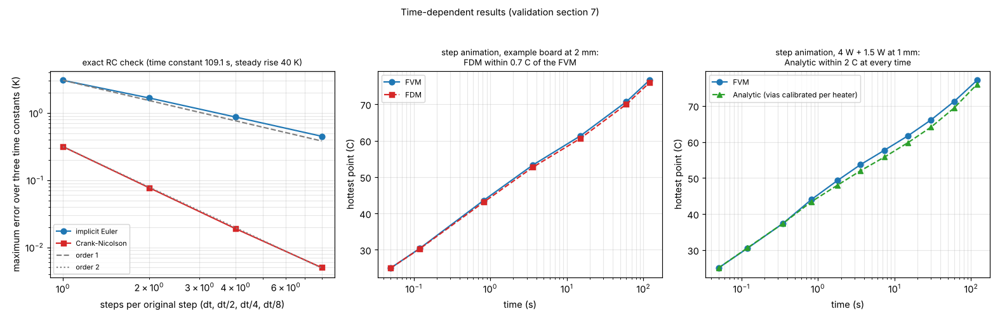

# 33. Time-dependent results: what the transient checks show

*Figure 26 (`figures/fig_26_time_results.png`): left, the maximum error of implicit Euler and Crank-Nicolson against the step on an exact RC solution (first and second order); middle, the hottest point after a power step in the FVM against the FDM; right, the same in the FVM against the Analytic model (values of `docs/validation.md` section 7).*

**Status: in program** (`docs/validation.md` section 7; scheme in topic 07, profiles in topic 10).

## 1. The exact check

One layer, a heater over the whole board, insulated edges: `C d theta / dt = P - G theta`, time constant 109.1 s, steady rise 40 K. Maximum error over three time constants:

| Scheme | dt | dt/2 | dt/4 | dt/8 |
| :-- | --: | --: | --: | --: |
| implicit Euler (K) | 3.06 | 1.67 | 0.87 | 0.45 |
| Crank-Nicolson (K) | 0.315 | 0.077 | 0.019 | 0.005 |

First and second order respectively; stored plus lost heat equals the injected heat within 0.2 %.

## 2. The models against each other

* **FVM against FDM** (example board, 2 mm): the hottest point is within 0.7 C at every output time (steady maxima 85.3 and 84.7 C). Power-profile peak: 134.2 C (FVM) against 129.6 C (FDM) at 2 mm, where the 6 mm heater is only three cells wide.
* **FVM against Analytic** (4 W + 1.5 W, 1 mm): within 2 C at every time after calibrating the vias per heater (without it up to 10 C off). The hottest point reaches 63 % of its final rise in about 19 s; the whole board needs minutes.

## 3. Power profiles

The exact mean power per step reproduces the energy for any step; against the exact periodic solution of a uniform board the decision's peak is within 0.3 % and Crank-Nicolson stepping within 0.4 %; averaging a fast heater changes the peak by less than the oscillation neglected, with 40 times fewer steps; a table equals the equivalent square wave to round-off. Example board with two heaters (100 Hz at 30 % duty averaged, 20 s period at 25 % duty resolved): peak of the hottest point FVM 135.3 C, Analytic 134.7, Lumped 131.8; steady with the average power 85.8 / 84.8 / 84.7 C; bound with the on-state powers 231.6 C (FVM). CSV example: peak FVM 119.5 C, Lumped 116.1, Analytic 115.1 (within 4 %).

## 4. Limits

The time simulation keeps the steady-state coefficients (topic 08); a metal block is refused by Lumped and Analytic in time; the Analytic transient smears vias and heatsinks (warned); the package has no heat capacity (topic 12). No transient measurement of a physical board.

## 5. Related topics

06 (modal propagator), 07 (scheme), 10 (profiles), 12.

## 6. Sources

Own computation: [L-validation]; the RC solution is textbook.

*What was read and what was not verified:* the numbers are from `docs/validation.md` section 7 (read in full) and are plotted exactly as listed there.
