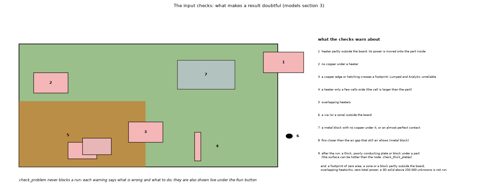

# 34. The input checks: what makes a result doubtful

*Figure 27 (`figures/fig_27_input_checks.png`): one board with the situations that `check_problem` warns about: 1 a heater partly outside the board, 2 no copper under a heater, 3 a copper edge crossing a footprint, 4 a heater only a few cells wide, 5 overlapping heaters, 6 a via outside the board, 7 a metal block with no copper under it. Items 8 and 9 and the last line were added for the checks that came later (fins closer than a still-air gap, the thick-plate check after the run, the 3D size limit).*

*Figure 33 (`figures/fig_33_thick_plate_correction.png`): the through-thickness correction `q'' t / (2 k)` against the thickness of the plate for copper (385 W/mK), aluminium (204), carbon steel (54) and FR-4 (0.3 through the thickness), for the flux of U1 of the example board (4 W over 100 mm2, 40 kW/m2), with the limit of the thick-plate check, 5 % (`checks.THICK_PLATE_LIMIT`) of the 60.87 K rise: 3.04 K. The thickness at the limit is 58.6 mm for copper, 31 mm for aluminium, 8.2 mm for steel and 0.046 mm for FR-4; the 35 um copper layer is 3 orders of magnitude below the limit. The rise here is that of the hottest point of the board (FVM, 0.5 mm), a stand-in for the rise of the heater that the check uses. Computed by `scripts/make_figures.py`.*

**Status: in program** (`pcbthermal/checks.py`, `docs/models.md` section 3).

## 1. What it does

`check_problem` (also run by `simulate` and live in the application under the Run button) **never blocks a run**. It lists, in plain words with what is wrong and what to do, the inputs that make a result physically doubtful. The warnings are the program's honesty about where the models are known to fail (topics 05, 06, 11, 20):

| # | Situation | Why it matters |
| :-- | :-- | :-- |
| 1 | a heater partly outside the board | its power is moved onto the part inside |
| 2 | no copper under a heater | the heat has only the laminate to spread in; Lumped and Analytic assume copper |
| 3 | a copper edge or hatching crossing a footprint | Lumped and Analytic unreliable (27 % low with an edge across the footprint, topics 05 and 06) |
| 4 | a heater only a few cells wide | the footprint is poorly resolved (thin heaters, +9.5 % in Lumped) |
| 5 | overlapping heaters | the powers add on the same cells |
| 6 | vias or zones outside the board | they are ignored |
| 7 | a metal block with no copper under it, or an almost perfect contact | the heat has no path into the block, or the contact is optimistic (topic 24) |
| 8 | plate fins closer than still air allows | the channel between the fins chokes; the fin model assumes the typed coefficient (topic 11) |
| - | a footprint of zero area; more than half of a zone outside the board; part of a metal block outside the board; two heatsinks that overlap | the area is ignored or only the part inside (or only the later heatsink) is used |
| - | zero total power | there is nothing to simulate |
| 9 | after the run: `q'' t / (2 k)` of a heater's copper layer or of a block under it above 5 % of the rise (`check_thick_plates`, with the flux that enters the block in the FVM or FDM result) | one node through a thick, poorly conducting plate is cooler than its surface under the source (topic 01) |

The Results summary also carries the warnings of the models themselves (the Lumped and Analytic models run on the rectangle of the same area of an outline, a block refused in time, the Analytic transient smearing vias, a 3D solid above 250 000 unknowns not run, a top-path split or a power loop that did not converge).

## 2. Where it is tested

`tests/` (the checks) and the stress test of the application (bad inputs, odd boards).

## 3. Related topics

05, 06, 11, 20, 24.

## 4. Sources

Own design; the failure cases are measured in `docs/validation.md` sections 2, 3 and 13 ([L-validation]).

*What was read and what was not verified:* from `docs/models.md` section 3 (read in full) and the list of messages of `pcbthermal/checks.py` of `develop` (rows 8, 9 and the line of further checks were missing here and are missing from `docs/models.md` 3); the thresholds inside `checks.py` were not re-derived here.
