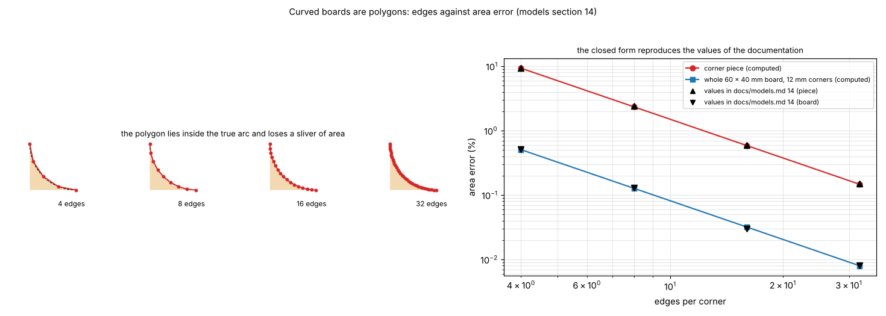

# 35. Curved boards are polygons

*Figure 28 (`figures/fig_28_curved_boards.png`): a rounded corner as a polygon with 4, 8, 16 and 32 edges (dashed: the true arc; the polygon lies inside it and loses a sliver of area), and the area lost against the number of edges: the closed form of an inscribed polygon (computed here) reproduces the values of `docs/models.md` section 14.*

**Status: in program** (`geometry.rounded_rectangle`, presets and Subdivide in the application, `docs/models.md` section 14).

## 1. What it is

A board edge is a polygon; a curve is a polygon with many short edges. The application offers presets (ellipse with 32 edges, **rounded corners** with 8 edges per corner, chamfers), **Subdivide** (a vertex in the middle of every edge, repeated to refine) and a vertex table; `geometry.rounded_rectangle(width, height, radius, segments)` builds a rounded rectangle for scripts. The solver treats the edge with the **cell cover**: a cell on the outline conducts with its covered fraction and loses heat along the outline length inside it (topic 20).

## 2. The area lost

An inscribed polygon with `n` edges per quarter circle has the area of the sector `(n/2) r^2 sin(pi/(2n))` against `pi r^2 / 4`, so the relative loss of the quarter disc is `1 - (2n/pi) sin(pi/(2n))`. For a 60 x 40 mm board with 12 mm corners:

| edges per corner | corner piece itself | whole board |
| --: | --: | --: |
| 4 | 9.3 % | 0.51 % |
| 8 | 2.4 % | 0.13 % |
| 16 | 0.6 % | 0.03 % |
| 32 | 0.15 % | 0.008 % |

(the figure checks these numbers against the closed form). With corners of 12 mm radius, a heater 2 mm from the corner and 0.5 mm cells, going from 8 to 16 edges per corner changes the temperature by less than 1 % (`tests/test_templates.py`).

## 3. The rule

Use edges not much longer than a few cells and cells smaller than a fifth of the radius of curvature; a neck narrower than two or three cells is poorly resolved. Subdividing refines the outline only: the solver grid is the cell size. Roadmap: arc and spline outlines, refinement near curves, holes and cut-outs inside the board.

## 4. Related topics

02 (cover), 20 (outline), 05 and 06 (the rectangle of the same area).

## 5. Sources

Own computation: [L-outline]; the closed form is elementary geometry.

*What was read and what was not verified:* the table is from `docs/models.md` section 14 and reproduced by the formula in `scripts/make_diagrams.py`.
