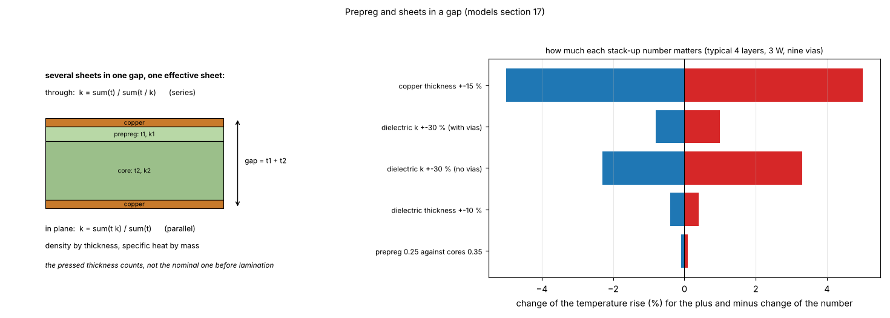

# 36. Prepreg and several sheets in one dielectric gap

*Figure 29 (`figures/fig_29_prepreg.png`): a prepreg and a core combined in one gap (resistances in series through the thickness, conductances in parallel in the plane) and how much each stack-up number moves the temperature rise (the values of `docs/models.md` section 17).*

**Status: in program** (`combine_sheets`, `data/stackups.json`, `docs/models.md` section 17).

## 1. What it is

A **prepreg** is glass cloth with uncured resin; after lamination it is a dielectric sheet like a core. In the model every gap between two copper layers is a thickness with a conductivity, so a prepreg enters as its **pressed thickness** (after lamination, not the nominal thickness before pressing) and its conductivity, exactly as a core does.

* **Thickness**: the pressed thickness is smaller than the nominal one because resin flows into the etched copper. Fabricator numbers: a 7628 prepreg 210.4 um pressed (8.6 mil nominal = 218 um), 1080 about 70 to 76 um, 2116 about 115 to 130 um, 3313 about 107 um; resin content 40 to 50 % standard.
* **Conductivity**: the glass raises it a little above the pure resin (0.2 to 0.3 W/mK); FR-4 laminates measure 0.29 to 0.34 W/mK through the thickness; filled prepregs reach 0.8 to 2 W/mK. Values for 1080, 2116 or 7628 separately were not found, so prepreg and core use the same FR-4 properties by default; per gap another material can be chosen.

## 2. Several sheets in one gap

A gap is normally one sheet. For a prepreg and a core with no copper between, or two plies of different glass styles, `combine_sheets` makes one gap of the **sum of the thicknesses**:

    k_through = sum(t) / sum(t / k)         (resistances in series)
    k_inplane = sum(t k) / sum(t)           (conductances in parallel)

with the density by thickness and the specific heat by mass. A template entry can give `"sheets": [...]` instead of one thickness.

## 3. How much it matters (typical 4 layers, 3 W under a 6 x 6 mm part, nine vias)

| Change | Rise |
| :-- | --: |
| all dielectric conductivities +-30 % | -0.8 / +1.0 % |
| all thicknesses +-10 % (the fabricator's tolerance) | -+0.4 % |
| a prepreg of 0.25 W/mK against cores of 0.35 | 0.1 % |
| the same +-30 % without vias | -2.3 / +3.3 % |
| **copper thickness +-15 %** | -+5 % |

The exact prepreg is not critical; the copper weight and the vias are: enter them carefully.

## 4. Related topics

01, 21 (vias), 22 (stack-up).

## 5. Sources

* Fabricator thicknesses and builds: [StackupTables] (JLCPCB, Eurocircuits and others). The pressed-thickness formula of a patent and the conductivity ranges are quoted by `docs/models.md` section 17 without addresses (**S**: not recorded).
* Own computation: [L-stackup].

*What was read and what was not verified:* from `docs/models.md` section 17 (read in full); the conductivity ranges are the document's, the sources were not recorded.
