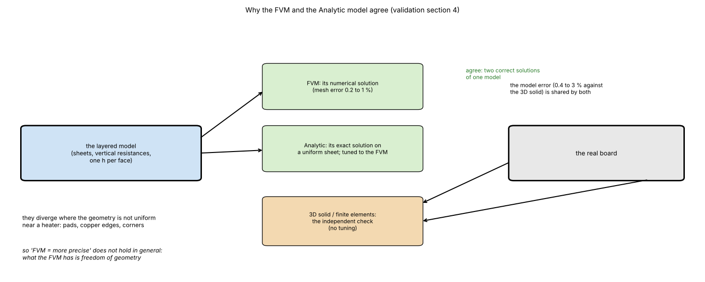

# 37. Why the FVM and the Analytic model give about the same numbers

*Figure 30 (`figures/fig_30_why_fvm_analytic_agree.png`): the FVM and the Analytic model solve the same layered model (numerically and exactly), the real board differs from that model by an error they share, and part of their agreement was tuned; the 3D solid and the finite-element solid are the independent check.*

**Status: explanation** (`docs/validation.md` section 4).

## 1. Four reasons

1. **They solve the same model.** Both treat every layer as a thin conducting sheet, the dielectric as a vertical resistance, one constant `h` per face, the same material properties. The Analytic model is the **exact** solution of that model on a uniform sheet; the FVM is its **numerical** solution; two correct solutions of one model agree, within the FVM's mesh error (0.2 to 1 %).
2. **The real board is not that model, and that error is shared** (0.4 to 3 % against the 3D solid). Neither can be better than the layered model; "FVM = more precise" does not hold in general. What the FVM has is **freedom of geometry**.
3. **Part of the agreement was engineered**: the Lumped and Analytic models were tuned against the FVM (copper weighted with the heater influence, fin lengths, Bessel factors), so the comparison tables measure agreement with the FVM; the 3D solid does not depend on that tuning.
4. **They diverge where the geometry is not uniform near the heater**: pads, copper edges, corners (24 % low with a 20 mm pad, 25 % with an edge across the footprint, topic 06).

## 2. What follows

* A table of "error against the FVM" is **agreement with a reference model**, not accuracy; the accuracy of the layered idealisation is measured against the 3D solid (topic 29).
* The vias and the fins are not tested independently by the 3D and finite-element solids, which share the choice of the via as a rod of the barrel's copper area (topic 29).

## 3. Related topics

01, 02, 06, 29.

## 4. Sources

Own computation: [L-validation], [L-solid3d]. The FVM-plus-Fourier architecture also appears in the literature ([PMC11410250]).

*What was read and what was not verified:* from `docs/validation.md` section 4 (read in full).
