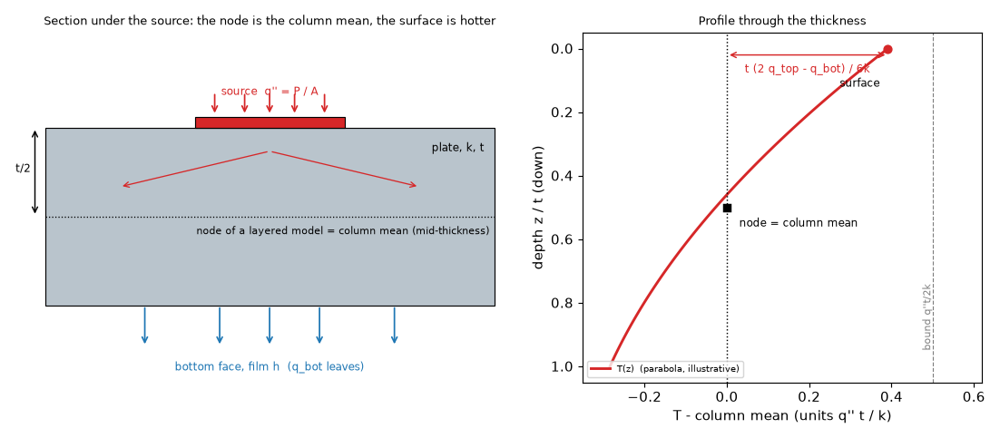
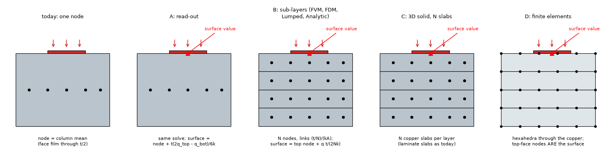
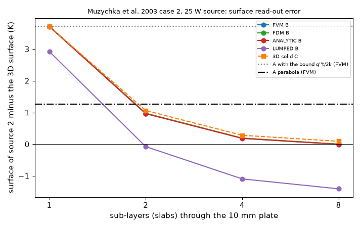
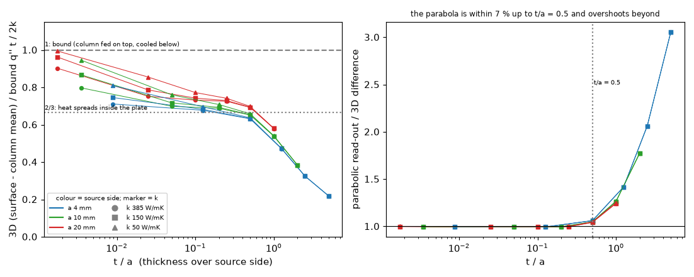
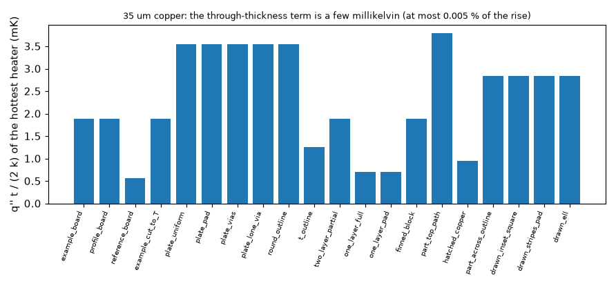
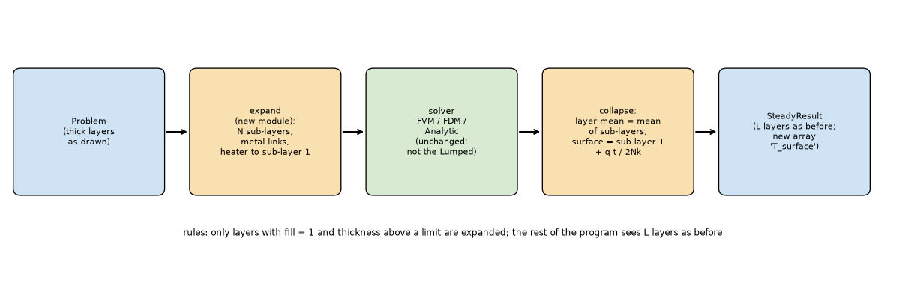

# Reading the temperature through the thickness of thick layers and blocks: four options, measured

The layered models (FVM, FDM, Lumped, Analytic) keep one temperature per copper layer, the mean over the thickness. Case 2 of Muzychka, Culham and Yovanovich (2003), a 10 mm plate under 100 to 250 kW/m2, reports the temperature of the SURFACE under the source, which is hotter than that mean. The film term `t/(2k)` (`fix/face-film-half-slab`, `docs/theory.md` 1.2, `docs/validation.md` 55) made the nodes read the column mean within 0.09 K; what is left is the through-thickness term itself, 2.06 / 4.70 / 3.82 / 2.94 K at the four sources. This folder asks how hard it is to let the program REPORT (and where useful COMPUTE) that term, and measures four options on the published cases. Nothing of the program is edited (`git diff development --stat -- pcbthermal tests examples ico` is empty); every prototype is a text patch or a re-expression of the problem inside `lib/`.

Scripts (repository root; the program's environment, `.venv`, is enough): `study_options.py` (case 2, about 30 s, peak 2.0 GB), `study_sweep.py` (thickness, source size and conductivity sweep, about 50 s, 1.1 GB), `study_lee.py` (Seri Lee's plate, about 20 s, 0.8 GB), `study_frozen_impact.py` (the 20 harness boards that have a heater, about 20 s), `make_diagrams.py` and `make_figures.py`; library `lib/surface_readout.py`, `lib/sublayers.py`, `lib/solid3d_sublayers.py`; tests `tests/test_through_thickness.py` (7 passed in 0.5 s). Outputs go to the git-ignored `out/`. The heavy runs were small enough (largest peak 2.0 GB, one process at a time) that the shared heavy-job lock, which a battery held while this study ran, was not taken.

## 1. The question, the options, and what would answer it

Four ways to get the surface temperature of a thick plate:

* **A. Read-out**: no change of the solve; the surface is the node (the column mean) plus a term built from the heat fluxes through the two faces of the cell.
* **B. Sub-layers**: N nodes through a thick metal layer or block in the FVM, FDM, Lumped and Analytic, like the laminate sub-gaps; the top node plus half a sub-layer is the surface.
* **C. 3D solid with several slabs through the copper**: today `solid3d.slab_rule` applies to the dielectric gaps only; every copper layer is ONE slab (`solid3d.py` line 270, `add("cu", l, tc[l], kx, kz)`).
* **D. The finite-element model** designed on the branch `docs/fem-model-design` (`releases/2.8.0/fem-model/DESIGN.md`, read in full for this question; its 3.2 gives a copper layer above 105 um `ceil(t/70 um)` elements up to 8 and a block `clip(ceil(t/1 mm), 2, 8)`, its 5.4 a `column` (default) and a `surface` read-out).

*Figure 1 (`figures/fig_01_section_profile.png`): left, the section of a plate under a source (heat enters the top, spreads, leaves through the bottom film); the node of a layered model is the column mean at mid-thickness. Right, the temperature through the thickness as the parabola of section 3 with illustrative fluxes (the shape is the formula, the numbers are not a result): the surface is hotter than the node by `t (2 q_top - q_bot) / 6k`, and the bound `q'' t / 2k` of the program's warning lies beyond it.*

*Figure 2 (`figures/fig_02_options.png`): the nodes that each option keeps through the thickness; the red triangle is where the surface value comes from.*

What would answer the question: (1) a closed form for the surface-minus-mean term that is checked against an independent solver over the thickness, the source size and the conductivity (section 3 and 4.2); (2) the published case 2 reproduced by each option with the program's own models (4.1); (3) a thin-copper board, where nothing should change, proved (4.3); (4) the cost, the frozen-number impact and the risks (5 to 8).

## 2. References used

* **Independent 3D solver** `tests/helpers/layered3d.py` (imports nothing from the program; reproduces the paper's Table 4 to 0.03 K, `research/muzychka-case2-analytic` 2): the surface and the column mean of case 2, the plate sweep and the thin-copper board. Case 2 here at 0.5 mm with 8 sub-slabs (the 16 sub-slab reference peaks at 5.3 GB, above the 3 GB set for this study; it reads 0.02 K lower on the surface, `research/muzychka-case2-analytic` 2). Reference surface centroids 97.41 / 103.85 / 101.31 / 99.95 C against the paper's 97.40 / 103.82 / 101.28 / 99.94.
* **The paper**, Table 3 and Table 4 on the page image (PDF page 7, journal page 184, rendered here with pypdfium2): sources 10, 25, 20, 15 W, 10 x 10 mm at (12.5, 12.5), (37.5, 12.5), (12.5, 37.5), (37.5, 37.5) mm; centroid temperatures 97.40, 103.82, 101.28, 99.94 C and mean source temperatures 96.85, 102.33, 100.10, 99.07 C.
* **Seri Lee's plate** (100 x 100 x 1.3 mm, k 200, 25 mm source; published constriction resistance 0.66 / 1.29 / 2.38 K/W) with the independent values 0.668 / 1.284 / 2.275 of `research/effective-conductivity` 4.4.
* **Closed-form conduction**: the parabola of section 3, derived here from the heat balance of the column (not a source of the literature; its check is section 4.2).

## 3. The closed form of option A

A layer of thickness `t` and conductivity `k` whose field varies slowly in the plane satisfies `k t laplace(T_m) = -(q_top + q_bot)`, with `q_top` and `q_bot` the net heat fluxes ENTERING through the two faces and `T_m` the column mean. With z downwards `T_z(0) = -q_top/k` and `T_z(t) = +q_bot/k`, so `T(z) = T_0 - q_top z/k + (q_top + q_bot) z^2 / (2 k t)` and

* `T_top - T_m = t (2 q_top - q_bot) / (6 k)`, `T_bottom - T_m = t (2 q_bot - q_top) / (6 k)`.

A column fed on top and cooled below (`q_bot = -q_top = -q`) gives the familiar `q t / 2k`, the bound of `checks.thick_plate_bound`; heat that spreads inside the layer (`q_bot -> 0`) gives `q t / 3k`, two thirds of it. **What the parabola assumes** (review, section 11): it is exact for a 1D column (no in-plane flow, the profile is linear and the formula gives `q t / 2k`) and, beyond 1D, when the in-plane Laplacian of the temperature is the same at every depth (the lowest-order thin-layer expansion; that is the 'slowly varying' condition). It does not neglect the spreading (that is `q_top + q_bot`), it neglects the change of the spreading through the thickness, which is what fails under a source narrower than the plate. **Its range**: with heat entering on top and the bottom face losing it (`-q_top <= q_bot <= 0`) the parabola lies between `q t / 3k` and `q t / 2k`, two thirds of the bound to the bound; it can never read less than two thirds of the bound, while the true term falls to 0.22 of it at `t/a = 5` (4.2). A 'cap at the bound' is therefore never active with these signs (it acts only when heat also enters through the bottom face); for `t/a > 0.5` the read-out is an upper estimate by construction, not by a cap. The fluxes are available in the cell: `q_top` is the source heat over its footprint (the program's `Q` per cell over the cell area) minus the face film, `q_bot` is the film flux `-theta / (1/h + t/(2k))` through the half layer (or, on a stack, the vertical link flux). That film form takes the bottom face a linear half layer below the node; on the parabola the face is `T_m + t (2 q_bot - q_top) / 6k` and the consistent flux is `q_bot (1 + h t / 3k) = -h theta + h t q_top / 6k`; the two differ by terms of the order of the Biot number `h t / k` (0.027 on case 2, 1e-7 for 35 um copper at 10 W/m2K), which is why the study's simpler form is enough. `lib/surface_readout.py` holds it (`offsets`, `bottom_flux`, `column_bound`); the derivation is in its docstring and `docs/theory-text.md`.

## 4. Results

### 4.1 Case 2 of Muzychka and others (`study_options.py`, cell 0.5 mm)

Error of the surface read-out against the independent 3D surface (K), `+` is hot. **Tree**: every number of this table is of the program at `development` 68e024cc (after `fix/face-film-half-slab`, so the nodes carry the film term), re-run by the review (section 11) to the printed digit; the 3D reference is the same on any tree. The plate is the one-layer plate of `research/muzychka-case2-analytic/lib/case2.py`; for B the plate becomes N copper layers of `t/N` joined by links of the plate's own conductivity (`lib/sublayers.py`: an advanced stack-up whose "dielectric" is the metal, k_through = k, k_inplane negligible; the face films see half a sub-layer through `Board.face_film_h`); for C the program's `solid3d.py` read as text with the one copper-slab line replaced by a loop (`lib/solid3d_sublayers.py`; N = 1 is bit-identical to the program, tested).

| read-out | model | N | unknowns | s | S1 | S2 | S3 | S4 |
| :-- | :-- | --: | --: | --: | --: | --: | --: | --: |
| today (node) | FVM | 1 | 10 000 | 0.07 | -1.96 | -4.62 | -3.73 | -2.85 |
| A with the bound `q t/2k` | FVM | 1 | 10 000 | 0.07 | +1.37 | +3.71 | +2.94 | +2.15 |
| **A parabola** | FVM | 1 | 10 000 | 0.07 | **+0.57** | **+1.26** | **+1.03** | **+0.80** |
| A parabola | FDM / Analytic | 1 | 10 201 / 10 000 | 0.0 | +0.54 / +0.57 | +1.27 / +1.26 | +1.03 / +1.03 | +0.79 / +0.79 |
| B | FVM | 2 | 20 000 | 0.06 | +0.35 | +0.97 | +0.76 | +0.55 |
| B | FVM | 4 | 40 000 | 0.22 | +0.07 | +0.19 | +0.15 | +0.11 |
| B | FVM | 8 | 80 000 | 0.95 | -0.00 | -0.00 | -0.00 | -0.00 |
| B | FDM | 4 / 8 | 40 804 / 81 608 | 0.22 / 1.13 | +0.04 / -0.03 | +0.19 / +0.00 | +0.14 / -0.01 | +0.09 / -0.02 |
| B | Analytic | 4 / 8 | 40 000 / 80 000 | 0.06 / 0.12 | +0.07 / -0.00 | +0.18 / -0.00 | +0.14 / -0.00 | +0.10 / -0.00 |
| B | Lumped | 1 / 2 / 4 / 8 | 10 000 to 80 000 | 0.1 | +1.67 / +0.55 / +0.18 / +0.06 | +2.93 / -0.07 / -1.09 / -1.41 | +2.70 / +0.33 / -0.48 / -0.72 | +1.89 / +0.15 / -0.44 / -0.62 |
| C | 3D solid | 1 | 50 000 | 0.31 | +1.37 | +3.71 | +2.94 | +2.15 |
| C | 3D solid | 2 / 4 / 8 | 60 000 / 80 000 / 120 000 | 0.47 / 0.92 / 3.82 | +0.44 / +0.16 / +0.09 | +1.06 / +0.28 / +0.09 | +0.86 / +0.24 / +0.09 | +0.65 / +0.20 / +0.09 |

*Figure 3 (`figures/fig_03_case2_options.png`): the error of the surface of the 25 W source against the number of sub-layers or slabs, for B (four models) and C, and the two read-outs of A as horizontal lines.*

Readings:

* The node of every layered model (N = 1) reads 2.0 / 4.6 / 3.7 / 2.9 K below the independent surface (the through-thickness term, with the film term already in). The column mean of the independent solver is read within 0.10 K by the FVM, FDM, Analytic and 3D solid at N = 1 and by the FVM and Analytic at N >= 2 to 0.00 K (two decimals), by the FDM to -0.02 to +0.01 K (the stack's mean over its sub-layers): the sub-layer stack changes nothing about the column mean, as it should.
* **A with the bound overshoots** by +1.4 to +3.7 K (it is the program's warning bound, never a read-out). **The parabola cuts it to +0.6 to +1.3 K** (0.8 to 1.6 % of the rises 72.4 / 78.8 / 76.3 / 75.0 K above the ambient): it still overshoots because the source (10 mm) is not wide against the plate (t/a = 1), section 4.2.
* **B converges as 1/N**: +1.0 K at N = 2, +0.2 at N = 4, 0.00 at N = 8 in the FVM, FDM and Analytic, for 2, 4 and 8 times the unknowns (0.95 s against 0.07 s). The 0.00 at N = 8 is partly by construction: the reference also has 8 sub-slabs and extrapolates its top slab as B does; the paper's own centroids are matched by the reference to 0.03 K, so B at N = 8 is within 0.03 K of the paper.
* **The Lumped is not a candidate for B**: its column mean carries its own error (+0.40, -0.70, -0.14, -0.16 K at N = 1 against the independent mean; +0.30, -0.80, -0.24, -0.26 K at N >= 2), and the surface read-out converges with N to that offset, not to the surface (S2 +2.93, -0.07, -1.09, -1.41 K at N = 1, 2, 4, 8). **Corrected by the review**: the first text called this 'not monotonic in N'; the S2 error is monotonic, it passes through zero at N = 2 by a cancellation of the sub-layer error against the Lumped's own column-mean error and ends near that error (-0.80 K). The conclusion stands: B adds nothing to the Lumped's accuracy.
* **C converges more slowly than B** (+0.28 at N = 4, +0.09 at N = 8 for S2) and costs more per slab (0.92 s and 3.82 s against 0.22 s and 0.95 s of the FVM; the one-layer plate also has the four 0.25 um slabs of its 1 um laminate in the solid); its +0.09 K at N = 8 is the column-mean offset of the solid (+0.09 K at every N, the same 0.1 K as in `research/muzychka-case2-analytic` 2).

### 4.2 The thickness, source size and conductivity sweep (`study_sweep.py`)

A 50 x 50 mm plate, bottom film 400 W/m2K, top adiabatic, a centred square source of side `a` = 4, 10, 20 mm, thickness 0.035 to 20 mm, k = 385, 150, 50 W/mK (54 cases, independent 3D, 8 sub-slabs through the plate, cell 1 mm). Per case the 3D difference (surface under the source centre minus the column mean) divided by the bound `q'' t / 2k`, and the parabolic read-out divided by the 3D difference:

| t / a | 3D difference / bound | parabola / 3D difference |
| :-- | --: | --: |
| 0.002 to 0.125 | 0.68 to 0.99 | 0.993 to 1.000 |
| 0.2 to 0.5 | 0.63 to 0.74 | 0.994 to 1.062 |
| 1 to 1.25 (case 2 is 1) | 0.47 to 0.58 | 1.24 to 1.42 |
| 2 to 2.5 | 0.33 to 0.38 | 1.77 to 2.06 |
| 5 | 0.22 | 3.06 |

*Figure 4 (`figures/fig_04_thickness_sweep.png`): left, the true difference over the bound against t/a for the 54 cases (colour the source side, marker the conductivity); right, the parabolic read-out over the true difference.*

* The bound is right only for a source as wide as the plate is thick turned over (`t/a -> 0`, the column): the true term is 0.68 to 0.99 of it for `t/a <= 0.125`, 0.63 to 0.74 up to 0.5 (heat spreads; the flux through the bottom face under the source, column `q_bot/q` of `out/sweep.txt`, is 0.7 to 98 % of `q''`, near 100 % only for a thin plate under a wide source, where the term approaches the bound), 0.47 to 0.58 at 1 to 1.25 (case 2: 0.58) and 0.22 at `t/a = 5`. The earlier statement of `research/effective-conductivity` 4.6 (0.6 to 0.8 of the bound) is the middle of this range.
* **The parabola is within 7 % of the 3D difference up to `t/a = 0.5`** (0.993 to 1.062 over the 36 cases with `t/a <= 0.5`), and **overshoots beyond** (1.24 to 1.42 at 1 to 1.25, 1.8 to 2.1 at 2 to 2.5, 3.1 at 5). The reference has 8 sub-slabs; the review re-ran nine of the plates with 8 and 16 (section 11): up to `t/a = 0.5` the ratio moves by at most 0.007 (1.062 to 1.069 at the worst), at `t/a = 1` from 1.264 to 1.278 and at `t/a = 5` from 3.06 to 3.52, so the overshoot beyond 0.5 is, if anything, understated. So option A is a read-out for the ordinary range and an upper estimate for a thick plate under a small source; case 2 (t/a = 1) is in the second range.
* The term in % of the rise (the last column of `out/sweep.txt`) is the figure that decides whether it matters: 0.002 to 0.03 % for 35 um at any source size, conductivity and source side of the sweep; 1.4 to 7.0 % for 2 mm of copper under a 10 and a 4 mm source; 14 to 116 % for 10 mm of k 50 under a 20 and a 4 mm source.

### 4.3 A thin-copper board, and the 20 harness boards (`study_sweep.py` part 2, `study_frozen_impact.py`)

* Independent 3D, 35 um copper (8 sub-slabs) / 1.53 mm laminate / 35 um copper, 2 W on 6 x 6 mm, h 10 W/m2K: the surface of the copper under the part is **1.76 mK** hotter than the column mean of the copper slab, **0.0018 % of the 95.76 K rise** (the bound `q'' t / 2k` is 2.53 mK). Nothing visible changes.
* The 20 harness boards that have a heater (`releases/regression-harness/lib/regress_boards.py`; every one has 35 um copper): the largest bound over the heaters is **0.57 to 3.79 mK, 0.0009 to 0.0049 % of the FVM rise at 2 mm** (`out/frozen.txt`). The finned block of the harness has 3 mm of aluminium (k 204): `q'' t / 2k` with the footprint flux is 0.31 K, with the flux that really enters the block (8 to 21 % of it) 0.03 to 0.06 K; the 74 cases of `research/block-and-fins/scripts/study_thick_plate_criterion.py` give a median 0.07 % and a maximum 0.33 % of the rise (reproduced here at 2 mm: 0.07 / 0.33 %).

*Figure 5 (`figures/fig_05_harness_bounds.png`): the largest `q'' t / 2k` over the heaters of each harness board, in mK.*

### 4.4 Seri Lee's plate (`study_lee.py`, FVM 0.5 mm, 1 W)

| position | paper (K/W) | independent 3D | FVM node | A parabola | A bound | FVM B (N = 4) |
| :-- | --: | --: | --: | --: | --: | --: |
| centre | 0.66 | 0.668 | 0.664 | 0.668 | 0.669 | 0.668 |
| edge midpoint | 1.29 | 1.284 | 1.280 | 1.284 | 1.285 | 1.284 |
| corner | 2.38 | 2.275 | 2.270 | 2.274 | 2.276 | 2.274 |

(The independent values are those printed by `study_lee_spreading.py`, stored in the script; `--with-reference` recomputes them at 3.8 GB.) The plate is thin (t/a = 0.052) and the term is 0.005 K/W of a 0.67 to 2.3 K/W resistance: **the node reads the independent value within 0.6, 0.3 and 0.2 % and the parabolic read-out within 0.0, 0.0 and 0.05 %**; the one-node model needs no sub-layers here, and the 5 % warning is not reached (`q'' t / 2k` is 0.8 % of the 0.67 K/W at the centre).

## 5. Each option and each model: difficulty, where, what moves

Sizes: S (a day or less, one file), M (a few days, several files, new tests), L (a week or more, touches the solvers and the interface). "Frozen" says which records of `tests/regression` move.

| option | model | size | where in the code | frozen numbers | accuracy (4.1 to 4.4) | cost |
| :-- | :-- | :-- | :-- | :-- | :-- | :-- |
| **A** | FVM, FDM | **S to M** | a function `through_terms` (new module `pcbthermal/thickness.py` or in `laminate.py` beside `face_terms`) called from `fvm.attach_face_terms` (line 919, FDM calls it at `fdm.py` 496); reads the peak and mean in `analysis.heater_stats` (line 213, the `face_peak` slot at 141) and `zone_stats` (146); `checks.check_thick_plates` (1327) | none if only added as an array (`T_surface`, the FEM design's name); all 20 boards with a heater (mK) if the heater rows are REPLACED | parabola +0.6 to +1.3 K on case 2 (t/a = 1), 0.1 % on Lee, within 7 % for t/a <= 0.5 | none (a few array operations) |
| A | Analytic | M | the modal solution has the face flux `h theta` at every cell; `analytic._AnalyticAdapter` (the result builder) adds the arrays | as above | as the FVM (reads the same node within 0.1 K) | none |
| A | Lumped | M | the per-heater node and the first-ring conductances; no per-cell flux, so `q_bot` is the heater flux share through the bottom rings | as above | bracket `q'' t / 3k` to `q'' t / 2k`; the Lumped's own error on case 2 is 0.2 to 0.7 K larger | none |
| A | 3D solid | not needed | see C | | | |
| **B** | FVM, FDM, Analytic | **L** (M if limited to fully filled layers) | a new module that expands a Problem's thick layers into N sub-layers (copper layers of `t/N`, metal links) and collapses the result (`api.simulate`, before the solvers); the vertical link `fvm.py` 236-241 (`gz = k_gap cell / d`) does NOT mix the copper fill, so a patterned thick layer needs `gz` and its FDM and `laminate.build` counterparts changed | none below the thickness threshold (all harness copper is 35 um; the block is already a node layer); the threshold decides | +1.0 K at N = 2, +0.2 at N = 4, 0.00 at N = 8 (case 2); the column mean unchanged | N times the unknowns of the layer (0.07 to 0.95 s, 1 to 8 times) |
| B | Lumped | not recommended | | | S2 -0.07 / -1.09 / -1.41 K at N = 2 / 4 / 8 (converges to its own column-mean error, -0.80 K) | |
| **C** | 3D solid | **S** | `solid3d.py` line 270 (the one `add("cu", ...)`: a loop of `n_cu` slabs; the review recommends the FEM design's copper rule, `n_cu = 1` up to 105 um, else `min(ceil(t / 70 um), 8)` (DESIGN 3.2), so that the 3D solid and the FEM resolve the same copper; INTEGRATION 2 had `clip(ceil(t / 0.25 mm), 1, 8)`); `unknowns()` line 123 (`ns = L + ...`); the layer temperature `solve_steady` line 457 (`theta_all[net.board_slab]`: mean over the sub-slabs, the first for the surface); the heat enters the first slab (already `board_slab`) | **bit-identical for 35, 70 and 105 um** (one slab below the rule's threshold); moves only a thick copper layer (none of the 20 harness boards) | +0.28 K (N = 4) and +0.09 K (N = 8) on S2 | 1.6 / 2.4 times the unknowns at N = 4 / 8 on case 2 (the plate has 4 laminate slabs of its own); the memory law (`memory.py`, row `solid3d`) is in the unknowns, so it follows |
| **D** | FEM (design) | already in the design | `femmesh` copper rule `ceil(t/70 um)` up to 8, `T_surface` array and a Layer box entry 'Surface' (DESIGN 3.2, 5.4) | adds records, moves none | not measured here (scikit-fem is not in this environment): expected as the layered3d solver, which the FEM matches to 0.03 K on the paper | per the design: 1.1 to 2.8 times the 3D solid |

*Figure 6 (`figures/fig_06_expand_collapse.png`): option B as a wrapper around the unchanged solvers.*

## 6. Impact on the frozen numbers, measured and argued

* **Option A, additive**: the regression records hold `t_max`, the part means, balances and times (`tests/regression/regress_harness.py`); new arrays are not recorded, so no record moves. To be confirmed in the branch by running `PCBT_FROZEN_CELLS=2,1,0.5` (this study did not run it, it did not touch the program).
* **Option A as the headline** (the heater rows, `t_max` of a part, Tj, the margin) would move **every record of a board with a heater by 0.57 to 3.79 mK** (`study_frozen_impact.py`, 20 of 20 boards, against the tolerance 1e-8 K) and the harness boards' `t_max` read-outs. A 'Surface' choice is therefore not the default (the unanimity of the 35 um case is what makes a default choice 'Column mean' right: like for like with the other models).
* **Option C**: no board of the harness has a copper layer above 105 um, so with `n_cu = 1` up to 105 um the records are bit-identical; the test of this branch must assert it. Only a thick copper layer drawn by the user or a 10 mm plate moves.
* **Option B**: the same (a threshold), plus the one thing that can move a number silently: the vertical link ignores the fill (`fvm.py` 241). Expanding only layers whose copper fill is 1 everywhere keeps it exact.

## 7. Risks and the conventions that must be fixed first

1. **Double counting with the face terms.** `laminate.face_terms` adds `Q t_cu / (2 k_z A)` of LAMINATE over bare cells (fill below 1) and `Board.face_film_h` passes the half copper layer for the film (its cell coefficient is `f h_eff + (1 - f) h`, the same fill weighting). The through-thickness term of the copper is a third, different layer of the same stack. For the MEAN of a cell of fill f the copper term is weighted f and the laminate term 1 - f (as `face_terms`' mean). **For the PEAK the weighting is wrong (review)**: `face_terms`' peak takes the full laminate term in every cell with fill below 1 (times the sliver guard), because the hottest point of the face is over the bare laminate; the surface peak of such a cell is the larger of the two terms (the laminate one, about `k_cu / k_z` = 1000 times larger per thickness, in practice), never their weighted sum and never both. The test is a cell at f = 0.5 against the independent 3D with patterned copper. Not measured here.
2. **Which number is 'the temperature of a part'.** Three definitions meet: the peak of the node over the footprint (the program, `heater_peak`), the mean over it, and the surface. On 35 um copper they differ by milli-kelvin; on a thick plate by the term of section 4. The proposal keeps the node as the headline (like for like with the other models, as `docs/validation.md` 55 does) and adds the surface as a labelled read-out.
3. **Tj and the top path.** `Tj = T + P theta` uses the node peak; the part sits on the surface, so on a thick plate the true base temperature is the surface. Adding the surface offset to Tj would double count what the user's `theta_JB` already includes if it was measured on a board with a thick plate. Decision for the maintainer: keep Tj on the node, and show the surface offset beside it.
4. **Profiles and the transient.** The term is quasi-static for the part's face (as the laminate face term is); a fast wave has the diffusion time `t^2 / alpha` through the plate (10 mm copper, 0.1 s; 35 um, 10 ns, nothing). The profile curves would need the offset on each step as for `face_terms`; not studied.
5. **The parabola assumes the fluxes of the cell.** Under a part smaller than the thickness the true term is smaller than the parabola (4.2); the read-out should carry the flag 't/a > 0.5: upper estimate'. (The first text also asked for a cap at the bound; with heat entering on top and leaving below the parabola never exceeds the bound, section 3, so the cap is inactive and is not what makes it an upper estimate.)
6. **B and the zones**: layers expanded in the Problem change what a zone, a via and an imported mask refer to; the wrapper must map them (a via is a conductor through all the sub-layers; the heater goes to the first sub-layer of a top layer and the last of a bottom layer).

## 8. Warnings and what the user sees

* `checks.check_thick_plates` (line 1327) says the surface can be hotter by 'up to' the bound. With A it can state the estimate and the range: 'surface about X K above the node (estimate from the face fluxes; q'' t/3k to q'' t/2k)'. It stays useful above t/a = 0.5, where the estimate is an upper value; with option B or C or D resolved for that layer it can be silent. It cannot become unnecessary with A alone.
* User-visible (names aligned by the review with `releases/2.8.0/fem-model/DESIGN.md` 5.4, which defines the read-outs **column** (default), **surface** and **point**; one vocabulary for A and the FEM): a **read-out choice 'Column' (default) / 'Surface'** (a `SolverOptions.readout`, the command line `--readout surface`, the Simulation settings box, the report summary and the Results part table gaining a 'T surface' column only when a thick layer or a block is under a part); the Layer box of the Results gets 'Surface (top)' and 'Surface (bottom)' after the layers when any exists (the FEM design has the same two entries and stores them as `arrays["T_surface"]`, shape (2, ny, nx), absolute temperatures; option A should fill the same array, node plus offset, rather than new offset arrays `surface_peak` / `surface_mean`, so one implementation of the entry serves both); tooltips and user-guide text for each.

## 9. Recommendation

1. **Do A first, additive, for the FVM, FDM and Analytic (size M).** Cheapest and safest: no solve changes, no frozen number moves, and it lets the program REPORT the surface within 7 % of the through-thickness term up to `t/a = 0.5` (and an upper estimate beyond, never below two thirds of the bound). It also turns the warning from a bound into a number. Keep the node (the 'column' read-out) as the headline; fill the FEM design's `T_surface` array and use its names (section 8).
2. **Do C second (size S, bit-identical for every ordinary board)**: the 3D solid is the program's own check of a thick plate and today it is also one slab through the copper; four slabs make it read the surface within 0.28 K of 4.7 on case 2, eight within 0.09 K, and it is the model the layered models are compared to (the 3D solid's validation then states the surface, not the column mean). One line of the program and the unknown count.
3. **D (the FEM)** already has the through-thickness slabs and the surface read-out in its design; this study only confirms the rule is needed (the case 2 table) and asks that the FEM test of case 2 measure the surface within 0.1 K as DESIGN 8.2 says. One 'Surface' Layer-box entry serves A and D.
4. **B only if the maintainer wants the layered models to COMPUTE the through-thickness field** (size L): it works (error +0.2 K at N = 4 on case 2, from 4 times the unknowns) but a user who wants a resolved thick plate already has the 3D solid and the FEM, and B touches the vertical link, the zones, the vias and the interface. Do it last, limited to fully filled layers above a thickness threshold, and never for the Lumped.

Order and branches in `INTEGRATION.md`.

## 10. Limits of this study

* One plate geometry for B and C (case 2, one layer, a thin laminate), one stack for the thin-copper board, the sources square and centred or on the 10 mm grid of case 2; round or elongated sources, several layers of thick copper, a thick block over a board, a source at an edge and a plate with a partial fill were not run.
* The reference of case 2 is the independent solver at 0.5 mm with 8 sub-slabs, which carries a 0.02 K offset against 16 (the paper's values agree with it within 0.03 K); the plan cell was not varied here (the earlier folder found the plan converged).
* A parabola from face fluxes at one cell. At a source's edge the flux is singular and the read-out there was not examined (the centroid and the 4-cell centre were read).
* Memory: the independent reference at 16 sub-slabs and the program's 8-layer stack at 0.5 mm on Lee's plate exceed 3 GB and were not run; times are one machine, one run.
* The FEM itself was not run (D is read from the design).
* The independent reference at 8 sub-slabs is not converged through the thickness under the 4 mm source at `t/a >= 1` (review, section 11); the conclusions use only the sign and the order of the overshoot there.
* The effect on the profile curves, the transient, the top-path split and Tj was argued, not measured.

## 11. Review (independent checks)

The reviewer re-derived the closed form, re-ran the cheap studies on `development` 68e024cc (after `fix/face-film-half-slab`; the three heavier runs at peak 1.2, 2.0 and 0.6 GB, one at a time, with the shared heavy-job lock held by another job, so only light runs were made), read the paper's tables on the page image and checked the proposals against the FEM design and the 2.7.1 project reader.

1. **The closed form** (section 3) re-derived from the heat balance of the column: `k t laplace(T_m) + q_top + q_bot = 0` with the face conditions `T_z(0) = -q_top / k`, `T_z(t) = q_bot / k` (z down, fluxes positive INTO the layer); the parabola follows if the in-plane Laplacian is the same at every depth. Signs as in `lib/surface_readout.py`: `q_top` is the source flux under the part minus the face film there (the program convection acts under a part), `q_bot` the (negative) flux leaving through the bottom film or the vertical link. Added to section 3: the assumption stated exactly, the range `[2/3, 1]` of the bound (so the cap of the first INTEGRATION text is inactive) and the Biot-order inconsistency of the half-layer film form (0.027 on case 2).
2. **The sweep, independently**: nine plates re-run with `tests/helpers/layered3d.py` by a script of the reviewer (its own reading of the surface, the column mean and the parabola, both from the node-based bottom flux and from the reference's own bottom-face flux, which agree within 0.005), with 8 and 16 sub-slabs. At 8 sub-slabs every printed ratio of `out/sweep.txt` was reproduced (0.993, 0.994, 0.998, 1.264, 1.062, 1.048, 3.057, 0.998, 1.046); at 16 sub-slabs the ratios up to `t/a = 0.5` move by at most 0.007 (worst 1.069) and beyond by more (1.278 at 1, 3.52 at 5): the claim 'within 7 % up to `t/a = 0.5`' holds, the overshoot beyond is understated (section 4.2 now says so).
3. **Case 2** (`study_options.py`, full run, 11 s, 2.0 GB): every number of the table of 4.1 reproduced to the printed digit on 68e024cc, including the node -1.96 / -4.62 / -3.73 / -2.85 K, the bound +1.37 / +3.71 / +2.94 / +2.15, the parabola +0.57 / +1.26 / +1.03 / +0.80, B in the FVM +0.35 / +0.97, +0.07 / +0.19, 0.00 and the solid +0.16 / +0.28 / +0.24 / +0.20 (4 slabs) and +0.09 (8). Table 3 and Table 4 of the paper read on the page image (PDF page 7, journal page 184): 10 / 25 / 20 / 15 W, 10 x 10 mm at (12.5, 12.5), (37.5, 12.5), (12.5, 37.5), (37.5, 37.5) mm; centroids 97.40 / 103.82 / 101.28 / 99.94 C, means 96.85 / 102.33 / 100.10 / 99.07 C: as quoted. **Corrected**: the Lumped's surface error is monotonic in N, not 'not monotonic' (4.1); the FDM column mean at N >= 2 is -0.02 to +0.01 K, not 0.00; the FDM unknowns at N = 1 are 10 201.
4. **Thin copper**: the 35 um board re-run with 4, 8 and 16 sub-slabs through each copper layer: 1.79 / 1.76 / 1.75 mK, 0.0018 % of the 95.76 K rise; the bound `q'' t / 2k` = 2 W / 36 mm2 x 35 um / 770 W/m K = 2.53 mK by hand. `study_frozen_impact.py` re-run: 20 of 20 harness boards with a heater, bound 0.568 to 3.788 mK, 0.0009 to 0.0049 % of the rise, as printed. That is the BOUND; the parabola would move them by two thirds to all of it.
5. **The recommendation** (section 9): the order A, C, D, B is sound (A is free and additive, C is one line and bit-identical on ordinary boards, B is expensive and duplicates C and the FEM). Changes asked by the review: (a) one vocabulary and one array with the FEM design: read-outs column / surface / point, `arrays["T_surface"]` (2, ny, nx) in absolute temperature, Layer entries 'Surface (top)' and 'Surface (bottom)' (section 8); (b) one copper slab rule for the 3D solid and the FEM, the design's 105 um / 70 um (section 5), not a second 0.25 mm rule; (c) the surface PEAK of a partly filled cell is the larger of the laminate and copper terms, not a fill-weighted sum (risk 1); (d) no cap, a flag (risk 5); (e) the read-out choice is stored as an optional key `solver.readout`, written only when it is not the default, never as an entry of `solver.models`: checked against the v2.7.1 tag (`git archive v2.7.1` in a scratch folder, its own `pcbthermal` imported, as `tests/test_format_compat_245.py` does for 2.4.5): a project with `solver.readout = "surface"` opens in 2.7.1 (`SolverOptions.from_dict` ignores unknown keys) and the key is dropped when 2.7.1 saves it again (a stated limit, as for any newer key), while a project with an unknown model in `solver.models` is refused by 2.7.1 ('models must be a non-empty subset of ...'). (f) Tj and the margin stay on the node (as section 7.3 and DESIGN 5.4); the warning `check_thick_plates` after A states the estimate and keeps the bound as its trigger.
6. **Figures** looked at: figure 4 had a legend that explained only one conductivity (now colour and marker separately; title 'within 7 %' to match the text); figure 6 drew the Lumped among the solvers of B, which section 9 excludes (removed; the boxes no longer touch; the array named `T_surface`). Figures 1, 2, 3 and 5 are correct pictures of the situation (figure 3 regenerated from the full run, byte-identical).
7. **Not verified by the review**: the FEM (not in this environment); B and C inside the program; the partly filled cell and a thick block over a board; the transient and profiles.

**Verdict: GO** for closing the investigation and merging it, with the corrections above. How difficult: A is M (the arithmetic is S; the read-out choice, the arrays, the part table, the warning text, the GUI and the help make it M), C is S, D is inside the FEM branches (no extra size), B is L; recommended order A, then C, then D with the FEM, B only on the maintainer's word.

## 12. What was read and what was not verified

* **Read in full**: Table 3 and Table 4 of Muzychka, Culham and Yovanovich (2003) (PDF page 7 rendered as an image, journal page 184); `releases/2.8.0/fem-model/DESIGN.md` of the branch `docs/fem-model-design` (read for sections 1, 3.2, 5.4, 8 and 11 through targeted searches and the printed lines; its remaining chapters were not needed); `research/muzychka-case2-analytic/README.md` (sections 1 to 8); `docs/theory.md` 1.2 and `checks.check_thick_plates` / `thick_plate_bound` as in the tree; the code at the places listed in section 5 (`fvm.py`, `solid3d.py`, `laminate.py`, `model.py`).
* **Reproduced**: the paper's Table 4 by the independent solver (0.01 to 0.03 K), the column mean and film term of case 2 for the program's four layered models and the 3D solid (the N = 1 rows), Seri Lee's three positions (the stored independent values; the FVM node 0.664 / 1.280 / 2.270), the median 0.07 % and maximum 0.33 % of the thick-block criterion.
* **New here (a derivation of this folder, not a published formula)**: the parabolic read-out; checked against the independent solver on 54 plates (4.2), on case 2 and on a small plate (test).
* **Read by the review**: the page image of Tables 3 and 4 again (rendered in a scratch folder, not stored); `releases/2.8.0/fem-model/DESIGN.md` 3.2 and 5.4 on `docs/fem-model-design`; `laminate.face_terms`, `fvm.attach_face_terms`, `Board.face_film_h`; `api.SolverOptions.to_dict` / `from_dict` on the tree and at the v2.7.1 tag. **Reproduced by the review**: section 11.
* **Not verified**: the FEM on case 2; options B and C inside the program (only the prototype equivalents were run: the text-patched solid equals the program at one slab, the sub-layer stack is the program run on an advanced stack-up); the frozen numbers with the new arrays (to run in the branch); partial copper fill in a thick layer; vias through a thick layer; the transient; real boards (none was used). Memory and times are of this machine at one load (load average about 2.7 with a battery running).

Reproduce: `.venv/bin/python research/through-thickness-readout/scripts/study_options.py`, then `study_sweep.py`, `study_lee.py`, `study_frozen_impact.py`, `make_diagrams.py`, `make_figures.py`; tests `.venv/bin/python -m pytest -q research/through-thickness-readout/tests`.
