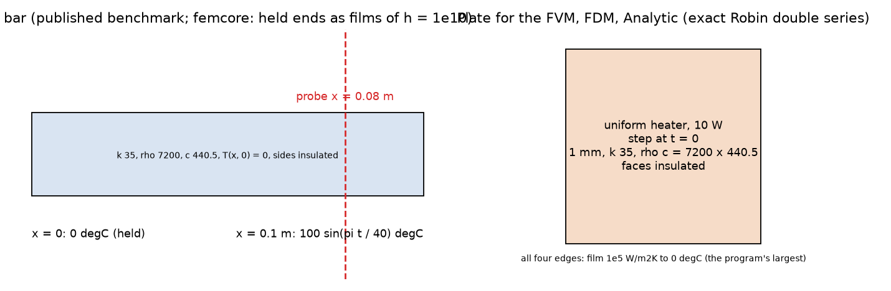
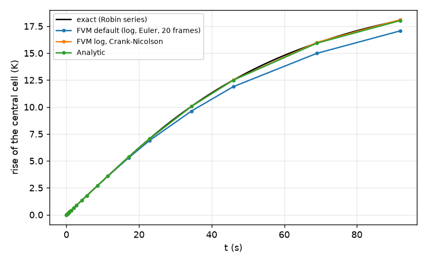

# Transient published case

Question (item e30 of `releases/2.9.0/PLAN.md`, rule 14 of `CLAUDE.md` section 9): find a published transient heat-conduction case with a reference value, open it at its source, and reproduce it with an independent solver and with the program's transient models.

Tree: `development` db6244b1 (the FEM transient of 2.9.0 included); numbers printed by `scripts/study_t3_and_plate.py`; figures by `scripts/make_figures.py`; tests `tests/test_exact1d.py` (5 pass).

## 1. What was found and what could be opened

| Candidate | Result | Status |
| :-- | :-- | :-- |
| NAFEMS T3, 1D transient with a sinusoidal end temperature (`The Standard NAFEMS Benchmarks`, catalogue P18, 1990) | The primary publication is a paid NAFEMS document, not obtained. The case (geometry, material, boundary conditions as formulas, initial state) and the reference 36.60 degC at x = 0.08 m, t = 32 s are printed in two independent open pages: the MOOSE documentation (Markdown source, read in full) and the Altair OptiStruct verification manual (read in full). | primary N, case and value S via two third-party pages (R for those pages) |
| Abaqus benchmarks manual 4.3.3 "T3: one-dimensional transient heat transfer" | HTTP 403 to the fetch tool; seen only in a search summary, which describes the end B condition as a constant 100 degC, in conflict with the two pages that were read (see 3) | N |
| Muzychka and Yovanovich, *Compact Models for Transient Thermal Spreading Resistance in Half-space, Flux Tube, and Flux Channel Regions*, ITherm 2023 (DOI 10.1109/itherm55368.2023.10177640) | IEEE, no open copy at the Waterloo archive or by search. The most relevant candidate for a board (a source on a flux channel). | N |
| Lam, Goudarzi, Muzychka, transient spreading in a circular flux tube, J. Thermophysics and Heat Transfer 2024 | Title only (from a citation list); circular geometry. | N |
| Carslaw and Jaeger, *Conduction of Heat in Solids* | The first edition on archive.org (`in.ernet.dli.2015.461869`) has a 143-byte text layer (an empty scan record); the 1959 edition is a restricted loan. Not opened. | N (stays M) |
| Lienhard, *A Heat Transfer Textbook* 6.00 (free download, MIT) | Opened. Section 5.6, p. 229 (PDF page 243): semi-infinite solid with a flux step, wall temperature `T_w = T_i + 2 q_w sqrt(alpha t / pi) / k`, eqn (5.56), derived from (5.55). A textbook formula, not a numerical benchmark. | R |

No published numerical transient case on a PCB (spreading, JEDEC or Delphi transient) could be opened in this pass: the transient spreading papers are in IEEE and Journal of Heat Transfer. This is the honest limit.

## 2. Reproduction of the T3 case (study part A)

The independent reference is an exact eigenfunction series (`lib/exact1d.py`, imports nothing from the program). Write `u = (x/L) g(t) + v` with `g = 100 sin(pi t/40)`; the modes of `v` obey `b_n' + mu_n b_n = -c_n g'(t)`, `c_n = 2 (-1)^(n+1)/(n pi)`, `mu_n = alpha (n pi/L)^2`, and the convolution with `g' = 100 w cos(w t)` is closed form. The truncation error is below 1e-8 (500, 4 000 and 20 000 terms agree to 1e-5).

| Quantity at x = 0.08 m, t = 32 s | degC |
| :-- | --: |
| published (MOOSE: 36.6; Altair: 36.60) | 36.60 |
| exact series (4 000 and 20 000 terms) | 36.603116 |
| difference exact - published | +0.0031 (the published value is the exact one rounded to 4 digits) |

The program under test is the FEM stepper (`pcbthermal.femcore`: `Model.assemble(capacity=True)`, `Stepper`), the bar as a 0.01 x 0.01 m column of Q1 bricks, the held ends as films of h = 1e10 W/m2K with a time factor on the load (the form of `tests/test_fem_transient_closed_forms.py`; the FEM has no prescribed-temperature condition: this is its penalty form). Printed by the study:

| Elements (3 200 Crank-Nicolson steps) | T (degC) | error vs exact (K) |
| --: | --: | --: |
| 20 | 36.7969 | +0.1938 |
| 50 | 36.6333 | +0.0302 |
| 100 | 36.6106 | +0.0075 |
| 200 | 36.6050 | +0.0019 |
| 400 | 36.6036 | +0.0005 |

The error falls as the square of the element size (second order), and 100 elements are inside 0.011 K of the published 36.60 (the published value has two decimals). Steps at 100 elements (Crank-Nicolson / implicit Euler, error vs exact in K): 100 steps +0.0059 / -0.1516; 400: +0.0074 / -0.0323; 1 600: +0.0075 / -0.0024; 3 200: +0.0075 / +0.0025 (Euler is first order in time; Crank-Nicolson has converged at the space error). Held end as a film h (100 elements, 3 200 steps): 1e4 gives 30.258 (-6.345), 1e6 gives 36.5408 (-0.0623), 1e10 gives 36.6106: the film has to be very large to stand for a held temperature (the penalty error is about 2 k/(h L) of the end value times the field gradient; not derived here, only measured).

The earlier numbers of the repository (36.611, and 36.605 of an independent line) are the 100- and 200-element rows: the review's value was the exact value at 200 elements, and 36.60 was in fact the exact value.

*Figure 1: the T3 bar and the plate (`fig_01_geometries.png`).*

*Figure 2: the T3 curve of the exact series, the published point, and the error of the program's FEM against the number of elements (`fig_02_t3_curve_and_fem_convergence.png`).*

## 3. What the other transients cannot do, and a neighbour that they can run

The FVM, FDM and Analytic transients (`solve_transient`) start from ambient and hold an edge only at the constant ambient (film `h_side`, limited to 1e5 W/m2K); none can follow a prescribed time-varying temperature. T3 is therefore NOT reproduced by them. Their representable neighbour (part B): a 0.1 m square plate, 1 mm, of the bar's material (k 35, rho c = 7200 x 440.5), one uniform heater of 10 W stepped on at t = 0, four edges at ambient through h_side = 1e5, faces insulated. The reference is the exact Robin double series of the product of 1D modes (`lib/exact1d.py`, `square_plate_robin_heating`; the Dirichlet limit and the steady centre value 0.0736713 q s^2/k are in the tests). The slowest-mode time constant is 45.9 s, the run is 92 s, and the error is the largest relative difference of the central cell (node) against the exact value at the same coordinate for t > 10 s.

| Model and stepping | cell 5 mm | cell 2.5 mm | cell 1.25 mm |
| :-- | --: | --: | --: |
| FVM, default (logarithmic steps, implicit Euler, 20 frames) | 5.87 % | 5.92 % | 5.93 % |
| FVM, logarithmic, Crank-Nicolson, 20 frames | 0.54 % | 0.46 % | 0.43 % |
| FVM, linear, 40 frames x 16 substeps, implicit Euler | 0.21 % | 0.14 % | 0.12 % |
| FVM, linear 40 x 16, Crank-Nicolson | 0.12 % | 0.04 % | 0.01 % |
| FDM, default | 6.19 % | 6.00 % | 5.95 % |
| FDM, logarithmic, Crank-Nicolson | 0.31 % | 0.36 % | 0.41 % |
| FDM, linear 40 x 16, implicit Euler | 0.41 % | 0.19 % | 0.13 % |
| FDM, linear 40 x 16, Crank-Nicolson | 0.31 % | 0.08 % | 0.02 % |
| Analytic (series) | 0.00 % | 0.01 % | 0.01 % |

Reading: the space error is small and converges; the error of the default run is the TIME stepping (the logarithmic stages double the step, and with 20 frames the last steps are a quarter of the run, a large part of the 45.9 s time constant), not the mesh. The steady limit agrees to 0.05 % (FVM, 2.5 mm, 2000 s: 21.3324 against the series 21.3207, ratio 1.0005; measured in the exploratory run of this study, not printed by the script). The Analytic model reproduces the series to 0.01 %.

*Figure 3: central rise of the plate in time, exact series against the FVM default, the FVM with Crank-Nicolson, and the Analytic (`fig_03_plate_centre_in_time.png`).*

## 4. Limits

* The primary NAFEMS document was not read: the case and the 36.60 come from two open third-party pages that agree and that the exact series reproduces to 0.003 K. The NAFEMS catalogue says the original T3 "proved unsatisfactory" and that Revision 2 corrected it (catalogue text read from the NAFEMS publication page, summary level): the revised definition printed in the pages read here is consistent with the exact series, so the case as run is the revised one or an equivalent.
* The reference of T3 is analytic (a Fourier series), so the "published numerical case" is in fact an exact value; the independent solver here is the series, not a second numerical code. A second numerical tool is the independent FEM of `research/independent-fem-extensions` (not re-run here).
* The FEM held ends are films of h = 1e10 (penalty), not a Dirichlet condition; they cost 0.0075 K at 100 elements at most (the row at 1e10 equals the Crank-Nicolson row of the element sweep).
* FVM, FDM and Analytic did not run T3 itself; part B is a neighbour with an exact series, a textbook-type check, not a published number.
* Transient spreading resistance on a flux channel (Muzychka and Yovanovich 2023) was not obtained.

## 5. What was read and what was not verified

* READ in full: the MOOSE page for T3 (Markdown source from the repository); the Altair OptiStruct page OS-V 0110; Lienhard, *A Heat Transfer Textbook* 6.00, p. 229 (eqns 5.55, 5.56) from the free PDF.
* SUMMARY: the NAFEMS publication page (P18, 1990, notes on T3 and revisions); a search summary of the Abaqus 4.3.3 page (which could not be opened); Crossref records of the Muzychka and Yovanovich 2023 paper.
* NOT OBTAINED: *The Standard NAFEMS Benchmarks* itself (and so the exact printed wording, the year of the revised T3 and the stated accuracy of the target, which none of the pages read gives); the 2023 ITherm paper; Carslaw and Jaeger (any edition) at page level; Rannacher 1984 (not searched in this pass).
* NOT VERIFIED: the stated accuracy of the benchmark target (the pages read give only 36.60 / 36.6); the second numerical tool was not re-run; the steady-limit ratio 1.0005 of part B comes from an exploratory run, not from the script.
* One own defect found and fixed with a regression test: the Dirichlet double series had a factor 4 instead of 16 (caught by `test_robin_plate_series_goes_to_the_dirichlet_series_and_to_the_steady_state`); the study uses the Robin series, so no printed number moved.
