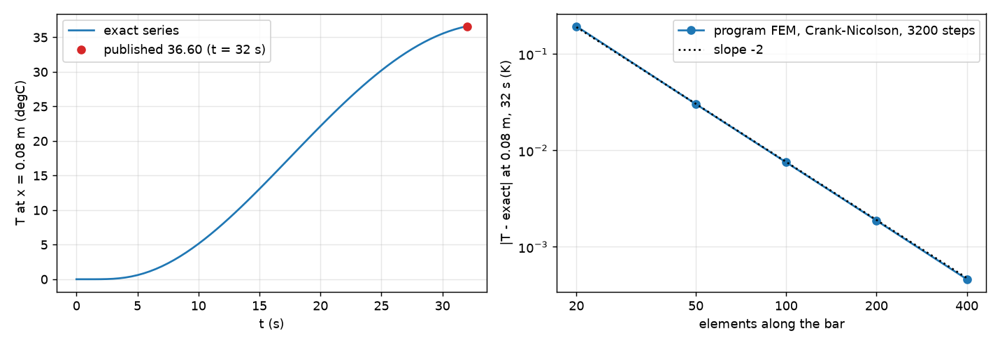

# Transient published case

Question (item e30 of `releases/2.9.0/PLAN.md`, rule 14 of `CLAUDE.md` section 9): find a published transient heat-conduction case with a reference value, open it at its source, and reproduce it with an independent solver and with the program's transient models.

Tree: `development` db6244b1 (the FEM transient of 2.9.0 included); numbers printed by `scripts/study_t3_and_plate.py` (about 2 min; `--quick` skips part C); figures by `scripts/make_figures.py`; tests `tests/test_exact1d.py` (8 pass). Section 6 is the review: what it re-ran, what it found wrong in the first version of this README, and the verdict.

## 1. What was found and what could be opened

| Candidate | Result | Status |
| :-- | :-- | :-- |
| NAFEMS T3, 1D transient with a sinusoidal end temperature (*The Standard NAFEMS Benchmarks*, TNSB Rev. 3, October 1990, catalogue P18; earlier in Cameron, Casey and Simpson, *Benchmark Tests for Thermal Analysis*, NAFEMS) | The primary publication is a paid NAFEMS document, not obtained. The case and the reference 36.60 degC at x = 0.08 m, t = 32 s are printed in four open documents of four different code vendors: the MOOSE documentation with its input file and its result files, the Abaqus Benchmarks Guide 4.3.3 with its input decks, the Altair OptiStruct verification manual (OS-V 0110) and the Wolfram PDEModels heat-transfer verification tests. | primary N; case and value S, from four third-party documents read in full (R for each) |
| Muzychka and Yovanovich, *Compact Models for Transient Thermal Spreading Resistance in Half-space, Flux Tube, and Flux Channel Regions*, ITherm 2023 (DOI 10.1109/itherm55368.2023.10177640) | IEEE; no open copy at the Waterloo laboratory archive, at Memorial University's repository (one PhD thesis on spreading resistance there, steady) or by search. The chapter "Transient Thermal Spreading Resistance" of their Wiley book (2023) is paid. The most relevant candidate for a board (a source on a flux channel). | N |
| Lam, Goudarzi, Muzychka, transient spreading in a circular flux tube, J. Thermophysics and Heat Transfer 2024 | Title only (from a citation list); circular geometry. | N |
| Yovanovich, "Transient spreading resistance of arbitrary isoflux contact areas: development of a universal time function" (AIAA, 1997) | Seen only as a citation; no open copy found. | N |
| Carslaw and Jaeger, *Conduction of Heat in Solids* | The first edition on archive.org (`in.ernet.dli.2015.461869`) has a 143-byte text layer (an empty scan record); the 1959 edition is a restricted loan. Not opened. | N (stays M) |
| Lienhard, *A Heat Transfer Textbook* 6.00 (free download) | Opened. Section 5.6, p. 229 (PDF page 243): semi-infinite solid with a flux step, wall temperature `T_w = T_i + 2 q_w sqrt(alpha t / pi) / k`, eqn (5.56), derived from (5.55). A textbook formula, not a numerical benchmark. | R |

**The end condition is sinusoidal in every source.** The first version of this README reported a conflict with the Abaqus page (a search summary had described its end B as a constant 100 degC). The review opened the Abaqus page and its input deck `nt3xx12c.inp`: the text reads "100 [image] degC at end B", the image is `sin(pi t / 40)`, and the deck applies `*AMPLITUDE, DEFINITION=PERIODIC` with circular frequency 0.07854 (= pi/40) and coefficient 100 to the end node. There is no conflict. The Wolfram test mirrors the bar (the sinusoid at x = 0, read at x = 0.02 m), the same point counted from the other end, with `TRef = 36.6` and a relative tolerance of 1e-3. The Altair page gives the material, the end conditions and the reference in its text, but not the length (that is only in its figure).

No published numerical transient case on a PCB (spreading, JEDEC or Delphi transient) could be opened: the transient spreading papers are in IEEE, AIAA and Journal of Heat Transfer. This is the honest limit.

## 2. Reproduction of the T3 case (study part A)

**Exact value.** The independent reference is an exact eigenfunction series (`lib/exact1d.py`, imports nothing from the program). Write `u = (x/L) g(t) + v` with `g = 100 sin(pi t/40)`; the modes of `v` obey `b_n' + mu_n b_n = -c_n g'(t)`, `c_n = 2 (-1)^(n+1)/(n pi)`, `mu_n = alpha (n pi/L)^2`, and the convolution with `g' = 100 w cos(w t)` is closed form. The truncation error is below 1e-8 (500, 4 000 and 20 000 terms agree to 1e-5). A second route that shares nothing with the series (the method of lines, second-order differences on 200 and 400 intervals, an implicit Runge-Kutta method to a tolerance of 1e-11, Richardson limit; `bar_sinusoidal_end_lines`) gives the same value to the sixth decimal.

| Quantity at x = 0.08 m, t = 32 s | degC |
| :-- | --: |
| published (MOOSE and Wolfram: 36.6; Abaqus and Altair: 36.60) | 36.60 |
| exact series (4 000 and 20 000 terms) | 36.603116 |
| method of lines, 200 / 400 intervals, Richardson limit | 36.601236 / 36.602646 / 36.603116 |
| difference exact - published | +0.0031 (the published value is the exact one rounded to 4 digits) |

**The program's FEM against the exact value.** The program under test is the FEM stepper (`pcbthermal.femcore`: `Model.assemble(capacity=True)`, `Stepper`), the bar as a 0.01 x 0.01 m column of Q1 bricks, the held ends as films of h = 1e10 W/m2K with a time factor on the load (the form of `tests/test_fem_transient_closed_forms.py`; the FEM has no prescribed-temperature condition: this is its penalty form). Printed by the study:

| Elements (3 200 Crank-Nicolson steps) | T (degC) | error vs exact (K) |
| --: | --: | --: |
| 20 | 36.7969 | +0.1938 |
| 50 | 36.6333 | +0.0302 |
| 100 | 36.6106 | +0.0075 |
| 200 | 36.6050 | +0.0019 |
| 400 | 36.6036 | +0.0005 |

The error falls as the square of the element size (second order), and 100 elements are inside 0.011 K of the published 36.60. Steps at 100 elements (Crank-Nicolson / implicit Euler, error vs exact in K): 100 steps +0.0059 / -0.1516; 400: +0.0074 / -0.0323; 1 600: +0.0075 / -0.0024; 3 200: +0.0075 / +0.0025 (Euler is first order in time; Crank-Nicolson has converged at the space error). Held end as a film h (100 elements, 3 200 steps): 1e4 gives 30.258 (-6.345), 1e6 gives 36.5408 (-0.0623), 1e10 gives 36.6106: the film has to be very large to stand for a held temperature (measured, not derived).

**The program's FEM against the published mesh results of other programs.** MOOSE and Abaqus publish their own coarse results (5 and 10 linear elements) and their input files fix the discretisation (32 implicit-Euler steps of 1 s; MOOSE with the consistent capacity, its result files `nafems_t3_edge2_{coarse,fine}_out.csv` give the value at t = 32 s to 12 digits). Reproducing those numbers checks the discretisation itself, not only the limit:

| 5 / 10 linear elements, 32 Euler steps of 1 s | 5 elements | 10 elements |
| :-- | --: | --: |
| MOOSE EDGE2, result file | 40.280676 | 36.893145 |
| program FEM (consistent capacity, ends as films of 1e10) | 40.280668 | 36.893138 |
| own 1D element, consistent capacity (`fe1d_bar`) | 40.280676 | 36.893145 |
| Abaqus DC1D2, Benchmarks Guide table | 34.54 | 35.51 |
| own 1D element, lumped capacity (`fe1d_bar`) | 34.5383 | 35.5063 |

The program's FEM equals the MOOSE result to 8e-6 K (the penalty film is the rest); the Abaqus rows are the same discretisation with a lumped capacity, reproduced to their printed digits by the own element. These are coarse mesh results of other programs, not references: they show that the program's FEM is the textbook Galerkin element with a consistent capacity and the theta method, and that the published spread of 34.5 to 40.3 degC among programs is the mesh and the capacity matrix, not a difference of the case.

*Figure 1: the T3 bar and the plate (`fig_01_geometries.png`).*

*Figure 2: the T3 curve of the exact series, the published point, and the error of the program's FEM against the number of elements (`fig_02_t3_curve_and_fem_convergence.png`).*

## 3. What the other transients cannot do, and a neighbour that they can run

The FVM, FDM and Analytic transients (`solve_transient`) start from ambient and hold an edge only at the constant ambient (film `h_side`, limited to 1e5 W/m2K); none can follow a prescribed time-varying temperature. T3 is therefore NOT reproduced by them. Their representable neighbour (part B): a 0.1 m square plate, 1 mm, of the bar's material (k 35, rho c = 7200 x 440.5), one uniform heater of 10 W stepped on at t = 0, four edges at ambient through h_side = 1e5, faces insulated. The reference is the exact Robin double series of the product of 1D modes (`lib/exact1d.py`, `square_plate_robin_heating`; the Dirichlet limit and the steady centre value 0.0736713 q s^2/k are in the tests). The slowest-mode time constant is 45.9 s, the run is 92 s, and the error is the largest relative difference of the central cell (node) against the exact value at the same coordinate for t > 10 s.

| Model and stepping | cell 5 mm | cell 2.5 mm | cell 1.25 mm |
| :-- | --: | --: | --: |
| FVM, logarithmic steps, implicit Euler, 20 frames | 5.87 % | 5.92 % | 5.93 % |
| FVM, logarithmic, Crank-Nicolson, 20 frames | 0.54 % | 0.46 % | 0.43 % |
| FVM, linear, 40 frames x 16 substeps, implicit Euler | 0.21 % | 0.14 % | 0.12 % |
| FVM, linear 40 x 16, Crank-Nicolson | 0.12 % | 0.04 % | 0.01 % |
| FDM, logarithmic, implicit Euler, 20 frames | 6.19 % | 6.00 % | 5.95 % |
| FDM, logarithmic, Crank-Nicolson | 0.31 % | 0.36 % | 0.41 % |
| FDM, linear 40 x 16, implicit Euler | 0.41 % | 0.19 % | 0.13 % |
| FDM, linear 40 x 16, Crank-Nicolson | 0.31 % | 0.08 % | 0.02 % |
| Analytic (series) | 0.00 % | 0.01 % | 0.01 % |

Reading: the space error is small and converges; the error of the logarithmic implicit-Euler run is the TIME stepping (the stages double the step, and with 20 frames the last steps are a quarter of the run, half of the 45.9 s time constant), not the mesh. The steady limit agrees to 0.06 % (FVM, 2.5 mm, steady solve of the same network: 21.3324 K at the central cell against the series 21.3207 K, ratio 1.00055). The Analytic model reproduces the series to 0.01 %.

**20 frames is not a default of the program** (the first version of this README called it "the default"): the Animation tab computes 60 frames, the command line `transient` 40, `solve_transient` 40. Part C measures what a user meets.

*Figure 3: central rise of the plate in time, exact series against the FVM with 20 logarithmic frames (implicit Euler and Crank-Nicolson) and the Analytic (`fig_03_plate_centre_in_time.png`).*

## 4. The time-step error at the program's defaults (study part C)

The defaults a user meets for the response to a power step: the **Animation tab** computes 60 frames, implicit Euler, logarithmic spacing, a duration preset to five estimated time constants (`fvm.estimate_time_constant`, the total capacity over the total conductance to the air); the **command line** `transient` computes 40 frames, implicit Euler, logarithmic, 600 s. The logarithmic grid has ten stages of `ceil(n_out/10)` equal steps, the step doubling from stage to stage, every step a frame, so the last steps are `t_end/12` (60 frames) or `t_end/8` (40 frames) and the FIRST frame is a single implicit-Euler step. The reference is the same network without its time-step error (implicit Euler with 128 and 256 substeps between consecutive frames, Richardson-extrapolated; it reproduces the 5.93 % of section 3 against the exact series on the plate), so the numbers below are the stepping error alone, on the hottest cell (peak rise), FVM, 2 mm (plate 2.5 mm):

| Board (estimated time constant) | Setting | worst (time) | first frame | worst after a third of the time to 63 % | at the end |
| :-- | :-- | --: | --: | --: | --: |
| example board (105.8 s) | Animation tab: 60, Euler, 529 s | -12.36 % (0.086 s) | -12.36 % | 0.70 % | -0.21 % |
| | same frames, Crank-Nicolson | +1.09 % (0.17 s) | +0.04 % | 0.03 % | +0.01 % |
| | command line: 40, Euler, 600 s | -16.51 % (0.15 s) | -16.51 % | 1.02 % | -0.24 % |
| reference board (108.8 s) | Animation tab | -2.13 % (2.3 s) | -0.65 % | 1.56 % | -0.16 % |
| | same frames, Crank-Nicolson | +0.06 % (5.1 s) | +0.00 % | 0.05 % | +0.01 % |
| | command line | -3.20 % (2.4 s) | -1.13 % | 1.87 % | -0.19 % |
| plate (6.5 s) | Animation tab: 60, Euler, 32 s | -1.29 % (32 s) | -0.00 % | 1.29 % | -1.29 % |
| | command line: 40, Euler, 600 s | -3.10 % (93 s) | -0.00 % | 3.10 % | -0.01 % |
| | 20 frames, 92 s (the run of section 3) | -5.93 % (69 s) | -0.00 % | 5.93 % | -5.32 % |

What this says:

* The 6 % of section 3 is the 20-frame run on a board whose slow time constant is half the run; at the defaults the late frames (after a third of the time to 63 %) carry 0.7 to 1.9 % on the boards and up to 3.1 % on the plate with the command line's 600 s. It is the same first-order error of implicit Euler that `docs/theory.md` 4b states for the FEM ("an Euler animation ... carries a first-order error of about 4 % at its first frame and 2 % later"), now measured on the FVM; for the FVM and FDM no project document gives its size.
* **The first frame of the FVM is one implicit-Euler step**: -12.4 % (Animation) and -16.5 % (command line) on the example board, where the part heats a thin copper in 0.1 s. The FEM walks its first stage in quarter steps (and, with Crank-Nicolson, opens with the Rannacher half steps); the FVM and FDM do not. In the first second every one-node-per-layer model is already too cool (58 % at 0.3 s and 30 % at 1 s on the two-layer board of `transient-reference-boards` 4.2, `docs/theory.md` 4b), so the first frames carry no accuracy claim either way; the step error adds to that.
* Crank-Nicolson with the same frames removes it (0.03 to 0.05 % after the first seconds, +1.1 % at worst in the first frames of the example board, where Crank-Nicolson without a start rings slightly).
* **The duration preset can be short**: on the plate the estimate is 6.5 s while the slowest mode is 45.9 s (four edges at a strong film: the total conductance is large, the slow mode is set by the conduction to the edges), so the Animation run stops at 32 s, at 70 % of the plateau. On the example and reference boards (convection on the faces) the estimate is the slow scale. Not a defect of the stepping; recorded in `INTEGRATION.md` 3.

This is a known kind of error with a new size: a proposal with the measured impact is in `INTEGRATION.md` 3, nothing is changed in the program.

## 5. Limits

* The primary NAFEMS document was not read: the case and the 36.60 come from four open third-party documents (MOOSE, Abaqus, Altair, Wolfram) that agree, two of them with input decks, and that the exact series reproduces to 0.003 K. The Abaqus page names the source as TNSB Rev. 3, October 1990; the Wolfram page as Cameron, Casey and Simpson, *Benchmark Tests for Thermal Analysis*. The NAFEMS catalogue says the original T3 "proved unsatisfactory" and that Revision 2 corrected it (catalogue text, summary level): the definition printed in the four documents is consistent with the exact series, so the case as run is the revised one or an equivalent. The stated accuracy of the target is not given by NAFEMS in any page read (Wolfram tests to 1e-3 relative).
* The reference of T3 is analytic (a Fourier series), so the "published numerical case" is an exact value; the published numerical results of other programs (MOOSE, Abaqus) are coarse mesh results and are reproduced as such (section 2).
* The FEM held ends are films of h = 1e10 (penalty), not a Dirichlet condition; they cost 8e-6 K on the MOOSE mesh and nothing visible at 100 elements.
* FVM, FDM and Analytic did not run T3 itself; part B is a neighbour with an exact series, a textbook-type check, not a published number.
* Transient spreading resistance on a flux channel (Muzychka and Yovanovich 2023) was not obtained: no published transient case of a heat source on a board is reproduced.
* Part C measures the FVM only (the FDM uses the same stepping, `fdm.solve_transient` calls `fvm.transient_from_network`), the step response only (not the power profiles, whose step is a tenth of the shortest stretch, and not the step-response curves of `step_responses`, which use Crank-Nicolson with ratio-3 stages).

## 6. Review

Independent review of the folder (re-run on the branch, program untouched: `git diff origin/development --stat -- pcbthermal tests examples ico` empty).

**Re-run.** `study_t3_and_plate.py` reprints every number of the first version (sections 2 and 3) to the printed digit; the tests pass. The steady ratio 1.0005 of section 3, which the first version took from an exploratory run, is now printed by the script (B1: 1.00055).

**Independent checks.**
* The exact value 36.603116 re-derived without the series: method of lines with an implicit Runge-Kutta integrator, Richardson limit 36.603116 (in the script, A1b, and a test).
* The four source pages opened by the reviewer: MOOSE (Markdown source, the input template with `FunctionDirichletBC` `100.0 * sin(pi*t/40)` and `dt = 1`, and the result files), Altair OS-V 0110, the Abaqus Benchmarks Guide 4.3.3 with the input deck, the Wolfram heat-transfer verification tests. Every number quoted in section 1 and in `research/theory/BIBLIOGRAPHY.md` was checked against them.
* The published mesh results of MOOSE and Abaqus reproduced by the program's FEM and by an own 1D element (section 2, A5, two tests): the program's FEM equals MOOSE to 8e-6 K.
* The 6 % of section 3 measured against the same network without time-step error (part C): it is time stepping, confirmed, and its size at the real defaults is 0.7 to 3 % late and up to -16.5 % at the first frame.

**Corrected in the folder.**
* "Default (log, Euler, 20 frames)" in the tables, the script and figure 3: 20 frames is not a default (60 in the Animation tab, 40 on the command line and in `solve_transient`); relabelled, and part C added for the real defaults.
* The Abaqus "conflict" (constant 100 degC) was a search summary, wrong: the page and its deck give `100 sin(pi t/40)`.
* "Two independent open pages": four, and the Altair text does not give the length.
* The test docstring gave the Dirichlet steady centre as 0.2947 q s^2/k; the assertion (and the value) is 0.0736713.
* Figures 1 and 2: overlapping titles and labels, the probe line through a label, unreadable minor tick labels; redrawn.
* `research/theory/BIBLIOGRAPHY.md`: [NAFEMS-T3] updated (the Abaqus conflict removed, TNSB Rev. 3 October 1990, four secondary sources), [Abaqus-T3] and [Wolfram-T3] added, a session date removed from [MOOSE-T3].

**Verdict: GO.** The investigation is closed: the T3 case is reproduced from opened sources (exact value, two independent derivations, and the published mesh results of two other programs), the FEM transient meets it, and the limits are written. The decisions for the maintainer are in `INTEGRATION.md` (the text of validation 57, the docstring of the FEM test, the default stepping of the FVM and FDM).

## 7. What was read and what was not verified

* READ in full: the MOOSE page for T3 (Markdown source), its input template `nafems_t3_edge_template.i` and the result files of the EDGE2 runs; the Altair OptiStruct page OS-V 0110; the Abaqus Benchmarks Guide 4.3.3 (2016 edition, a university mirror) with its equation image and the input deck `nt3xx12c.inp`; the Wolfram PDEModels page "Heat Transfer Model Verification Tests" (test HeatTransfer-FEM-Transient-1D-Single-HeatTransfer-0001: its code; the computed value is only in an image, not read); Lienhard, *A Heat Transfer Textbook* 6.00, p. 229 (eqns 5.55, 5.56).
* SUMMARY: the NAFEMS publication page (P18, 1990, notes on T3 and revisions); Crossref records of the Muzychka and Yovanovich 2023 paper; search results for the Memorial University theses and the Wiley book chapter.
* NOT OBTAINED: *The Standard NAFEMS Benchmarks* and *Benchmark Tests for Thermal Analysis* themselves (so the exact printed wording and the stated accuracy of the target); the 2023 ITherm paper; Yovanovich 1997; Carslaw and Jaeger (any edition) at page level; Rannacher 1984 (not searched).
* NOT VERIFIED: the FDM at the defaults of part C (same stepping code, not run); the power profiles and the step-response curves at their defaults; the second numerical tool of `research/independent-fem-extensions` was not re-run (not needed: the published mesh results of two other programs and the method of lines take its place).
* One own defect found by the researcher and fixed with a regression test: the Dirichlet double series had a factor 4 instead of 16 (caught by `test_robin_plate_series_goes_to_the_dirichlet_series_and_to_the_steady_state`); the study uses the Robin series, so no printed number moved.
