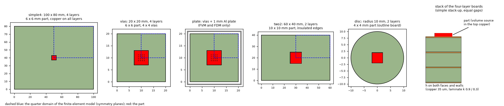
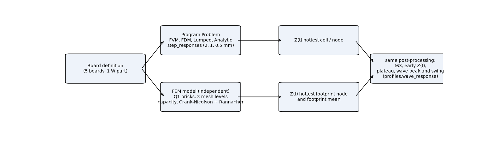
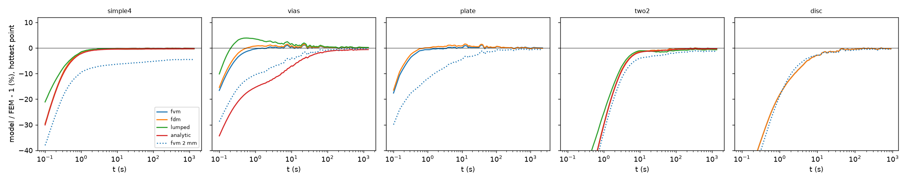
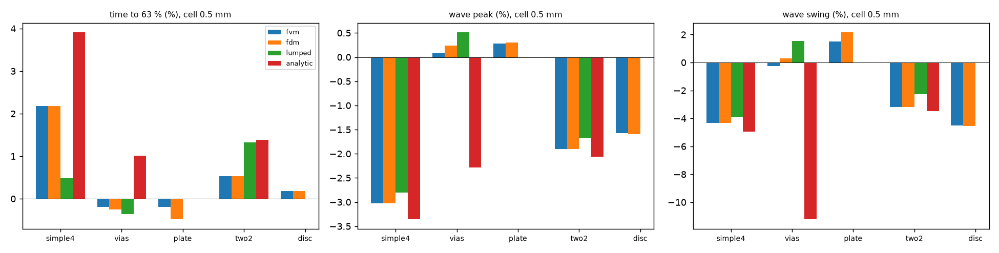
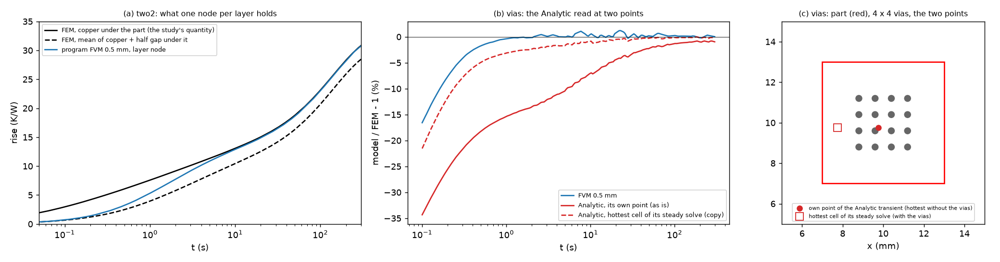

# Transient reference on synthetic boards

Question: how far is the transient of the program's models (FVM, FDM, Lumped, Analytic; the 3D solid is steady only) from an independent solver, on boards of ours, in the quantities the
program uses: the step response, the time to 63 %, the plateau and the peak and swing of a square wave? The reference is the transient tool of `research/independent-fem-extensions`
(`lib/transient.py`: capacity, Crank-Nicolson with a Rannacher start, reviewed there as a reference of the program's transient within 0.5 % at the plateau and the time to 63 %, and
-0.5 to -3.5 % on the fast swing of a footprint mean over a small source). Nothing of the program is changed; the investigation proposes (`INTEGRATION.md`).

## 1. Method

### 1.1 The boards and the chain

*Figure 1 (fig_01_boards.png): the five boards (plan views, the quarter domain of the finite-element model dashed, the part in red) and the stack of the four-layer boards.*

*Figure 2 (fig_02_chain.png): the chain. The same Problem is solved by the program's `step_responses` and described to the finite-element model; the two responses go through the same post-processing.*

| board | what | why |
| :-- | :-- | :-- |
| `simple4` | 100 x 80 mm, four layers, simple stack-up, full copper, 6 x 6 mm part, 1 W, h 10, h_side 10 | the case whose time to 63 % moved 16 % when the simple stack-up took physical slabs (validation 43) |
| `vias` | 20 x 20 mm, four layers, 6 x 6 mm part over a 4 x 4 cluster of resin-filled hollow vias (0.3 mm drill, 0.8 mm pitch) | vias in the transient |
| `plate` | `vias` plus a 1 mm aluminium plate through a 0.1 mm interface | metal block (FVM and FDM only) |
| `two2` | 60 x 40 mm, two layers, full copper, 10 x 10 mm part, insulated edges | a two-layer board, thick laminate under the part |
| `disc` | disc of radius 10 mm, two layers, 4 x 4 mm part, h_side 10 | an outline board (FVM and FDM only) |

The finite-element models are the builders of the two earlier folders (`independent-fem-edge/lib/board.py`, `independent-fem-extensions/lib/cluster.py`), not edited; the program's
Problems are in `lib/refboards.py`. The part is a volume source in the top copper (the program's convention). Copper 35 um, k 385, rho c 3.45e6; laminate k 0.9 / 0.3, rho c 1.665e6.

### 1.2 What is compared

* **Readout.** The program's FVM and FDM step responses read the hottest cell (node) of the board (`fvm.step_responses`). The finite-element reference reads the hottest top node of the
  footprint (found in the steady field) and, for information, the footprint mean. The hottest node is the like quantity; the footprint mean is 0.4 to 11 % below it at the plateau
  (11 % on `simple4`, 7 % on `two2`, 1.7 % on `disc`, 0.4 % on the via boards) and its time to 63 % differs by up to a factor 1.8 (`simple4`: 5.15 s against 2.84 s), so the mean is not the comparison
  quantity and its columns are only in the cache. The 0.5 to 3.5 % caveat of the tool on the fast swing of a footprint mean is therefore not part of these errors, which read a node; the tool's
  uncertainty on a node away from a source edge is 0.2 %, and here the finest levels agree with the previous ones to 0.4 % in the time to 63 % (simple4 2.836 / 2.841 s) and 0.1 % in z(t).
* **Time to 63 %** of each curve against its own plateau (log-time interpolation, as `fvm`); **early response** at 0.3, 1, 3, 10 s; **wave**: 30 % duty square wave, period 2 s (`simple4`) or
  20 s (50 s for `plate`), 1 W on; peak and swing of the periodic state at the hottest point.
* **Wave reference.** The program obtains the wave by superposition of its step response (`profiles.wave_response`). The finite-element reference is the same superposition applied to the
  finest finite-element step response, **checked against direct time stepping** (section 2.5): the two agree to 0.01 to 0.15 % once the stepping has run long enough.
* **Mesh levels.** Three or four levels per board (2 to 3 distinct ones for `vias` and `plate`: the plan of `cluster.build` is the same for `hf` 0.8 and 0.4, and the cluster windows fix the
  mesh near the part); each solve under 1 GB resident (largest 0.94 GB), unknowns 2 915 to 68 672; the energy balance of every step response closes to 1e-10 of the input or better.

## 2. Results

### 2.1 The finite-element reference and its mesh convergence

| board | level | unknowns | plateau hot K/W | plateau mean K/W | t63 hot s | t63 mean s | energy residual |
| :-- | --: | --: | --: | --: | --: | --: | --: |
| simple4 | 1.6 | 10098 | 22.1696 | 19.4678 | 2.747 | 5.466 | 2.7e-11 |
| simple4 | 0.8 | 12750 | 22.0597 | 19.6281 | 2.824 | 5.235 | 2.1e-11 |
| simple4 | 0.4 | 18972 | 22.0424 | 19.6708 | 2.836 | 5.175 | 4.2e-11 |
| simple4 | 0.2 | 33558 | 22.0350 | 19.6860 | 2.841 | 5.153 | 4.7e-12 |
| vias | 0.4 | 44252 | 113.2918 | 112.8513 | 119.820 | 120.288 | 2.0e-11 |
| vias | 0.2 | 54464 | 113.2910 | 112.8667 | 119.781 | 120.271 | 1.4e-11 |
| plate | 0.4 | 55796 | 104.2983 | 103.8310 | 200.220 | 201.317 | 3.8e-11 |
| plate | 0.8 | 55796 | 104.2982 | 103.8309 | 200.221 | 201.318 | 1.3e-11 |
| plate | 0.2 | 68672 | 104.3013 | 103.8470 | 200.192 | 201.282 | 8.5e-12 |
| two2 | 1.0 | 9765 | 33.2658 | 30.9028 | 73.513 | 83.963 | 1.0e-10 |
| two2 | 0.5 | 14985 | 33.2460 | 30.9245 | 73.597 | 83.866 | 2.6e-11 |
| two2 | 0.25 | 30000 | 33.2422 | 30.9311 | 73.613 | 83.837 | 1.3e-10 |
| disc | 6 | 2915 | 156.5563 | 153.7091 | 105.672 | 107.870 | 1.2e-12 |
| disc | 10 | 7491 | 155.5676 | 152.8289 | 105.651 | 107.780 | 1.6e-11 |
| disc | 14 | 14795 | 155.2963 | 152.5871 | 105.644 | 107.754 | 2.4e-12 |

*Table 1: finite-element step responses (hottest top node and footprint mean, K/W of the part; time to 63 % in s). The last level of every board is the reference. `plate`: 0.8 and 0.4 are one mesh.*

The hottest node converges to 0.05 % in the plateau and 0.2 % in the time to 63 % between the last two levels on every board, except `disc` (the plateau still moves 0.17 % between 10 and 14).

### 2.2 The program against the reference: steady, time to 63 %, early response, wave

*Figure 3 (fig_03_step_errors.png): `model / FEM - 1` of the step response at the hottest point against time, cell 0.5 mm (dotted: the FVM at 2 mm).*

*Figure 4 (fig_04_t63_wave_errors.png): errors of the time to 63 % and of the wave peak and swing, by board and model, cell 0.5 mm.*

| board | model | cell mm | plateau % | t63 % | z(0.3 s) % | z(1 s) % | z(3 s) % | z(10 s) % | wave peak % | wave swing % |
| :-- | :-- | --: | --: | --: | --: | --: | --: | --: | --: | --: |
| simple4 | fvm | 2.0 | -4.53 | +28.48 | -19.5 | -9.5 | -7.2 | -6.3 | -9.73 | -12.94 |
| simple4 | fvm | 1.0 | -0.36 | +3.20 | -10.9 | -2.1 | -0.7 | -0.5 | -3.37 | -4.79 |
| simple4 | fvm | 0.5 | -0.16 | +2.18 | -10.4 | -1.7 | -0.3 | -0.2 | -3.02 | -4.34 |
| simple4 | fdm | 2.0 | -4.53 | +28.44 | -19.5 | -9.5 | -7.2 | -6.3 | -9.74 | -12.94 |
| simple4 | fdm | 1.0 | -0.36 | +3.18 | -10.9 | -2.1 | -0.7 | -0.5 | -3.37 | -4.79 |
| simple4 | fdm | 0.5 | -0.16 | +2.18 | -10.4 | -1.7 | -0.3 | -0.2 | -3.02 | -4.34 |
| simple4 | lumped | 1.0 | -0.51 | +5.39 | -12.5 | -3.8 | -1.1 | -0.7 | -5.13 | -7.63 |
| simple4 | lumped | 0.5 | -0.35 | +0.48 | -8.3 | -1.5 | -0.3 | -0.4 | -2.81 | -3.87 |
| simple4 | analytic | 1.0 | -0.98 | +7.43 | -12.1 | -3.4 | -1.8 | -1.4 | -4.34 | -6.20 |
| simple4 | analytic | 0.5 | -0.32 | +3.91 | -10.8 | -2.2 | -0.7 | -0.5 | -3.36 | -4.95 |
| simple4 | old-fvm | 2.0 | -4.80 | +44.88 | -31.6 | -15.9 | -9.3 | -7.0 | -15.72 | -22.96 |
| simple4 | old-fvm | 1.0 | -0.65 | +19.64 | -23.7 | -8.7 | -2.9 | -1.1 | -9.58 | -15.14 |
| simple4 | old-fvm | 0.5 | -0.46 | +18.49 | -23.2 | -8.3 | -2.5 | -0.9 | -9.23 | -14.67 |
| simple4 | old-lumped | 1.0 | -0.81 | +21.98 | -23.7 | -10.8 | -3.3 | -1.4 | -11.13 | -17.92 |
| simple4 | old-lumped | 0.5 | -0.65 | +16.55 | -19.9 | -8.1 | -2.5 | -1.1 | -8.74 | -13.84 |
| simple4 | old-analytic | 1.0 | -1.28 | +24.07 | -24.7 | -9.9 | -4.0 | -2.1 | -10.47 | -16.44 |
| simple4 | old-analytic | 0.5 | -0.62 | +20.42 | -23.6 | -8.8 | -3.0 | -1.2 | -9.54 | -15.26 |
| vias | fvm | 2.0 | -0.42 | +0.54 | -16.4 | -10.4 | -7.6 | -4.0 | -1.39 | -7.00 |
| vias | fvm | 1.0 | -0.21 | +0.13 | -9.8 | -5.2 | -3.8 | -1.8 | -0.70 | -3.80 |
| vias | fvm | 0.5 | +0.04 | -0.19 | -4.2 | -0.4 | +0.1 | +0.5 | +0.09 | -0.27 |
| vias | fdm | 2.0 | -0.56 | +0.58 | -17.7 | -12.4 | -9.9 | -5.5 | -1.90 | -9.36 |
| vias | fdm | 1.0 | +0.35 | -0.59 | +1.9 | +5.9 | +5.3 | +3.5 | +1.10 | +4.31 |
| vias | fdm | 0.5 | +0.10 | -0.25 | -2.7 | +0.8 | +0.8 | +0.9 | +0.24 | +0.29 |
| vias | lumped | 1.0 | +0.46 | -0.63 | +3.3 | +7.1 | +5.7 | +3.7 | +1.24 | +4.59 |
| vias | lumped | 0.5 | +0.19 | -0.37 | +2.5 | +3.5 | +2.2 | +1.7 | +0.51 | +1.53 |
| vias | analytic | 1.0 | -0.54 | +0.92 | -19.9 | -13.9 | -11.0 | -6.3 | -2.05 | -10.17 |
| vias | analytic | 0.5 | -0.62 | +1.01 | -21.7 | -15.4 | -12.2 | -7.0 | -2.29 | -11.23 |
| plate | fvm | 2.0 | -0.63 | +0.28 | -18.1 | -12.0 | -7.8 | -4.5 | -1.15 | -2.97 |
| plate | fvm | 1.0 | -0.26 | +0.19 | -9.6 | -5.8 | -4.9 | -3.4 | -0.65 | -1.94 |
| plate | fvm | 0.5 | +0.02 | -0.20 | -4.2 | -0.7 | -0.3 | +0.1 | +0.28 | +1.49 |
| plate | fdm | 2.0 | -1.49 | +0.13 | -18.4 | -15.3 | -13.9 | -9.8 | -2.93 | -8.22 |
| plate | fdm | 1.0 | -0.01 | -1.07 | +1.8 | +5.4 | +5.3 | +4.6 | +1.16 | +5.89 |
| plate | fdm | 0.5 | -0.13 | -0.49 | -3.0 | +0.1 | +0.6 | +0.8 | +0.30 | +2.16 |
| two2 | fvm | 2.0 | -1.32 | +2.58 | -59.7 | -33.0 | -12.3 | -4.0 | -3.83 | -6.15 |
| two2 | fvm | 1.0 | -0.32 | +0.61 | -58.4 | -30.1 | -9.3 | -1.5 | -2.00 | -3.32 |
| two2 | fvm | 0.5 | -0.28 | +0.53 | -58.2 | -29.9 | -9.1 | -1.4 | -1.91 | -3.17 |
| two2 | fdm | 2.0 | -1.32 | +2.58 | -59.7 | -33.0 | -12.3 | -4.0 | -3.83 | -6.15 |
| two2 | fdm | 1.0 | -0.32 | +0.61 | -58.4 | -30.1 | -9.3 | -1.5 | -2.00 | -3.32 |
| two2 | fdm | 0.5 | -0.28 | +0.53 | -58.2 | -29.9 | -9.1 | -1.4 | -1.91 | -3.17 |
| two2 | lumped | 1.0 | +0.99 | -1.95 | -48.4 | -24.9 | -5.1 | +2.7 | +0.74 | +1.30 |
| two2 | lumped | 0.5 | -0.69 | +1.32 | -47.2 | -25.3 | -7.7 | -1.1 | -1.67 | -2.28 |
| two2 | analytic | 1.0 | -0.47 | +1.67 | -58.7 | -30.5 | -10.0 | -2.1 | -2.35 | -3.92 |
| two2 | analytic | 0.5 | -0.32 | +1.39 | -58.6 | -30.1 | -9.5 | -1.7 | -2.06 | -3.48 |
| disc | fvm | 2.0 | -0.53 | +0.42 | -41.2 | -18.9 | -6.9 | -2.8 | -1.36 | -3.51 |
| disc | fvm | 1.0 | -0.38 | +0.24 | -38.1 | -18.6 | -8.3 | -2.7 | -1.48 | -4.11 |
| disc | fvm | 0.5 | -0.33 | +0.19 | -37.2 | -18.2 | -8.8 | -2.8 | -1.57 | -4.49 |
| disc | fdm | 2.0 | -0.55 | +0.34 | -41.3 | -19.9 | -7.9 | -2.9 | -1.52 | -3.95 |
| disc | fdm | 1.0 | -0.39 | +0.21 | -38.1 | -18.7 | -8.5 | -2.8 | -1.53 | -4.22 |
| disc | fdm | 0.5 | -0.34 | +0.18 | -37.2 | -18.2 | -8.8 | -2.9 | -1.59 | -4.54 |

*Table 2: error of the program, in percent, `model / FEM - 1`, against the finest finite-element level (hottest node). The rows `old-*` are the same models with the thickness of every node of a
simple stack-up of three or more layers put back to T / L (the rule of 2.6.0 and before), made on a copy by replacing `model.Board.slab_thicknesses` inside the study process only. The Lumped and
Analytic are run at their clamped 0.5 to 1 mm cell. The Lumped and Analytic transient refuse `plate` (metal block: "this calculation does not support a metal block") and `disc` ("this model needs a
rectangular board: the board has an outline polygon"), as documented; the rows are absent.*

### 2.3 What the numbers say

1. **The plateau and the time to 63 % are good.** At 0.5 mm the FVM and FDM read the plateau of the hottest node -0.3 to +0.1 % and the time to 63 % -0.5 to +2.2 % of the reference on the five boards;
   at 1 mm -0.4 to +0.35 % and -1.1 to +3.2 %. At 0.5 mm the Lumped and Analytic are within -0.7 to +0.2 % (plateau) and -0.4 to +3.9 % (time to 63 %); at their 1 mm cell -1.0 to +1.0 % and -2.0 to +7.4 % (`simple4` Analytic). The largest time to 63 % error at 0.5 mm is
   `simple4` (+2.2 % FVM and FDM, +0.5 % Lumped, +3.9 % Analytic; the reference time is itself moved by 0.2 % between the last two levels); the mean-vs-node difference of the tool (0.5 to 3.5 %) is
   of this size, so the order of the errors, not their last digit, is the result.
2. **The 2.7.0 slab rule is confirmed by an independent solver.** With the old T / L slabs the time to 63 % of `simple4` reads +18.5 % (FVM 0.5 mm; 3.366 s against the reference 2.841 s), +16.6 % Lumped,
   +20.4 % Analytic; with the physical slabs +2.2 / +0.5 / +3.9 %. The 14 % move of the program between the two rules (3.366 to 2.903 s, the 16 % of validation 43.3 for a small part) is toward the
   reference. The wave of `simple4` goes from -9.2 / -14.7 % (peak / swing, FVM) to -3.0 / -4.3 %. This is the first independent check of that item's transient (43.3 said "no transient was compared
   with an independent solver").
3. **The first seconds are read too cool, and not because of the mesh.** On `two2` the response at 0.3 / 1 / 3 / 10 s is -58 / -30 / -9 / -1.4 % (FVM, FDM and Analytic alike, -47 / -25 / -8 / -1 % Lumped)
   and the error does not change with the cell (0.5 and 1 mm differ by 0.2 point; at 2 mm -60 %). The cause is the single node of the top layer: it holds the copper plus half of the adjacent gap,
   and the heat of a step first heats the copper alone. The capacity of the node under the 10 x 10 mm part is (35 um x 3.45e6 + 0.765 mm x 1.665e6) x 1e-4 m2 = 0.139 J/K, so the adiabatic
   rise per watt at 0.3 s is 0.3 / 0.139 = 2.15 K/W; the program reads 2.08 K/W (the finite-element node 4.99, 2.4 times higher). The time that the laminate half gap needs to follow is d2 / kappa = (0.765 mm)2 / 1.8e-7 =
   3.3 s on two layers and 0.3 s for the 0.24 mm half gap of the four-layer boards, which is where the errors fall to about -10 % (`two2` 3 s; `simple4` 0.3 s). The disc (half gap 0.765 mm, a 4 mm
   part) reads -37 / -18 / -9 / -3 %. This is the transient face of the known one-node-per-layer limit of the fast waves (the closed-form floor of the profile decision exists for that reason; the
   step response and the animation have none). **Unsafe side** (too cool) for anything shorter than about 3 s on two layers. The review (section 4.2) checked that this is a limit of the model and not
   a difference of definition: the program's node is the copper temperature at the plateau and carries the capacity of copper plus half gap at the start.
4. **The wave of a slow board is 2 to 5 % cool in the peak.** FVM and FDM at 0.5 mm: peak -3.0 / -1.9 / -1.6 % and swing -4.3 / -3.2 / -4.5 % on `simple4` (2 s), `two2` (20 s) and `disc` (20 s); on
   the via and plate boards +0.1 / +0.3 % and -0.3 / +1.5 %. All the same sign as item 3 (the swing reads the response at the first seconds). Analytic: -3.4 to -2.0 % peak, -5.0 to -3.5 % swing on the
   via-free boards.
5. **Cell size in the transient: 1 mm is not 0.5 mm on the via boards, and 2 mm is much worse.** `vias` and `plate`: the early response of the FVM at 1 mm is -10 to -2 % (0.3 to 10 s) and of the FDM
   +2 to +6 % (the two models bracket the reference by opposite signs, as in the steady state of the barrel: the node-centred well and the cell-centred well converge from different sides), both within
   1.5 point of the reference and of each other from 0.5 mm. At 2 mm the FVM and FDM read -16 to -4 % early on the via boards and, on `simple4` (a 6 mm part is three cells, its edges at 47 and 53 mm in the middle of 2 mm cells, so the source is smeared over four cells), -4.5 % in the plateau and **+28 % in the time to 63 %**; the same part with its edges on cell lines reads +2.4 % and -10 % against the program at 0.5 mm (review, section 4.4), so the size and the sign depend on where the edges fall, and the input check already warns ('only 3.0 cells wide'). The
   default step response of the profile decision uses at most a quarter of the narrow side of the part with a profile (1.5 mm here) and is not affected; an animation at the cell of the user (2 mm by
   default on large boards) is.
6. **Analytic with vias: an offset that the review traced to the point it reads (section 4.3).** `vias`: -21.7 / -15.4 / -12.2 / -7.0 % at 0.3 / 1 / 3 / 10 s, -0.6 % in the plateau, wave swing -11.2 %, time to 63 % +1.0 %. A control
   (same board without the vias, program's FVM against Analytic at 0.5 mm, `z` at 0.3, 1, 3, 10, 30, 100 s): the Analytic is within 0.5 % at every time (8.066 / 11.808 / 14.919 / 20.997 against
   8.106 / 11.886 / 14.999 / 21.085), with the vias it is 0.77, 0.90, 1.0, 1.04, 1.03, 1.0 K/W below the FVM (3.42 / 5.07 / 7.10 / 12.84 against 4.19 / 5.97 / 8.10 / 13.88): not the series truncation (`n_terms` reaches the transient: 20 terms move the plateau by 0.02 %, 100 to 2500 by under 1e-4, converged). The offset is about 1 K/W at every time (0.9 % of the plateau, 22 % of the 0.3 s response, which is
   why the swing of a 20 s wave is 11 % off). **Cause (review):** the Analytic transient reads its 'hottest point' on the board WITHOUT the vias (the centre of the part, over the vias), not at the hottest cell of
   its own steady solve with them (the part edge, 2 mm away); at its own point the plateau is the steady value there (112.59 K/W, so the calibration is right), but the steady maximum is 113.24 K/W. Read at the
   steady hottest cell, the error falls to -7.9 / -3.1 / -1.9 / -0.8 % at 0.3 / 1 / 3 / 10 s, plateau -0.04 %, swing -1.9 % (a defect of the program, measured on a copy; `INTEGRATION.md` 3). The Lumped with vias reads +2.5 to +7 % hot early.
7. **Outline board.** `disc`: FVM and FDM -0.3 to -0.5 % plateau and +0.2 to +0.4 % time to 63 % at every cell; wave -1.4 to -1.6 / -3.5 to -4.5 %. The 360-sided polygon of the program against the O-grid circle of the model (both
   resolve the rim) is within 0.4 % of the plateau.

### 2.4 FVM against FDM

Identical on the board without vias or blocks (`two2`, `disc`, `simple4`: the same numbers to 0.05 %; the faces and nodes coincide), different on the via and plate boards at 1 mm (item 5) and
close to each other at 0.5 mm (plateau within 0.06 point, time to 63 % within 0.1 point, early response within 1.5 point).

### 2.5 The wave reference and a lesson on the tool

The tool marches a wave from the steady state of the mean power. On a board whose slow mode is much longer than the period this start leaves a slow ripple that decays with the board time constant,
and the **periodicity of the swing between the last two periods (1e-4 to 8e-3) does not show it**: six periods overstate the peak by 0.8 % (`two2`, 17.711 K/W against 17.567 at 48 periods) and 1.6 %
(`disc`, 62.82 against 61.84 at 72). With enough periods (five time constants) the time stepping agrees with the superposition of the step response to 0.01 % (`two2`: 17.5674 against 17.5651) and 0.15 % (`disc`:
61.8413 against 61.7496), and the swing to 0.01 and 0.02 %; the reference of Table 2 is the superposition. The tool's earlier fast-wave results (20 Hz, ten periods of 50 ms, a 1.5 s transient)
are not affected, because the slow mode has no ripple there to leave.

## 3. Limits of the study

* One part per board, 1 W, h 10 and h_side 10 or insulated; no partial copper, no second part, no profile through the decision path (`profiles.decide`, the closed-form floor): the wave is computed from the
  step response as `profiles.wave_response` does, so the closed-form floor of fast waves (2.6.0) is not exercised; waves above about 1 Hz are not covered.
* The finite-element hottest node is mesh-limited to 0.2 % in time to 63 %; the 0.5 mm FVM reads the mean of a 0.5 mm cell, so a part of a few cells carries a 0.1 to 0.3 % node-against-cell offset in the plateau.
* `vias` and `plate` have two distinct finite-element meshes (not three); the disc plateau moves 0.17 % between the last two levels.
* The 3D solid has no transient; the Lumped and Analytic have none for blocks and outlines (as documented, confirmed by the refusals).
* The wave reference of `vias` and `plate` is the superposition (direct stepping to five time constants costs 25 to 30 minutes per board); it was validated by stepping on `two2`, `disc` and `simple4`
  (0.01 to 0.15 %).
* The old-rule rows rest on a monkeypatch of `slab_thicknesses` for three or more layers inside the study process; the equivalent advanced stack-up (equal gaps) of the earlier review gives the same numbers.

## 4. Review

The independent review re-ran the study on the branch tip and tested its explanations. Verdict: **GO** for the merge, with the corrections below written into this folder.

### 4.1 Re-run

* Program side (`prog` of `two2`, `vias`, `simple4` and `progold` of `simple4`, 40 step responses): bit-identical to the cache (largest relative difference 0). Finite elements: `two2` at 1.0 and 0.25,
  `simple4` at 0.2, `disc` at 14 re-solved from scratch: identical to the cache to 4e-12; energy residuals 7.5e-12 to 1.3e-10. The wave of `two2` by time stepping (48 periods, level 0.5) gives
  17.5674 / 11.3571 again. The report on the cache reproduces all 392 numbers of Table 2 to the printed digit (Table 1 too).
* The old slab rule: `simple4` FVM at 0.5 mm 3.3659 s against 2.8406 s, +18.49 % (the physical slabs 2.9026 s, +2.18 %), reproduced bit for bit.

### 4.2 The first seconds: a limit of the model, not a difference of definition

*Figure 5 (fig_05_review_checks.png): (a) `two2`: the finite-element copper under the part and the heat-capacity mean of the column copper plus half gap under it, against the program's
layer node; (b) `vias`: the Analytic step response read at its own point and at the hottest cell of its steady solve, error against the finite elements; (c) the plan of `vias` with the two points.*

The finite-element hottest node is the copper surface under the part; the program's node holds copper plus half gap. The review read the finite elements also at the capacity mean of that column
(`scripts/study_review_checks.py slab`, level 0.5): 1.68 / 3.95 / 6.93 / 10.43 K/W at 0.3 / 1 / 3 / 10 s and 30.89 at the plateau, against the copper 4.99 / 7.58 / 10.11 / 13.07 and 33.25 and the
program 2.08 / 5.31 / 9.18 / 12.88 and 33.15. The program's node is neither: at the plateau it is the copper (within 0.3 %; the column mean is 7 % below), at the start it carries the capacity of the
column (2.08 against 2.15 adiabatic). Since the program reports the node as the temperature of the part, the copper is the like quantity and the -58 % at 0.3 s is a limit of one node per layer.
Checks of the reference: 24 elements through the gap instead of 12 change the copper at 0.3 s by 0.13 % (5.016 against 5.010); a closed-form bound (a heated sheet on a semi-infinite laminate,
no sideways spread, `2 q'' sqrt(t / pi) / e`, e = sqrt(0.3 x 1.665e6)) gives 8.7 K/W at 0.3 s, above the finite elements as it must be.

### 4.3 The Analytic with vias: the point it reads

`analytic._local_dynamics` builds the coupled block on `_modal_dynamics(problem, ..., 0.0, 0.0)`, the board without vias, and keeps that system's `points`: the hottest cell of the board WITHOUT the
vias (`vias`: x = y = 9.75 mm, over the cluster). The steady solve with the vias is hottest at x = 7.75 mm, at the edge of the part away from the vias (the FVM agrees by symmetry). The calibration
makes the block's plateau equal the steady value at the point it reads (112.591 against 112.591 K/W), so it is right; the point is not. Experiments (`study_review_checks.py analytic`):

| read at | plateau K/W | t63 s | z 0.3 / 1 / 3 / 10 s | err. plateau / t63 / z 0.3 s / swing 20 s |
| :-- | --: | --: | :-- | :-- |
| own point (the program, 0.5 mm) | 112.591 | 120.989 | 3.42 / 5.07 / 7.10 / 12.84 | -0.62 / +1.01 / -21.7 / -11.2 % |
| hottest cell of the steady solve (copy, 0.5 mm) | 113.247 | 120.003 | 4.03 / 5.80 / 7.94 / 13.69 | -0.04 / +0.18 / -7.9 / -1.9 % |
| FVM 0.5 mm / finite elements | 113.334 / 113.291 | 119.556 / 119.781 | 4.19 / 5.97 / 8.10 / 13.88 (FVM) | - |

The size of the coupled block (K 8, 16, 32: under 0.02 K/W) and the calibration target (the FVM's plateau instead of the Analytic steady: 0.07 K/W) change almost nothing. The remaining -7.9 % at
0.3 s is the Analytic's own early error with vias (the FVM is -4.2 %). On the example board the same change moves U1 (the part over vias) +0.69 % in the plateau and -1.0 % in the time to 63 %; the
other part does not move. The animation map is not affected (it draws the field); the step responses, the profile curves and the decision are.

### 4.4 The coarse cell

The 6 mm part of `simple4` has its edges at 47 and 53 mm, in the middle of the 2 mm cells. With the edges on cell lines (48 to 54 mm) the same 2 mm cell reads +2.44 % in the plateau and -10.1 % in
the time to 63 %, against -4.37 % and +25.7 % misaligned (both against the program at 0.5 mm; `study_review_checks.py align`). The input check (`checks.check_problem`) already warns in both cases
('only 3.0 cells wide', with the cell to use), so a second warning (the author's proposal 2) would repeat it; the numbers are better added to that text.

### 4.5 Corrections made by the review

* Item 3 of 2.3: the half gap of `two2` is 0.765 mm (not 0.78): capacity 0.139 J/K, adiabatic 2.15 K/W, d2 / kappa 3.3 s; conclusion unchanged.
* Item 5: the +28 % is a misaligned source; the aligned one reads -10 %, and the existing input warning fires.
* Item 6: the offset is the point the Analytic transient reads (a program defect, `INTEGRATION.md` 3), not the via couplings of the block; the sentence that `n_terms` might not reach the
  transient was wrong (it reaches it and the series is converged at 100 terms).
* `INTEGRATION.md`: proposal 2 replaced, proposal 3 rewritten as a fix, the texts of proposal 1 given.

## 5. What was read and what was not verified

* Read in full: `research/independent-fem-extensions` README 8.3, 9.3 (the tool's checks and its stated uncertainty), `lib/transient.py`, `scripts/study_transient.py`, `cluster.py`; the program's
  `fvm.step_responses`, `profiles.wave_response`, `api._step_response`, `response_cell_mm`, `model.slab_thicknesses`; validation 43. No new literature source was needed: the reference is the folder above
  (checked there against the axisymmetric modal reference of `research/fast-wave-oscillation`).
* Reproduced: the transient of the program on five boards against the finite-element tool; the earlier tool's statement that the plateau and the time to 63 % are within 0.5 % holds here for the plateau (0.05 %)
  and the time to 63 % (0.2 %) of the reference itself.
* Not verified (by the author; the review found the cause of item 6, section 4.3): a measured board (none exists in this study); the profile decision end to end; any change
  of the program (none made).
* Review: read `analytic._local_dynamics`, `_modal_dynamics`, `_ModalSet`, `analytic_local.LocalSystem.calibrate`, `fvm.step_responses_from_network`, `checks.check_problem` (cell warning) and the diff of
  `fix/via-and-edge-warning-texts` on `checks.py`; not verified by the review: `vias` and `plate` at a third finite-element level, the profile decision end to end, the fix of 4.3 with several parts and with a
  heatsink (measured with one powered part per system).
* Scripts: `scripts/study_transient_boards.py` (modes `fem`, `femwave`, `prog`, `progold`), `study_review_checks.py` (modes `slab`, `analytic`, `align`), `report_transient_boards.py`, `make_diagrams.py`, `make_figures.py`; tests `tests/test_refboards.py` (8 tests,
  the finite-element ones need the scratch environment of `independent-fem-edge`: numpy and scipy only, pyamg above 30 000 unknowns). Cache in `out/` (git-ignored). Scratch environment: a Python 3.13
  virtual environment outside the repository with `independent-fem-edge/requirements.txt`.
