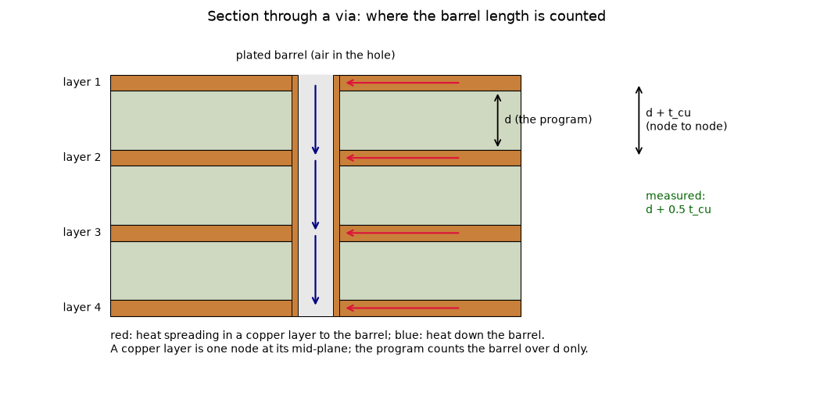
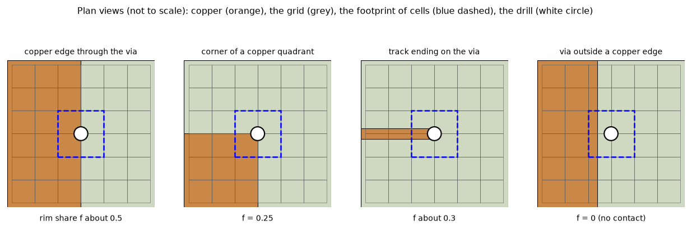
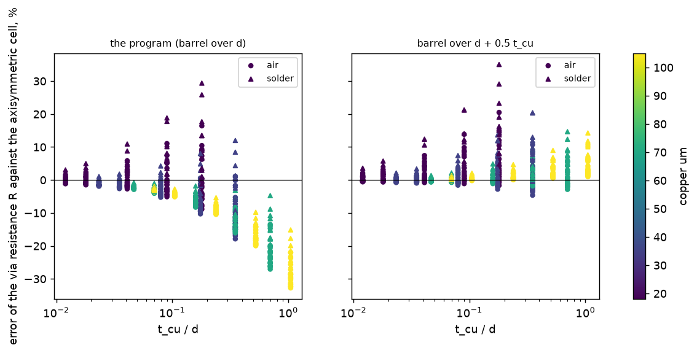
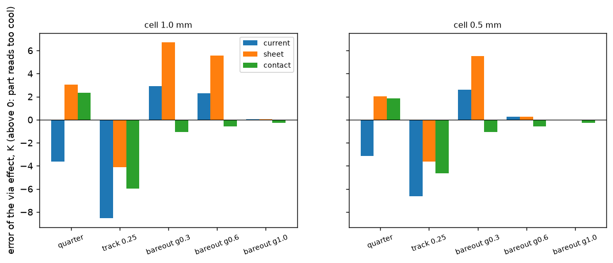
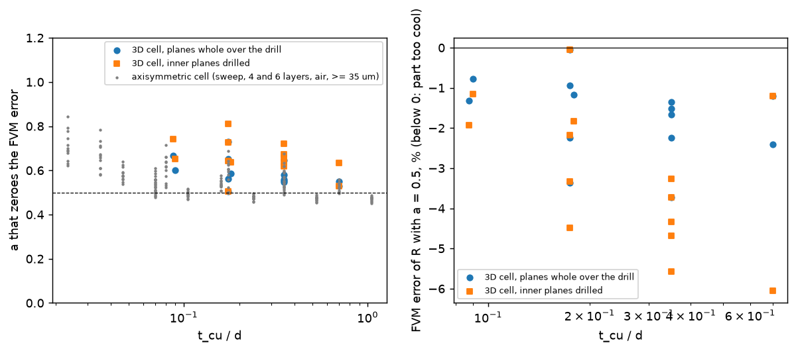

# via-contact-geometry

What is the right contact between a via barrel and a copper plane that covers only part of its footprint, and what length should the barrel have between two copper nodes? Two open items of `research/ROADMAP.md`: **A20** (a via on a plane with copper over part of its footprint) and **A22** (the barrel counted over the dielectric gap only). Status: written, run and **reviewed** (section 7: go for the merge; the barrel rule checked against a second, independent 3D reference, three claims corrected). Program: `develop` at `40d2fb71` (2.5.2). The program was not edited: every variant is a copy of the via logic installed in memory (`lib/barrel.py`, `lib/contact.py`) and removed on exit; `git diff develop --stat -- pcbthermal tests examples ico` is empty.

**Status (audit 2.7.0).** Adopted in 2.6.0 as recommended (`fix/via-barrel-and-rim-uncoupling`: barrel `d + 0.5 t_bar` in the FVM, FDM, Lumped and Analytic, rim uncoupling and partial-rim scaling of the well; the sheet weights not adopted; `docs/validation.md` 34). The 'program' and 'current' columns below are the program of 2.5.2; on the 2.7.0 tree the program is the variant `contact_geo` with the barrel rule (audit check of section 3.4 below).

Run from the repository root with the main environment: `.venv/bin/python research/via-contact-geometry/scripts/<script>.py`; tests: `.venv/bin/python -m pytest -q research/via-contact-geometry/tests` (8 pass). The numbers below are the ones the scripts print (`out/` is git-ignored; every script rewrites its file).

## 1. Question, what would answer it, and the situation

*Questions.* (A22) The program counts the barrel conductance of a gap as `k_cu A / d` with `d` the dielectric gap and crosses the copper nodes with no resistance; the earlier study (`published-cases-followup` 6.4, reviewed) measured on one stack that `d + t_cu / 2` brings the FVM to -0.3 / -0.5 %. What is the rule over a sweep, and is it a constant? (A20) What contact geometry should the coupling use where the copper covers only part of the footprint, without a star coupling (no-go, `via-star-coupling`)?

*What answers it.* (A22) A reference that does not use the program: an axisymmetric unit cell of the layered idealisation (`lib/axicell.py`), against the FVM and FDM over a sweep of copper, gap, drill, filler, layers and pitch. (A20) The fifteen 10 mm boards of the star's review against the 3D solid, in kelvin and in per cent of the rise, for the program and the candidates; the cold-spot board of `docs/theory.md` 2.2; the frozen boards.

*Why the star failed* (read in the commit `cee6de4c` of `feature/via-star-coupling`: its README 5, `docs/validation.md` 31.7 and its tests; the branch is not in `develop`): on an independent set it moved the via at a copper corner (-66 -> +103 %) and the via just outside a copper edge (+276 -> +729 % at 1 mm) to the unsafe side (part too cool), and its barrel node short-circuits the footprint in the plane (0.65 K on the dead-via test). The weights by sheet conductance read the cell's mean copper, not the copper that touches the barrel. This folder keeps the mean-potential coupling and adds the contact.

*Figure 1 (`figures/fig_01_barrel_section.png`, `scripts/make_diagrams.py`): section through a four-layer board (not to scale): the copper layers are nodes at their mid-planes, the barrel is the plated wall, the red arrows are the heat spreading in a layer to the barrel and the blue ones the heat down the barrel. The program counts the barrel over `d`; node to node it is `d + t_cu`; the measured rule is `d + 0.5 t_cu`.*

*Figure 2 (`figures/fig_02_contact_plans.png`): the four partial-copper cases: copper (orange), grid cells (grey), the footprint (blue dashed), the drill (white). The share of the rim of the drill that touches copper is f = 0.5, 0.25, about 0.3 and 0.*

## 2. Barrel length (A22)

### 2.1 Reference and setup

`lib/axicell.py`: axisymmetric finite volumes of one via unit cell (equal-area disc, planes continuous over the drill as in the layered models, uniform flux over the whole top, isothermal bottom, insulated side), an arbitrary stack, imports nothing from the program. `scripts/study_barrel_length.py`: the same board in the FVM and FDM (one pitch wide, 1 W over the whole top, `h_bottom` 1e7 W/m2K), `R = mean top temperature / 1 W`, cells of 0.0625 mm. Checks: the board without via: reference 22481.17 K/W, FVM and FDM 22478.14 K/W (-0.013 %, as in the earlier study); the series circuit to 1e-3 (`tests/test_via_contact_geometry.py`); the reference moves under 0.5 % when the grids are refined (test; on the 4 x 70 um stack of 6.4 of `published-cases-followup` a finer grid moves it -0.8 %, 207.52 -> 205.87 K/W, review). The cell leaves out the bottom film of the program's boards (1e7 W/m2K, `1/(h p^2)`, 0.3 to 2.7 % of R on these cells), so the errors below are biased up by that much (review, section 7.1).

**The cell must be converged.** At 4 cells per pitch the FVM error of a via is noise (+12 % to -4 % at pitch 1 mm and 2 layers); from 8 cells per pitch on it is constant (2 layers 35 um, gap 0.2 mm, pitch 1 mm: -0.6, +0.7, +0.2, -0.2, -0.5 % at 8, 10, 12, 16, 20 cells; 4 layers 70 um: -13.5, -13.2, -13.3, -13.4, -13.4 %).

### 2.2 The sweep (720 boards: 2, 4, 6 layers; copper 18, 35, 70, 105 um; gap 0.1 to 1.5 mm; drill 0.2, 0.3, 0.5 mm; air and solder filler; two pitches)

Error of `R` against the axisymmetric cell, FVM (the FDM is within 0.2 points everywhere), per cent, negative = the program reads the via more conductive than it is (the part reads too cool, unsafe). `a` is the extra barrel length per gap in units of the copper thickness (`d_eff = d + a t_cu`, `lib/barrel.py`; a = 0 is the program):

| subset | n | a = 0: mean / min / max | a = 0.5: mean / min / max | best a | mean abs error at a = 0, 0.5, best |
| :-- | --: | --: | --: | --: | --: |
| all | 720 | -5.6 / -32.8 / +29.4 | +2.2 / -4.6 / +35.0 | 0.44 | 6.96, 2.54, 2.21 |
| copper 35 um and more | 540 | -8.0 / -32.8 / +12.0 | +1.7 / -4.6 / +20.4 | 0.44 | 8.19, 2.06, 1.69 |
| the same, air | 270 | -9.1 / -32.8 / +1.1 | +0.5 / -4.6 / +10.7 | 0.48 | 9.11, 1.24, 1.16 |
| 4 and 6 layers, copper 35 um and more | 360 | -9.1 / -32.8 / -0.6 | +0.8 / -4.6 / +11.8 | 0.47 | 9.13, 1.42, 1.24 |
| 2 layers, copper 35 um and more | 180 | -5.7 / -29.4 / +12.0 | +3.3 / -0.3 / +20.4 | 0.38 | 6.32, 3.35, 2.07 |
| copper 18 um | 180 | +1.4 / -8.9 / +29.4 | +3.8 / -1.7 / +35.0 | 0.09 | 3.27, 3.97, 3.26 |

*Figure 3 (`figures/fig_03_barrel_sweep.png`, `scripts/make_figures.py`): error of R against t_cu / d, FVM, for the program (left) and the rule d + 0.5 t_cu (right); colour = copper thickness, triangles = solder filler. The program's error falls from 0 to -33 % as t_cu / d goes from 0.01 to 1; the rule flattens it to -5 .. +10 %. The positive branch (18 um copper, thin gap, large solder via) is not the barrel: see below.*

*(Review: the 'best a' of this table is the one of the axisymmetric cell; a second, independent reference puts it at 0.50 to 0.82, section 7.1.)*

Reading. (1) The deficit is real and grows with `t_cu / d` (-9 % mean on 4 and 6 layers of 35 um and more, up to -33 %). (2) The best `a` is 0.44 to 0.48 for 35 um and more, the same for 4 and 6 layers and nearly for 2 layers (0.38): the **measured** rule is half a copper thickness per gap, that is a quarter of the thickness at each end (not the full half-thickness at each end, which is `a` = 1 and gives +10 % on average: the plane copper around the barrel shunts the barrel inside the copper layer). It is linear in a (the error at 0.5 is within 0.8 points of the mean of those at 0 and 1). (3) With 18 um copper the sign flips (the best `a` is 0.09 and the rule makes it worse, up to +35 %): there the larger error is the in-plane constriction of the thin plane onto a large via (the Peaceman well and the footprint), a term of the opposite sign that the rule does not touch; the barrel rule is not a fix for it. *(Review, 7.1: the flip is not a property of 18 um copper as such; 18 um air vias of 0.3 mm on four layers follow the rule (best a 0.59 to 0.65 against the 3D cell); the positive branch is the thin, two-layer or solder-filled boards where the barrel resistance is small, and it is the target radius e^(-1/4) r_via of the well: with the target at r_via the same cases go to -14 to -28 %. It is on the safe side.)*
(4) A second look with the 3D solid of the program (`scripts/study_barrel_solid.py`, 4 layers, drill 0.3, pitch 0.5, air, plan cell pitch/10, 8 slabs): error against the axisymmetric cell, FVM a = 0 / a = 0.5 / 3D solid: 18 um, gap 0.2: -2.8 / +1.1 / -0.7 %; 35 um: -8.6 / -1.2 / -4.2; 70 um: -15.0 / -0.8 / -6.5; 70 um, gap 0.44: -7.7 / -0.5 / -3.3; 105 um: -19.4 / +1.0 / -7.2; 105 um, gap 0.44: -10.1 / +0.4 / -3.8. The 3D solid has the **same sign and trend at 40 to 50 % of the size**, and it has not converged in the cell (pitch 1 mm: 70 um -6.5 % at 0.1 mm, -5.3 % at 0.05 mm, the cell cannot go below 0.05 mm; 8 and 16 slabs give the same). So the rule `a = 0.5` rests on the axisymmetric cell alone; the 3D solid would put `a` between about 0.2 and 0.5. Which of the two is right through the copper thickness (a plated wall crossing a copper layer, with the plane around it) was not settled here (doubt 1). *(Settled by the review, 7.1: an independent Cartesian 3D cell with the plating resolved (5 um) agrees with the axisymmetric cell to 0.1 to 3.2 % and puts `a` at 0.50 to 0.73; the program's 3D solid is not converged on a plated wall and is not a reference for this.)*

## 3. Contact of the barrel with a partial plane (A20)

### 3.1 What the program's coupling carries

The footprint of cells is enlarged until the lattice effective radius equals the target `e^(-1/4) r_via`, so the Peaceman well `2 pi S / ln(r_eff / r_t)` is nearly infinite and **the resistance between a plane and the barrel is carried by the lattice of the footprint cells, not by the well** (`scripts/study_well.py`): the layer-to-layer conductance of the via block as a share of the barrel conductance of the gap is 0.82 / 0.88 / 0.95 / 1.000 at cells of 1 / 0.5 / 0.25 / 0.125 mm for a lone 0.3 mm via on full copper and for the quarter-copper board, 0.67 / 0.77 / 0.93 / 1.000 for the track. Consequences: scaling the well by the share f of the rim on copper does nothing at fine cells (it only matters at 0.5 mm and coarser and for f = 0, which uncouples the layer), and the way to change the contact is the weights.

### 3.2 Candidates (all on a copy, `lib/contact.py`; the barrel, wells and Kron reduction are the program's; footprints with uniform sheet conductance and full copper rim go to the program's own code, bit-identical)

* `current`: the program.
* `sheet`: weights by sheet conductance (variant (a) of `via-partial-copper`, `lib/viavariants.py`).
* `contact_geo`: the program's geometric weights, the well scaled by the rim share f (the rim of the drill sampled at 48 points, copper = union of the zones of the layer, `Zone.fill` as the share), a layer with f = 0 uncoupled.
* `contact`: the weights of `sheet` and the rim share f on the well; f = 0 uncouples the layer. A mean-potential coupling, no star.

### 3.3 The fifteen-board set against the 3D solid (`scripts/study_contact_set.py`, `scripts/study_reference_set.py solid`)

The 3D solid at 0.1 mm and 8 slabs (written by `study_reference_set.py solid`, copied from the star's review; a program model, good to about 5 % on the partial cases, whose slab convergence the star's review measured: track 13.84 / 12.28 / 11.65 K, quarter 5.82 / 5.52 / 5.39 K at 4 / 8 / 16 slabs). FVM, **error of the via effect in K and, in brackets, in per cent of the rise without the via** (positive: the via is too effective, the part reads too cool, unsafe). The other nine cases (full copper with drills 0.2 to 1.5 mm, 4 layers, arrays, via 0.35 mm from an edge or a corner) are identical for the four variants (bit-identical by construction) and are -0.4 to -2.8 K (-0.1 to -4.2 %) at 1 to 0.25 mm, the discretisation error that is not about contact.

| case (3D effect, rise) | cell | current | sheet | contact_geo | contact |
| :-- | --: | --: | --: | --: | --: |
| quarter (5.52 K, 60.5 K) | 1.0 | -3.62 (-6.0) | +3.06 (+5.1) | -4.30 (-7.1) | +2.32 (+3.8) |
| | 0.5 | -3.13 (-5.2) | +2.01 (+3.3) | -3.64 (-6.0) | +1.84 (+3.0) |
| | 0.25 | -2.88 (-4.8) | +1.54 (+2.6) | -3.09 (-5.1) | +1.54 (+2.6) |
| track 0.25 mm (12.28 K, 91.1 K) | 1.0 | -8.55 (-9.4) | -4.09 (-4.5) | -10.29 (-11.3) | -5.95 (-6.5) |
| | 0.5 | -6.65 (-7.3) | -3.65 (-4.0) | -7.84 (-8.6) | -4.62 (-5.1) |
| | 0.25 | -5.82 (-6.4) | -2.80 (-3.1) | -6.16 (-6.8) | -2.86 (-3.1) |
| via 0.3 mm outside a copper edge (1.05 K, 82.1 K) | 1.0 | +2.90 (+3.5) | +6.73 (+8.2) | -1.05 (-1.3) | -1.05 (-1.3) |
| | 0.5 | +2.62 (+3.2) | +5.52 (+6.7) | -1.05 (-1.3) | -1.05 (-1.3) |
| | 0.25 | +0.45 (+0.5) | +0.45 (+0.5) | -1.05 (-1.3) | -1.05 (-1.3) |
| via 0.6 mm outside (0.56 K, 83.9 K) | 1.0 | +2.28 (+2.7) | +5.56 (+6.6) | -0.56 (-0.7) | -0.56 (-0.7) |
| | 0.5 | +0.26 (+0.3) | +0.26 (+0.3) | -0.56 (-0.7) | -0.56 (-0.7) |
| via 1.0 mm outside (0.27 K, 87.9 K) | 1.0 | +0.05 (+0.1) | +0.05 (+0.1) | -0.27 (-0.3) | -0.27 (-0.3) |

*Figure 4 (`figures/fig_04_partial_copper_errors.png`): the same, in K, at 1 and 0.5 mm, for `current`, `sheet`, `contact_geo` and `contact` (above zero the part reads too cool; `contact_geo` added by the review).*

Reading (in kelvin and in per cent of the rise, not in per cent of the via effect: for a via that does almost nothing, +276 % is 2.9 K of 82 K). (1) **The via outside the copper edge**: the program over-reads the via (+2.9 K, +3.5 % of the rise, at 1 mm; the `sheet` weights make it worse, +6.7 K, because they put the whole weight on copper cells that do not touch the barrel); uncoupling the layer whose rim touches no copper turns it into -1.05 K, the via effect simply lost, on the safe side, bounded by what the via does; and removes the worst unsafe error of the set. (2) **The track**: `contact` -5.95 K against the program's -8.55 K at 1 mm and -2.86 against -5.82 K at 0.25 mm: both safe, the sheet weights halve the deficit. (3) **The quarter** (a via at the corner of a copper region) goes from the safe side (-3.6 K, part too hot) to the **unsafe** side (+2.3 K at 1 mm, +1.5 K at 0.25 mm, 2.6 to 3.8 % of the rise): the same direction as the star, with a smaller size (the star's was +103 % of the via effect at 1 mm, twice the 3D value; here +42 %). It is the case that needs a coupling that knows the wedge (3.5). (4) The rim share alone, on the program's weights (`contact_geo`), changes nothing except for f = 0.
In the FDM the same cases: the via outside the edge is +326 % / +534 % / +793 % at 1 mm (g = 0.3 / 0.6 / 1.0 mm) in the program and -100 % (via effect lost) with `contact`; the track, the quarter and the rest move by 0 to 7 points.

### 3.4 The cold-spot board of `docs/theory.md` 2.2 (`scripts/study_documented_case.py`)

FVM via effect, K (cold spot, K), cells 1 / 0.5 / 0.25 / 0.125 mm; the 3D solid of the old comparison (0.70 / 2.86 / 7.20 / 10.74 K) has not converged and is not a reference:

| variant | 1 mm | 0.5 mm | 0.25 mm | 0.125 mm |
| :-- | --: | --: | --: | --: |
| current | 6.41 (0.00) | 7.31 (-7.94) | 7.67 (-14.43) | 8.28 (-14.33) |
| sheet | 12.85 (0.00) | 12.69 (0.00) | 12.50 (0.00) | 12.35 (0.00) |
| contact_geo | 5.58 (0.00) | 6.79 (-5.62) | 7.47 (-13.01) | 8.27 (-14.32) |
| contact | 12.33 (0.00) | 12.40 (0.00) | 12.49 (0.00) | 12.35 (0.00) |

*(audit 2.7.0: re-run on the 2.7.0 tree, the `current` row is now the program of 2.6.0, which uses the rim share of `contact_geo` and the barrel `d + 0.5 t_cu`: FVM 5.55 (0.00) / 6.76 (-5.49) / 7.44 (-12.80) / 8.24 (-14.05) K, FDM 8.58 / 10.61 / 10.99 / 11.25 K at 1 / 0.5 / 0.25 / 0.125 mm, within 0.03 K (0.27 K on the cold spot at 0.125 mm) of `contact_geo`, the difference being the barrel length; the `sheet`, `contact_geo` and `contact` rows reproduce to the digit, they build their own couplings with the barrel over `d`. The 2.5.2 `current` row above is the program before 2.6.0.)*

The cold spot is cured by the **weights** (`sheet`, `contact`) and not by the contact share (`contact_geo` keeps it). Positive off-diagonal entries stay (8 at 1 to 0.25 mm and 292 at 0.125 mm against 10 and 202 for the program): **the maximum principle is not restored by structure**, only measured (a star would; it was rejected).

### 3.5 What is not solved: the wedge

For a via at the corner of the copper the correct well is that of a sector, `(theta / 2 pi) 2 pi S / ln(...)`, with the radius at which the lattice takes over **of the sector**, not that of the full plane. The footprint was tuned (`r_eff = e^(-1/4) r_via`) for a full plane, so a mean-potential coupling with copper only in a quadrant cannot give the right resistance with the same constant; scaling the well by f is vacuous at fine cells (3.1). What would do it is the lattice resistance computed from the actual copper around the via: a local solve per via and layer (a fine raster of the zones around the barrel, the footprint cells as the coarse side, the conductances from the Schur complement), which is a model of its own and was not attempted here (next step, `INTEGRATION.md` 4).

## 4. Effect on the frozen numbers (`scripts/study_frozen.py`)

The five boards of the regression harness with vias (`example_board`, `profile_board`, `example_cut_to_T`, `plate_vias`, `plate_lone_via`), FVM and FDM at 2, 1 and 0.5 mm (30 steady-maximum records; the times to 63 % and the Lumped, Analytic and 3D solid were not run):

* **The contact coupling** (`contact`, the weights by sheet conductance and the rim share): **0.0000 K on all 30** (every via of these boards sits on uniform full copper; `via-partial-copper` found 0 partial vias on them).
* **The barrel rule a = 0.5**: all 30 move, up (hotter, the barrel conducts less): +0.125 / +0.146 K (`example_board` FVM / FDM, 2 mm), +0.140 / +0.141 (1 mm), +0.142 / +0.142 (0.5 mm); the same for `profile_board`; `example_cut_to_T` +0.128 to +0.149 K; `plate_vias` +0.061 to +0.069 K; `plate_lone_via` +0.028 to +0.050 K. The largest is 0.149 K, 0.25 % of the rise (0.06 to 0.25 % on the examples, 0.04 % on the plate); the boards are 1.6 mm, 35 um (t_cu / d about 0.022), where the rule is about -1 % of the barrel conductance.

The same on the fifteen-board set: the rule changes the via effect by 0.0002 to 0.11 K (median 0.03 K) on the 10 mm boards (2 layers, 35 um, 1.6 mm), and the table of 3.3 is the same to the second digit (`out/contact_b05.json`). It matters on multilayer boards with thick copper and thin prepregs (2.2), where no frozen board exists.

## 5. Verdict (numbers above; the recommendation is in `INTEGRATION.md`)

1. **A22.** The program's barrel is too conductive by 0 to 33 % of the via resistance, growing with t_cu / d (-9 % mean for 35 um and more on 4 and 6 layers); the half-thickness per gap (a = 0.5) brings that to +0.8 % mean (-4.6 to +11.8 %) against the axisymmetric cell. *(Review: against the independent 3D cell a = 0.5 leaves -0.1 to -3.9 % (planes whole) and -0.2 to -6.5 % (inner planes drilled) on 35 um and more, the unsafe side; the constant is a lower end, not a fit to one reference, section 7.1.)*
2. **A20.** Three separate things: weights by sheet conductance remove the cold spot and the via effect becomes cell-independent (12.3 to 12.5 K at 0.5 to 0.125 mm), but they worsen a via outside a copper edge; leaving a layer uncoupled when the rim touches no copper removes that worst case (+2.9 K -> -1.05 K, safe) at no cost on the frozen boards; the corner of a copper region (quarter) moves from -3.6 K (safe) to +2.3 K (unsafe, 3.8 % of the rise) and needs the sector well, not done.
3. Neither change touches the Lumped, the Analytic or the 3D solid; the Lumped's via also uses `k_cu A / d` (`gz_via`), so the barrel rule should be measured there too (not done). *(Review, 7.3: done; the Lumped and the Analytic move +0.016 to +0.159 K on the frozen boards; the 3D solid draws the barrel through its copper slabs and is not touched.)*

## 6. Limits

* The references: the axisymmetric cell is mine (rewritten for an arbitrary stack; structure from the cell of `published-cases-followup`, checked against the series circuit and against itself under refinement; the review ran it on the Shen stack: 207.523 K/W against the 207.52 printed there, now a test); the 3D solid is a program model (the star's review used it the same way).
* The fifteen boards are 10 mm, 2 layers, 35 um, 1.6 mm, 50 W/m2K, one via or a 3 x 3 array: no multilayer partial-copper case, no imported masks (`rim_copper_share` returns 1 for a problem with imported copper), no antipad, no zone with `fill` below 1 tested.
* The rim share is sampled at 48 points; a copper edge exactly through the centre gives f = 0.5 (tested), but a sliver of copper thinner than the sampling (about 20 um at 0.3 mm) is not seen.
* Cells below 0.125 mm were not used for the set (the earlier studies' limit); the cell in the barrel study is 0.0625 mm.
* The barrel study used a uniform stack (equal gaps, equal copper); outer layers carry heat from one side only and are counted like the inner ones.

## 7. Review

Independent review of the folder (program `develop` at `40d2fb71`; nothing of the program edited, `git diff develop --stat -- pcbthermal tests examples ico` empty). Re-run: the tests (8 pass, one added), `study_documented_case.py` (every number of 3.4 to the digit, positive entries 10 / 8 / 202 / 292 included), three cases of 3.3 at 1 mm (quarter, track, via outside at 0.3 mm: the table to the hundredth of a kelvin), and the frozen shifts of 4 (the FVM and FDM numbers again, through a different patch). New: `scripts/study_barrel_reference3d.py` (an independent 3D reference) and `scripts/study_frozen_models.py` (the Lumped, the Analytic and the times to 63 %); figure 5.

### 7.1 The barrel rule against a second, independent reference (`study_barrel_reference3d.py`)

The reference is the Cartesian 3D solver `tests/helpers/layered3d.py` (imports nothing from the program; harmonic means; its linear solve replaced by SuperLU's symmetric mode to fit in 2 GB, the discretisation untouched) on a **quarter of the square unit cell** (the program's board exactly, not the equal-area disc), the plating drawn as the plan cells whose centre lies in the annulus with the conductivity scaled so that the copper area is exact, plan cells of pitch / 100 (5 um at a 0.5 mm pitch: five cells across the plating) and pitch / 50, graded slabs, 1 W over the whole top, the bottom film 1e7 W/m2K, the dielectric isotropic 0.29 W/mK in all three solvers. Fifteen cases (2, 4, 6 layers; 18, 35, 70 um; gaps 0.1, 0.2, 0.4 mm; drills 0.2, 0.3, 0.6 mm; air and solder; pitch drill + 0.2 mm), in two geometries: the planes continuous over the drill (the idealisation, as the axisymmetric cell) and the inner planes drilled (the real via; the outer planes kept whole because the flux covers the whole top). Grid: R moves 0.1 to 0.6 % from pitch / 50 to pitch / 100 (an order-1 extrapolation moves the best `a` by 0.01).

| | planes whole | inner planes drilled |
| :-- | --: | --: |
| axisymmetric cell against the 3D cell (with the film added) | -0.1 to -3.2 % | -0.8 to -6.9 % |
| FVM, a = 0 (the program), 35 um and more: mean / min / max | -14.2 / -26.2 / -5.3 % | -15.5 / -29.0 / -5.9 % |
| FVM, a = 0.5, 35 um and more | -1.8 / -3.7 / -0.1 % | -3.4 / -6.1 / -0.1 % |
| the a that zeroes the error, 35 um and more: mean (range) | 0.59 (0.50 to 0.73) | 0.66 (0.50 to 0.82) |
| 18 um, air, 0.3 mm, 4 layers: a = 0 / 0.5; best a | -7.9, -4.6 / -1.2, -0.8; 0.59, 0.60 | -8.5, -5.0 / -1.8, -1.2; 0.64, 0.65 |

*Figure 5 (`figures/fig_05_barrel_references.png`, `scripts/make_figures.py`): left, the extra length a that zeroes the FVM error, case by case, against t_cu / d, for the 3D cell with the planes whole and with the inner planes drilled and for the axisymmetric sweep (4 and 6 layers, air, 35 um and more); right, the FVM error of R with a = 0.5 against the 3D cell (below zero: the part reads too cool).*

Reading. (1) **The deficit is confirmed by an independent reference**, a little larger than the axisymmetric cell says (the cell leaves out the bottom film, 0.3 to 2.7 % of R here, and is a disc). (2) **Doubt 1 answered**: the plane continuous over the drill does not inflate the deficit; drilling the inner planes, as a real via is, makes it larger (best a 0.66 against 0.59). (3) **The constant a = 0.5 lies between the two references (0.44 to 0.48 and 0.50 to 0.82), not a fit to one of them**: it removes 62 to 99 % of the deficit and leaves at most -3.9 % (idealisation) or -6.5 % (real via) of R on the unsafe side; a larger constant (0.6 to 0.7) would fit the 3D cell better but overshoot the axisymmetric cell. (4) **Doubt 2 answered** (`--outliers`, five boards of the positive branch of 2.2: two layers, 18 or 35 um, gap 0.1 to 0.2 mm, 0.3 to 0.5 mm solder or air): the 3D cell confirms the positive error (-2.8 to +10.3 % at a = 0, +2.5 to +13.5 % at a = 0.5), and replacing the target radius e^(-1/4) r_via by r_via (`viawell.TARGET_RATIO`, patched in memory) turns every one of them to -14 to -28 % like the rest: the positive branch is the well's target radius, which carries a constriction of `(1/4) / (2 pi S)` per plane (5.6 K/W at 18 um) that matters only where the barrel resistance is of that size. It is the open item A14 (target radius by stack-up), on the safe side, and a rule a(t_cu) must not be used to hide it. With the target at r_via the best a would be about 0.8 to 1 on the main set, but +6 to +19 % on 70 um copper at a = 1: no single pair of constants is better than (e^(-1/4), 0.5).

### 7.2 The contact (A20)

Reproduced (3.3 and 3.4). Judgement:
* **Uncoupling a layer whose rim touches no copper** is physical (the barrel is not connected to copper it does not touch; the 1.05 K of the 3D solid is the laminate around the barrel, which the uncoupled via loses: the safe side, bounded by the via effect). It is the only change that removes the worst unsafe case of the set (+2.90 K, +3.5 % of the rise, at 1 mm) without creating another one. With the program's weights (`contact_geo`) it moves the quarter -3.62 -> -4.30 K and the track -8.55 -> -10.29 K at 1 mm, both further on the safe side, and leaves the cold spot (-5.62 K at 0.5 mm).
* **The weights by sheet conductance** remove the cold spot and make the documented board cell-independent, but (a) the quarter goes to the unsafe side, +2.32 K at 1 mm and +1.54 K at 0.25 mm (3.8 and 2.6 % of the rise) against the 8-slab 3D solid, and the 3D solid's own via effect falls with the slabs (5.82, 5.52, 5.39 K at 4, 8, 16) and the program's 3D solid reads a plated barrel too conductive (2.2 (4): 40 to 50 % of the FVM's barrel deficit), so +2.3 K is a lower bound of the unsafe error; (b) on the 'bare' board of `via-star-coupling` 5.2 (a part on the bare half beside the via) the same weights read the via effect 84 to 93 % too weak, which this folder did not re-run or mention; (c) positive off-diagonal entries remain (8 at 1 to 0.25 mm, 292 against the program's 202 at 0.125 mm on the cold-spot board): the cold spot is gone on the boards measured, but no maximum principle is guaranteed, and a finer cell has more positive entries, not fewer. A safe-side error (the cold spot, a via effect read low) is exchanged for an unsafe one at a copper corner, which a user cannot see.
* The corner case is not acceptable as a default without a warning; the partial-copper warning of 2.5.0 already flags such vias (`checks.partial_copper_vias`), so a release note would not reach the user who needs it.

### 7.3 Frozen numbers (`study_frozen_models.py`)

The barrel rule installed for every model by scaling `Via.thermal_area` by d / (d + 0.5 t_cu) (the five via boards have equal gaps; the FVM and FDM shifts equal those of 4 to the digit, which checks the patch). Steady maximum at 2, 1, 0.5 mm: **FVM and FDM** +0.028 to +0.149 K (as in 4); **Lumped** +0.016 to +0.159 K; **Analytic** +0.037 to +0.158 K (at most 0.26 % of the rise); **times to 63 %** -1.0 to +0.002 % (example board U1: FVM -0.76 %, FDM -0.94 %, Lumped -1.01 %, Analytic -0.98 %; the second part unchanged); the **3D solid** draws the barrel through its copper slabs and is not touched (not run); boards without vias do not move. So the rule moves 30 FVM/FDM and 30 Lumped/Analytic steady maxima and all 36 times to 63 % of the five via boards (beyond the frozen tolerance of 1e-6; the second part of the example boards by under 0.03 %; the outline board has no Lumped or Analytic time run); the other fields of those records (means, checksums) move with them. The contact change moves none (confirmed: 0.0000 K on all 30, every via on uniform full copper). **Imported masks**: not measured; `rim_copper_share` returns 1 for imported copper, so the contact change would do nothing there, while the barrel rule applies to every via of an imported board (the RP2040 and CO60 boards have hundreds; a measurement belongs to the `fix/` branch).

### 7.4 The star coupling (consistency)

Read in `cee6de4c` (`via-star-coupling` README 5 and the commit message): the no-go rests on the quarter (+103 %) and the via outside the edge (+729 %) on the unsafe side and an in-plane short through the barrel node. This folder's numbers for `current` and `sheet` equal those of the star's review, and its conclusion (keep the mean-potential coupling) agrees. The star's own table 5.2 holds the 'bare' case that argues against the sheet weights (7.2 (b)); it is now cited here.

### 7.5 Claims corrected

* `INTEGRATION.md` 3 called a = 0.25 'the safer choice ... cannot overshoot'. Overshooting is the safe side (the part reads hotter); a = 0.25 leaves twice the unsafe error of 0.5. Corrected.
* 2.2 (3) and doubt 2: the sign flip is not '18 um copper'; it is the target radius on boards with a small barrel resistance (7.1 (4)).
* `lib/axicell.py` said it was checked against the Shen number 'in tests/test_axicell.py', a file that does not exist and a test that the README said was left: the check now exists (207.523 against 207.52, `tests/test_via_contact_geometry.py`), the docstring says so and states the missing bottom film.
* 2.1: 'moves under 0.5 % when refined' holds for the test case only; -0.8 % on the Shen stack.
* 3.4 and the verdict called the 3D solid of the old comparison not converged, true; the 3D solid of 3.3 is not converged either for the quarter (7.2 (a)), which the README now says.

### 7.5b Checked in the reproduction pass (Shen cell, program mean against the resolved cell)

Comparing like with like (the program's heater mean `t_mean`, not `t_max`, against the mean top temperature of the resolved Shen cell over 144, 1.4611 K): a = 0 reads 1.3364 K at 0.1 mm and 1.3358 K at 0.05 mm (-8.5 %), a = 0.5 reads 1.4395 K and 1.4389 K (-1.5 %). Shen cell 210.40 K/W: a = 0 -8.9 %, a = 0.5 -1.9 %. A Cartesian 3D cell (plating resolved, dielectric isotropic 0.29 W/mK): planes whole 208.10 K/W, inner planes drilled 210.38 K/W; program a = 0 -7.9 / -8.9 %, a = 0.5 -0.8 / -1.9 %. Sweep of pitch 0.45 to 3 mm and copper 18 / 35 / 70 um: a = 0.5 within -2.1 to +0.15 %; the a that zeroes the error lies between 0.44 and 0.84; no density term is needed. The earlier +0.8 % agreement of the 2.5.x barrel was two errors cancelling (barrel deficit -8.5 %, max against mean about +9 %).

### 7.6 Not verified

The contact cases against an independent reference (only the program's 3D solid; a resolved Cartesian cell of a 10 mm board does not fit in memory); the barrel rule on the 720 boards against the 3D cell (15 + 5 cases); pitches of 1 mm in the 3D cell; vias with antipads; imported boards; any measurement. The `published-cases-followup` A22 entry ('checked by a Cartesian 3D cell to 0.5 %') was read from its branch and not re-run.

**Verdict: GO for the merge** of the folder as a study. Recommendations in `INTEGRATION.md` 3.

## 8. What was read and what was not verified

Read in full (code and text on this machine): `research/ROADMAP.md` A20 and A22; `research/via-partial-copper/README.md` and `INTEGRATION.md`, `lib/viavariants.py`, `scripts/study_frozen.py`, `scripts/study_documented_case.py`; `docs/validation.md` 30; the commit `cee6de4c` of `feature/via-star-coupling` (README 5 as added by the commit, `study_reference_set.py`, the validation 31.7 and theory text); `research/published-cases-followup` README 6.3 and 6.4 and `lib/via_cell.py` and `scripts/study_shen_vias.py` (from its branch); `pcbthermal/viawell.py` `build`, `kron_barrel`, `well_conductance`. The review read in addition `tests/helpers/layered3d.py` (whole), `pcbthermal/viawell.py` lines 41, 191, 372, 424 to 540, `model.Via.thermal_area`, the `thermal_area` users in `analytic.py`, `viaconstriction.py`, `solid3d.py`, and the README 6.3 and 6.4 of `published-cases-followup` (from its branch). **No external source was opened for this folder**: the Peaceman well, the Krogh/log kernel and the Shen et al. cell are as in the earlier folders (Shen et al.: read there, by the earlier reviewer; Peaceman: from memory, status M); the sector well of 3.5 is my own derivation, not checked. Reproduced here: the 15-board numbers of the program and of the `sheet` variant (they equal those printed by the earlier folders: quarter -66 / -57 / -52 % of the via effect, track -70 / -54 / -47 %, via outside +276 / +250 / +42 %, at 1 / 0.5 / 0.25 mm), the cold-spot table (7.31 and -7.94 K at 0.5 mm, 12.35 K at 0.125 mm), the frozen shifts of the contact coupling (0). **Not verified**: the constant `a` against a converged 3D reference (doubt 1); the time responses; the Lumped's barrel; the imported boards; any physical board.

### Doubts for the reviewer

*Answered by the review (section 7): doubt 1 in 7.1 (2) and (3), doubt 2 in 7.1 (4), doubts 3 and 4 in 7.2.*

1. The axisymmetric cell says `a` = 0.44 to 0.48, the 3D solid (not converged, program model) 0.2 to 0.5: which is right through a copper layer, and does the axisymmetric cell's plane-over-the-hole assumption (the copper plane continuous across the drill) favour a larger deficit?
2. With 18 um copper the opposite error (+10 to +29 % with a = 0) dominates: is it the Peaceman well / footprint (A20 territory) or the unit cell's in-plane term? A rule `a(t_cu)` would hide it.
3. `contact` moves the quarter from safe to unsafe by 2.3 K at 1 mm: is that acceptable as the price of removing the cold spot and the outside-the-edge case, or does the quarter need the sector well first?
4. The uncoupling at f = 0 means a via touching no copper on a layer does nothing there, while the laminate beside the barrel does conduct (the 3D solid's 1.05 K of the via outside the edge): the -1.05 K (safe) is that loss.
