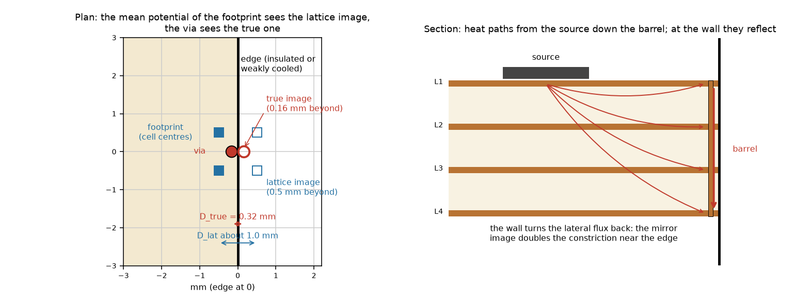
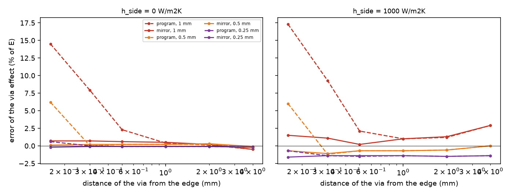

# The via near a board edge: an image for the well on the grid

**Question.** The via of the FVM (`viawell.py`: a footprint of cells, a Peaceman well, the Kron reduction) has no image of the board edge in its lattice kernel, so a via within about one cell of the edge reads +12 to +15 % in its effect at a 1 mm cell (today only a warning, `checks.check_via_limits`). Can an image (or another correction) enter 2.5.0 safely, or does it wait for 2.6.0? This folder re-measures the error on the current `develop`, tests a mirror image and a Robin image against an independent resolved reference, and checks the matrix, the cost and what the image moves in the frozen numbers. The program is not edited: the candidates are installed in memory by `lib/edge_hook.py` on `viawell.build`.

**What is new against `research/via-real-board`** (which derived the mirror image on a prototype of the treatment and adopted it for `h_side` 0 and 10 W/m2K): the image is re-implemented on the **program as it is on `develop`** (`viawell.footprint`, `kron_barrel`), a **Robin image** is derived and tested for edge films up to 1e5 W/m2K (the earlier 1e6 row is gone: since the integration of the branches `Board.validate` refuses an edge coefficient above 1e5 W/m2K, so `study_edge_sweep.py` stops its default list there), the errors are given **in kelvin and as a share of the board rise** (the percentage of the via effect misleads for a cold edge), the frozen-number boards and the matrix properties are measured, and a closed-form reading of the image (Yovanovich 1995) is added.

## 1. The situation

*Figure 01 (`figures/fig_01_via_near_edge.png`): left, plan: a 0.3 mm via 0.16 mm from the edge on 1 mm cells; the footprint sits on the cell centres (0.5 mm from the edge), so the potential its mean sees from the wall is that of an image 1.0 mm away (`D_lat`), while the via has its true image at 0.32 mm (`D_true`); right, section: the heat paths from a source to the barrel and their reflection at the wall.*

### 1.1 The candidates (`lib/edge_hook.py`)

* **program**: `viawell.build` as it is.
* **mirror** (the insulated wall): the well becomes `G_c = 2 pi S / (ln(r_eff / r_t) + c)`, `c = sum over the walls of [ln D_lat - ln D_true]`, `ln D_lat = ln dx + (pi/2)(P_img - kappa)`, `P_img = sum_ab w_a w_b a(x_a - x'_b)` the potential kernel `a` of the five-point stencil between the cells of the footprint and the mirror images `x'` of the cell centres, `D_true = 2 max(delta, r_v)`; at a corner the diagonal image is added; when `c` is so negative that the denominator is not positive the footprint is enlarged (smallest disc with `ln(r_eff/r_t) + c > 0`) instead of making the well infinite.
* **robin** (an edge film `h_side`): the image of a point source at distance `delta` from a wall with `du/dn = -u/l` (`l = S/(h_side slab)` per plane) is the point image plus a line image of density `exp(-s/l)` beyond the wall, `Phi(D) = ln D - (2/l) int_0^inf exp(-s/l) ln(D + s) ds`; `c = Phi_lat - Phi_true` with the same operator on the lattice image of the footprint and on the true image. Derived here: the condition is checked by finite differences in `tests/test_edge_hook.py`; `Phi = ln D` for `l -> inf` and `-ln D` for `l -> 0`. Not a published formula (Yovanovich 1995 gives the two-medium image of a point source, section 5).

## 2. The reference and the cases

Board of `research/via-real-board/lib/edge_reference.py`: 10 x 10 mm, four copper planes of 35 um in FR-4 (0.3 W/mK), `h_top` 10, `h_bottom` 200 W/m2K, 0.5 W in a 3 x 2 mm source, one 0.3 mm copper-filled via at distance `d` from the right edge. Reference: the same layered model on a 1/16 mm grid by the independent solver `sheets2d` (imports nothing of the program), the barrel at its real size; the via effect `E = T_max(no via) - T_max(via)`. **Reference convergence** (`out/abs_reference.txt`): `E` at 1/16 and 1/32 mm = 3.1623 and 3.1591 K (insulated), 0.4119 and 0.4112 K (`h_side` 1000), so the reference is good to 0.1 %. The layered idealisation against a real 3D barrel is not repeated (`research/point-via-convergence` 3.2). Cells 1, 0.5 and 0.25 mm; all runs light (below 0.5 GB). Scripts: `scripts/study_edge_sweep.py`, `scripts/study_edge_absolute.py`, `scripts/study_adoption_impact.py`.

## 3. Results

### 3.1 The error on the current develop, and what the image does (`out/sweep.txt`)

Error of `E` against the reference, FVM, insulated edge (`h_side` 0), in per cent of `E`:

| d (mm) | reference E (K) | program 1 / 0.5 / 0.25 mm | mirror 1 / 0.5 / 0.25 mm |
| --: | --: | :-- | :-- |
| 0.16 | 3.162 | +14.5 / +6.2 / +0.6 % | +0.7 / +0.1 / -0.2 % |
| 0.3 | 3.358 | +7.9 / 0.0 / 0.0 % | +0.7 / +0.2 / -0.1 % |
| 0.5 | 3.542 | +2.3 / +0.2 / -0.1 % | +0.6 / +0.2 / -0.1 % |
| 1 | 3.839 | +0.4 / +0.2 / -0.1 % | +0.5 / +0.2 / -0.1 % |
| 2 | 4.274 | +0.1 / +0.2 / -0.1 % | +0.2 / +0.3 / -0.1 % |
| 4 | 5.343 | -0.5 / -0.1 / -0.2 % | -0.5 / -0.1 / -0.2 % |

`h_side = 10 W/m2K` is within 0.3 points of this table (program +14.8 / +6.2 / +0.6 % at d = 0.16 mm; mirror +0.7 / +0.1 / -0.2 %). **The +14.5 % of the Decisions Log is reproduced on `develop` (tip `2f3bd73`); the excess falls with the cell (1 mm: +14.5 %, 0.5 mm: +6.2 %, 0.25 mm: +0.6 %) and with the distance (gone by 1 cell).** The mirror image takes the nearest via to +0.7 % at 1 mm, never worse than 0.2 points beyond the program away from the edge.

In kelvin (`out/abs_films.txt`): the board rise without the via is 53.1 K; the program's error of `T_max` for the nearest via is -0.53 K at 1 mm (-1.0 % of the rise) and -0.20 K at 0.5 mm (-0.4 %), the mirror -0.094 K (-0.18 %) and -0.006 K. **The error is small in absolute terms: a part's temperature is wrong by 1 % of its rise at worst, on the cool (non-conservative) side**, because the via effect is too large.

*Figure 02 (`figures/fig_02_edge_error_against_distance.png`): error of the via effect against the distance from the edge for three cells, program (dashed) and mirror image (solid); left insulated edge, right `h_side` 1000 W/m2K.*

### 3.2 Edge films from insulated to isothermal (`out/sweep.txt`, `out/abs_films.txt`)

| h_side (W/m2K) | l = S / (h_side slab) | E ref (K), d = 0.16 mm | program / mirror / robin at 1 mm (% of E) | error of T_max, program / mirror, 1 mm (K) |
| --: | --: | --: | :-- | :-- |
| 0 | inf | 3.162 | +14.5 / +0.7 / +0.7 | -0.533 / -0.094 |
| 10 | 3.4 m | 2.993 | +14.8 / +0.7 / +0.7 | -0.515 / -0.092 |
| 100 | 0.34 m | 1.992 | +15.3 / +1.0 / +1.1 | (not run) |
| 1000 | 34 mm | 0.412 | +17.3 / +1.5 / +2.9 | -0.157 / -0.092 |
| 10000 | 3.4 mm | 0.023 | +7.2 / -11.6 / -2.9 | -0.224 / -0.220 |
| 100000 | 0.34 mm | 0.001 | -51 / -63 / -45 | -0.626 / -0.626 |

* **Up to 1000 W/m2K the mirror image is right** (+0.7 to +1.5 % at 1 mm). Natural convection plus radiation at an edge is 10 to 30 W/m2K, so every real "insulated or convective" edge is in this range.
* **The Robin image is no better where it matters**: equal to the mirror up to 100 W/m2K, worse at 1000 (+2.9 against +1.5 %). Above 10 000 W/m2K it is closer in the percentage of `E`, but there `E` is 0.023 K and 0.001 K, a fraction of a per cent of the rise, and the error of `T_max` is the same for the three variants (-0.22 K at 10 000, -0.63 K at 100 000 W/m2K, 1 mm): it is the discretisation of the strongly cooled edge itself (the half cell between the node and the wall), **not the via**, and the image cannot remove it. Why the film length decides: the film matters only when `l = k/h_side` is not much larger than the lattice image distance `D_lat` (about one cell); on this board (S = 0.0136 W/K per plane, slab 0.4 mm) `l` is 3.4 m to 34 mm at 10 to 1000 W/m2K and 3.4 mm at 10 000 W/m2K, which is where the image stops being right. (The review corrected the column of the table and this sentence: they gave `k / h_side` of bulk copper, 38 m to 0.39 m, eleven times the film length the hook uses, `S / (h_side slab)`; the conclusion is unchanged.)
* A clamped or cold-plate edge (isothermal) is not a convective edge: the program models it only by a huge `h_side`, and there the via effect near the edge is negligible anyway.

### 3.3 Corner and outline (`out/abs_corner.txt`, `out/abs_outline.txt`)

| case | program 1 / 0.5 mm | mirror 1 / 0.5 mm |
| :-- | :-- | :-- |
| via 0.16 mm from two edges (corner), insulated | +26.0 / +9.4 % | -1.0 / -0.7 % |
| corner, d = 0.3 mm | +11.4 / -3.2 % | -0.5 / -0.3 % |
| corner, `h_side` 10, d = 0.16 mm | +26.1 / +9.4 % | -1.0 / -0.7 % (Robin: the same, with the diagonal image kept for a long film) |
| outline cut at x = 7 mm (a grid line), d = 0.16 mm | +14.1 / +5.9 % | +1.1 / +0.1 % |
| outline cut at x = 7.0625 mm (inside a cell), d = 0.16 mm | +16.5 / +7.3 % | +2.5 / +0.3 % |
| same outline, d = 1 mm | -0.4 / -0.7 % | +1.6 / +0.1 % |

The image is applied with the footprint restricted to the cells on the board, which `develop` already does (`viawell.restrict_to_board`). **Not tested here and found by the review of `feature/via-edge-image`:** next to a reflex corner (a T, an L) the side the via faces ends at the corner and its full mirror overstates the wall (-13.5 % against -2.9 % without the image, a via 0.26 mm from the reflex corner of an inverted T at 1 mm); the program therefore gives no image within 0.6 cells of a reflex vertex or a short or slanted side (`docs/validation.md` 28.1). At the outline cut inside a cell and d = 1 mm at 1 mm cells the image is 1.2 points worse than the program (+1.6 against -0.4 %): the only row where it loses, and within the budget.

### 3.4 The other models

* **FDM** (program, `out/abs_fdm.txt`): -4.5 / -7.1 / -1.7 % at d = 0.16 mm and 1 / 0.5 / 0.25 mm, -10.1 % at d = 0.3 mm and 1 mm. The edge nodes are half volumes whose mirror is themselves; the error has the **opposite sign** to the FVM's (the via effect too small, so the via cools the part too little and the part reads hot: the safe side), and the mirror image above does not apply to it (the hook leaves the FDM alone). Not proposed; the FDM is a comparison model.
* **3D solid** (program, `out/abs_solid.txt`, against the layered reference, so it mixes the idealisation): +18.1 % at d = 0.16 mm and 1 mm against -0.7 % at d = 4 mm, so about +19 points of edge excess, the same sign and size as the FVM; +4.4 % at 0.5 mm. Its `tuned_footprint` has no image either. Not measured with an image; left as a note.

### 3.5 The matrix, the balance, the cost, the frozen numbers (`out/impact.txt`)

* **The image changes only the well conductances**, so the Kron couplings `G_lm` stay symmetric, non-negative and with zero row sum: on the edge board at 1 mm the matrix is symmetric (`max |K - K^T|` = 0), the row sums differ from those of the board without vias by 4e-18 W/K (program) and 4e-18 W/K (mirror), no positive off-diagonal in either, and the energy balance is -7.7e-14 (program) and -8.3e-14 (mirror) of the power. The image weakens a well (`c > 0`, `G_c` smaller) or, for `c < 0`, enlarges the footprint, so no new sign appears.
* **Cost**: the edge term takes 0.045 ms per via at 1 and 0.5 mm, 0.050 ms with a 10-cell footprint at 0.125 mm (limit proposed: 1 ms).
* **Frozen numbers** (prototype; **superseded by the program**, section 7: with the reflex-corner guard of `viawell.image_walls` `example_cut_to_T` moves -0.0103 K at 2 mm and -0.0001 K at 1 mm, the -0.196 K below came from walls given to vias beyond the end of an outline side): of the five boards of `tests/regression` that have vias, four do not move at all (example board, profile board, plate with 16 vias, plate with one via: no wall within 6 cells); `example_cut_to_T` moves **-0.196 K at 2 mm, -0.0024 K at 1 mm** and 0 at 0.5 mm (its nine vias lie within 6 cells of the outline of the T at 2 mm). It would need a pending shift. The sign is cooler (the via effect larger): at 2 mm the vias are 1 to 6 cells from the outline and the term `c` there is negative or small (the lattice image is nearer than the true one), the case the enlargement of 3.3 handles. **No reference was made for that board, so whether the shift is an improvement is not verified** (a 0.2 K move on the T board; the 2 mm cell is also where the program warns about the via).

## 4. Verdict for 2.5.0

* **The mirror image fits 2.5.0** (adopted: `feature/via-edge-image`, merged into `develop`, with the reflex-corner guard; section 7). It is small (about 85 lines in `viawell.py` with the two helper functions, `INTEGRATION.md`), local (FVM wells only, the matrix structure and the SOR blocks unchanged, no new unknowns), cheap (0.05 ms per via), brings the nearest via from +14.5 to +0.7 % at 1 mm, a corner from +26 to -1 %, an outline from +14 to +1 % (inside a cell +2.5 %), costs nothing where no wall is near (bit-identical: four of five boards), and the acceptance numbers are in `INTEGRATION.md`. It repeats the decision of `research/via-real-board` on the program as it is now.
* **The Robin image does not**: no gain up to 1000 W/m2K, a loss at 1000, and above that it fixes a quantity that does not matter and not the discretisation error of a cold edge. Document the limit: the image is for insulated or convective edges (`h_side` up to about 1000 W/m2K); a strongly cooled edge is not a mirror.
* **What stays as a limit and a warning**: the FDM (opposite sign, -4.5 to -10 % at 1 mm), the 3D solid (+19 points), diagonal and curved outline edges (no wall: the axis-parallel segments only; the error of a diagonal edge was not measured), a cell of 2 mm or more, and a via across the edge (clipped at `r_v`). `checks.check_via_limits` should keep warning for these and stop warning for the FVM wall cases it now handles (or say how much is left).
* **Decision for the maintainer**: adopt the mirror image on a `feature/via-edge-image` branch (with the pending shift of `example_cut_to_T`), or leave it to 2.6.0 and keep the warning. The risk is low; what 2.5.0 loses by waiting is a 1 % error of the part's temperature (cool side) for a via within a cell of an edge.

## 5. Published basis

M. M. Yovanovich, *Construction resistance of planar isoflux heat sources within semi-infinite conductors: image method*, ASME/JSME Thermal Engineering Conference, vol. 1 (1995) (R, pages 25 to 27 of the copy read: equations 1 to 11). For a point source `s` at distance `c` from the plane between two media, the image has strength `s_2 = -[(lambda_2 - lambda_1)/(lambda_2 + lambda_1)] s` (eq. 9), so `T_1 = s/(4 pi lambda_1 r_1) - [(lambda_2 - lambda_1)/(lambda_2 + lambda_1)] s/(4 pi lambda_1 r_2)` (eq. 10); `lambda_2 >> lambda_1` is an isothermal plane (a sink image) and `lambda_2 << lambda_1` an adiabatic plane (a source image). This is the three-dimensional form of the mirror (insulated) and the negative (isothermal) image used here; the paper does not treat a lattice or a convective edge. Its use here is the sign and the limits; the number that matters (`c`) is the program's lattice, not the paper. Not reproduced: the circular-source values of its Table 1 and Figure 3 (a different geometry: three-dimensional half-space constriction), so no published numerical case of the *edge* was reproduced. The independent check is the resolved reference of section 2 (a published case for a via near an edge does not exist in the papers held). K.-T. Lee and M. M. Yovanovich, *Conjugate heat transfer from vertical plates with discrete heat sources*, ASME J. Electronic Packaging 111 (1989) 261-266 (key [LeeYovanovich1989Discrete]; the review corrected the initial and the title) (R in part: the solid-side model of section 3 takes the plate edges as insulated because they dissipate a negligible share, which is the assumption behind the "insulated edge" case here; no via and no edge image in it).

## 6. Limits of this study

* One board (10 x 10 mm, a source 1 mm from one edge and 3 mm wide), one via, the layered idealisation (not a 3D barrel), copper planes in every layer (the film length `l` was taken for copper; for a plane that is mostly laminate `l` is short and the Robin image would matter at a smaller `h_side`, not tested).
* Not tested: several vias (their footprints overlap and `c` is per via), a via array along an edge, a diagonal or curved wall, two opposite walls within reach (a narrow board: one wall per axis, the nearest), the FDM and the 3D solid with an image, a real board.
* The corner of a cooled edge (Robin) is not treated beyond a long film.
* The position of the via along the edge: `via-real-board` 3.1 swept it (image within +0.5 to +1.8 % at 1 mm); not repeated.
* The study did not check the image on the heat balance of a transient or on the Lumped model (`gz_via` is unchanged, so they do not move).

## 7. Review

Closing review on this branch merged with `develop` at `0507e5c` (which holds `feature/via-edge-image`); `git diff develop...HEAD -- pcbthermal tests examples ico` and the project documents: empty. **Verdict: go for closing the investigation.** The program's image equals the prototype of this folder wherever the prototype was measured, and the numbers of `docs/validation.md` 28 are reproduced; the corrections are listed below.

### 7.1 What was re-run (program of `develop`, which has the image)

* `study_edge_sweep.py`, insulated, `h_side` 10 and 1000 W/m2K, d = 0.16 to 4 mm, cells 1 / 0.5 / 0.25 mm, and the corner at 1 / 0.5 mm (28 s, 0.43 GB): the program's image and the prototype `mirror` agree to the printed digit on all 18 box-edge rows (54 values) and the 2 corner rows (4 values); the new mode `none` (the program with `viawell.EDGE_REACH_CELLS = 0`) reproduces the old program column (+14.5 / +6.2 / +0.6 % at d = 0.16 mm, +17.3 / +6.0 / -0.7 % at 1000 W/m2K).
* `study_edge_absolute.py --part outline` (7 s): the program equals the prototype on the twelve outline rows (+1.1 / +0.1 % on a grid line, +2.5 / +0.3 % inside a cell at d = 0.16 mm).
* `study_adoption_impact.py`, rewritten for the program that has the image (`out/impact.txt`): the program's image moves `example_cut_to_T` **-0.0103 K at 2 mm, -0.0001 K at 1 mm**, 0 at 0.5 mm (the pending file of `feature/via-edge-image`), the prototype -0.1964 / -0.0024 K as section 3.5 said; the other four boards with vias do not move; the matrix of the edge board stays symmetric with no positive off-diagonal entry, the heat balance -8.1e-14; the edge term 0.04 ms per via.
* The tests of the folder (7 pass, one updated, 7.3) and `tests/test_via_edge_image.py` of the program (21 pass).
* Not re-run: `--part films`, `solid`, `fdm`, `reference` of `study_edge_absolute.py` (the program's FDM and 3D solid are not changed by the image; the reference convergence 3.1623 / 3.1591 K is in `out/abs_reference.txt` from the first run) and the figure scripts.

### 7.2 Against `docs/validation.md` 28

Every "with" value of the table of 28 is reproduced by the re-run except one rounding: `h_side` 10 W/m2K, d = 2 mm, 1 mm cell is +0.455 % (printed +0.4 % in 28, +0.5 % here; the 0.5 mm "without" of that row is +0.2 % in this folder's first run against +0.3 % in 28). Both are within the 0.1 point the review of the feature stated. The frozen-number paragraph of 28 (-0.0103 K) and its explanation of the -0.196 K of this folder (walls given to vias beyond the end of a side) are confirmed: of the nine vias of `example_cut_to_T` the prototype's rule finds a wall for 9 at 2 mm and 3 at 1 mm, the program for 3 and 1. The prototype's larger shift is not shown to be wrong in direction (it moves the via effect at 2 mm towards the 0.25 mm value, which is not a converged reference); the guard rests on the reflex-corner cases of 28.1.

### 7.3 Corrections made in this folder

* The film length of 3.2 (table column and text): it was `k / h_side` of bulk copper (38 m to 3.9 mm), eleven times the length the hook uses, `l = S / (h_side slab)` (3.4 m to 0.34 mm on this board); the conclusion stands.
* The frozen-number statement of 3.5 and `INTEGRATION.md` 3 marked as the prototype's and superseded; the reflex corner added to 3.3 and to the status of `INTEGRATION.md`.
* The citation of Lee and Yovanovich (1989): author K.-T. Lee and the title as published (the bibliography entry of `research/theory/BIBLIOGRAPHY.md`); the merge of `develop` kept the bibliography entry that was read in full and points this folder's use to it.
* `lib/edge_hook.py` gains the mode `none` and `tests/test_edge_hook.py::test_mirror_removes_the_excess_at_the_nearest_via` failed after the adoption (it took the program for the version without the image); it now compares `none`, the prototype and the program, and holds the program equal to the prototype on a box edge.

### 7.4 What stays open

* As section 6, plus: several vias near an edge and a diagonal or curved edge against a resolved reference; the FDM (-4.5 to -10 % at 1 mm, the safe side) and the 3D solid (+19 points at 1 mm) still have no image and keep the warning.
* Composition with the numerical fix of a partial-copper footprint (`research/via-partial-copper`, README 9.4): the image enters the well's denominator, so a star coupling must fold it into its per-layer calibration.

## 8. What was read and what was not verified

* **Read in full (R)**: Yovanovich (1995) image method, pages 1 to 4 of the local copy (equations 1 to 11, the limiting cases); `viawell.py` and `docs/theory.md` 2.6 and 1.5; `research/via-real-board` README 3 and `lib/edge_image.py`, `edge_reference.py`.
* **Read in part (R)**: Lee and Yovanovich (1989): the solid-side assumptions (insulated edges); the conjugate part and the figures were not studied.
* **Not read, and not needed here**: Shen and Soleymani's via papers (they deal with arrays of vias, not edges); Karpinski and others (2010) (Peaceman near a boundary; named in the plan, not obtained in this session).
* **Reproduced**: the +12 to +15 % of the Decisions Log on `develop` (+14.5 % at 1 mm, d = 0.16 mm); the mirror image of `via-real-board` (+0.7 %) with an independent implementation on `viawell.py`; the resolved reference converges to 0.1 % between 1/16 and 1/32 mm.
* **Derived here, not from a source**: the Robin image and its use as `c = Phi_lat - Phi_true` (tests: the boundary condition by finite differences and the two limits; the numbers of 3.2 are its only check against a reference, and they do not support adopting it).
* **Not verified**: a published numerical case for the edge (none held); the 3D barrel near an edge; the figures were drawn by `scripts/make_diagrams.py` and `make_figures.py` from the tables in `out/` (git-ignored, regenerated by the scripts).
* **Load**: every run was light (below 0.5 GB, seconds to two minutes each) on a machine whose swap was already 1.8 to 4.7 GB from other jobs (the swap figure was 4.66 GB at the first run, which exceeds the ceiling of 3.0 GB; the runs added no measurable growth and were tiny).
* **Review (section 7):** re-ran the sweep, the outline part and the adoption impact on the program with the image, the tests; read `pcbthermal/viawell.py` (`image_walls`, `EDGE_REACH_CELLS`, `EDGE_GUARD_CELLS`), `docs/validation.md` 28 and the pending file of `feature/via-edge-image`.

**Update for 2.5.0 (reproduction pass)**: `scripts/study_edge_sweep.py` ended with `ValueError: the edge heat transfer coefficient must not exceed 100000 W/m2K` at its last table, because the default `--h-side` list ended at 1e6; the list now ends at 1e5 and the 1e6 table is not produced (an edge film of that size is outside the program's range; the physical limit `h_side` -> infinity, an isothermal edge, is not reached by the program). The re-run here finished with exit code 0 (the folder's 7 tests pass); the pass had found the tables from 0 to 1e5 equal to the README, and only the tail of this re-run (the last table, 1e5) was read again here.

**Audit 2.7.0.** `scripts/study_edge_sweep.py --h-side 0 10 --cells 1 0.5 0.25` stopped at `h_side` 10 with a NumPy broadcast error: since the laminate band along the edge of 2.6.0 (`fix/laminate-edge-band`) a board with `h_side > 0` has laminate nodes at its edge, so the per-area parameters that `research/point-via-convergence/lib/program_cases.layer_parameters` read from the program's network (`net.gz` at the centre cell) were ragged. Fixed in that library (the network is built with `ladder=False`, one node per copper layer; the uniform board's centre cell reads the same numbers); the 51 tests of `point-via-convergence`, `via-real-board` and this folder pass. Re-run: the reference effects are unchanged (3.162, 3.358, ... K at `h_side` 0; 2.993 K at 10), the program now equals the mirror column (the image is in the program), and both read about 1 point **lower** than section 3: d = 0.16 mm -0.2 / -0.8 / -1.1 % at 1 / 0.5 / 0.25 mm (section 3: +0.7 / +0.1 / -0.2), d = 4 mm -1.7 / -1.3 / -1.4 % (-0.5 / -0.1 / -0.2); `h_side` 10, d = 0.16 mm -0.1 / -0.7 / -1.0 %. The cause is the barrel `d + 0.5 t_cu` of 2.6.0 (`research/via-contact-geometry`): with `viawell.BARREL_COPPER_FRACTION = 0` the program prints the mirror column of section 3 to the digit at `h_side` 0 (and +0.8 instead of +0.7 % at 10 W/m2K, the 2.6.0 edge items). The resolved reference of this folder keeps the barrel over the gap `d` only, so on the 2.6.x program the comparison mixes two barrel definitions: the image is still right (program and mirror equal, the edge error gone: 'none' +13.5 / +5.3 / -0.3 % at d = 0.16 mm), but the residual of about -1 % is the barrel rule, not the image.
