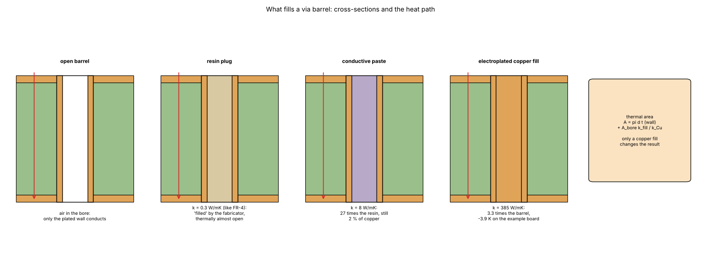
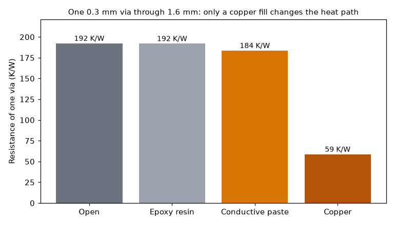
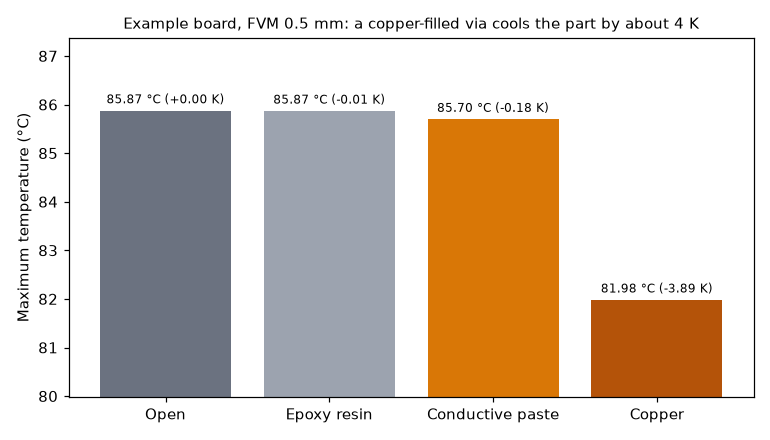
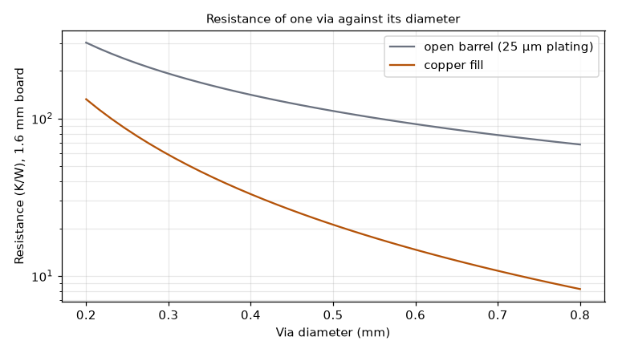

# What fills a via barrel, and how much it matters for heat

Status: **implemented** in the program (see `IMPLEMENTED.md`). Script: `study_via_fill.py`; figures: `make_figures.py`.

## 1. The question

A fabricator's "filled via" is not a copper-filled via. Does the fill of the barrel change the temperature of a part, and which fills are worth choosing?

### 1.1 Diagram



*Figure 4 (`figures/fig_04_via_fills_schematic.png`): The via fills as cross-sections: an open barrel, a resin plug (0.3 W/mK), conductive paste (8 W/mK) and an electroplated copper fill (385 W/mK), with the heat path down the barrel and the thermal area it gives.*

## 2. Findings in short

* The usual fabricator "filled via" is an **epoxy resin plug** (IPC-4761 types V to VII: V filled, VI filled and covered with solder mask, VII filled and capped with plated copper so it can be soldered over). It keeps the hole closed and the surface flat but conducts like FR-4: no thermal gain (192.1 against 192.4 K/W).
* A **conductive paste** (copper or silver epoxy) helps a little (about −5 %).
* Only an **electroplated copper fill** is a real heat path: the resistance of one 0.3 mm via falls by 69 %, and on the example board the maximum temperature falls by 3.9 K.
* The model: along the axis, `R = L / (k_Cu · A_eq)` with `A_eq = A_plating + min(k_fill / k_Cu, 1) · π r_in²` (`Via.thermal_area`); a copper fill is the whole disc.

## 3. Folder layout

| File | What it is |
| :-- | :-- |
| `scripts/study_via_fill.py` | The study: resistance of one via and effect on the example board for every fill (prints the tables below). |
| `scripts/make_figures.py` | Draws the three figures of this folder. |
| `scripts/make_diagrams.py` | Draws the schematic diagram (figure 4; no data, no program; uses `research/diagram_kit.py`). |
| `figures/` | `fig_01` to `fig_04`; figure 4 is the schematic diagram. |
| `IMPLEMENTED.md` | Where the result lives in the program and how it is tested. |
| `LOG.md` | What was read and how, what was not verified. |

## 4. How to run, and the results

```sh
.venv/bin/python research/via-fill/scripts/study_via_fill.py      # about 1 minute: the two tables below
.venv/bin/python research/via-fill/scripts/make_figures.py        # the figures
```

### 4.1 Resistance of one via (0.3 mm, 25 µm plating, 1.6 mm long)

| Fill | k of the fill (W/mK) | A equivalent (mm²) | R (K/W) | vs open |
| :-- | --: | --: | --: | --: |
| Open (hollow barrel) | - | 0.0216 | 192.4 | 0 % |
| Epoxy resin, non-conductive | 0.3 | 0.0216 | 192.1 | −0 % |
| Conductive paste | 8 | 0.0226 | 183.7 | −5 % |
| Copper, electroplated fill | 385 | 0.0707 | 58.8 | −69 % |



*Figure 1: `figures/fig_01_via_resistance_by_fill.png`.*

The 192 K/W of the open via is the textbook figure for this barrel (an independent article gives 192 °C/W per via, 12 K/W for 16).

### 4.2 The example board

3 × 3 vias of 0.3 mm under U1, finite volumes at 0.5 mm: open 85.87 °C, resin 85.87 (−0.01 K), conductive paste 85.70 (−0.18 K), copper fill 81.98 (−3.89 K). All five models order the fills the same way (`tests/test_via_fill.py`).



*Figure 2: `figures/fig_02_example_board_by_fill.png`.*

### 4.3 Against the diameter

The resistance of an open barrel falls with the diameter roughly as the circumference (the plating area), a copper fill as the disc; the gap between the two curves widens as the via gets larger.



*Figure 3: `figures/fig_03_resistance_against_diameter.png`.*

## 5. Limits of this study

* The plated copper **cap** over the ends of a capped via (type VII) is not modelled; it adds a little copper at the pad.
* The 0.5 to 1 mm resistance of the **solder** of a via-in-pad is not modelled.
* The fill conductivities are the values quoted by fabricator pages (non-conductive epoxy about 0.3 W/mK, conductive copper-epoxy 8, another source up to 16, silver-filled epoxy 3 to 15, electroplated copper 385 to 400), not measurements of ours.
* No comparison with a measured board (no model of the program has been compared with a physical board).

## 6. Sources

Fabricator pages, not the IPC standard, which was not read:

1. JLCPCB, https://jlcpcb.com/blog/via-filling-guide (table of fill materials and IPC-4761 types V to VII).
2. ALLPCB, https://www.allpcb.com/allelectrohub/how-to-choose-the-optimal-via-fill-material-for-pcb-design.
3. Thermal via array article, https://www.atlaspcb.com/blog/thermal-via-pcb-heat-dissipation-array-design (192 °C/W per via; its 185 K/W for an epoxy-filled via is not a model of the fill).
