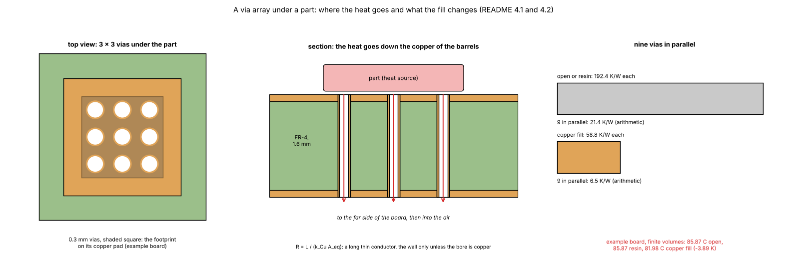
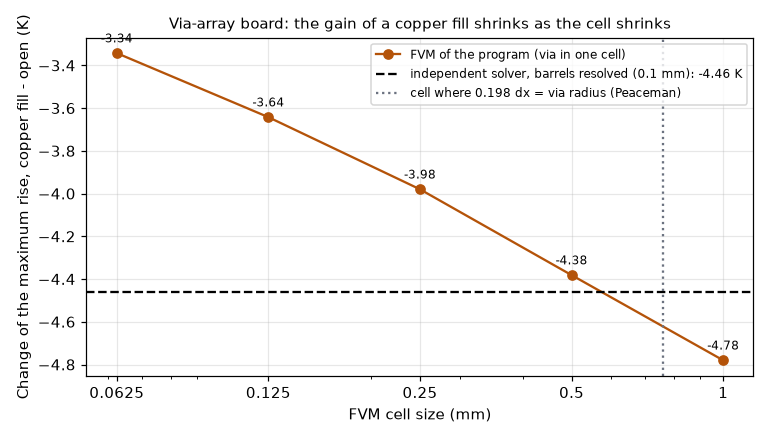

# What fills a via barrel, and how much it matters for heat

Status: **implemented** in the program in 2.4.0 (see the program's `docs/versions.md` and `docs/validation.md` section 18). Scripts: `scripts/study_via_fill.py` (the study), `scripts/study_via_model_checks.py` (the review checks of section 7); figures: `scripts/make_figures.py` and `scripts/make_diagrams.py`. Reviewed (section 7; `LOG.md` says what was read).

## 1. The question

A fabricator's "filled via" is not a copper-filled via. Does the fill of the barrel change the temperature of a part, and which fills are worth choosing?

### 1.1 Diagrams and illustrations


*Figure 4 (`figures/fig_04_via_fills_schematic.png`): The via fills as cross-sections: an open barrel, a resin plug (0.3 W/mK), conductive paste (8 W/mK) and an electroplated copper fill (385 W/mK), with the heat path down the plated wall (and the bore when it is copper) and the thermal area the program gives it.*



*Figure 5 (`figures/fig_05_via_array_under_a_part.png`): the 3 x 3 via array under U1 of the example board (top view), the section of the four-layer board with the heat going down the barrels into the inner planes and the bottom heatsink area, and the resistance of nine vias in parallel for an open barrel and for a copper fill.*

## 2. Findings in short

* The usual fabricator "filled via" is an **epoxy resin plug** (IPC-4761 types V to VII: V filled, VI filled and covered with solder mask, VII filled and capped with plated copper so it can be soldered over). It keeps the hole closed and the surface flat but conducts like FR-4: no thermal gain (192.1 against 192.4 K/W; −0.01 K on the example board in every model). Even at the 1 to 3 W/mK that one page gives for "epoxy", the gain would be under 2 %.
* A **conductive paste** (copper or silver epoxy) helps a little (about −5 % of the via resistance, −0.18 to −0.29 K on the example board).
* Only an **electroplated copper fill** is a real heat path: the resistance of one 0.3 mm via falls by 69 % (3.3 times the conductance), and on the example board the maximum temperature falls by 3.9 K in the FVM at 0.5 mm (4.5 K at 1 mm). The independent check of section 7.3 puts the right value between those two; the Lumped and Analytic models give 6.3 to 7.0 K, 40 to 75 % more than the FVM (section 7.2), and 35 to 52 % more than the independent reference on a similar board (7.3).
* **Why 3.3 times the conductance gives only −3.9 K**: the vias are one resistance in a chain (spreading in the copper, the inner planes, the faces' air films). Removing the vias costs +8.8 K and perfectly conducting vias would gain −7.1 K (FVM, 0.5 mm): a copper fill takes 55 % of the largest gain the vias can give on this board.
* The model: along the axis, `R = L / (k_Cu · A_eq)` with `A_eq = π[r² − (r − t)²] + min(k_fill / k_Cu, 1) · π (r − t)²`, `r` half the **drill** diameter, `t` the plating (`Via.thermal_area`); a copper fill is the whole disc. The program's network holds exactly this conductance per gap (section 7.1).

## 3. Folder layout

| File | What it is |
| :-- | :-- |
| `README.md` | This file: the results. |
| `INTEGRATION.md` | The program defects found by the review and the corrections proposed (not implemented). |
| `docs/for-the-project-documents.md` | Text to fold into `docs/` of `develop` (stale or missing statements). |
| `scripts/study_via_fill.py` | The study: resistance of one via and effect on the example board for every fill (prints the tables of 4.1 and 4.2). |
| `scripts/study_via_model_checks.py` | The review checks: closed form in the network, every model, the limits, the cell size, the independent solver, the 3D clip, the diameter convention (section 7). |
| `scripts/make_figures.py` | Draws the data figures 1, 2, 3 and 6. |
| `scripts/make_diagrams.py` | Draws the schematic diagram and the illustration (figures 4 and 5; no program; uses `research/diagram_kit.py`). |
| `figures/` | `fig_01` to `fig_06`. |

## 4. How to run, and the results

```sh
.venv/bin/python research/via-fill/scripts/study_via_fill.py           # about 5 s: the two tables below
.venv/bin/python research/via-fill/scripts/study_via_model_checks.py   # about 8 minutes (up to 3 GB): section 7; --fine adds 0.0625 and 0.05 mm (about 22 minutes; a peak footprint of 22.5 GB on a 16 GB machine, so it pages: run it alone)
.venv/bin/python research/via-fill/scripts/make_figures.py             # about 2 minutes
.venv/bin/python research/via-fill/scripts/make_diagrams.py
```

### 4.1 Resistance of one via (0.3 mm drill, 25 µm plating, 1.6 mm long)

| Fill | k of the fill (W/mK) | A equivalent (mm²) | R of one 0.3 mm via, 1.6 mm long (K/W) | vs open |
| :-- | --: | --: | --: | --: |
| Open | - | 0.0216 | 192.4 | +0 % |
| Epoxy resin | 0.3 | 0.0216 | 192.1 | -0 % |
| Conductive paste | 8 | 0.0226 | 183.7 | -5 % |
| Copper | 385 | 0.0707 | 58.8 | -69 % |


*Figure 1: `figures/fig_01_via_resistance_by_fill.png`.*

The 192 K/W of the open via is the figure of the thermal-via article of source 3, which states the same geometry (0.3 mm drill, 25 µm plating, 1.6 mm, 385 W/mK, annulus 0.0216 mm²) and gives 12 K/W for 16 vias in parallel; it is the closed form, re-derived here by hand (π (0.15² − 0.125²) = 0.0216 mm²; 1.6e-3 / (385 × 0.0216e-6) = 192.4 K/W). The same article's "copper-filled (VIPPO) about 45 °C/W" does not state its geometry: it is not the 58.8 K/W of a 0.3 mm drill (it would need about 0.34 mm).

Inside the program the barrel is counted only across the dielectric gaps (the copper layers are plane copper in the model), so the series resistance of one open via of the example board is 175.6 K/W over 1.46 mm of dielectric, not 192.4 K/W over 1.6 mm (section 7.1).

### 4.2 The example board

3 × 3 vias of 0.3 mm (3.5 mm pitch) under U1, finite volumes at 0.5 mm:

| Fill | example board Tmax (°C) | change vs open (K) |
| :-- | --: | --: |
| Open | 85.87 | +0.00 |
| Epoxy resin | 85.87 | -0.01 |
| Conductive paste | 85.70 | -0.18 |
| Copper | 81.98 | -3.89 |

All five models order the fills the same way (`tests/test_via_fill.py`), but they do not agree on the size of the copper-fill gain: −3.9 to −4.5 K in the FVM, FDM and 3D solid, −6.3 to −7.0 K in the Lumped and Analytic models (section 7.2).


*Figure 2: `figures/fig_02_example_board_by_fill.png`.*

### 4.3 Against the diameter

The resistance of an open barrel falls with the diameter roughly as the circumference (the plating area), a copper fill as the disc; their ratio is about `r / 2t` (2.3 at 0.2 mm, 8.3 at 0.8 mm), so the gap between the two curves widens as the via gets larger.


*Figure 3: `figures/fig_03_resistance_against_diameter.png`.*

## 5. Limits of this study

* The plated copper **cap** over the ends of a capped via (type VII) is not modelled; it adds a little copper at the pad.
* The **solder** joint of a via-in-pad (and the solder that wicks into an open via) is not modelled.
* The fill conductivities are the values quoted by fabricator pages (non-conductive epoxy about 0.3 W/mK and conductive copper-epoxy 8 W/mK from JLCPCB, electroplated copper "around" or "approaching" 400 W/mK; ALLPCB quotes "1 to 3 W/mK" for epoxy without saying which), not measurements of ours. The ranges "up to 16 W/mK" and "silver-filled epoxy 3 to 15 W/mK" written here before the review are in none of the three cited pages (checked in the review): no source is known for them. At 16 W/mK the paste would give −9 % of the via resistance.
* The via is a point feature in the FVM and FDM, and a per-cell average in the 3D solid: the result depends on the cell size below about 0.5 mm (section 7.3).
* No comparison with a measured board (no model of the program has been compared with a physical board).

## 6. Sources

Fabricator pages, not the IPC standard, which was not read (what was read and how: section 7.7):

1. JLCPCB, https://jlcpcb.com/blog/via-filling-guide (table of fill materials: epoxy about 0.3, conductive copper-epoxy 8, electroplated copper approaching 400 W/mK; IPC-4761 types V to VII).
2. ALLPCB, https://www.allpcb.com/allelectrohub/how-to-choose-the-optimal-via-fill-material-for-pcb-design (copper fill around 400 W/mK; epoxy 1 to 3 W/mK).
3. Atlas PCB, thermal via array article, https://www.atlaspcb.com/blog/thermal-via-pcb-heat-dissipation-array-design (192 °C/W per open via with the geometry of 4.1; its 185 K/W for an epoxy-filled, capped via and its 45 K/W for a copper-filled via are given without a geometry).
4. D. W. Peaceman, "Interpretation of well-block pressures in numerical reservoir simulation", SPE Journal 18 (1978) 183-194: the equivalent radius 0.198 Δx of a point source in one cell of a five-point stencil (from memory, not re-read; used only to explain section 7.3, which is measured).

## 7. Review

Reviewer agent, program of this branch (equal to `develop` `a9c1cd1` plus the merges since; the example-board numbers are identical on `develop` `3e90a7f`). Every number of this section is printed by `scripts/study_via_model_checks.py`.

### 7.1 The program holds the closed form

The FVM network of the example board (1 mm cells) adds 0.01709 W/K per via per gap, equal to `k_Cu A / d` with A = 0.0216 mm² and d = 0.4867 mm; the series resistance is 175.6 K/W in the network and in the closed form over the three gaps. The FDM, Analytic and 3D solid read the same `Via.thermal_area` (`fdm.py`, `analytic.py`, `solid3d.py`); the 3D solid spreads it over the cell that holds the via centre, as "the real copper area of the barrel" (`docs/theory.md` 4).

### 7.2 Every model, every fill, and the two limits

Example board, change against the open via in K (`no vias`: the nine vias removed; `perfect vias`: their area times 10⁴):

| Case | FVM 0.5 | FDM 0.5 | Lumped 0.5 | Analytic 0.5 | FVM 1 | FDM 1 | Lumped 1 | Analytic 1 | 3D solid 1 |
| :-- | --: | --: | --: | --: | --: | --: | --: | --: | --: |
| Epoxy resin | −0.01 | −0.01 | −0.01 | −0.01 | −0.01 | −0.01 | −0.01 | −0.01 | −0.01 |
| Conductive paste | −0.18 | −0.18 | −0.28 | −0.25 | −0.20 | −0.20 | −0.29 | −0.25 | −0.20 |
| Copper | −3.89 | −4.09 | −6.79 | −6.32 | −4.49 | −4.55 | −6.95 | −6.40 | −4.49 |
| no vias | +8.84 | +9.45 | +11.15 | +10.02 | +8.86 | +10.20 | +11.85 | +9.91 | +8.93 |
| perfect vias | −7.13 | −7.54 | −10.86 | −12.20 | −8.31 | −8.38 | −12.25 | −12.32 | −7.96 |

(The 3D solid's perfect-via limit is cut short by the per-cell clip of 7.4.) The Lumped and Analytic models give the vias 12 to 75 % more effect than the FVM in every row (40 to 75 % for the copper fill); the independent check below says the FVM is right and the two are too sensitive to the vias.

### 7.3 Cell size, and an independent reference

On the example board the copper-fill gain of the FVM is −4.91, −4.49, −3.89 and −3.59 K at 2, 1, 0.5 and 0.25 mm, while the board without vias settles (94.36, 94.67, 94.71, 94.72 °C): the via, not the board, is grid-dependent.

To find the right value, a board that the independent finite-volume solver `research/solid3d-verification/lib/layered3d.py` can solve with the barrels at their real size: 21 × 21 mm, four full 35 µm planes, 1.6 mm, 3 × 3 vias of 0.3 mm at 3.5 mm pitch under a 10 × 10 mm source of 2 W, h = 10 (top) and 200 W/m²K (bottom, so that the vias matter), insulated edges, FR-4 isotropic 0.3 W/mK in both codes. The independent solver draws each barrel as area fractions of 0.1 and 1/12 mm cells (exact copper area, air in an open bore), quarter domain. Rise of the hottest point in K:

| Solver | open | copper fill | gain of the copper fill |
| :-- | --: | --: | --: |
| independent, barrels resolved, 0.1 mm | 40.39 | 35.94 | −4.46 |
| independent, barrels resolved, 1/12 mm | 40.47 | 36.03 | −4.44 |
| independent, barrels resolved, 0.0625 mm | 40.45 | 36.05 | −4.41 |
| independent, barrels resolved, 0.05 mm | 40.55 | 36.11 | −4.44 |
| FVM 1 mm | 40.39 | 35.61 | −4.78 |
| FDM 1 mm | 40.59 | 35.96 | −4.63 |
| Lumped 1 mm | 38.76 | 32.08 | −6.68 |
| Analytic 1 mm | 39.83 | 33.78 | −6.05 |
| 3D solid 1 mm | 40.42 | 35.65 | −4.77 |
| FVM 0.5 mm | 40.76 | 36.37 | −4.38 |
| FDM 0.5 mm | 40.58 | 36.17 | −4.41 |
| Lumped 0.5 mm | 39.04 | 32.27 | −6.77 |
| Analytic 0.5 mm | 39.83 | 33.82 | −6.01 |
| 3D solid 0.5 mm | 40.80 | 36.46 | −4.35 |
| FVM 0.25 mm | 41.05 | 37.07 | −3.98 |
| FVM 0.125 mm | 41.35 | 37.71 | −3.64 |
| FVM 0.0625 mm | 41.65 | 38.31 | −3.34 |



*Figure 6 (`figures/fig_06_copper_fill_gain_against_cell.png`): gain of a copper fill on the via-array board against the FVM cell size, with the independent solver as the reference.*

* At 0.5 to 1 mm the FVM, FDM and 3D solid are within 0.1 to 0.3 K of the reference gain (−4.45 K): the −3.89 K of 4.2 is credible within about 0.5 K.
* Below 0.5 mm the FVM does **not** converge: the gain shrinks by 0.3 to 0.4 K at every halving of the cell, and the open-via rise grows (40.39 to 41.65 K, +3 %, while the reference stays at 40.4 to 40.5 K). Explanation (tested by the numbers, not by a separate derivation): a via in one cell of a five-point stencil behaves like a via of radius 0.198 Δx (Peaceman 1978); it equals the real radius 0.15 mm at Δx = 0.76 mm, and below it the model adds a constriction of `ln(r_v / 0.198 Δx) / (2π S)` per via end that a real via does not have. The cell where the FVM matches the reference, found by interpolation, is about 0.56 mm: the same order as the 0.76 mm of the isolated-via formula (here nine vias share the heat and four planes take it). A defect of the program for fine cells (Gerber boards, small parts): `INTEGRATION.md` 1.
* The Lumped and Analytic models overstate the gain of a copper fill by 35 to 52 % against the reference (−6.0 to −6.8 K against −4.45 K), consistent with the example board.
* What the reference shares with the program: the layered stack, the films and the plane copper; it does not share the via model (point or cell average) and resolves the constriction around each barrel.

### 7.4 3D solid: a large via is cut to one cell

The 3D solid sets the per-cell via fraction to `min(Σ A_via / cell area, 1)` (`solid3d.py`, the line after the via loop). A copper-filled via larger than its cell loses the excess: a 0.3 mm copper fill keeps 88 % of its area at 0.25 mm cells (it clips below 0.266 mm), a 0.5 mm copper fill keeps 32 % at 0.25 mm (it clips below 0.443 mm). Open barrels clip only below 0.15 to 0.19 mm. A limit of the program for fine cells (`INTEGRATION.md` 2).

### 7.5 What the diameter means

The program reads the via diameter as the **drill** (the plating inside it), the convention of source 3; the tooltip (`gui/tips.py`, "Finished hole diameter of the via") and the docstring of `Via.diameter` (`model.py`) say "finished hole", which on a fabricator's drawing is the hole after plating. Read as a finished hole, a 0.3 mm via has a 0.35 mm drill: 162.8 K/W open (−15 %) and 43.2 K/W copper-filled (−27 %). A wrong label in the program (`INTEGRATION.md` 3).

### 7.6 Corrections made by the review

* The table labels of 4.1 are now those the script prints (the names of the library), with its header; the run time of `study_via_fill.py` is 5 s, not "about 1 minute".
* "All five models order the fills the same way" was true but hid that the Lumped and Analytic gains are 40 to 75 % larger; the cell dependence of the −3.9 K is now stated.
* The "textbook figure" of 192 K/W is the closed form, which source 3 states with the same geometry (re-read); its 45 K/W for a copper fill is not our geometry.
* Two conductivity ranges with no traceable source are marked as such (section 5); the "0.5 to 1 mm resistance of the solder" of section 5 (also in `docs/validation.md` 18) had no meaning and was replaced.
* Figure 4: the formula box said `A = π d t`, the thin-wall form, 9 % above the annulus the program uses (0.0236 against 0.0216 mm²); the heat arrows were drawn in the laminate, not in the barrel. Figure 5: the section showed a two-layer board; the example board has four copper layers (three full planes) and a bottom heatsink area under U1; "open or resin: 192.4" now gives the resin its own 192.1. Both redrawn; figure 6 added.
* Added `INTEGRATION.md` (the defects of the program and the corrections proposed) and `docs/for-the-project-documents.md`.

### 7.7 What was read and what was not verified

* The study itself: the question was what a fabricator's "filled via" is and whether the fill matters for heat; implemented in 2.4.0 (`Via.fill_k`, `Via.thermal_area`, `VIA_FILLS`, the *Fill* list; `tests/test_via_fill.py`). The three pages of section 6 were read at the time through the web tools of the session; how much of each was read was not recorded. The IPC-4761 standard was not read.
* In the review the pages were opened again (WebFetch, through a summary of each page, not the raw HTML): Atlas PCB (192 °C/W per open via from `L/(k A)` with L = 1.6 mm, k = 385 W/mK, a 0.3 mm drill, 25 µm plating, annulus 0.0216 mm², the geometry and convention of the program; 12 °C/W for 16 vias; epoxy-filled and capped about 185 °C/W, copper-filled (VIPPO) about 45 °C/W, a solid press-fit rod about 12 °C/W, no geometry given for these; its FAQ quotes an "effective conductivity of 2.5 to 3.5 W/mK" for a plated via, which contradicts its own formula); JLCPCB (epoxy about 0.3 W/mK, conductive copper-epoxy 8 W/mK as "JLCPCB's published figure", electroplated copper approaching 400 W/mK; IPC-4761 types V, VI, VII); ALLPCB (copper fill around 400 W/mK, "epoxy's 1-3 W/mK range" without saying which epoxy; no value for silver-filled epoxy and no 16 W/mK).
* Not found in the cited pages: "up to 16 W/mK" and "silver-filled epoxy 3 to 15 W/mK" (marked in section 5 as not traced to a source). From memory only: plated copper 385 to 400 W/mK as the usual handbook range.
* Re-run in the review: `study_via_fill.py` (reproduces 4.1 and 4.2 to the digit, in 5 s), `make_figures.py`, `make_diagrams.py` and the new `study_via_model_checks.py`, on this branch and on a worktree of `develop` `3e90a7f`; the example-board tables print the same digits on both.

Not verified:


* No physical board; the IPC-4761 text; the fill conductivities beyond what the three pages say (read through a summary of each page).
* The Peaceman radius is quoted from memory; the measured matching cell agrees with it but it was not re-derived.
* The independent reference was run at 0.1, 1/12, 0.0625 and 0.05 mm (`--fine`, 450 000 and 700 000 unknowns). A first run at 0.05 mm had an open bore of zero conductivity (isolated cells under the source, a wrong result) and was discarded; the corrected run, made on a machine just restarted with nothing else running, gives 40.55 / 36.11 K and a gain of −4.44 K, which stays with the other references (−4.41 to −4.46 K). The run needed a peak memory footprint of 22.5 GB reported by `/usr/bin/time -l` on a 16 GB machine (it includes compressed memory and swap, so the machine paged; the plan's 10 GB was an underestimate) and took about 22 minutes while paging (the `vm_stat` swap-out counter of the machine went from 0 before the run to 6.0 million pages after this step, which also held the small-pad and FEM checks of `solid3d-verification`), so the 22 minutes are not a quiet-machine time.
