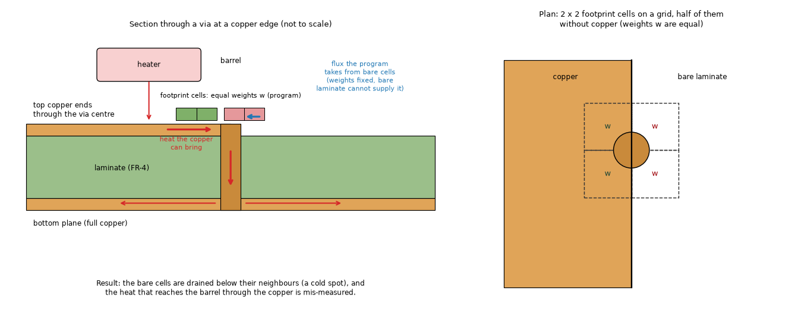
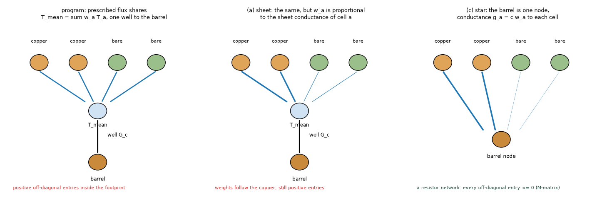
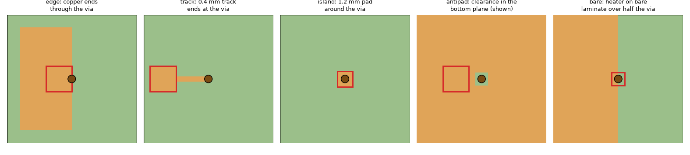
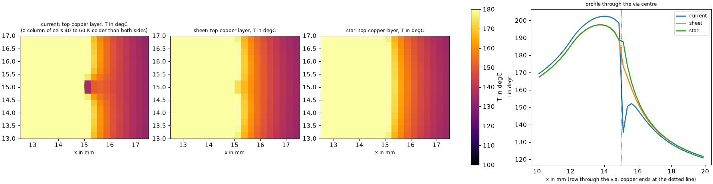
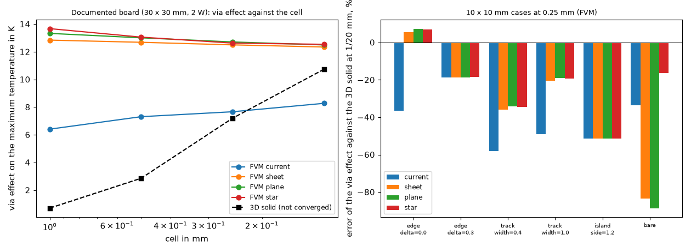
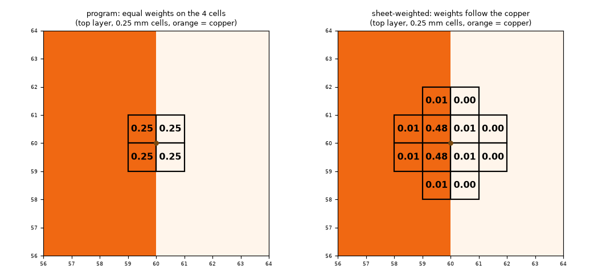

# via-partial-copper

A via whose footprint covers a plane that has copper over only part of the footprint (a copper edge, a track that ends at the via, a thin pad, a clearance around the barrel). The program couples every plane to the barrel through the mean temperature of a footprint of cells with fixed weights (`pcbthermal/viawell.py`, `docs/theory.md` 2.6). `docs/theory.md` 2.2 and `docs/versions.md` ('Planned') record that on such a plane the FVM shows a cold spot and "exaggerates the via effect 2.5 to 4 times". This folder reproduces the cold spot on clean boards, finds the mechanism, prototypes three corrections on a copy of the via logic (`lib/viavariants.py`, installed in memory; the program is not touched), and measures them against a converged 3D solid, the frozen boards and the full-copper boards the via was tuned on.

**Reviewed** (section 9): go for closing; the reviewer's recommendation for the numerical fix differs from section 7 (the star coupling, not the sheet weights, in 2.6.0). Everything below was run with `pcbthermal` at the tip of `develop` (branch `research/via-partial-copper`, scripts from the repository root: `.venv/bin/python research/via-partial-copper/scripts/<script>.py`; tests: `.venv/bin/python -m pytest -q research/via-partial-copper/tests`, 16 pass). The numbers are the ones the scripts print.

**Status (audit 2.6.1).** The warning (proposal A) is in the program since 2.5.0. The numerical fix recommended by the review (the star) was implemented on `feature/via-star-coupling` and its review gave no-go; it is not in the program. 2.6.0 added the barrel length `d + 0.5 t_cu` and the rim uncoupling (`research/via-contact-geometry`), which move the 'current' rows of the tables below (audit re-run in section 2).

## 1. Question and what would answer it

*Question.* Why does a partial-copper footprint make a cold spot, how far is the via effect wrong in each direction, do antipads (clearances around a via) do the same, and what is the smallest correction that removes it without moving what is right?

*Answer needs.* The cold spot reproduced on clean cases; the via effect against a reference that has converged (the first 3D numbers of the Planned item were not converged, 4.1); the correction measured on cases with and without partial copper; the frozen boards; an acceptance test.

### 1.1 Pictures of the situation

*Figure 1 (`figures/fig_01_section_copper_edge.png`): left, section of a via whose top copper ends at the barrel, with the heat paths and the equal footprint weights, half of which sit on bare laminate; right, the plan of the 2 x 2 footprint cells on the grid.*

*Figure 2 (`figures/fig_02_three_couplings.png`): the program's coupling (prescribed flux shares to one mean temperature), the same with weights by sheet conductance (variant a, `sheet`) and the star (variant c, `star`: the barrel is a node, every cell reaches it through its own conductance).*

*Figure 3 (`figures/fig_03_test_cases_plan.png`): copper edge through the via, track ending at the via, 1.2 mm pad around the via, clearance (antipad) in the bottom plane, small part on bare laminate over half the via.*

## 2. The cold spot reproduced

Board of `docs/theory.md` 2.2 (`copper_edge_board` of `tests/test_maximum_principle.py`: 30 x 30 mm, two layers, h = 10 W/m2K, bottom plane full, top copper ending at x = 15 mm through a 0.3 mm via, a 2 W 3 x 3 mm part on the edge). `scripts/study_documented_case.py`. "Cold spot" is the test's: window of the vias plus 1 mm, window minimum minus rim minimum, per plane.

| FVM, program as it is | 1 mm | 0.5 mm | 0.25 mm | 0.125 mm |
| :-- | --: | --: | --: | --: |
| cold spot, K | 0.00 | **-7.94** | **-14.43** | **-14.33** |
| via effect on the maximum, K | 6.41 | 7.31 | 7.67 | 8.28 |
| positive off-diagonal entries of K | 10 | 10 | 10 | 202 |
| FDM via effect, K (cold spot 0.00 at every cell) | 8.93 | 10.69 | 11.06 | 11.36 |
| 3D solid via effect, K | 0.70 | 2.86 | 7.20 | 10.74 |

The cold spot of the Planned item is reproduced to the digit (-7.94 and -14.43 K). *(audit 2.6.1: on the 2.6.1 tree the program reads FVM via effect 5.55 / 6.76 / 7.44 / 8.24 K, cold spot 0.00 / -5.49 / -12.80 / -14.05 K, FDM 8.58 / 10.61 / 10.99 / 11.25 K, 3D solid 0.74 / 2.86 / 7.09 / 10.56 K at 1 / 0.5 / 0.25 / 0.125 mm. The FVM and FDM moved with 2.6.0: the rim uncoupling (the top copper ends at the via centre, so its well is scaled by a rim share of about 0.5; this is the variant `contact_geo` of `research/via-contact-geometry`) and the barrel `d + 0.5 t_cu`; the 3D solid moved with its slabs by thickness (its barrel is unchanged). The cold spot is smaller at 0.5 and 0.25 mm but still there; the 'sheet', 'plane' and 'star' rows of 5.1 reproduce to the digit (they rebuild their own couplings). The table above is the program of 2.5.0.)* The FDM has none (node-centred footprint, copper edge on the node line).

**A claim of the Planned item is not supported.** It says the via effect is "7.7 K against 2.9 K in the 3D solid", read as an exaggeration of 2.5 times. The 2.9 K is the 3D solid at 0.5 mm; the table shows that this reference is not converged: it grows 0.70, 2.86, 7.20, 10.74 K from 1 to 0.125 mm and has not stopped. At 0.125 mm the FVM (8.28 K) is below it. On the 10 x 10 mm boards of section 3, where the 3D solid converges (1/16 and 1/20 mm agree to 0.2 % on the copper edge), the program's FVM reads the via effect **low** (-31 to -47 % on a copper edge through the via, -45 to -68 % on a track), not high. The cold spot is a real defect (the field is not physical, section 4); "the via effect is exaggerated" is withdrawn. The effect is misread in both directions (section 3).

*Figure 5 (`figures/fig_05_top_layer_around_the_via.png`): the top copper layer of the documented board at 0.25 mm around the via. Program: the column of the two cells right of the copper edge reads about 110 to 135 degC next to 125 to 175 on the sides (profile, right). Sheet-weighted and star: no dip.*

## 3. Clean cases

Ten x ten mm, two layers, one 0.3 mm via at the centre, insulated edges, h = 50 W/m2K; heater and copper of figure 3 (`lib/cases.py`). Reference: the 3D solid at 1/16 and 1/20 mm (each pair printed; the two agree within 0.2 % on the edge, 5 to 6 % on the bare and island cases). The via effect is the rise without the via minus the rise with it, K. `scripts/study_variants.py` (output `out/variants.json`, 353 rows, FVM and FDM, 1 to 0.125 mm, four treatments).

| case | 3D effect 1/16, 1/20 mm | FVM program 0.125 / 0.25 / 0.5 / 1 mm |
| :-- | :-- | :-- |
| edge through the via | 7.38, 7.39 | 5.13 (-31 %) / 4.69 (-37 %) / 4.38 (-41 %) / 3.90 (-47 %) |
| edge 0.3 mm past the via (via on copper) | 8.81, 8.86 | 7.34 (-17 %) / 7.20 / 7.38 / 6.00 |
| edge 0.3 mm before the via (via on bare laminate) | 1.07, 0.94 | 1.27 (+35 %) / 1.50 (+59 %) / 3.67 (+292 %) / 3.95 (+321 %) |
| track 0.4 mm ending at the via | 21.59, 22.62 | 10.37 (-54 %) / 9.49 (-58 %) / 9.43 / 7.23 |
| track 1.0 mm | 25.81, 25.80 | 14.17 (-45 %) / 13.16 (-49 %) / 12.45 / 9.88 |
| 1.2 mm pad around the via (island) | 36.48, 38.79 | 23.39 (-40 %) / 18.83 (-51 %) / 14.09 / 13.04 |
| part on bare laminate over half the via | 10.36, 9.81 | 4.80 (-51 %) / 6.51 (-34 %) / 15.33 (+56 %) / 7.76 (-21 %) |

The error of the program's via effect is of either sign and of tens of percent whenever the copper changes inside the footprint, and the grid-convergence is not monotone (bare case). Where the footprint is wholly on copper the island and the edge-past-the-via cases are low too, by 17 to 50 %: that is not the partial footprint (the weights are identical in every treatment there) but the missing image of a copper edge or the sub-cell pad, and no variant touches it.

**Cold spot of these cases.** The window metric is silent on these 10 mm boards except the FDM edge case at 0.125 mm (-3.30 K) and the FVM edge case at 0.0625 mm (-1.59 K, run during exploration, not in the table): the dip is large only where the neighbouring cells differ by tens of K (the 2 W part on the edge of the 30 mm board). The via effect is the more general symptom.

### 3.1 Antipads (clearance rings around the barrel)

Untested before. `cases.antipad` (full top plane, a 2 x 2 mm heater beside the via, bottom plane with a square clearance of 1 or 2 mm, with or without an isolated 0.6 mm land) and `cases.array4` (stand-in for a thermal-via array: 12 x 12 mm, four layers, 6 x 6 mm top pad under a 4 x 4 mm, 1 W part, 3 x 3 vias at 1.2 mm pitch, a GND plane the vias touch, a plane on layer 3 with 0.8 mm square antipads, a full bottom plane).

| | 3D effect, K | FVM program 0.15 or 0.25 / 0.5 mm, K | cold spot | minimum rise |
| :-- | :-- | :-- | :-- | :-- |
| array4, antipads 0.8 mm | 23.75 (0.2 mm), 23.72 (0.15), 23.67 (0.12) | 20.68 (0.25) / 21.16 (0.5); 20.51 (0.15) | none | 65.0 K (above ambient) |
| array4, solid layer 3 | 24.16, 24.12, 24.08 | 21.01 (0.25) / 21.31 (0.5) | none | 65.2 K |
| single via, clearance 1 mm | 0.34 | 0.31 / 0.43 / 1.06 (0.25 / 0.5 / 1 mm) | none | 44.1 K |
| single via, clearance 1 mm, land 0.6 | 0.42 | 1.05 / 0.98 / 1.06 | none | 44.4 K |
| single via, clearance 2 mm | 0.31 | 0.24 / 0.31 / 0.37 | none | 44.0 K |

An antipad does not make a cold spot and does not move the via effect measurably on the array (-13 % either way, with or without the clearances; the clearance of 0.8 mm holds the whole footprint at every cell tested, so the footprint is uniform bare laminate and the well is the laminate's: a near-zero coupling, as it should be). The single via with a clearance reads 0.1 to 0.7 K off on the part's temperature at the coarse cells (the clearance is smaller than the cell, so the cell shows copper); that is a resolution effect of 0.3 to 1 K in 44 to 64 K, and none of the treatments changes it. Conclusion: **antipads are not a cause of the problem**; the cases that matter are the ones with a copper edge or a track end inside the footprint.

## 4. Mechanism

Dump of the 30 mm board at 0.25 mm (script of the exploration, numbers in figure 5): the via footprint is four cells, columns 59 and 60 and two rows, equal weights 0.25 (figure 4, left). Column 59 holds copper, column 60 does not (the edge is at the boundary). In `viawell.build` the heat taken from a footprint cell of plane l is `G[l, m] w_a (T_mean,l - T_mean,m)` for the barrel path: **the flux drawn from each cell is its weight times the difference of the plane means, not a function of the cell's own temperature**. The bare cells (top layer, column 60) carry half the weight and are drained at a rate their neighbours cannot supply (S of a bare cell is the laminate's alone, 2.0e-4 W/K against 1.42e-2 W/K for copper: 1.4 %): they fall to 110.5 K against 173 K in the copper cell beside them and 125 K beyond, below the barrel's own temperature (about 113 K). A cell colder than the barrel it supplies is the signature of the lost maximum principle.

*Matrix form.* The via adds `G u u^T` with `u = e_l w - e_m w`, which is symmetric positive semidefinite with zero row sums (checked on the dense blocks: `tests/test_via_partial_copper.py`, eigenvalues >= -1e-9, row sums <= 1e-9 of the largest entry), so K stays symmetric positive definite and the solve is unique and conservative. But `G w_a w_a'` is positive between two cells a and a' of one plane: K has positive off-diagonal entries (10 on the 30 mm board at 0.25 mm; 202 at 0.125 mm) and is not an M-matrix, so K^-1 is not non-negative: a source elsewhere can lower a temperature. With copper under the whole footprint the neighbours' conductances overwhelm the positive entry (`tests/test_maximum_principle.py`: no cold spot on copper); where cells differ a hundredfold in conductance they do not. The smallest eigenvalue of K is the board's slowest mode (it did not change by 1e-4 with any treatment, `scripts/study_matrix.py`), so positive definiteness is shown structurally (positive semidefinite via terms) and not by that number.

*Not reproduced.* The Planned item says the part on bare laminate over half a via reads below the ambient (-2.5 % to -38 % of the rise, h = 10 to 5000 W/m2K, 0.05 and 0.025 mm cells). My bare cases (h = 50 and 2000 W/m2K, cells 1 to 0.125 mm) have a minimum rise above zero in every treatment (0.11 to 7.9 K); the cells 0.05 and 0.025 mm and the exact board of that observation were not run.

## 5. Candidate corrections

All on a copy (`lib/viavariants.py`): `patched(name)` replaces `viawell.build`, `matrix_entries`, `unknown_blocks` in memory and restores them. The barrel conductance, the plating, the footprint search, the Peaceman well and the Kron reduction are the program's.

* **current**: the program.
* **sheet (a)**: per-layer weights `w^l_a` proportional to the geometric weight times the sheet conductance of the cell in that layer (S / cover, which includes the laminate); the footprint is enlarged until the effective radius of the *weighted* distribution reaches `e^(-1/4) r_via`; the well uses the weighted mean S; mean-potential coupling as now. A via whose geometric footprint has the same sheet conductance in every cell of every layer is built by the program's own code (bit-identical).
* **plane (b)**: the program's footprint, but a cell takes part in a layer only when its S is at least 20 % of the largest of that layer; a layer with no such cell is not coupled (antipad); same bit-identity rule.
* **star (c)**: the weights of (a), but the barrel is a node per layer reached through `g_a = c w_a` to every cell, the barrel nodes eliminated (Schur complement of a resistor network, whose off-diagonal entries are all <= 0: an M-matrix). `c` is calibrated per layer with the lattice kernel so that a lone via in a uniform sheet has the program's total resistance `ln(R / r_t) / (2 pi S)` (a (n+1)-unknown linear solve and a root find, 0.15 to 0.3 ms per layer and via).
* (d) *a clip of the temperature* is rejected: it hides the symptom, breaks the energy balance and is not a model.

### 5.1 The documented board

`scripts/study_documented_case.py`; via effect in K (cold spot in K in brackets, all 0.00 except where shown), FVM:

| variant | 1 mm | 0.5 mm | 0.25 mm | 0.125 mm | positive entries at 0.25 / 0.125 mm |
| :-- | --: | --: | --: | --: | --: |
| current | 6.41 | 7.31 (-7.94) | 7.67 (-14.43) | 8.28 (-14.33) | 10 / 202 |
| sheet | 12.85 | 12.69 | 12.50 | 12.35 | 8 / 292 |
| plane | 13.33 | 13.01 | 12.71 | 12.50 | 22 / 136 |
| star | 13.68 | 13.06 | 12.63 | 12.54 | **0 / 0** |

All three remove the cold spot at every cell and make the FVM via effect nearly cell-independent (12.4 to 12.7 K at 0.5 to 0.125 mm), where the 3D solid is still climbing through 10.74 K at 0.125 mm and the FDM sits at 11.0 to 11.4. The FDM is not changed by the variants at 1 mm (its edge falls on a node line) and by 0.1 to 0.5 K elsewhere.

*Figure 6 (`figures/fig_06_via_effect_against_cell.png`): left, the via effect of the documented board against the cell for the four FVM treatments and the 3D solid (not converged); right, error of the via effect against the 3D solid at 1/20 mm on the 10 mm cases at 0.25 mm.*

*Figure 4 (`figures/fig_04_footprint_weights.png`): the footprint weights of the top layer at 0.25 mm: the program's four equal weights, half on bare laminate; the sheet-weighted distribution, 0.48 on each of the two copper cells nearest the via and 0.01 or 0.00 on the others (the footprint grows to eleven cells to reach the target radius).*

### 5.2 The 10 mm cases (FVM, 0.25 mm, error of the via effect against the 3D solid at 1/20 mm)

| case | current | sheet | plane | star |
| :-- | --: | --: | --: | --: |
| edge through the via | -37 % | +5 % | +7 % | +7 % |
| edge 0.3 mm past the via | -19 % | -19 % | -19 % | -18 % |
| edge 0.3 mm before the via (bare) | +59 % | +59 % | +59 % | +94 % |
| track 0.4 mm | -58 % | -36 % | -34 % | -34 % |
| track 1.0 mm | -49 % | -20 % | -19 % | -19 % |
| island 1.2 mm | -51 % | -51 % | -51 % | -51 % |
| bare (part on the bare half) | -34 % | -84 % | -89 % | -16 % |
| bare, h = 2000 | -8 % | -87 % | -93 % | +38 % |

(`out/variants.json`; the table of every cell and the FDM is the printed output of `study_variants.py`.) Reading: the three treatments remove the cold spot and the low reading on the copper edge and track cases (the cases of the Planned item), and leave the other errors where they are (island, edge past the via: not a footprint-weight problem). **Variants a and b make the via on a bare cell read much too weak in the "bare" case** (-84 to -93 %): all the weight goes to the copper cells, and a part whose heat is generated over the bare half has almost no path to the barrel. The star keeps that path because the flux is driven by each cell's temperature (-12 % at 0.125 mm, -16 % at 0.25 mm, -2 % at 1 mm, but +119 % at 0.5 mm: that case is not converged for anyone, the 3D references of 1/16 and 1/20 mm differ by 5 % and the heater edge falls on the cell edge at some cells). A via just off the copper (edge 0.3 mm before the via, at 0.5 mm and coarser) is already read 3 to 4 times too strongly by the program (the cell fill brings the copper onto the via) and variants a to c make it worse at those cells (6.6 to 8.3 K against 1.07 K).

### 5.3 What does not move

* **Boards with no partial footprint.** `sheet` and `plane` are bit-identical (`np.array_equal` of the whole field, example board 1 mm; `tests/test_via_partial_copper.py`). The star differs a little everywhere because it is another coupling.
* **The frozen regression boards** (`scripts/study_frozen.py`; five of the 17 have vias: `example_board`, its profile twin, `example_cut_to_T`, `plate_vias`, `plate_lone_via`; at 2, 1 and 0.5 mm, FVM and FDM): **partial vias: 0 on every one**, so `sheet` and `plane` shift every record by exactly 0.0000 K. The star shifts the three example boards by -0.0007 to -0.052 K at 2 mm, -0.0029 to -0.455 K at 1 mm (FDM example) and -0.078 to -0.163 K at 0.5 mm, and the plates by 0.0000 K at 2 and 1 mm and up to -0.732 K at 0.5 mm (`plate_vias` FDM: 0.66 % of its rise; `plate_lone_via` +0.003 K, the only shift upwards); the Lumped, Analytic and 3D solid are not touched by any variant. (The review corrected this sentence: it gave -0.0007 to -0.0052 K at 2 mm, while `example_cut_to_T` moves -0.052 K, and it hid the zero shifts of the plates.)
* **Full copper, convergence and copper-fill gain** (`scripts/study_fullcopper.py`; 3 x 3 array, lone via; FVM and FDM, 1 to 0.125 mm): `sheet` and `plane` equal the program to the last digit; the star keeps the gain of a copper fill at -4.489 / -4.488 K (FVM 0.25 / 0.125 mm) against the program's -4.492 / -4.495 and the resolved -4.51, and the lone via within 0.016 K at 0.25 mm; at 1 mm it moves the array by 0.16 K of 40.5.

*(Matrix structure, `scripts/study_matrix.py`, 0.25 mm: asymmetry of K at most 5e-18 for the star and exactly 0 for the others; positive off-diagonal entries program 10 / sheet 8 / plane 8 or 22 / star 0 on the edge and track boards; the minimum of theta is non-negative everywhere.)*

## 6. The warning rule

`lib/warnrule.py`: for each via the footprint of the FVM on the cells of the run, and for each copper layer the sheet conductance of the cells that hold at least 5 % of the largest weight; the footprint is partial when the smallest of them is below half the largest. `scripts/study_warning.py` (it reads `out/variants.json`):

| | program wrong (> 25 % of the 3D effect, reference > 1 K) | program right |
| :-- | --: | --: |
| rule fires | 19 | 4 |
| rule silent | 4 | 17 |

It fires on every copper-edge, track and bare case at every cell (except the edge past the via, silent from 0.5 mm: the footprint is wholly on copper; and the island, silent at every cell: its error is the sub-cell pad and not the footprint) and on the documented board at every cell (1 partial via; the cold spot is only at 0.5 mm and finer, the low via effect at all). It is silent on all four antipad cases and on the array with antipads (0 partial pairs at 1 to 0.15 mm) and on **all five frozen boards with vias at 2, 1 and 0.5 mm (0 false alarms)**. The four silent-and-wrong are the island and the edge past the via (other causes); the four fired-and-right are the edge before the via at fine cells and the bare case at 0.25 mm. Direction in the text: the effect may be misread in **either** direction, not "exaggerated". Cost: one footprint per via (the call the run makes anyway).

## 7. Verdict

* The cold spot is real, reproduced to the digit, and caused by the fixed weights of the mean-potential coupling on a plane with copper over part of the footprint; antipads are harmless (0 cold spots; at most 0.3 to 0.7 K in 44 to 64 K from sub-cell resolution).
* "The via effect is exaggerated 2.5 to 4 times" is **withdrawn**: it compared with an unconverged 3D solid. Against a converged reference the program is 30 to 70 % too low on the edge and track cases, and too high for a via beside a copper edge at a coarse cell.
* Best fix for the cases of the item: **sheet-weighted weights (a)** applied only to non-uniform footprints: it removes the cold spot, brings the copper-edge via effect from -37 % to +5 %, the track from -58 % to -36 %, moves **zero** of the 17 frozen records (5 boards with vias) and the full-copper convergence, and is a local change. Its weaknesses are stated: it still has positive off-diagonal entries (8 on the edge board, 292 at 0.125 mm), so the guarantee is by measurement and not by structure, and it makes a part heating a bare cell read too weak (-84 %). **The star (c)** is the physically better form (potential-driven flux; an M-matrix: 0 positive entries, the maximum principle holds by construction on every board, also full copper where the program has 16 to 3104 positive entries), but it is a model change that moves every board with vias (up to 0.73 K, 0.66 % of the rise) and needs the full re-validation of the via (point-via convergence, array, the real-window comparison) and a cost cache (0.15 to 0.3 ms per layer and via, about 10 s for 8500 vias unless the calibration is cached by footprint shape).
* **2.5.0 or not.** The text-only warning (section 6) belongs in 2.5.0: no number moves, 0 false alarms on the frozen boards, 83 % of the wrong cases caught. The numerical fix does **not** belong in 2.5.0 unless the maintainer accepts one more validation: the imported Gerber boards (RP2040, ISASTM, CMM2) are where partial footprints occur in numbers (vias end on pads and planes have clearances), and they were not run here (the boards are not in the repository, 8); their via effect would move by tens of percent in either direction. It also edits `viawell.py` in parallel with `feature/via-edge-image` (INTEGRATION.md 4). Recommended order: warning now; then `fix/via-partial-copper` with variant (a) after the edge image is merged, validated on the real windows of `research/gerber-real-boards` with holes; the star as a later model change, once, together with the edge image if the maintainer wants one coupling.

## 8. Limits and what was not verified

* The boards are synthetic (10 x 10 and 30 x 30 mm, two layers; one four-layer 12 x 12 mm array). **No imported board was run** (RP2040, ISASTM and CMM2 are downloaded into `data/` of another folder and are not present in this checkout); the numbers of 2.5.0 on real boards are unknown.
* The 3D solid reference converges on the copper-edge and track cases (1/16 against 1/20 mm: 0.2 % on the edge, 5 % on the 0.4 mm track, 0.0 % on the 1 mm track) but not on the island (6 %) and bare cases (5 to 12 %); on the 30 mm board it is not converged at 0.125 mm and finer cells need more than 3 GB, so the via effect there has no converged truth (the variants give 12.4 to 12.7 K, the 3D solid 10.74 K and rising).
* The cold spot window is a local metric (rim of ±1.5 mm for the 10 mm boards, ±1 mm of the vias for the 30 mm board); on the 10 mm boards it is almost always zero, so the via effect is the real indicator.
* Cells 0.0625 mm and finer, FDM antipads with a land and the dependence on the heater position relative to the cell grid were not swept. The FDM is not changed by the variants (its copper edge falls on a node line in these boards).
* The prototype `viavariants.py` rebuilds the program's `build` first and then replaces it, so its timing is not that of an in-place change; the calibration of the star is cached nowhere.
* The edge image of `feature/via-edge-image` was read in the diff only (`git diff develop...feature/via-edge-image -- pcbthermal/viawell.py`); the composition was not run.

## 9. Review

Independent review on the branch merged with `develop` (`c3acf0c` for the runs, then `1ea1d37`, see below; program 2.4.5 plus the 2.5.0 work; `git diff develop -- pcbthermal tests examples ico` empty). **Verdict: go for closing the investigation.** The findings hold; one sentence was corrected (5.3), and the recommendation for the numerical fix is changed (9.4).

### 9.1 What was re-run

* The 16 tests of the folder: pass.
* `study_documented_case.py` (64 s, 2.6 GB peak): every number of the tables of sections 2 and 5.1 reproduced to the printed digit (3D 0.70 / 2.86 / 7.20 / 10.74 K; the FVM and FDM rows of the four treatments, cold spots -7.94 and -14.43 K, positive entries 10 / 10 / 10 / 202).
* `study_frozen.py` (41 s): the table of 5.3 reproduced; the sentence on the shifts of the star was wrong at 2 mm (`example_cut_to_T`: -0.052 K, not inside "-0.0007 to -0.0052 K") and hid the zero shifts and one upward shift of the plates; corrected in place.
* `study_variants.py` (the full sweep, 132 s, 2.1 GB peak, paused once for the load of the machine): all 352 rows of `out/variants.json` identical to the executor's file (largest difference of the via effect and of the reference 0.0 K), so the tables of 3, 3.1 and 5.2 stand.
* `study_warning.py` on the re-run file: the confusion table of 6 reproduced (19 / 4 / 4 / 17) and 0 partial vias on the five frozen boards with vias at 2, 1 and 0.5 mm.
* **After `develop` moved during the review** (it now holds `feature/via-edge-image` and the warning of `fix/via-partial-copper-warning`; merged into this branch at `1ea1d37`): the tests pass; `study_frozen.py` is unchanged except `example_cut_to_T` at 2 mm (the program 94.454 -> 94.444 degC, the edge image; the star column -0.0414 instead of -0.0517 K, because `lib/viavariants.py` rebuilds the star's footprint without the image while `sheet` and `plane` reuse the program's block); the FVM rows of the 10 mm cases at 1 mm move by at most 0.0025 K (the walls are now within the six-cell reach at 1 mm), below the printed digit; the other cells are out of reach and not affected. A star branch must carry the image term (9.4).
* Not re-run: `study_fullcopper.py`, `study_matrix.py`, `study_reproduce.py`, `make_figures.py`, `make_diagrams.py` (the figures quote only numbers that the re-run tables reproduce; the full-copper and matrix claims rest on the executor's runs and the tests of the folder).

### 9.2 Independent checks

* **The mechanism, measured directly** (a dump of the program's network, documented board, FVM): at 0.5 mm the footprint is four cells of weight 0.25; on the top layer the two copper cells are at 176.52 K and the two bare cells at 110.85 K (sheet conductance 2.04e-4 against 1.36e-2 W/K), while the bottom-plane cells of the same footprint are at 112.06 and 111.20 K; at 0.25 mm 173.44 / 110.53 K on top against 113.04 / 112.61 K below. **A top cell that is fed only from the hot side is colder than the far end of the barrel it drains into**: heat flows from the bottom plane up the barrel into the cold top cell and out again, which no physical barrel does. This is the explanation of section 4, tested on the quantity it names.
* **The reference, and what it assumes about the barrel.** The 3D solid (`solid3d.py`, real slabs) is a different discretisation from the layered FVM; it reads the via footprint of `viawell.tuned_footprint` but not `viawell.build`, and it gives the barrel's copper area to the **through** conductivity of the cells of the drill disc, with no copper conducting around the circumference. On a copper edge through the via, half of that smeared barrel therefore ends in bare laminate in the reference too. The review measured what this costs (`edge`, 10 mm board, the 3D solid at 1/16 and 1/20 mm, 42 s, 1.8 GB): with the top copper also covering the barrel's own 0.3 mm square (a proxy for the plated wall that joins its two halves) the via effect rises from 7.38 / 7.39 K to **8.69 / 8.71 K** (+18 %), and a 0.5 mm pad gives the same 8.69 / 8.68 K, so the proxy saturates. Against 8.71 K the FVM at 0.25 mm reads program **-46 %**, sheet -10 %, plane -9 %, star -9 % (0.125 mm: -41 / -12 / -10 / -10 %). So: the program's low reading is confirmed and larger; the ranking of the treatments is unchanged; **the "-37 % to +5 %" of the sheet weights is relative to the smeared-barrel reference**, and against a barrel that conducts around its wall the treatments are about 10 % low. A real via has its pad on the layers it connects, which is the 8.7 K case (the `edge 0.3 mm past the via` row, 8.81 / 8.86 K, agrees). The independent layered solver of `research/point-via-convergence/lib/sheets2d.py` was not used: it spreads the barrel the same way and has no through-thickness resolution.
* **"Exaggerated 2.5 to 4 times" withdrawn: confirmed.** The 2.9 K of the Planned item is the 3D solid at 0.5 mm, which is still rising at 0.125 mm (10.74 K); on the 10 mm boards, where the reference converges, the program reads the via effect low on copper edges and tracks. `docs/theory.md` 2.2 and `docs/versions.md` 'Planned' on `develop` now say so (corrected by `fix/via-partial-copper-warning`, merged during this review).
* **Antipads.** Agreed: no cold spot and no measurable change of the via effect on the array; the clearance is a resolution effect of the cell.

### 9.3 Limits added by the review

* The 3D reference smears the barrel over its disc with no conduction around the wall (9.2); on the copper edge through the via this lowers the via effect by about 15 % (7.39 against 8.71 K). The accuracy numbers of 3 and 5.2 are relative to the smeared barrel; the barrel with its wall was measured on that one case only.
* The documented 30 mm board has no converged reference (the 3D solid needs more than 3 GB below 0.125 mm), so "the treatments give 12.4 to 12.7 K" is cell-independence, not accuracy. The 10 mm cases carry the accuracy claims.
* The `bare` and `edge before the via` cases (the via on bare laminate) have via effects of 0.9 to 10 K whose 3D references differ by 5 to 12 % between 1/16 and 1/20 mm; their percentages (+59 to +321 %, -84 to +119 %) are indicative only.
* No imported board was run (8): the warning of `fix/via-partial-copper-warning` and any fix must be measured on the windows with holes of `research/gerber-real-boards` first.

### 9.4 Recommendation for the numerical fix (changed by the review)

Section 7 recommends the sheet weights (a) first and the star (c) later. The review recommends **the star (c), once, in 2.6.0, and not (a)**:

* On the eight 10 mm rows at 0.25 mm (5.2) the star is equal to or better than (a) on seven: edge +7 against +5 % (equal within the reference; -9 against -10 % against the barrel with its wall, 9.2), track -34 / -19 against -36 / -20 %, island and edge past the via unchanged for both, and the via next to a bare cell -16 % and +38 % against -84 % and -87 %; it is worse only for the via on bare laminate 0.3 mm from the copper (+94 against +59 %, on a via effect of about 1 K, 0.35 K more).
* It is the only treatment with a structural guarantee: K is an M-matrix (0 positive off-diagonal entries on every board tested), so the maximum principle holds and the cold spot cannot come back on another layout (imported copper with clearances and track ends at fine cells is where it would). Variant (a) keeps positive entries (8 at 0.25 mm, 292 at 0.125 mm) and its absence of cold spots is only measured on these boards.
* It is the physical model of a barrel that is isothermal around its circumference and is reached through each cell's own conductance; (a) prescribes flux shares to copper cells, which is why a part heating a bare cell next to the via loses its path (-84 %).
* Its cost is a model change: every board with vias moves (frozen records up to -0.73 K, 0.66 % of the rise, `plate_vias` FDM 0.5 mm; FDM example -0.45 K at 1 mm) and needs a pending shift, and the calibration needs a cache by footprint shape. Doing (a) first and (c) later would move the imported boards twice.
* **Version:** not 2.5.0 (2.5.0 has the warning; `viawell.py` is also edited by `feature/via-edge-image`). In 2.6.0 on `fix/via-star-coupling` (or `fix/via-partial-copper`), after the edge image is in `develop`, with the image term folded into the star's per-layer calibration (the edge term changes the lone-via resistance the calibration targets).
* **Tests of that branch:** (1) no positive off-diagonal entry of K on the documented board at 1 to 0.125 mm, the example board at 1 and 0.5 mm and a 10 x 10 array at 0.25 mm; (2) `tests/test_maximum_principle.py` loses its `xfail` at 0.5 and 0.25 mm; (3) the documented board's via effect between 12.0 and 13.5 K at 0.5, 0.25 and 0.125 mm with a spread below 0.8 K; (4) the 10 mm copper edge through the via within 15 % of both tabulated 3D values at 1/20 mm (7.39 K smeared barrel, 8.71 K with the barrel square covered) and the 1 mm track within 25 %, at 0.5 and 0.25 mm; (5) a lone via on uniform copper keeps `ln(R/r_t)/(2 pi S)` to 1e-6 and the 3 x 3 copper-fill gain stays within 0.05 K of -4.51 K; (6) `tests/test_point_via.py` and `tests/test_via_edge_image.py` unchanged in their tolerances; (7) a pending file for the frozen records; (8) the via build of a board with 8500 vias within 2 s with the cache (about 10 s without it, 5.1); (9) as a condition of the merge, a study of the imported windows with holes with and without the star.
* If the maintainer prefers no frozen shift, (a) is the fallback, with the limits of 7 and INTEGRATION.md 2 written into `docs/theory.md` 2.2.

## 10. What was read and what was not verified

* **Read in full (R):** `pcbthermal/viawell.py` (every function), `docs/theory.md` 2.2 and 2.6, the Decisions Log entry of `fix/inverse-factor-reuse`, `docs/versions.md` 'Planned' item on the footprint weights, `tests/test_maximum_principle.py`, the call sites in `fvm.py` and `fdm.py`, the diff of `feature/via-edge-image` for `viawell.py`.
* **From memory (M):** that the Schur complement of an M-matrix (and of a connected resistor network) is again an M-matrix with non-positive off-diagonal entries and zero row sums (Fiedler and Ptak; standard; also the star-mesh transform): the 0 positive entries measured here are the check, not the proof. The lattice kernel and Peaceman well are those of the program (`research/point-via-convergence`; the Peaceman and Krogh sources were not opened by that folder either).
* **Not obtained (N):** no new external source was opened; none was needed for the method (an electrical-network argument and measurements). No published numerical case of a via at a copper edge exists that I know of; the reproduced cases are the program's own (the Planned item's board) and a converged 3D solid of the program (`solid3d.py`, verified against Yovanovich's Table 3 in `research/solid3d-verification`), so the independence is that of a different discretisation of the same physics, not of an experiment.
* **Reproduced:** the cold spot of `docs/theory.md` 2.2 (-7.94 and -14.43 K) and its via effect (7.31 and 7.67 K). **Not reproduced:** the cold spot below ambient (-2.5 % to -38 %) and "exaggerated 2.5 to 4 times" (contradicted, section 2).
* **Run, one at a time, light (peak under 3 GB):** `study_reproduce.py` (quick), `study_variants.py` (full), `study_documented_case.py`, `study_matrix.py`, `study_frozen.py`, `study_fullcopper.py`, `study_warning.py`, `make_diagrams.py`, `make_figures.py`, the 16 tests.
* **Review (section 9):** re-ran the tests, `study_documented_case.py`, `study_frozen.py` (before and after the merge of `develop`), `study_variants.py` (352 rows identical), `study_warning.py`; measured the footprint temperatures of the documented board and the 3D solid with the barrel square covered (scripts in the reviewer's scratch space, not kept: the network dump is three lines over `tests/test_maximum_principle.network`, the lipped board is `cases.edge` plus a 0.3 mm top zone at the via). Read `pcbthermal/solid3d.py` for the via (lines 15 and 150 to 159) and `docs/theory.md` 2.2 as merged.
