# The via near an edge and on a real board (studies S1 and S2)

**Status: studies run, waits for the reviewer.** Every number below is copied from a table printed by a script of this folder (`out/`, git-ignored; `scripts/run_s1.sh`, `run_s2.sh`, `run_s2b.sh`, `run_s2c.sh`, `run_s2d.sh` and the single scripts named in each section). No timing is quoted; sizes are counts. The first runs found three defects of this folder's own code, fixed with regression tests (section 6).

This folder closes the open points that `point-via-convergence` (A5), `sor-with-via-couplings` (A13) and the roadmap items A14/A15 left before the via correction is implemented as a fix: the point via (mean-potential coupling, centred footprint, Peaceman well of target radius `0.78 r_v`), the block SOR (c') and the single footprint rule of the 3D solid. The program is not touched; everything is measured on in-memory copies (`lib/edge_patch.py`) of the program of `develop` including `fix/part-across-outline` (the footprint restriction uses the same `net.cover` as `geometry.part_weights`).

## 1. Questions

1. **S1.** A via near the board edge or an outline is +12 to +15 % in the via effect at 1 mm cells because the lattice kernel has no image of the edge (`point-via-convergence` 8). Is it worth putting the image in the kernel, or do we document a limit? How does the error depend on the distance to the edge, the cell and `h_side`? What does the footprint restricted to the cells on the board change at an outline?
2. **S2.** On a real board with at least 100 vias: how do the size and the fill-in of the matrix grow with the number of vias; how many sweeps does the block SOR (c') need against the direct solution; what does the 3D solid do with the single footprint rule; what does the Lumped model keep (`gz_via`); how much does the temperature move against the current program; where does it break?
3. **Delivery.** What to change in the program (functions and files), the tests, the numbers of `docs/validation.md` that move, new warnings and documented limits (`INTEGRATION.md`).

### 1.1 Pictures of the situation

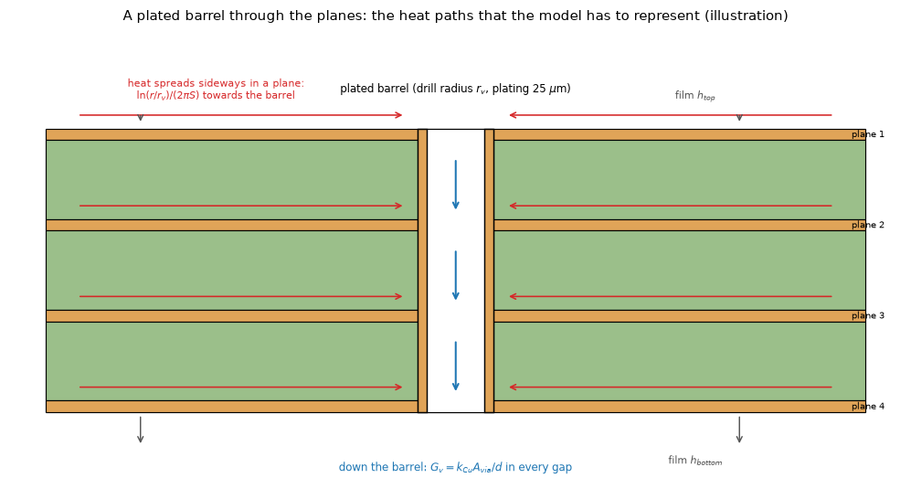

*Figure 01 (`figures/fig_01_barrel_section_heat_paths.png`): the section of a plated barrel through four planes: heat spreads sideways in each plane towards the barrel (`ln(r/r_v)/(2 pi S)`), goes down the barrel (`G_v` per gap) and leaves through the films (illustration).*

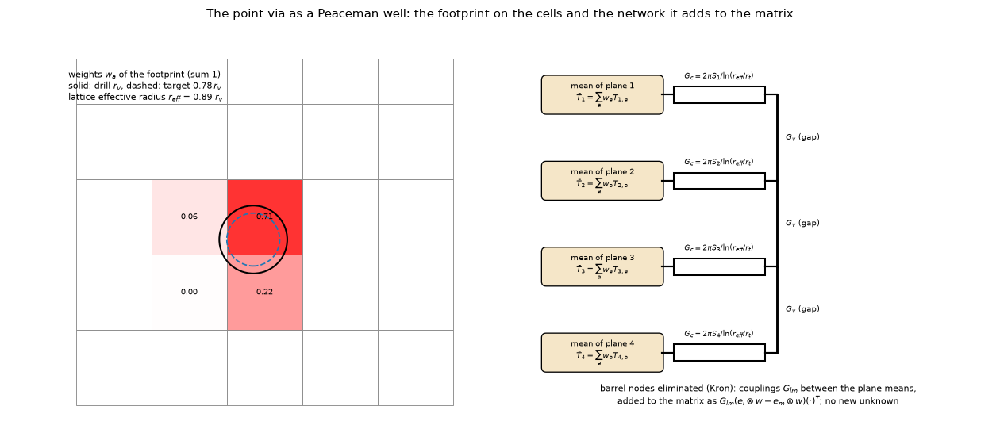

*Figure 02 (`figures/fig_02_point_via_peaceman_well.png`): left, the footprint weights of a via on the cells, the drill and the target radius `0.78 r_v`; right, the network added to the matrix (wells `G_c`, barrel `G_v`, plane means) (geometry of the drawing, weights from the footprint routine).*

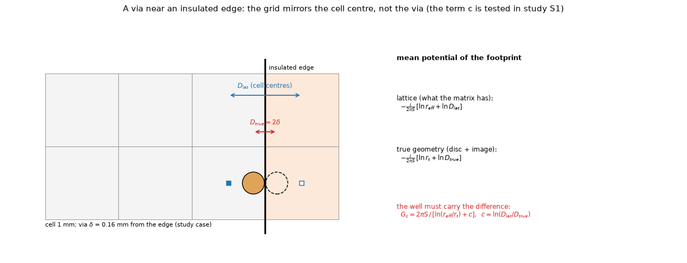

*Figure 03 (`figures/fig_03_via_near_edge_image.png`): a via 0.16 mm from an insulated edge on 1 mm cells: the true image at `D_true = 2 delta`, the image the grid has at `D_lat` (mirror of the cell centre), and the term `c = ln(D_lat/D_true)` that the well carries.*

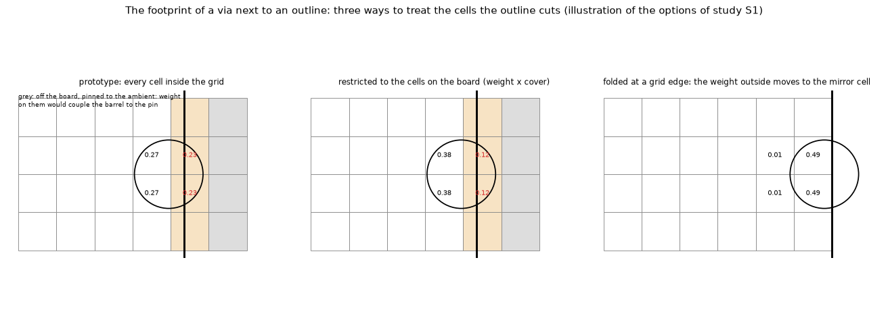

*Figure 04 (`figures/fig_04_footprint_on_board_cells.png`): three treatments of the cells that an outline cuts or the grid border leaves out: kept (prototype), restricted to the board with the cover as weight, folded to the mirror cell.*

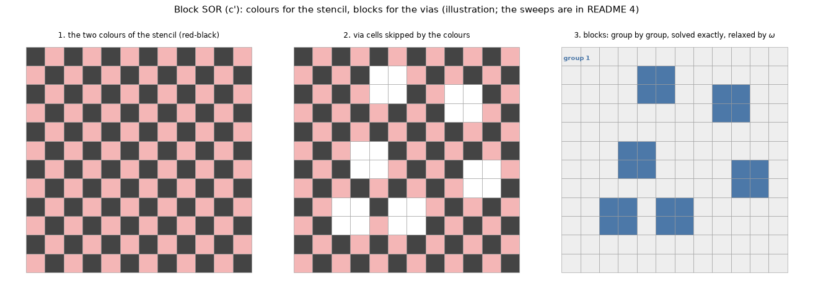

*Figure 05 (`figures/fig_05_block_sor_colouring.png`): the red-black colours of the stencil, the via cells skipped by them, and the via blocks coloured in groups of blocks that K does not couple (illustration).*

## 2. Method

* **Reference for S1** (`lib/edge_reference.py`): the layered model of the program written again in `sheets2d` (imports nothing of the program) on a 1/16 mm grid, the barrel at its real size. Board: 10 x 10 mm, four planes, 0.5 W in a 3 x 2 mm source, one 0.3 mm copper-filled via at 0.16 to 4 mm from the right edge; edge film `h_side` 0 and 10 W/m2K, the corner, outline cuts at x = 7 and 7.0625 mm. The layered idealisation against a 3D barrel is `point-via-convergence` 3.2/3.3 (not repeated; its -2.1 to +3.9 % spread in the target radius stays in the budget). **Convergence of the reference** (`scripts/check_reference.py`, section 3.5).
* **Candidate for the image** (`lib/edge_image.py`, `docs/theory-text.md`): `G_c = 2 pi S / (ln(r_eff/r_t) + c)`, `c = sum ln(D_lat/D_true)` over the images of the walls near the via. **Decision rule, written before the run** (header of `scripts/study_edge_distance.py`): adopt only if the error at 1 mm and d <= 1 mm falls under 3 % for every distance and for `h_side` 0 and 10, the cost is under 1 ms per via and the code is under 60 lines; otherwise document the limit.
* **Variants** (`lib/runs.py`): program (develop), `mw` (the prototype of `point-via-convergence`), `mw+board` (footprint on the board), `mw+image`, `mw+fold`.
* **Boards for S2** (`lib/real_board.py`): the Allegro four-layer board (283 plated holes, 241 of 0.305 mm, 36 of 1.143 mm; licence not stated: **numbers only, no picture**), the Stormduino (MIT, 109 plated holes, two layers) and an own via field (a 10 x 10 or 30 x 30 array under a 7 mm pad plus a ring of 24: 124 and 924 holes; and a growing array at a fixed 1.5 mm pitch of 100 to 4900 vias), full copper on every layer, the source (3 W, 8 mm) on the densest window of holes, so that the via effect is isolated; the real copper pattern (`gerber-models`) is a second stage. Files are read in place; nothing of a third party is stored here.
* **Memory**: every process below about 4 GB. Left out for that reason: the Allegro board at 0.25 mm (527 000 unknowns; the LU factors were estimated at 1.8 GB by counting non-zeros, not solved), the 1/32 mm reference (410 000 unknowns; replaced by the 1/8 mm to 1/16 mm convergence check), the 3D solid above 250 000 unknowns (the program's limit) and the 36-slab stress scenario.
* Tests: `tests/` has 25 tests, all passing on the merged program: the algebra of the image, restriction and fold; identity of the hook with the prototype when its options are off; vias as pure couplings (symmetry, zero row sum); `gz + gz_via` equal to the program's `gz` (also on vias on cell lines); the walls; the block structure; the board builders; the reference cut on the fine grid.

## 3. S1: the via near an edge

### 3.1 Insulated box edge, distance and cell (`out/edge_distance.txt`)

Error of the via effect E against the reference, `h_side` = 0, FVM. E of the reference: 3.162 / 3.358 / 3.542 / 3.839 / 4.274 / 5.343 K at d = 0.16 / 0.3 / 0.5 / 1 / 2 / 4 mm.

| d (mm) | variant | 1 mm | 0.5 mm | 0.25 mm | 0.125 mm |
| --: | :-- | --: | --: | --: | --: |
| 0.16 | program | +18.5 % | +2.4 % | -10.0 % | -12.0 % |
| 0.16 | mw | +14.5 % | +6.2 % | +0.5 % | -0.4 % |
| 0.16 | mw+image | **+0.7 %** | +0.1 % | -0.2 % | -0.4 % |
| 0.3 | program | +11.6 % | -3.6 % | -6.1 % | -13.4 % |
| 0.3 | mw | +7.9 % | +0.0 % | -0.0 % | -0.3 % |
| 0.3 | mw+image | +0.7 % | +0.2 % | -0.1 % | -0.2 % |
| 0.5 | program | +5.9 % | +2.9 % | -6.3 % | -13.3 % |
| 0.5 | mw | +2.3 % | +0.2 % | -0.1 % | -0.2 % |
| 0.5 | mw+image | +0.6 % | +0.2 % | -0.1 % | -0.2 % |
| 1 | program | +12.8 % | +1.3 % | -7.6 % | -14.5 % |
| 1 | mw | +0.4 % | +0.2 % | -0.1 % | -0.2 % |
| 1 | mw+image | +0.5 % | +0.2 % | -0.1 % | -0.2 % |
| 2 | program | +1.3 % | -4.2 % | -10.5 % | -16.5 % |
| 2 | mw / mw+image | +0.1 % / +0.2 % | +0.2 % / +0.3 % | -0.1 % | -0.2 % |
| 4 | program | -0.4 % | -5.4 % | -11.4 % | -17.3 % |
| 4 | mw / mw+image | -0.5 % | -0.1 % | -0.2 % | -0.3 % |

`mw+fold` is identical to `mw` in every row (at a box edge the footprint is not cut). The program drifts from +18.5 % to -12 % with the cell (the known non-convergence); the prototype `mw` converges but is +14.5 % at 1 mm for the via 0.16 mm from the edge, and the image removes exactly that (+0.7 %). Beyond d = 1 mm the image changes nothing (the kernel already carries the edge).

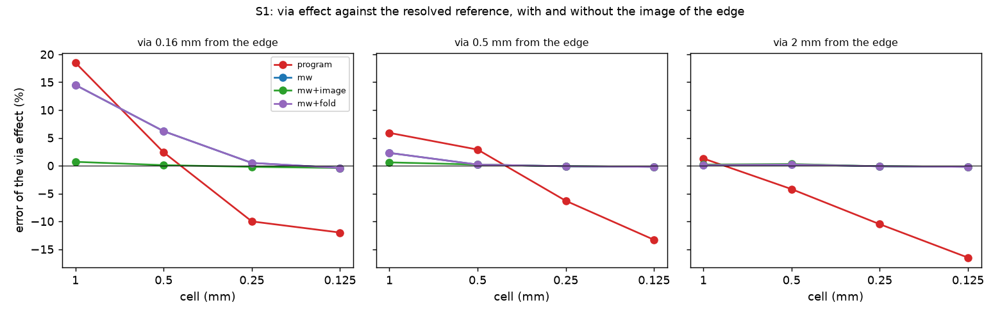

*Figure 06 (`figures/fig_06_edge_error_against_cell.png`): error of the via effect against the cell for a via 0.16, 0.5 and 2 mm from the insulated edge: program, prototype, with the image (`mw` is hidden under `mw+fold`).*

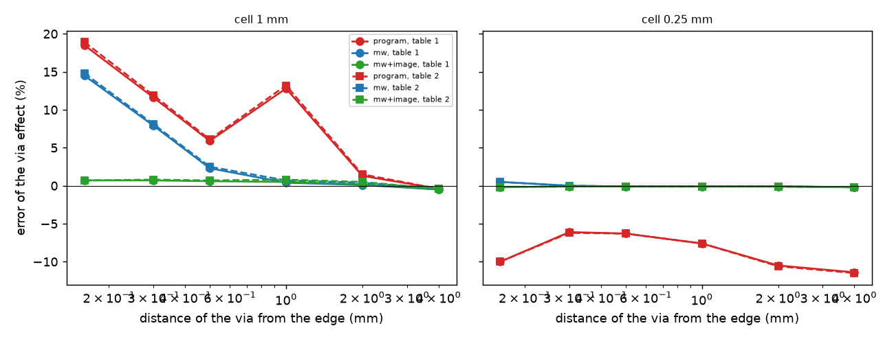

*Figure 07 (`figures/fig_07_edge_error_against_distance.png`): the error at 1 mm and 0.25 mm cells against the distance to the edge, `h_side` 0 (circles, table 1) and 10 (squares, table 2).*

### 3.2 Edge film and corner (`out/edge_distance.txt`, `out/edge_corner.txt`)

* `h_side` = 10 W/m2K: the same picture. For d = 0.16 mm: program +18.9 % / +2.4 % / -10.0 % / -12.0 %, `mw` +14.8 % / +6.2 % / +0.5 % / -0.4 %, `mw+image` **+0.7 %** / +0.1 % / -0.2 % / -0.4 % at 1 / 0.5 / 0.25 / 0.125 mm (E of the reference 2.993 K); at d = 0.3, 0.5, 1: `mw+image` +0.8 %, +0.7 %, +0.8 % at 1 mm. The film changes the error by at most 0.4 points.
* **Corner** (the via 0.16 to 4 mm from both the right and the top edge; E of the reference 2.115 K at 0.16 mm): `mw` +26.0 % / +7.0 % / +0.4 % / -0.5 % at 1 / 0.5 / 0.25 / 0.125 mm, `mw+image` **-1.0 %** / -0.7 % / -0.6 % / -0.6 %; d = 0.3 mm: `mw` +11.4 % / -3.3 % at 1 / 0.5 mm, `mw+image` -0.5 % / -3.3 % (the 0.5 mm value is the same for both: -3.3 %, which no variant removes; the program is -5.5 %); from d = 0.5 on both are within -0.8 to -0.3 %. The image brings the corner at 1 mm from +26 % to -1 %.

### 3.3 An outline off the grid lines and the footprint on the board (`out/edge_outline.txt`)

Outline at x = 7 mm (on a grid line at 1 and 0.5 mm) and at 7.0625 mm (inside a cell), via at d from it. Error of E (reference 7.628 / 8.502 / 9.226 K at x = 7; 7.471 / 8.328 / 9.036 K at 7.0625 mm for d = 0.16 / 0.5 / 1):

| cut, d | variant | 1 mm | 0.5 mm | 0.25 mm | 0.125 mm |
| :-- | :-- | --: | --: | --: | --: |
| 7, 0.16 | program | +17.6 % | +2.2 % | -9.6 % | -11.4 % |
| 7, 0.16 | mw = mw+board | +14.1 % | +5.9 % | +0.4 % | -0.4 % |
| 7, 0.16 | mw+image | **+1.1 %** | +0.1 % | -0.3 % | -0.4 % |
| 7, 0.5 | mw+image / mw | +0.8 % / +2.4 % | +0.3 % | -0.2 % | -0.3 % |
| 7, 1 | mw+image / mw | +0.7 % / +0.7 % | +0.2 % | -0.2 % | -0.2 % |
| 7.0625, 0.16 | program | +20.1 % | +4.4 % | -6.9 % | -14.7 % |
| 7.0625, 0.16 | mw | +1.9 % | -2.3 % | +0.2 % | -0.6 % |
| 7.0625, 0.16 | mw+board | +16.5 % | +8.1 % | +1.2 % | -0.4 % |
| 7.0625, 0.16 | mw+image | **+2.5 %** | +0.9 % | -0.1 % | -0.4 % |
| 7.0625, 0.16 | mw+image, footprint not restricted | **-10.2 %** | -8.0 % | -0.1 % | -0.6 % |
| 7.0625, 0.5 | mw+image / mw | +2.2 % / +4.5 % | +1.0 % / -0.3 % | -0.1 % | -0.2 % |
| 7.0625, 1 | mw+image / mw | +1.6 % / -0.5 % | +1.3 % / +0.6 % | -0.1 % | -0.2 % |

* On a cut at a grid line the image acts as at a box edge (+14.1 % to +1.1 %).
* On a cut inside a cell the image works with the footprint restricted to the board (+2.5 %), and **fails without the restriction** (-10.2 %): the cell with cover 0.0625 would carry weight and the pinned cells would be coupled to the barrel. The prototype's +1.9 % without both is a cancellation of two errors (restricted without the image it is +16.5 %). So **the restriction is needed together with the image**, and the image is right to about 2.5 % at 1 mm in these cases.
* `mw+fold` equals `mw+board` in every row: the fold acts only at the border of the grid, never at an outline inside it, and at the border of the grid of the box it did not change any case. It is **not proposed**.
* The counter "cut footprints" was 0 in every case: the footprints of a 0.3 mm via did not reach cells off the board, only partial cells (cover 0.0625). The "infinite wells" counted for `mw` at x = 7 are the prototype's wells for vias at 0.5 and 1 mm (`r_eff <= r_t`), not an effect of the edge.

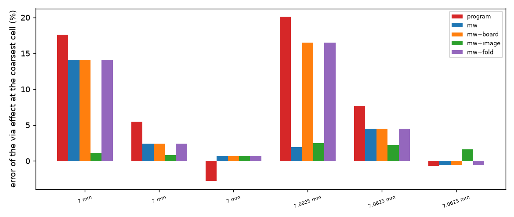

*Figure 08 (`figures/fig_08_outline_footprint_variants.png`): the error of every variant at the coarsest cell (1 mm) for each cut and distance.*

### 3.4 Decision (rule of section 2 applied literally)

| criterion | result | verdict |
| :-- | :-- | :-- |
| error at 1 mm, d <= 1 mm, under 3 %, for every distance, `h_side` 0 and 10 | box edge: +0.5 to +0.8 %; outline on a grid line: +0.7 to +1.1 %; outline inside a cell (with the restriction): +1.6 to +2.5 %; corner: -0.5 to -1.0 % | **met** |
| cost under 1 ms per via | the edge term alone is under 1 ms at 1, 0.5, 0.25 and 0.125 mm; the footprint plus the term is over 1 ms at 0.125 mm (a 12-cell footprint, the cost of the base treatment, not of the image) (`scripts/check_image_cost.py`) | **met** for the image |
| code under 60 lines | 56 lines of code (no blanks, comments or docstrings) in `a_cont`, `centres`, `mirror`, `image_energy`, `log_image_distance`, `well_correction`, `well_conductance_image` and `walls_for`; the call in the hook adds about 8 more | **met**, narrowly (the integration lines bring it to the limit) |

**The image of the edge is adopted** for walls parallel to an axis (box edges and the axis-parallel segments of an outline) in the FVM, **together with the footprint restricted to the cells on the board**. Documented limits: a diagonal or curved outline edge has no image (the error there was not measured); the FDM edge nodes are half volumes and get none; a via within one drill radius of the edge is clipped at `r_v`; the corner case at d = 0.3 mm and 0.5 mm cells stays at -3.3 % for both variants.

### 3.5 Convergence of the reference (`out/check_reference.txt`)

E at 1/8 and 1/16 mm: 3.1644 / 3.1623 (d = 0.16), 3.5191 / 3.5415 (0.5), 4.2432 / 4.2736 (2). The first-order Richardson limits (3.160, 3.564, 4.304 K) are 0.1, 0.7 and 0.7 % above the 1/16 value. **The reference is uncertain by about 0.7 %**, and it is low, which is why the fine-cell errors of `mw` sit at -0.2 to -0.4 % in the tables: they are inside that band, not a defect of the treatment. The 1/32 mm check (410 000 unknowns) was not run (memory).

## 4. S2: boards with 100 or more vias

### 4.1 The vias of the boards (`out/real_stats.txt`)

| board | holes | diameters (mm: count) | nearest neighbour (mm) | at 1 mm: cells with a via, shared | overlapping pairs 1 / 0.5 / 0.25 mm |
| :-- | --: | :-- | --: | :-- | :-- |
| Allegro (4 layers, 101.7 x 81.1 mm) | 283 | 0.305: 241, 0.762: 3, 0.889: 2, 1.143: 36, 2.032: 1 | 2.28 | 282 of 8262, 0 % | 108 / 25 / 2 |
| Stormduino (2 layers, 68.6 x 53.4 mm) | 109 | 0.4: 20, 0.6: 4, 0.65: 10, 0.8: 30, 1: 41, 3.2: 4 | 2.87 | 109 of 3657, 0 % | 80 / 8 / 0 |
| own 10 x 10 + ring | 124 | 0.3: 124 | 1.58 | 88 of 3000, 32 % | 1310 / 342 / 180 |
| own 30 x 30 + ring | 924 | 0.3: 924 | 0.36 | 88 of 3000, 73 % | 99 810 / 36 648 / 14 670 |

Real layouts keep their vias apart (nearest neighbour 2.3 to 2.9 mm); at 0.5 mm the footprints of the real boards hardly overlap. Dense via fields are the own arrays.

### 4.2 The matrix against the number of vias (`out/fillin.txt`)

* **Fixed pad is not a scaling**: 49 to 4924 vias under the same 7 x 7 mm pad touch the same cells, so `nnz(K)` saturates (84 424 at 1 mm for 924 to 4924 vias). The study keeps it as the saturation case and adds a **growing array at a fixed 1.5 mm pitch**.
* **Growing array, 1.5 mm pitch, four planes, 0.5 mm cells** (`nnz` counts; memory from the LU non-zeros at 12 bytes each, not measured):

| vias | unknowns | nnz(K) program | nnz(K) couplings | dense coupling entries | LU nnz program | LU nnz couplings | memory estimate (couplings) |
| --: | --: | --: | --: | --: | --: | --: | --: |
| 100 | 17 956 | 115 642 | 134 042 | 25 600 | 2.24 M | 2.39 M | 0.03 GB |
| 900 | 64 516 | 417 322 | 582 922 | 230 400 | 11.39 M | 12.06 M | 0.14 GB |
| 2500 | 139 876 | 906 202 | 1 366 202 | 640 000 | 29.76 M | 31.24 M | 0.37 GB |
| 4900 | 244 036 | 1 582 282 | 2 483 882 | 1 254 400 | 58.78 M | 59.77 M | 0.72 GB |

The couplings add 16 to 57 % to `nnz(K)` (the footprint is 4 cells, 256 dense entries per via on four planes) but **the LU factors grow by 2 to 7 % at most** (the factor fill-in of the sparse stencil dominates): 4900 vias do not break the direct solver. At 1 mm the figures are the same in character (LU 1.98 M against 1.97 M at 900 vias). On the real boards: Allegro at 1 / 0.5 / 0.25 mm LU nnz 4.90 M / 28.4 M / 151.7 M with the couplings against 4.91 M / 30.0 M / 158.0 M without (the couplings do not increase it; 1.8 GB estimated at 0.25 mm, not solved); Stormduino 0.45 M / 2.48 M / 13.2 M against 0.41 M / 2.27 M / 11.7 M (+8 to +12 %).

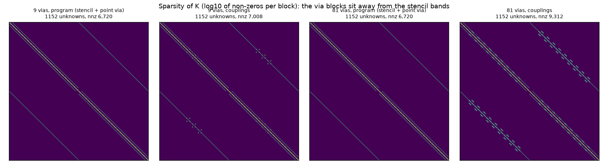

*Figure 09 (`figures/fig_09_sparsity_against_vias.png`): the sparsity of K (non-zeros per block, log scale) for 9 and 81 vias with and without the couplings.*

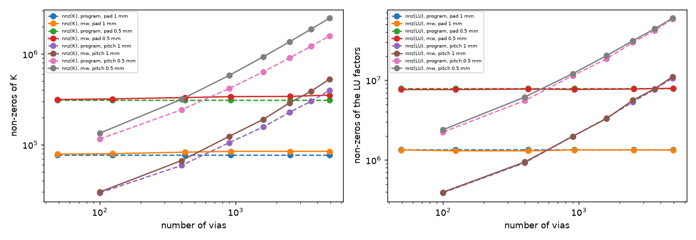

*Figure 10 (`figures/fig_10_unknowns_nnz_against_vias.png`): non-zeros of K and of the LU factors against the number of vias, "pad" (fixed 7 mm pad, saturates) and "pitch" (growing array), program (dashed) and couplings (solid).*

### 4.3 Where it breaks: the blocks of the block SOR (`out/block_limit.txt`)

The dense inverse of a block is the cost that grows. Footprints that overlap merge into one block; an array whose pitch equals the cell is one block (counts, no solve):

| array | pitch | cell | unknowns | blocks | largest block (unknowns) | dense inverses |
| :-- | --: | --: | --: | --: | --: | --: |
| 20 x 20 | 1.5 mm | 1 mm | 5 776 | 400 | 16 | 0 MB |
| 40 x 40 | 1.5 mm | 0.5 mm | 75 076 | 1600 | 16 | 3 MB |
| 20 x 20 | 1 mm | 1 mm | 3 364 | **1** | 1 764 | 25 MB |
| 40 x 40 | 1 mm | 1 mm | 9 604 | **1** | 6 724 | **362 MB** |
| 40 x 40 | 0.6 mm | 0.5 mm | 17 956 | 171 | 864 | 11 MB |

The memory of the inverse grows with the square of the merged area: by extrapolation (squares of the unknowns, not measured) a 100 x 100 array at pitch = cell would need about 13 GB. **Real boards stay far from it** (largest block 32 unknowns at 1 mm, 88 to 98 at 0.5 mm on the Allegro and Stormduino); the limit is a via field with pitch near the cell. The block SOR needs a guard: when the largest block exceeds a limit (a few thousand unknowns, a few hundred MB), use the direct solver.

### 4.4 Block SOR on the real boards (`out/sor_real.txt`, `out/sor_real_05.txt`)

| board | cell | unknowns | blocks (largest, colours) | block SOR sweeps | max diff to direct | sweeps without vias | the program's rule |
| :-- | --: | --: | :-- | --: | --: | --: | :-- |
| Allegro | 1 | 33 048 | 277 (32, 3) | 3320 | 1.2e-8 K | 3410 | not converged, 37.2 K off |
| Stormduino | 1 | 7 314 | 106 (32, 2) | 2380 | 1.9e-8 K | 2530 | not converged, 63.0 K off |
| own 100 | 1 | 12 000 | 60 (16, 2) | 5850 | 3.6e-8 K | 5920 | not converged, 64.8 K off |
| own 900 | 1 | 12 000 | 25 (256, 1) | 5780 | 3.4e-8 K | 5920 | not converged, 64.8 K off |
| Allegro | 0.5 | 131 544 | 282 (88, 2) | 6880 | 5.8e-9 K | 6990 | not converged, 37.6 K off |
| Stormduino | 0.5 | 29 318 | 109 (98, 2) | 5090 | 9.3e-9 K | 5300 | not converged, 65.6 K off |
| own 100 | 0.5 | 48 000 | 60 (52, 5) | 12 050 | 1.8e-8 K | 12 180 | not converged, 64.9 K off |
| own 900 | 0.5 | 48 000 | 25 (1008, 1) | 11 900 | 1.7e-8 K | 12 180 | not converged, 64.8 K off |

The block SOR (c') reaches the direct solution to 1e-8 K in **the same sweeps as the board without vias (0.9 to 1.0 times)**, up to 924 vias; the program's SOR rule on the same matrix stops with a violated balance 37 to 66 K off (cap 20 000 and 30 000 sweeps), the failure of `sor-with-via-couplings` reproduced on real layouts.

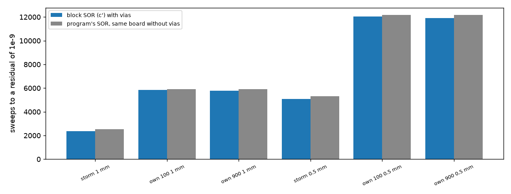

*Figure 11 (`figures/fig_11_sor_sweeps_real_boards.png`): sweeps of the block SOR with vias against the program's SOR on the same board without vias (the Allegro board is left out of the figure).*

### 4.5 Temperature (`out/real_effect.txt`, `out/real_effect_fine.txt`, `out/maps_*.npz`)

Via effect E = T_max(no via) - T_max(via), FVM, 3 W in 8 mm on the densest window; "mw" is the recommended treatment with the footprint on the board (no image: no hole of these boards is near an edge):

| board | treatment | 2 mm | 1 mm | 0.5 mm | 0.25 mm | change 1 mm to finest |
| :-- | :-- | --: | --: | --: | --: | --: |
| Allegro | program | 14.46 | 12.71 | 12.25 | not run | -0.46 K |
| Allegro | mw | 13.09 | 12.33 | 12.79 | not run | +0.46 K |
| Stormduino | program | 5.42 | 5.60 | 5.36 | 5.11 | -0.49 K |
| Stormduino | mw | 7.47 | 5.15 | 5.70 | 5.58 | +0.43 K |
| own 100 | program | 19.22 | 19.28 | 19.44 | 19.41 | +0.13 K |
| own 100 | mw | 19.16 | 19.44 | 19.63 | 19.67 | +0.23 K |
| own 900 | program | 20.56 | 20.77 | 20.83 | - | +0.06 K |
| own 900 | mw | 20.53 | 20.77 | 20.84 | - | +0.08 K |

**On these layouts the treatment does not converge visibly better than the program**: the changes from 1 mm to the finest cell are of the same size (about 0.5 K on the Allegro and Stormduino boards, 5 to 10 % of E), with opposite signs. The program drifts monotonically (Stormduino 5.60 / 5.36 / 5.11), `mw` jumps between 1 and 0.5 mm and then is flat (5.15 / 5.70 / 5.58: 0.12 K from 0.5 to 0.25 mm against 0.25 K). With 1 mm and 3.2 mm component holes next to the source the via effect depends on the footprint of those large holes; these boards have no independent reference, so the figures say how much the answer moves with the cell, not which one is right; the evidence that the treatment is right remains the simple boards (`point-via-convergence`, S1). The own fields, whose vias are all 0.3 mm, behave as the unit cell does: small and similar changes (+0.1 to +0.2 K). The FDM column is in `out/real_effect.txt` (for example Stormduino mw E 4.94 / 5.11 / 5.70, program 5.03 / 5.14 / 5.24).

**Copper-fill gain** (FVM, 0.5 mm): Allegro program -3.00, mw -2.94 K; Stormduino -1.81 / -2.05 K; own 100 -0.83 / -0.82 K.

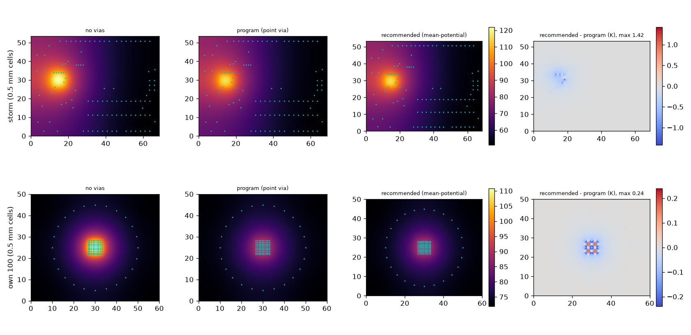

*Figure 12 (`figures/fig_12_temperature_maps_before_after.png`): the Stormduino and the own field at 0.5 mm (no picture of the Allegro board): top-layer temperature without vias, with the program, with the recommended treatment, and the difference (largest 1.42 K on the Stormduino, 0.24 K on the own field).*

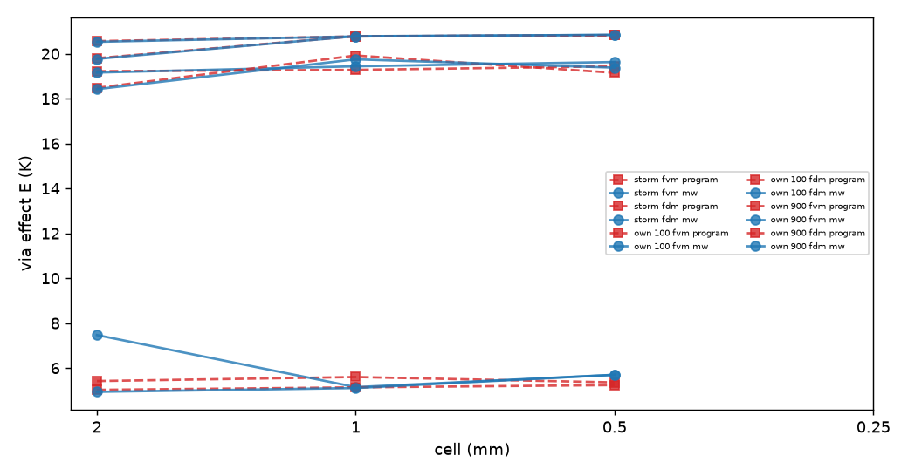

*Figure 13 (`figures/fig_13_via_effect_against_cell.png`): the via effect against the cell (2, 1 and 0.5 mm; the 0.25 mm values are in the table), FVM and FDM, program (red dashed) and recommended (blue), Stormduino (the lower curves) and the own fields.*

### 4.6 The 3D solid with the single footprint rule (`out/solid3d_real.txt`)

Windows of 30 x 30 mm around the densest holes (58, 29 and 104 holes), cells 1 and 0.5 mm (0.25 mm is above the 250 000 limit); `E` in K:

| window | cell | FVM program | FVM mw | 3D program rule | 3D single rule | fill gain 3D, program rule | fill gain 3D, single rule |
| :-- | --: | --: | --: | --: | --: | --: | --: |
| Allegro | 1 | 11.85 | 11.59 | 11.88 | 11.96 | -2.87 | -2.85 |
| Allegro | 0.5 | 11.96 | 12.36 | 11.97 | 12.46 | -3.23 | -2.98 |
| Stormduino | 1 | 5.96 | 5.79 | 5.99 | 5.99 | -2.22 | -2.28 |
| Stormduino | 0.5 | 5.55 | 5.75 | 5.57 | 5.85 | -2.07 | -2.29 |
| own 100 | 1 | 18.81 | 18.97 | 18.86 | 18.86 | -1.03 | -1.03 |
| own 100 | 0.5 | 18.97 | 19.16 | 19.03 | 19.32 | -0.81 | -0.85 |

At 1 mm the two rules agree (the vias are smaller than a cell: a point). At 0.5 mm the single rule raises E by 0.3 to 0.5 K and puts the 3D solid within 0.1 to 0.16 K of the recommended FVM treatment (Allegro 12.46 against 12.36, Stormduino 5.85 against 5.75, own 19.32 against 19.16), where the program's rule is 0.2 to 0.4 K below it; the fill gain of the 3D solid changes by 0.04 to 0.25 K. This is agreement between two models of this program, not an independent reference. The cell at which the 3D reaches 0.25 mm is excluded by the program's own limit.

### 4.7 Lumped and Analytic (`out/lumped_gzvia.txt`)

| board | Lumped T_max, program | with `gz_via` | without `gz_via` |
| :-- | --: | --: | --: |
| example board | 84.6586 | 84.6586 | 96.5103 |
| 3 x 3 array board | 63.7602 | 63.7602 | 74.8230 |
| own 100 vias | 92.3365 | 92.3365 | 112.9179 |

With `gz_via` the Lumped model is **bit-identical** (difference 0.0, and `gz` + `gz_via` equals the program's `gz` to 0.0 W/K on every board); without it the Lumped model loses its vias (+10 to +20 K), so the line in `lumped.py` is not optional. The Analytic model does not read the FVM arrays and is untouched. Against the recommended FVM on the own fields (1 and 0.5 mm): Lumped +1.6 / +0.4 % (100 vias) and +1.4 / -0.0 % (900 vias), Analytic +4.1 / +4.5 % and +3.8 / +4.0 % (the known overstatement, A6, not changed by this work).

### 4.8 Numbers of `docs/validation.md` that move (`out/validation_rows.txt`)

Temperatures in degrees C; only cells that moved by more than 0.05 are listed; **no cell of the 3D solid, Lumped or Analytic column moved**.

* **Section 2 (1 mm), the eight rows with vias**: FVM falls by 0.57 to 0.62 K and FDM rises by 0.71 to 0.74 K: example board (full) FVM 85.81 -> 85.22, FDM 84.38 -> 85.12; no heatsink 88.91 -> 88.29 / 87.47 -> 88.18; top copper over the full board 85.29 -> 84.72 / 83.94 -> 84.67; only heater U1 79.97 -> 79.38 / 78.54 -> 79.27. The FVM-FDM difference of the example board falls from 1.43 to 0.10 K. The percentage errors of every row against the FVM change accordingly (the rows without vias do not move).
* **Section 2.1 (example board against the cell)**: FVM 83.00 / 85.34 / 85.81 / 85.87 / 85.95 become 83.52 / 85.07 / 85.22 / 85.17 / 85.15 at 4 / 2 / 1 / 0.5 / 0.25 mm (the spread between 1 and 0.25 mm falls from 0.14 K to 0.07 K, and it falls monotonically from 1 mm on); FDM with area sampling 82.29 / 84.66 / 84.38 / 85.22 / 85.67 become 83.79 / 84.26 / 85.12 / 85.12 / 85.13; FDM with point sampling 85.36 / 86.18 / 85.15 / 85.58 / 85.80 become 86.68 / 85.77 / 85.90 / 85.47 / 85.27. The 3D solid column does not move.
* **Section 18 (fills of the example board, 0.5 mm)**: FVM open 85.87 -> 85.17, resin 85.87 -> 85.17, paste 85.70 -> 84.99, copper 81.98 -> 80.98; FDM open 85.22 -> 85.12, copper 81.13 -> 80.91. The copper-fill gain becomes -4.19 K (FVM) and -4.21 K (FDM) against -3.89 and -4.09 K; the 3D solid at 1 mm and the Lumped and Analytic columns (-6.3 to -7.0 K) do not move. The text "-3.9 to -4.6 K in the FVM, FDM and 3D solid" becomes about -4.2 K.
* **The via rows of Lumped and Analytic** (A6): unchanged.
* **Section 5 (solvers)**: the SOR rows of the example board are the ones to recompute on the adoption branch (the program's rule would fail there; with the block SOR they agree with the direct solver to 1e-8 K). Not run here with the example board's full table.
* The scenario table runs here with the 3D solid skipped where the program's own limit forbids it (the 36-slab stress case); the other 3D cells are unchanged.

## 5. Limits that remain

* **Uniform copper** on the real boards (the isolated via effect); the interplay with a real copper pattern is a second stage (`gerber-models`).
* **The treatment shows no clearly better convergence on the real layouts** (section 4.5): the evidence of its accuracy is the simple boards and S1; the real boards give the size of the cell dependence (about 0.5 K, 5 to 10 % of E on boards with large drills), which no board here can attribute.
* The image: walls parallel to an axis only; no diagonal or curved outline edge; none in the FDM; a via within one drill radius of the edge is clipped; the corner at 0.5 mm cells and d = 0.3 mm keeps -3.3 %.
* The block SOR has a memory limit for a via field with pitch near the cell (about 13 GB for 100 x 100, extrapolated): guard and fallback needed.
* The reference of S1 is uncertain by about 0.7 %; no 1/32 mm run; no 3D barrel reference near an edge.
* The Allegro board at 0.25 mm and the 3D solid at 0.25 mm were not run (memory and the program's limit); the Allegro board has no stated licence: numbers only.
* No measured board.

## 6. Defects of this folder's own code found and fixed

1. `edge_patch`: `gz_via` took the cell by `floor((x - origin) / dx)`; the program uses `x // dx`, which differs for a via exactly on a cell line. The first run of `study_lumped_gzvia.py` showed 1.7e-2 W/K and a Lumped difference of -7.45e-4 K on the own field; fixed by calling the program's `cell_index_of_point`; regression `test_gz_via_matches_on_vias_that_sit_on_cell_lines`, rerun: 0.0.
2. `study_edge_outline.py`: a cut at 7.03125 mm is not on the 1/16 mm reference grid and the run stopped; the defaults are now 7.0 and 7.0625 mm; regression `test_reference_cut_must_lie_on_the_fine_grid`.
3. `study_validation_rows.py`: the 3D solid stopped the run for the 36-slab case and for the example board at 0.5 mm (over the program's limit); the table now skips those cells and takes the 3D fills at 1 mm.
4. `study_fillin.py`: the first scaling (a fixed pad) saturated and measured nothing about growth; a fixed-pitch array was added.

## What was read and what was not verified

**Read in full or in the part that matters.** The code and documents of `point-via-convergence` (README 8, 9, INTEGRATION.md), `sor-with-via-couplings` (INTEGRATION.md, `lib/sorvia.py`), `fvm.py` (edge, cover and pin handling), `geometry.py` (`part_weights`, `cell_index_of_point`), `solid3d.py` (the via fraction), `lumped.py` (what it reads from the network), and the Excellon header of the Allegro board (tool table).

**Seen as a summary only.** The image-well method (a search snippet) and a paper on the Peaceman well block near a boundary (title only; `research/theory/BIBLIOGRAPHY.md` section 18).

**Not obtained.** Peaceman (1978, 1983) full texts; any source that gives a well-block radius next to a boundary. The image term is derived here from the lattice kernel and confirmed numerically against the resolved reference; it is not taken from a source. No published numerical case of a via near an edge was reproduced.

**Reproduced.** The prototype's E at 0.16 mm from the edge (3.62 K at 1 mm, program 3.75 K) of `point-via-convergence` 8; the SOR failure of `sor-with-via-couplings` on real layouts.

**Doubts of the researcher.** (1) The image is +2.5 % at 1 mm for an outline inside a cell, but the cases are three distances at one board; other outlines (rotated, rounded) are not tested. (2) The corner row at d = 0.3 mm and 0.5 mm cells (-3.3 %) is unexplained. (3) On the real boards the via effect is a T_max difference, which moves when the hot spot moves from cell to cell; a more stable measure (a mean over the source) was not tried. (4) The Allegro layout is of unknown origin; the heater on the densest window is the worst case for the model.

## Reproduce

`sh research/via-real-board/scripts/run_s1.sh`, `run_s2.sh`, `run_s2b.sh`, `run_s2c.sh`, `run_s2d.sh` from the repository root (no network: the boards are read from `research/gerber-import/data`, found by `lib/paths.py`), then `scripts/study_block_limit.py`, `check_reference.py`, `check_image_cost.py`, `make_diagrams.py`, `make_figures.py`; tests: `.venv/bin/python -m pytest -q research/via-real-board/tests` (25 tests).
