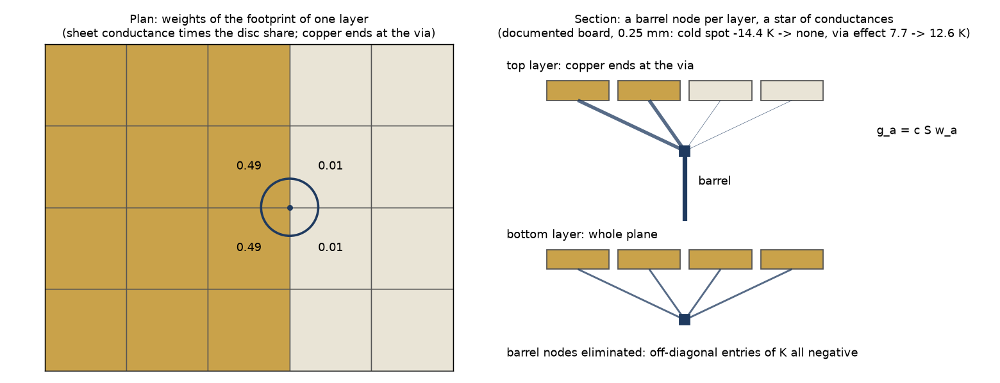
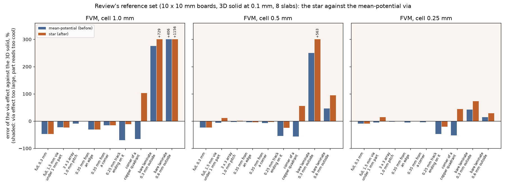

# via-star-coupling

Measurements of the star coupling of the via that `feature/via-star-coupling` put into `pcbthermal/viawell.py` (variant (c) of `research/via-partial-copper`, README 5 and 9.4). The program is the implementation; this folder holds the before-and-after studies, which run on any program tree (`--tree`), so the "before" is a checkout of the commit before the change. The numbers and their reading are in `docs/validation.md` 31 and `docs/theory.md` 2.2 and 2.6.

## 1. Question

Does a barrel node per layer reached from every footprint cell (an M-matrix by construction) remove the cold spot and the positive off-diagonal entries of K, keep what the mean-potential via got right (convergence with the cell, the copper-fill gain, the edge image, memory), and what does it do to the cases where the copper changes inside the footprint?

### 1.1 Picture

*Figure 1 (`figures/fig_01_star_coupling.png`, `scripts/make_diagrams.py`): plan of the footprint at the end of a copper edge (weights illustrative) and the section with the barrel nodes and the star of conductances.*

## 2. Studies

| script | what it answers | needs |
| :-- | :-- | :-- |
| `scripts/study_star_before_after.py --tree <tree> --out out/<name>.json`, then `--compare` | the documented board, the 10 mm cases against the tabulated 3D values, the dense array, the 3 x 3 copper-fill gain, the example board, direct/CG/SOR, the cost | nothing |
| `scripts/study_array_reference.py --tree <tree>` | the dense 10 x 10 array on a 16 mm board against the 3D solid at 0.2 and 0.1 mm | 3D solid, about 1 GB |
| `scripts/study_real_windows.py --tree <tree>` | the CO60 windows with their plated holes | `PCBT_REAL_BOARDS` |
| `research/memory-guard/scripts/study_via_law.py` (run on both trees) | the peak memory of the direct solve | nothing, one child process per case |
| `scripts/study_reference_set.py {layered,solid,dead,table}` | the review's own set of fifteen boards against the 3D solid, and the via that carries no heat (section 5) | 3D solid, up to 2.5 GB at 16 slabs |

## 3. Results (summary; the tables are in `docs/validation.md` 31)

* Positive off-diagonal entries of K: 0 everywhere (example board 16 / 64 at 1 mm and 144 / 432 at 0.5 mm before; 10 x 10 array 96 to 3104 before). The cold spot of the board of `docs/theory.md` 2.2 (-7.94 K at 0.5 mm, -14.43 K at 0.25 mm) is gone; its via effect is 13.68 / 13.06 / 12.63 / 12.54 K at 1 to 0.125 mm (6.41 to 8.28 K before).
* Against the 3D solid at 1/20 mm on 10 mm boards (FVM, 0.25 to 1 mm): copper edge through the via -31..-47 % to +6..+32 %; track -45..-68 % to -11..-34 %; island and edge past the via unchanged; **a via on bare laminate just outside a copper edge worse** (2 to 9 times high at 0.5 mm and coarser).
* The dense array of 100 vias is within 1 % of the 3D solid (50.31 / 50.39 K) before and after; the 3 x 3 copper-fill gain within 0.06 K of the resolved -4.51 K.
* Frozen records: 21 of 30 move, at most 0.73 K (`tests/regression/data/pending/via-star-coupling.json`); windows of the CO60 board -0.4 to -4.4 K.
* Cost: memory and non-zeros of K equal to the tree before; network build of 8500 vias 3.1 s against 2.8 s.

## 4. Defects found in the first version of the implementation (fixed, with tests)

* The root finder of the star conductance assumed a positive target and gave the cap for cells smaller than the target radius: +1.2 % and +5.2 % at the finest cells of the periodic unit cell (`test_a_lone_via_in_a_periodic_cell_converges_with_the_cell`, `test_the_calibration_keeps_the_resistance_of_a_lone_via`).
* The edge image as a number (`edge_term`) in the star's target gave +4.5 % at a corner and +1.8 % near an edge at fine cells; as a matrix over the footprint cells (`edge_kernel`) the sweep of `docs/validation.md` 28 keeps its errors.

## 5. Review

**Verdict: no-go for the star as the default via of the FVM and FDM; the decision is the maintainer's.** It removes the positive entries of K and the cold spot (reproduced: 0 positive entries, no cold spot, every number of section 3 and of `docs/validation.md` 31.1 to 31.4 reproduced to the printed digit by `study_star_before_after.py` on `29030c9` and on the branch), but on boards it was not built on it trades the safe-side errors of the mean-potential via (via effect too small, part too hot) for unsafe-side errors (via effect too large, part too cool), it adds an artefact of its own on full copper, and its gain is limited to two of the case families. The earlier recommendation of `research/via-partial-copper` README 9.4 ("C equal to or better than B on seven of the eight rows") rested on the rows the star was then calibrated and tuned on; on the independent set below it does not hold.

### 5.1 Independent reference set

`scripts/study_reference_set.py`: fifteen 10 x 10 mm boards not used to build the star, the via effect (rise without the via minus rise with it) of the FVM and FDM at 2 to 0.125 mm on the tree before (`29030c9`) and after, against the 3D solid (unchanged by the branch) at 0.1 mm and 8 dielectric slabs. The 3D reference was checked through the thickness and in the plan on seven of the cases (4 / 8 / 16 slabs at 0.1 mm, 4 slabs at 0.05 mm): the full-copper and array values move by under 0.5 %, the partial-copper ones by 3 to 9 % (track 13.84 / 12.28 / 11.65 K, quarter 5.82 / 5.52 / 5.39 K at 4 / 8 / 16 slabs), much less than the differences between the two couplings. Signed error of the FVM via effect, per cent, before -> after:

| case (3D, K) | 2 mm | 1 mm | 0.5 mm | 0.25 mm | 0.125 mm |
| :-- | --: | --: | --: | --: | --: |
| full copper, drill 0.2 / 0.3 / 0.6 mm, 2 layers; 0.3 mm, 4 layers | -23 to -31, unchanged | -43 to -51, unchanged | -17 to -26, unchanged | -2 to -12, unchanged | -2 to -5, within 1 point |
| full copper, drill 1.0 mm (7.43) | -10 -> -10 | -34 -> -34 | -6 -> -1 | -5 -> +2 | -4 -> +3 |
| full copper, drill 1.5 mm, 1 mm part over it (7.86) | -6 -> +6 | -23 -> -23 | -6 -> +11 | -5 -> +15 | -5 -> +15 |
| 3 x 3 array, 1.0 mm pitch (12.41) | -5 -> +15 | -9 -> 0 | -3 -> +1 | -2 -> 0 | -1 -> 0 |
| 3 x 3 array, 0.6 mm pitch (13.28) | -2 -> -2 | -8 -> -8 | -5 -> -4 | -2 -> -2 | -1 -> -1 |
| via 0.35 mm from an edge / a corner (7.50 / 14.76) | unchanged | unchanged | -4 / -7 -> -4 / -3 | -5 / -4 -> +1 / -1 | -4 / -4 -> -1 / -1 |
| via at the corner of a copper quadrant (5.52) | -50 -> -50 | **-66 -> +103** | **-57 -> +55** | **-52 -> +45** | **-45 -> +37** |
| 0.25 mm track ending on the via (12.28) | -95 -> -95 | -70 -> -11 | -54 -> -24 | -47 -> -21 | -43 -> -13 |
| via on bare laminate 0.3 mm outside a copper edge (1.05) | +652 -> +652 | **+276 -> +729** | **+250 -> +563** | +42 -> +73 | +20 -> +82 |
| the same, 0.6 mm (0.56) | +526 -> +526 | **+406 -> +1156** | +46 -> +94 | +14 -> +29 | -4 -> +27 |
| the same, 1.0 mm (0.27) | -54 -> -54 | +19 -> +120 | -8 -> +22 | -33 -> -24 | -43 -> -26 |

*Figure 2 (`figures/fig_02_reference_set_errors.png`, `scripts/make_figures.py`): the FVM via effect against the 3D solid at 1, 0.5 and 0.25 mm, mean-potential via (blue) and star (orange); above zero the part reads too cool; bars clipped at +300 % carry their value.*

In the FDM the star changes the partial-copper cases little (track -53 -> -48 % at 0.25 mm, quarter -13 -> -1 %) and moves the via on bare laminate up by the same factors (0.3 mm outside: +306 -> +436 % at 0.25 mm). Read: the star is better on the track and on the copper edge through the via (`validation.md` 31.2), equal on full copper away from large vias, and **worse, and on the unsafe side**, on the via at the corner of a copper region and on a via just outside a copper edge (the common via beside a pad). At 1 mm the via 0.3 mm outside a copper edge reads 7.7 K too cool in a rise of 84 K (9 %), 2.9 K before. The quarter case does not converge with the cell to the reference after (+37 % at 0.125 mm), nor before (-45 %).

### 5.2 The artefact of the star: an in-plane short across the footprint

The barrel node of a layer joins every cell of the footprint of that layer, so the footprint is short-circuited in the plane whether or not heat goes down the barrel. Test (`study_reference_set.py dead`): the example board with the barrel plating set to 1 nm, so that the vias carry no heat; any change of the maximum is the coupling's own. Before: 0.001 K at every cell (FVM and FDM). After: FVM 0.002 / 0.005 / **0.223** / 0.100 K and FDM 0.011 / **0.653** / 0.146 / 0.123 K at 2 / 1 / 0.5 / 0.25 mm. This is the move of the frozen numbers: the FDM example at 1 mm moves -0.455 K (the via effect +0.455 K, the dead via 0.653 K), away from its finer values (85.13 / 85.12 / 85.13 before, 84.67 / 85.04 / 85.06 °C after at 1 / 0.5 / 0.25 mm), and the FVM at 0.5 mm -0.158 K (dead via 0.223 K). The FDM at 1 mm has 4-node footprints (1 mm across) on the vias at half-millimetre positions of the example; the physical short is the barrel's own radius, 0.15 mm. The same short explains the large via over a small part (+15 % at fine cells) and the 1.0 mm-pitch array at 2 mm (+15 %). The calibration (2.7b) holds the resistance of a lone via from the far field, not the in-plane conductance of the footprint, so the short does not vanish where the footprint is several cells; it shrinks with the cell only as far as the footprint does.

### 5.3 Why the partial-copper cases go to the unsafe side, and one variant tried

The sheet weights read the cell's mean copper: a cell that holds copper which does not touch the barrel (the via outside the edge) or touches a quarter of it (the corner) gets the barrel coupling of a full plane. A variant was measured on a copy of the branch (not committed): each layer's star scaled by the share of the drill circle that lies on copper of that layer (the conductance of a wedge well, `theta S / ln`). It removes the over-reading outside a copper edge (the via effect goes to about 0, -94 to -100 %, about 1 K too small instead of 3 to 8 K too large) but leaves the quarter at +31 to +71 % (FVM), the track at -16 to -36 % and the dead-via artefact unchanged; it is not proposed as such. What would be needed is a coupling that knows where the copper touches the barrel (sub-cell geometry of the zones or the imported masks) and that shorts the plane only over the barrel radius; neither is a small change.

### 5.4 Other checks

* Frozen numbers at 2, 1 and 0.5 mm: 317 passed with the pending file; without it exactly 25 fail (the 21 moved records of the five via boards and 4 times to 63 %), as declared.
* Physical sanity (FVM and FDM): no positive off-diagonal entry and K exactly symmetric on a lone via at 0.1 mm, a 9 mm via on a 10 mm board, a via larger than the board, a via at the corner, a one-layer board (the via is ignored); the maximum falls monotonically with 0, 1, 2, 4, 9 vias; no fallback of the symmetric LU was logged; direct, CG and block SOR agree (`validation.md` 31.1).
* Tests: `tests/test_via_star.py`, `test_maximum_principle.py`, `test_via_edge_image.py`, `test_point_via.py`, `test_via_partial_copper_warning.py`, `test_warning_texts_plain.py` and the research tests of `via-edge-image` and `via-partial-copper`: 141 passed, 2 skipped. The two skipped tests of `research/via-edge-image/tests/test_edge_hook.py` patch the mean-potential via of 2.5.1 and cannot run against the star; they are right to skip on this branch and would run again on `develop` if the star is not adopted.
* The reflex-corner limit is wider after (+4.1 / +4.7 % at 0.5 mm, budgets of `tests/test_via_edge_image.py` widened to 5.0 / 5.5 %): a regression accepted by the branch, not a fix.
* The 3D reference 7.39 K of the copper edge through the via (4 slabs at 0.05 mm, `research/via-partial-copper`) is about 4 to 6 % above the value converged through the thickness (7.29 / 7.04 / 6.93 K at 4 / 8 / 16 slabs, 0.1 mm); the errors of `validation.md` 31.2 for that row are therefore about 5 points too favourable to the star (+7 % at 0.25 mm is closer to +12 %).

### 5.5 Recommendation

Keep the mean-potential via of `develop` (no frozen shift; the warning of 2.5.0 stays). Keep this branch as the record of the measurement. Variant B of `research/via-partial-copper` (sheet weights in the mean-potential via, no star) is the fallback named there; it keeps positive entries and read the part on bare laminate -84 to -93 % (that folder's INTEGRATION.md 3), and it was not re-measured here, so it is not recommended either without the set of 5.1. A star should come back only with the barrel contact taken from the geometry and the plane short limited to the barrel, and only if it beats the mean-potential via on the set of 5.1 at 1 and 0.5 mm with no case moved to the unsafe side.

## 6. What was read and what was not verified

Read and used: `research/via-partial-copper` (README, INTEGRATION.md, `lib/viavariants.py`, tests), `docs/theory.md` 2.2 and 2.6, `pcbthermal/viawell.py`, `fvm.py`, `fdm.py`, `checks.py`. Reproduced: the cold spot and the via effects of that README (the documented board, to the digit), the research star's numbers (the same to the printed digit before the edge image). Not re-run: the 3D references of the 10 mm boards (taken from `research/via-partial-copper` README 3 and 9.2). Not verified: a physical board; a resolved 3D reference of the 30 mm board; the imported windows beyond CO60; the FDM next to a board edge; the reflex-corner wobble at 0.5 mm (+4 to +5 %) is measured, not explained beyond the grid at the corner. The review (section 5) re-ran `study_star_before_after.py` on both trees (every number reproduced) and the frozen numbers, and built its own reference set against the 3D solid (`study_reference_set.py`; the 3D solid at 0.1 mm and 8 slabs, checked at 16 slabs and at 0.05 mm on seven cases, not converged beyond that: the references are good to about 5 %). Not verified by the review: `study_array_reference.py` and `study_real_windows.py` were not re-run (their numbers are the executor's); the variant of 5.3 was measured on a copy and is not in the repository; variant B was not re-measured.
