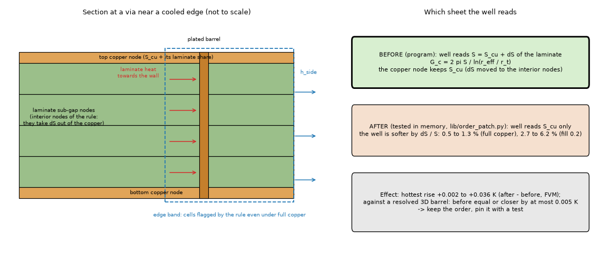
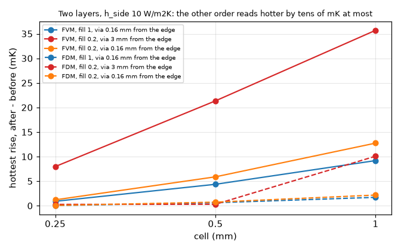

# Via well and the laminate rule: which sheet does the well read?

## 1. Question

*Figure 1 (`fig_01_section_and_order.png`): left, the section of a two-layer board at a via near a cooled edge, with the laminate sub-gap nodes of the rule and the edge band; right, the sheet the well reads in each order and the measured effect.*

`fvm.Network.__init__` calls `viawell.build(..., self.S, ...)` with the sheet conductance of the copper nodes BEFORE `_add_ladder` (`laminate.build`) moves the laminate of the
interior sub-gap nodes out of them; the plane node the via is attached to carries the REDUCED sheet. `fdm.py` does the same on purpose ("as in the FVM"). Since 2.6.0 the edge band
flags every cell near an edge, even over full copper. Is the mismatch (a) intended and right, (b) an inconsistency with a measurable effect, (c) hidden by the laminate nodes?
(Finding 3 of the independent review of 2.7.0.) The program was not edited: `lib/order_patch.py` makes the wells read the sheet after the rule, in memory, in the FVM order
(wells first, refilled in place) and in the FDM order (rule first).

## 2. Size of the mismatch (measured, `tests/test_order_pin.py`)

Ratio of the sheet the well reads to the sheet the node keeps, in the cells flagged by the rule: 1.0127 (2 layers, full copper), 1.0054 (4 layers), 1.062 (2 layers, fill 0.2),
1.027 (4 layers, fill 0.2). The review quoted 3.7 % and 15 to 20 %; on this board (35 um, 1.6 mm, four sub-gaps at most) it is 0.5 to 1.3 % and 2.7 to 6.2 %.

## 3. Effect on the program (`scripts/study_order_program.py`, 192 FVM cases, 32 FDM)

Board: 10 x 10 mm, 2 and 4 layers, fill 1 and 0.2, h_side 10 and 200 W/m2K, one via or a 2 x 2 block at d = 0.16, 0.5, 1, 3 mm from the edge, cells 1, 0.5, 0.25 mm. The
"after" order always reads HOTTER (the well is softer).

| layers | fill | max shift of the hottest rise, FVM | % of the rise | % of the via effect E | FDM max shift |
| --: | --: | --: | --: | --: | --: |
| 2 | 1 | 0.013 K | 0.025 | 0.33 | 0.003 K |
| 2 | 0.2 | 0.036 K | 0.044 | 2.8 | 0.005 K |
| 4 | 1 | 0.002 K | 0.004 | 0.07 | 0.0006 K |
| 4 | 0.2 | 0.010 K | 0.013 | 0.7 | 0.002 K |

*Figure 2 (`fig_02_order_shift_vs_cell.png`): hottest rise with the sheet read after the rule minus before, two layers, h_side 10 W/m2K, FVM (solid) and FDM (dashed), against the cell.*

The largest is a 2-layer hatched board at 1 mm cell; it falls with the cell (0.036, 0.021, 0.008 K at 1, 0.5, 0.25 mm). h_side 200 halves it. Interior vias (outside the band, fill 1): identical.
The effect is small because the well is a log term in a chain dominated by the barrel and the plane spreading: a 1.3 % stiffer well moves E by 0.3 %.

## 4. Against the resolved 3D reference (`lib/ref3d_via.py`, `scripts/study_order_reference.py`)

An independent 3D finite-volume solver (half board, barrel drawn at real size as an area mixture, real laminate sub-slabs, films on faces and sides, 1/16 mm, imports nothing from
the program; without the via and the film the rise agrees with the program's FVM at 0.25 mm to 0.08 %, E to 0.7 %; 1/8 against 1/16 mm: T0 changes by 0.0001 K at h_side 10, but by 0.024 K
(2 layers) and 0.059 K (4 layers) at h_side 200 (review, section 8: the earlier text quoted only the h_side 10 figure), E by 0.2 %). The solver uses the `pyamg` preconditioner when it is installed
(it is not in `requirements.txt`); without it it falls back to the sparse LU (same numbers, about 2 GB per two-layer row at 1/16 mm).
Full copper, one via, 2 and 4 layers, h_side 10 and 200, d = 0.16 to 3 mm, cells 0.5 and 0.25 mm (32 rows):

* error of the hottest rise: before and after differ by at most 0.008 K (0.01 to 0.02 % of the rise, at 0.5 mm; equal to 0.002 K at 0.25 mm). At h_side 10 both are within 0.05 % of
  the rise; at 200 both are 0.6 to 1.3 % cool (the laminate/edge residual of `laminate-edge-band`, not the well: identical in both orders).
* error of E: after is equal or worse by 0.0 to 0.35 points of E (e.g. -1.52 % to -1.67 %, -1.07 to -1.22 %); never better. At 0.25 mm the two agree within 0.06 points.

So on full copper the BEFORE order (today) is equal or marginally closer, and the difference is 0.005 K at most, far below the residual against the reference. Hatched rows
(fill 0.25 as real stripes in the 3D) are not usable: the smeared fill of the program is 58 to 64 % off the stripes for the idealisation, 100 K, 20 times anything the order does
(the order shifts them by at most 0.01 K); stated, not a finding. A hatched board therefore has NO independent reference here that can decide an effect of 0.036 K.

## 5. Frozen numbers (`scripts/study_order_frozen.py`, 17 harness boards, FVM and FDM, 2 and 1 mm)

Of 68 hottest-temperature values one moves: `example_cut_to_T` at 2 mm, FVM and FDM, +0.00088 K. Via boards without an edge film or partial copper (the example, plate vias, lone via) do not
move at all, because no cell is flagged. The records of the other quantities (via-board means, Lumped, times) were not run; they are the same quantity at the same wells.

## 6. Why the FDM reads before

The comment in `fdm.py` says only "as in the FVM": there is no independent rationale. The FDM shift is 3 to 6 times smaller than the FVM's (nodes on the edge, no film on the laminate nodes).

## 7. Reading (answer)

(a)/(c): intended and defensible, and the effect is negligible. The barrel is in contact with the whole laminate thickness of the layer (the plated wall runs through the sub-gaps), so
the heat that the laminate carries sideways into the barrel wall belongs to the well; the interior laminate nodes have no well of their own. Reading the sheet before the rule credits that
share to the well; the reduced sheet would drop it. Measured: before is equal or closer to the 3D reference, by at most 0.005 K. Not a defect of consequence.

## 8. Review

Independent review of this folder (re-run on the research branch with `develop` merged in; the program is not edited).

* **Code read against the claim.** `fvm.Network.__init__` calls `viawell.build(..., self.S, ...)` (fvm.py 237) before `_add_ladder` (277), and `fdm.py` keeps `via_S = S` before
  replacing `S` by the rule's sheet (fdm.py 191 to 194, used at 247 and for the imported-copper faces at 228). The question is stated right.
* **Re-run.** `tests/test_order_pin.py`: 2 passed. `study_order_program.py --layers 2 --fills 0.2 --h 10`: the worst row (+0.0357 K, +0.044 % of the rise, 2.77 % of E) reproduced
  to the digit. `study_order_reference.py --fills 1` (32 rows): byte-identical to `out/ref_fvm.md`. `study_order_frozen.py`: byte-identical to `out/frozen.md` (only `example_cut_to_T`
  at 2 mm moves, +0.00088 K in the FVM and the FDM).
* **Corrected.** The convergence of the 3D reference was quoted only at h_side 10. At h_side 200 the reference without a via is 39.656 / 39.633 K (2 layers, 1/8 and 1/16 mm) and
  37.080 / 37.021 K (4 layers): the reference moves 0.06 to 0.15 % of the rise between the two grids, still far below the residual of the program at that film. The order question is
  not affected (the two orders are compared on the same reference row). The study could not be re-run without `pyamg` (not in the project environment); the solver now falls back to the LU.
* **An observation that is not this folder's question.** At h_side 200, without a via, the program moves AWAY from the reference as the cell shrinks: FVM 39.67 / 39.31 / 39.17 /
  39.12 K at 1 / 0.5 / 0.25 / 0.125 mm and FDM 38.57 / 38.92 / 39.05 / 39.09 K, against 39.63 K (2 layers; 4 layers FVM 36.34 K at 0.125 mm against 37.02 K, -1.8 %). Both models
  converge to the same value, about 1.3 % (2 layers) and 1.8 % (4 layers) of the rise cooler than the resolved solid: the FVM at 1 mm is close only by a cancellation. This is the residual
  of the layered model at a strongly cooled edge (`research/laminate-edge-band`, `research/strong-edge-laminate`), identical in both orders; it is recorded here, not studied.
* **The argument of section 7 is weaker than the measurement.** The interior laminate nodes in the footprint still conduct sideways and reach the wells through the copper nodes, so
  reading the sheet before the rule may count part of the laminate twice rather than credit a missing path; the split was not computed. What decides is the measurement: on full copper
  the order before the rule is equal to or closer to the resolved barrel (by at most 0.005 K), and the other order moves the program by at most 0.036 K. The sentence proposed for
  `docs/theory.md` 2.6 (`INTEGRATION.md`) is rewritten to rest on the measurement.
* **Not verified.** Hatched boards against a reference that represents the smeared fill (none exists here); imported copper (the FDM uses the same `via_S` for its imported faces);
  the Lumped and Analytic (no wells of this kind); transient and profile records.

**Verdict: GO.** Keep the order, adopt the pin test and the theory sentence of `INTEGRATION.md` on a `fix/` branch (documents and one test; no number moves).

## What was read and what was not verified

Code read: `fvm.py` 195 to 360, `fdm.py` 160 to 250, `laminate.py` build, `viawell.py` build, `docs/theory.md` 1.4 and 2.6 headings. No literature opened (none needed). The 3D reference was
checked against the program (above) and by its own energy-balance in the solver; it has no stand-alone test of a series circuit (not written). Not done: hatched boards against a resolved
reference that represents the smeared fill; 3 mm via at cell 0.25 in the FDM; imported copper; the Lumped and Analytic (no wells of this kind); times to 63 % and profile records.
The "theory" justification of section 7 is an argument, not a computed split of the laminate flux into the barrel.
