# Young's omega for the SOR (S3) and a tile rule for the Analytic via correction (S4)

**Status: reviewed (one round); the decisions are the maintainer's.** Every number below is copied from the output of the scripts of `scripts/` (run on this machine; the Markdown they print is in the git-ignored `out/`). Nothing was changed in the program: the proposals are in `INTEGRATION.md` with their measured impact. The review re-ran the light studies, compared every quoted number with the printed tables, corrected six statements of the first version (marked where they are), diagnosed the 0.45 mm failure, and added two studies: the block SOR on nine more boards (2.6b) and twenty boards kept apart from the choice of the tile rule and the Lumped cap (3.9, 3.10).

*(audit 2.6.1: S3 and S4 are in the program since 2.4.5, `fix/sor-omega` and `fix/via-constriction`; 'Nothing was changed in the program' in the next sentence is the status when written. The S4 scripts that patch the old Analytic are obsolete, see 'Status of the scripts on the 2.5.0 candidate' at the end.)*

**Summary.** S3: the Rayleigh bound of the Jacobi radius (one product with K, restricted to the linked nodes) gives an omega on the safe side of Young's optimum on every board tested, 2.8 to 11 times fewer sweeps than the program's formula on the ten boards of the program (2.8 on the example board), and meets the decision rule written before the runs; Lanczos, the power method and the adaptive estimate are not worth their cost; for the block SOR with the mean-potential via couplings the same bound must be taken on the full K (twelve boards, 2.8 to 19.7 times fewer sweeps, 0 to 11 % above the best, stable up to omega 1.999). S4: with a tile equal to `min(1 mm, 0.75 d_nn)` (d_nn the nearest-neighbour distance of the vias, floor 0.25 mm) the Analytic via correction stays within 3.0 % (simple boards), 1.8 % (dense boards) and 4.2 % (4 to 576 vias) of the via effect of the fine-grid reference; the number of modes of G needs no rule; on twenty boards kept apart the rule is within 1.1 % on every pad and array (pitch 0.45 to 3.5 mm, where a fixed 1 mm tile is 6 to 10 % off below 0.6 mm) and 7.7 % on a lone via inside the footprint. The Lumped well has no cheap fix for a lone via (limit and warning); the macro cap of 0.75 cuts the largest array error from 53.8 to 18.8 % but raises some errors of the arrays at pitch 1.0 and of a held-out 4 x 4 array (to +12.1 %).

## 0. Questions

**S3 (Young's omega of the SOR).** `research/sor-with-via-couplings` found that the relaxation factor of the board without vias is 1.9613 against 1.8609 from the program's formula
`2 / (1 + sin(pi / n))` on the 3 x 3 array board, 6.0 times fewer sweeps, but it computed `rho_J` with an eigenvalue solver. Is there an estimate of the Jacobi spectral radius that is cheap
compared with the solve and robust on boards with vias, partial copper, outlines and many layers (power iteration, a few Lanczos steps, a closed form with the layer and via terms, a measured
fit, the decay of the SOR itself)? **Stop rule:** if the estimate needs a factorisation or as many matrix products as the solve costs, the item is dropped (the direct solver is the default and
SOR is a comparison solver; a change is recommended only if clearly worth it).

**S4 (tile of the Analytic via correction; the Lumped well).** `research/lumped-analytic-vias` proposed the self-term of the tile Green function with 1 mm tiles around vias (within 4 % everywhere
tested) but the result is sensitive to the tile (1.5 mm up to -40 %, 2 mm +21 %) and `G` is built from `min(M, 64)` modes (`M >= 2W/tile` is needed on large boards). Which automatic rule
for the tile (a function of the via radius, pitch, cell and board size) keeps the error small, where does it break, what does it cost in unknowns, and what of the Lumped well (the Krogh well per
plane; the known limits: a lone via or a row outside the footprint, 9 to 31 % of a small effect and ring dependent; dense arrays of open barrels 8 to 24 % under) can be fixed cheaply and what stays
a limit with a warning?

## 1. Situation (drawings)

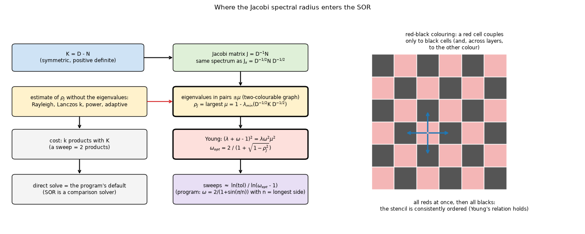

*Figure 01, `fig_01_jacobi_and_sor_iteration.png`: left, the chain from K to the sweeps (where `rho_J` enters, where the estimate sits and what it costs); right, the red-black colouring of the stencil.*

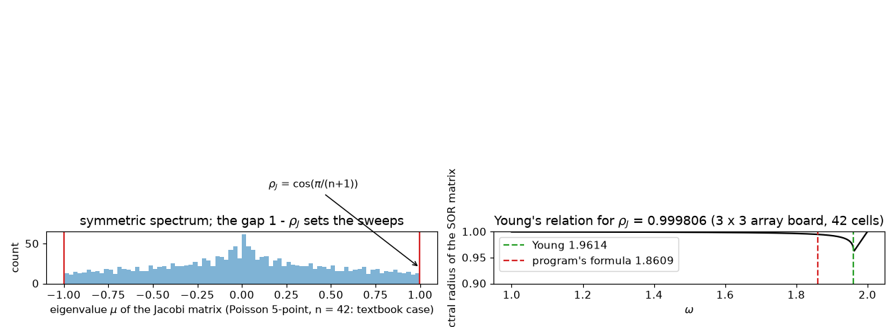

*Figure 02, `fig_02_spectrum_and_omega_curve.png`: left, the symmetric spectrum of the Jacobi matrix of the textbook plate (n = 42); right, the SOR radius against omega from Young's relation with `rho_J` = 0.999806 (README of `sor-with-via-couplings` 8.3), with the program's omega and Young's.*

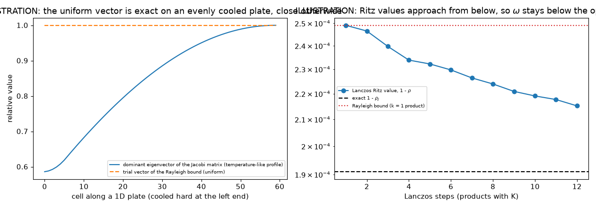

*Figure 03, `fig_03_rayleigh_and_lanczos_picture.png`: ILLUSTRATION on a 1D chain: the uniform trial vector against the dominant eigenvector of an unevenly cooled plate, and the Ritz values rising from below.*

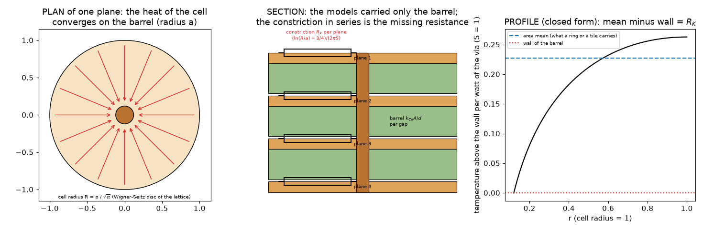

*Figure 04, `fig_04_via_lattice_cell_constriction.png`: the cell of a via lattice: heat converging on the barrel in a plane, the section with the constriction in series with the barrel, and the closed-form profile.*

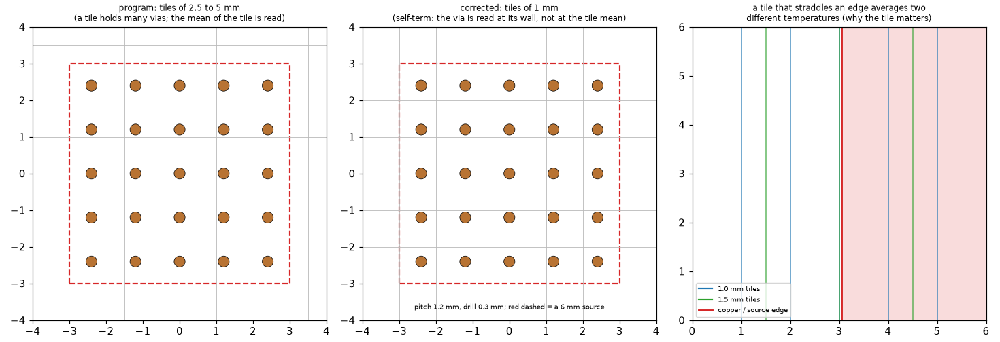

*Figure 05, `fig_05_tile_grid_over_a_via_array.png`: a 5 x 5 array under the program's tiles and under 1 mm tiles; right, a source edge on a tile line and across a tile.*

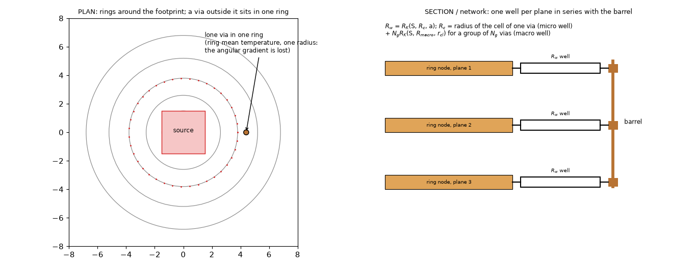

*Figure 06, `fig_06_krogh_well_in_the_lumped_rings.png`: the rings of the Lumped model, a lone via outside the footprint in one ring, and the well per plane in series with the barrel.*

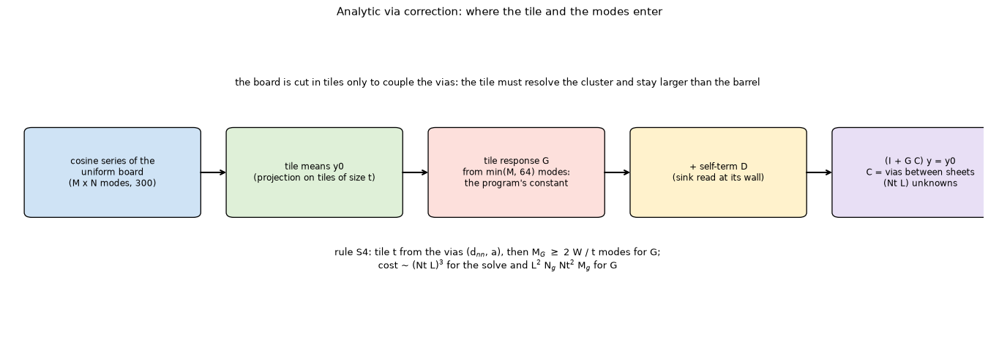

*Figure 07, `fig_07_tile_green_function_chain.png`: the chain of the Analytic correction and where the tile and the 64 modes act.*

The formulas are in `docs/theory-text.md`.

## 2. S3 results: Young's omega

Tables are the scripts' output, shortened to the columns that carry the argument (the full printed tables are reproduced by the commands of section 6).

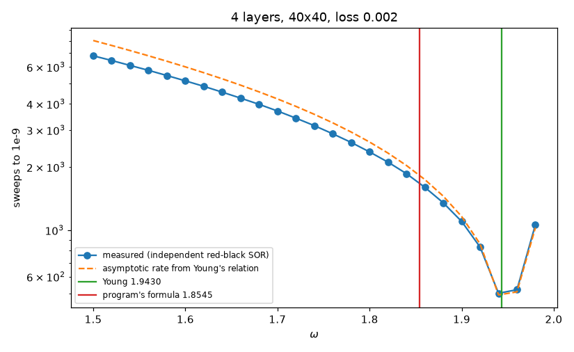

*Figure 08, `fig_08_sweeps_against_omega.png`: measured sweeps of an independent red-black SOR against omega on a 4-layer plate, the asymptotic rate from Young's relation, the program's omega and Young's.*

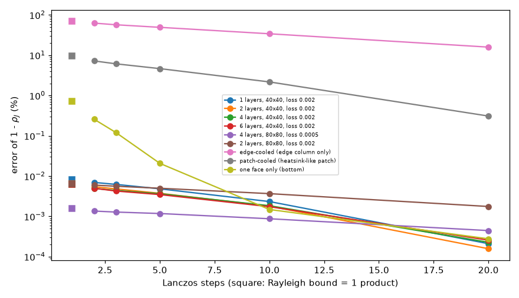

*Figure 09, `fig_09_lanczos_error_against_steps.png`: error of 1 - rho_J of Rayleigh and Lanczos against the steps, even and uneven losses.*

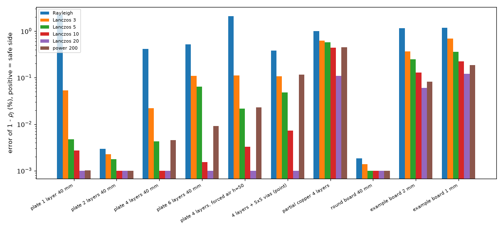

*Figure 10, `fig_10_estimate_error_against_board_type.png`: error of every estimate on the boards of the program.*

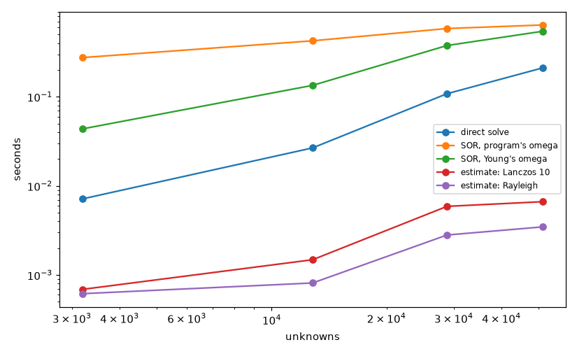

*Figure 11, `fig_11_cost_of_the_estimate.png`: seconds of the estimate against the solve and the sweeps, with the grid.*

**2.1 Textbook case** (`study_s3_exact.py` A). Poisson matrix, fixed edges, n = 6, 8, 10, 12: the eigenvalues give `rho_J = cos(pi/(n+1))` (0.900969, 0.939693, 0.959493, 0.970942), Young's `omega_opt` = 1.3948, 1.4903, 1.5604, 1.6138
equals `2/(1+sin(pi/(n+1)))` to four digits, and the dense SOR iteration matrix at n = 8 has radius 0.490291 at 1.4903 and 0.883022 / 0.822946 / 0.703189 / 0.500000 / 0.700000 / 0.900000 at omega 1.0 / 1.2 / 1.4 / 1.5 / 1.7 / 1.9, identical to
Young's relation to six digits (the dense matrix uses nothing of the relation). The program's formula `2/(1+sin(pi/n))` is that optimum for a plate with *fixed edges* and the node count as n (1.3333 against 1.3948 at n = 6): a plate that loses heat only at its edges. A cooled
board has `rho_J` set by its loss `a`, so the formula is below the optimum, on the safe side but slow (section 2.4).

**2.2 Exact cases** (B). Periodic plate with uniform loss: `rho_J = 4g/(4g+a)` agrees with the eigenvalues to 8 digits on four tori (0.97560976 at 16 x 16, a = 0.1, to 0.99997500 at 64 x 64, a = 1e-4) and the Rayleigh bound with one product is
exact there (the trial vector is the eigenvector); `omega_opt` 1.64000 to 1.98596.

**2.3 Plates of the program's stencil** (C, relative error of 1 - rho_J, positive = safe side):

| plate | Rayleigh | Lanczos 3 | Lanczos 10 | Lanczos 20 | power 200 |
| :-- | --: | --: | --: | --: | --: |
| 1 to 6 layers, even loss | +0.01 % | +0.00 to +0.01 % | +0.00 % | +0.00 % | +0.00 % |
| one face only | +0.72 % | +0.12 % | +0.00 % | +0.00 % | +0.00 % |
| patch-cooled (heatsink-like) | +9.45 % | +6.11 % | +2.17 % | +0.31 % | +1.43 % |
| edge-cooled (edge column only) | +70.25 % | +56.93 % | +34.05 % | +15.88 % | +29.01 % |

Where the loss is not uniform the uniform trial vector is a poor eigenvector and every estimate converges slowly; it never overshoots (it is a Rayleigh quotient, a lower bound, for a matrix with non-negative entries). The power method on `J_s` itself oscillates in sign
(the spectrum is symmetric): 200 products gave an estimate of rho_J of +0.242 and 800 gave -0.832 on the 4-layer plate (the estimates, not errors as the first version said; exact 0.999570), the iteration on `(I + J_s)/2` reaches 0.997831 after 800 products; Lanczos with a random start 0.997918 after 50. So the power method needs
hundreds of products and a shifted matrix; it is not proposed.

**2.4 Sweeps against omega** (D, the same plates, independent red-black SOR, tol 1e-9): program 710 to 3380 sweeps against 390 to 820 at Young's omega (1.8 times on the 80 x 80 two-layer plate, whose program omega is already 1.9244, 3.7 to 4.1 times on the others; the first version of this README said "1450 to 3380, 3.7 to 4.1 times" and left that row out), equal for Rayleigh on the even-loss plates; on the uneven plates program / Young / Rayleigh / Lanczos 8 =
4650 / 690 / 1250 / 1070 (edge-cooled) and 11650 / 1100 / 1330 / 1200 (patch-cooled): the Rayleigh estimate needs 1.2 to 1.8 times the sweeps of Young's optimum there but still 3.7 and 8.8 times fewer than the program's.

**2.5 The boards of the program** (`study_s3_boards.py` part 1; the point treatment of the vias, pure stencil; tolerance 1e-9; sweeps at the program's omega, Young's exact omega, Rayleigh, Lanczos 10, the adaptive one and the measured best):

| board | cell mm | N | rho_J | program | Young exact | Rayleigh | Lanczos 10 | adaptive | measured best |
| :-- | --: | --: | --: | --: | --: | --: | --: | --: | --: |
| plate 1 layer 40 mm | 1.0 | 4800 | 0.999650 | 2362 | 505 | 541 | 505 | 570 | 463 |
| plate 2 layers | 1.0 | 3200 | 0.999814 | 4425 | 692 | 692 | 692 | 900 | 670 |
| plate 4 layers | 1.0 | 6400 | 0.999908 | 8845 | 983 | 998 | 983 | 1480 | 915 |
| plate 6 layers | 1.0 | 9600 | 0.999939 | 13359 | 1212 | 1236 | 1212 | 1260 | 1209 |
| plate 4 layers, forced air h = 50 | 1.0 | 6400 | 0.999546 | 1748 | 429 | 457 | 429 | 470 | 392 |
| 4 layers + 5 x 5 vias (point) | 0.5 | 25600 | 0.999977 | 18392 | 2024 | 2054 | 2024 | 2010 | 1777 |
| partial copper 4 layers | 1.0 | 6400 | 0.999876 | 6623 | 848 | 877 | 862 | 1250 | 811 |
| round board 40 mm | 1.0 | 3200 | 0.999814 | 4460 | 696 | 696 | 696 | 920 | 674 |
| example board 2 mm | 2.0 | 8000 | 0.999466 | 1149 | 390 | 406 | 392 | 410 | 363 |
| example board 1 mm | 1.0 | 32000 | 0.999860 | 2247 | 781 | 812 | 787 | 790 | 728 |

(Re-run by the review on develop after `fix/board-cover-8x8`, `--quick`: every row identical except the round board, whose cover of the edge cells moved: program 4460 sweeps (the table) instead of 4459, Young / Rayleigh unchanged at 696, "Rayleigh all nodes" +434 465 % instead of +436 641 %.) The Rayleigh bound needs 2.8 (example board) to 11 (6 layers) times fewer sweeps than the program's formula and needs 0 to 7 % more sweeps than the exact Young's. Error of 1 - rho_J of the Rayleigh bound on these boards: +0.00 % (2 layers, round board) to +2.26 % (1 layer), +1.16 / +1.17 % on the example board; every entry non-negative (safe side). Lanczos 10 brings it to +0.00 to +0.44 % (+0.13 / +0.22 % on the example), which saves 0 to 7 % of the sweeps and costs 10 products (5 sweeps' worth by
the two-product count of the script). The omega of the adaptive estimate (from the decay of the SOR iteration itself) is above the optimum on several boards (for example 1.9757 against 1.9621 on the 2-layer plate, 900 against 692 sweeps) and is better than Rayleigh by at most 2.7 % (2010 against 2054 sweeps on the 5 x 5 board, 790 against 812 on the example board at 1 mm; the first version said 1 %): not proposed.

**Defect found in this study and fixed.** The first Rayleigh bound summed over every node. On the round board the cells off the outline are pinned to the ambient and decoupled (no link), so they are eigenvectors with mu = 0 and dilute the quotient: the error of 1 - rho_J was +436 641 % and omega 1.009. `young.rho_rayleigh` now sums
only the nodes with a link (`linked_only=True`); the column "Rayleigh all nodes" of the study keeps the old behaviour for comparison and `test_rayleigh_ignores_decoupled_nodes` fails on the old code. The same applies to the closed form from the totals (`g_amb.sum()` and the diagonal sum): it collapses on a board with an outline (the same +436 641 % in the printed table), so the proposal uses the masked
Rayleigh product, not the totals.

**2.6 With the mean-potential vias, block SOR** (`study_s3_boards.py` part 2, the block SOR of `sor-with-via-couplings`). The stencil part of K has `rho_J` of 0.999452 / 0.999652 / 0.999787 on the 3 x 3 array, the 5 x 5 array and the example board, but the full K has 0.999977 / 0.999977 / 0.999860 (the via couplings make the
board much stiffer to iterate): an omega from the stencil part is far from the optimum. Omega / sweeps:

| board | program | Young (stencil) | Lanczos 10 (stencil) | Young (full K) | Lanczos 10 (full K) | Rayleigh (full K) | measured best |
| :-- | --: | --: | --: | --: | --: | --: | --: |
| 3 x 3 array, 0.5 mm | 1.8609 / 34530 | 1.9359 / 15730 | 1.9337 / 16290 | 1.9864 / 1960 | 1.9864 / 1970 | 1.9864 / 2010 | 1.9866 / 1960 |
| 5 x 5 array pitch 1.2, 0.5 mm | 1.9005 / 23810 | 1.9486 / 12250 | 1.9347 / 15600 | 1.9865 / 1890 | 1.9865 / 1890 | 1.9865 / 1940 | 1.9871 / 1940 |
| example board 1 mm | 1.9391 / 2250 | 1.9596 / 1320 | 1.9546 / 1560 | 1.9671 / 780 | 1.9670 / 790 | 1.9669 / 810 | 1.9694 / 740 |

With the Rayleigh bound of the **full** K the block SOR needs 17.2, 12.3 and 2.8 times fewer sweeps than the program's formula, and at most 9.5 % more than the measured best (2010 against 1960, 1940 against 1940, 810 against 740). The full K has positive entries inside a footprint, so its Jacobi matrix is not non-negative and Young's relation is not guaranteed there: this rests on three boards
only (the measured sweeps decide, not the theory), and the proposal must be checked on more boards when the block SOR is implemented.

**2.6b Nine more boards (review, `study_s3_block_more.py`).** The same block SOR (c'), the mean-potential treatment, 0.5 mm cells (2 mm on the example board), tol 1e-9; both ends of the spectrum of `J_s` of the full K by eigenvalues (with positive entries in K the largest modulus could sit at the negative end; it does not on any board); omega / sweeps:

| board | N | lambda_max / lambda_min of J_s | program | Rayleigh (full K) | Young (exact, full K) | measured best | sweeps at omega 1.995 / 1.999 |
| :-- | --: | --: | --: | --: | --: | --: | --: |
| lone via under the source, 2 layers | 3200 | 0.999953 / -0.999894 | 1.8545 / 17820 | 1.9809 / 1420 | 1.9809 / 1420 | 1.9824 / 1410 | 4540 / 22600 |
| 2 x 2 pitch 2.0, 4 layers | 6400 | 0.999977 / -0.999618 | 1.8545 / 35280 | 1.9864 / 2010 | 1.9864 / 1980 | 1.9864 / 1980 | 4650 / 22710 |
| 4 x 4 pitch 1.0, 4 layers | 6400 | 0.999977 / -0.999318 | 1.8545 / 34730 | 1.9864 / 1760 | 1.9864 / 1640 | 1.9864 / 1640 | 4610 / 22290 |
| 3 x 3 pitch 2.5, 6 layers | 13824 | 0.999985 / -0.999476 | 1.8772 / 44810 | 1.9889 / 2470 | 1.9889 / 2420 | 1.9889 / 2420 | 4690 / 22540 |
| 3 x 3 pitch 3.5, open barrels, 4 layers | 7056 | 0.999977 / -0.999431 | 1.8609 / 34530 | 1.9864 / 2010 | 1.9864 / 1970 | 1.9864 / 1970 | 4650 / 22870 |
| 3 x 3 pitch 2.0 beside the source, 2 layers | 4608 | 0.999953 / -0.999734 | 1.8772 / 14790 | 1.9809 / 1370 | 1.9809 / 1370 | 1.9809 / 1370 | 4530 / 22710 |
| round board 30 mm, 3 x 3 pitch 2.0, 2 layers | 7200 | 0.999954 / -0.999745 | 1.9005 / 12180 | 1.9809 / 1400 | 1.9809 / 1400 | 1.9809 / 1400 | 4540 / 22470 |
| forced air h = 50, 3 x 3 pitch 2.0, 4 layers | 6400 | 0.999885 / -0.999221 | 1.8545 / 7110 | 1.9698 / 910 | 1.9701 / 840 | 1.9701 / 840 | 4570 / 22270 |
| example board 2 mm | 8000 | 0.999466 / -0.999240 | 1.8818 / 1150 | 1.9364 / 410 | 1.9367 / 390 | 1.9414 / 370 | 4420 / 21920 |

On these nine boards the omega from the masked Rayleigh bound of the full K is at or below the measured best every time, needs 0 to 11 % more sweeps than the best (1420 against 1410 to 410 against 370) and 2.8 (example board) to 19.7 (4 x 4 at 1.0 mm) times fewer than the program's formula; with the three boards of 2.6 that is twelve boards. **Stability:** the block SOR converged at omega 1.995 and 1.999 on every board (4420 to 4690 and 21920 to 22870 sweeps); the residual first grows, by up to 62 times, then falls. That is what the theory predicts for a block SOR of a symmetric positive definite matrix whose diagonal blocks are solved exactly (convergence for every 0 < omega < 2: Saad 2003 Theorem 4.10 for the point form, read; the block form through Varga 1962 Theorem 3.6, known from a summary, status S), and the Rayleigh omega is below 2 by construction (`1 - rho` is the Rayleigh quotient of a positive definite matrix, so `rho < 1`). An omega from the stencil part of K (2.6) is the one to avoid: it is on the safe side too but 6.3 and 7.8 times slower than the full K on the two arrays of 2.6 (1.6 times on the example board).

**2.7 Cost** (part 3, 2-layer plate, tol 1e-9; seconds on this machine):

| grid | N | omega_opt | sweeps program / Young | Rayleigh s | Lanczos 10 s | direct s | SOR with Young s |
| :-- | --: | --: | --: | --: | --: | --: | --: |
| 40 x 40 x 2 | 3200 | 1.9621 | 4425 / 692 | 0.0006 | 0.001 | 0.007 | 0.04 |
| 80 x 80 x 2 | 12800 | 1.9624 | 2143 / 678 | 0.0008 | 0.001 | 0.027 | 0.13 |
| 120 x 120 x 2 | 28800 | 1.9624 | 1304 / 668 | 0.0028 | 0.006 | 0.109 | 0.38 |
| 160 x 160 x 2 | 51200 | 1.9625 | 751 / 661 | 0.0035 | 0.007 | 0.211 | 0.54 |

On the ten boards the Rayleigh bound takes 0.0004 to 0.0017 s (one product; under 1 % of the SOR seconds it saves, 0.1 to 6 s). The program's formula gets closer to the optimum as the grid refines (its `n` grows while `rho_J` of a plate with a fixed loss stays at 0.99982): the gain
is 6.3 times at 40 x 40 and 1.2 at 160 x 160. The direct solve is faster than the SOR with Young's omega on every board (0.147 s against 0.72 s on the 5 x 5 board), which is the reason SOR stays a comparison solver.

**2.8 Decision rule (written before the runs) against the numbers.** (a) lower bound or within 1 % of 1 - rho_J on every board: the Rayleigh bound is a lower bound on every case of 2.3 to 2.6 (met); Lanczos 10 is within 0.44 % on the boards of the program. (b) cost under 5 % of the sweeps it saves: under 1 % (met). (c) SOR no slower than the program's on every
board: 10 of 10 boards, the plates of 2.4, the 160 x 160 plate (Young's; Rayleigh not run on the scaling plates) and the twelve block-SOR boards of 2.6 and 2.6b (met). **The Rayleigh bound with the linked-node mask is the estimate to adopt if the maintainer wants the item; Lanczos, power method and adaptive estimate are dropped.** The result of the solve does not change (the stopping rule is the residual); only the sweeps do.

## 3. S4 results: tile rule and the Lumped well

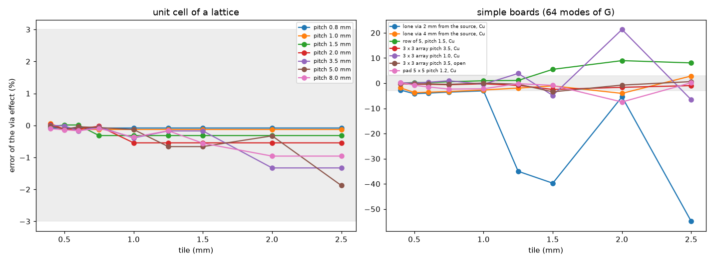

*Figure 12, `fig_12_error_against_the_tile.png`: error of the Analytic via effect against the tile on the unit cells and the simple boards.*

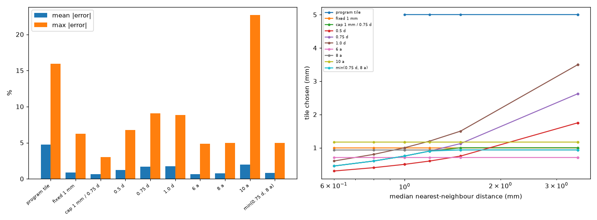

*Figure 13, `fig_13_tile_rules.png`: the tile each rule chooses against the nearest-neighbour distance, and mean / maximum error of every rule.*

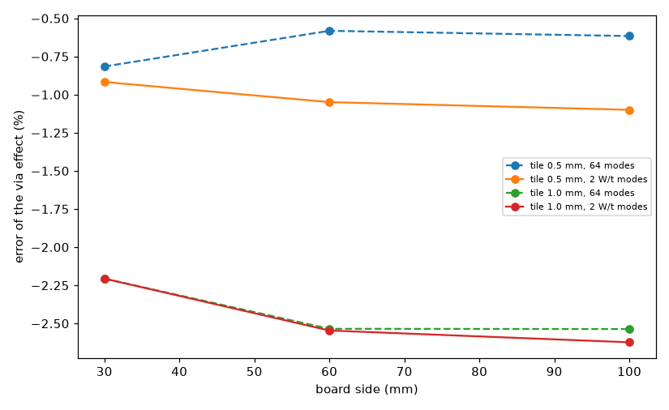

*Figure 14, `fig_14_modes_against_board_size.png`: modes of the tile Green function against the board size.*

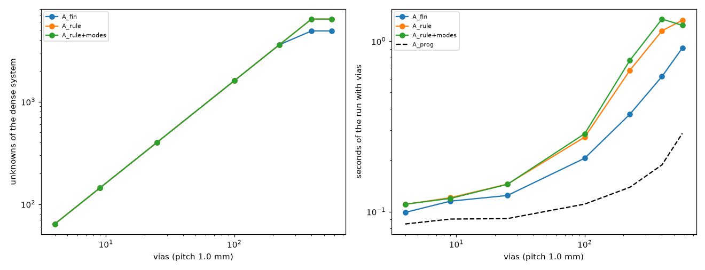

*Figure 15, `fig_15_cost_against_the_number_of_vias.png`: unknowns, seconds and memory of the correction against the number of vias.*

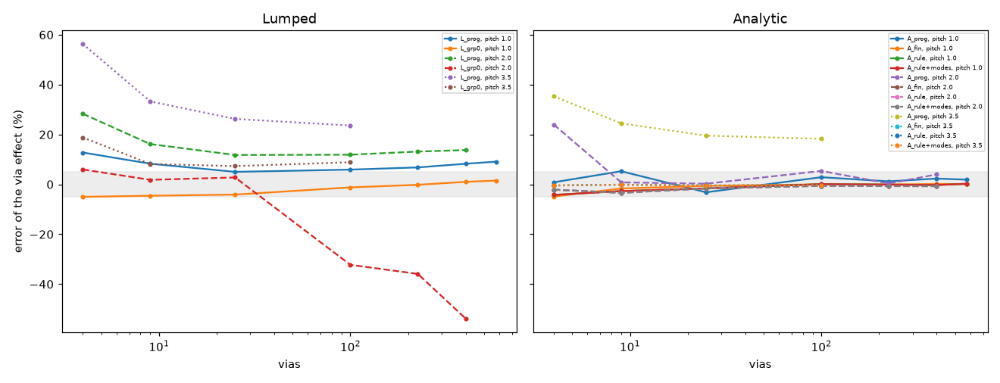

*Figure 16, `fig_16_error_against_the_number_of_vias.png`: error of the via effect against the number of vias, Lumped and Analytic, before and after (grey band: 5 %).*

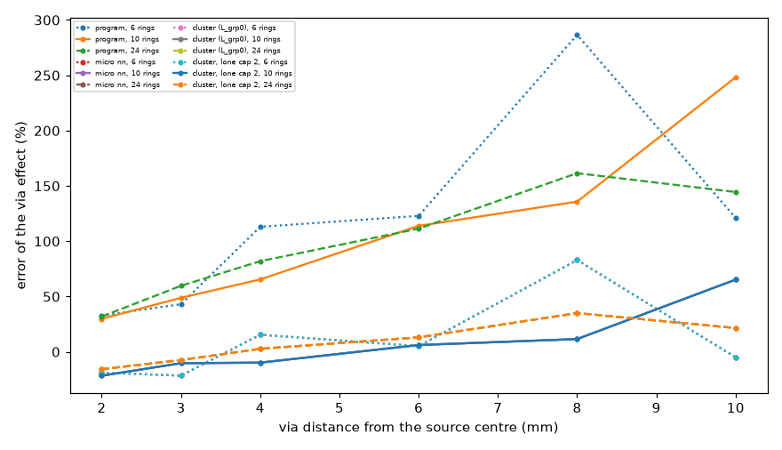

*Figure 17, `fig_17_lumped_lone_via_against_distance_and_rings.png`: Lumped lone via, error against the distance and the number of rings.*

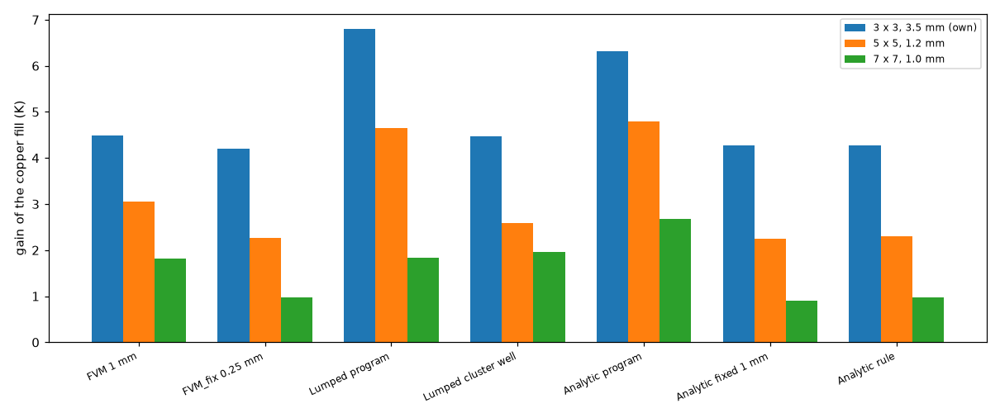

*Figure 18, `fig_18_copper_fill_gain_example_board.png`: copper-fill gain of the example board and its denser arrays in every model.*

The reference is the fine-grid layered solver `resolved_boards.full_board_2d` (barrels drawn at their real size, 1/16 mm grid, 1/8 mm on boards above 60 mm; 0.05 mm on the dense set). "Error" is the error of the *via effect* (the drop of the maximum temperature the vias produce), not of the total.

**3.1 Unit cell** (`study_s4_tile.py` 1; lattice, 2 layers, 0.3 mm drill, copper fill; percent):

| pitch mm | E_ref K | closed form with Krogh wells | Analytic, program | tile 0.5 | tile 1.0 | tile 2.0 | tile 2.5 |
| :-- | --: | --: | --: | --: | --: | --: | --: |
| 0.8 | 7893.87 | +0.0 | +0.2 | -0.1 | -0.1 | -0.1 | -0.1 |
| 1.5 | 2181.09 | +0.1 | +1.4 | +0.0 | -0.3 | -0.3 | -0.3 |
| 3.5 | 329.94 | +0.8 | +1.8 | -0.0 | -0.4 | -1.3 | -1.3 |
| 5.0 | 129.16 | +1.6 | +5.6 | -0.1 | -0.1 | -0.3 | -1.9 |
| 8.0 | 29.97 | +4.1 | +34.9 | -0.1 | -0.4 | -1.0 | -1.0 |

The one-cell closed form (Krogh well in series with the barrel) reproduces the fine grid to 0.0 to 4.1 %; the program's Analytic is 34.9 % off at 8 mm pitch, and every tile of 0.4 to 2.5 mm is within 1.9 % on the lattice (the cell has no source edge to meet).

**3.2 Simple boards** (part 2; 64 modes against 2 per tile: identical within 0.2 points at the tiles shown; at the tile 0.4 mm, not shown, the 2-per-tile series is 2.3 points worse on the lone via):

| board | tile 0.5 | 0.75 | 1.0 | 1.25 | 1.5 | 2.0 | 2.5 |
| :-- | --: | --: | --: | --: | --: | --: | --: |
| lone via 2 mm from the source | -4.2 | -3.6 | -3.0 | -35.0 | -39.7 | -5.4 | -54.9 |
| lone via 4 mm | -3.7 | -3.3 | -2.7 | -1.9 | -1.1 | -4.0 | +2.9 |
| row of 5, pitch 1.5 | +0.3 | +0.6 | +1.0 | +1.1 | +5.5 | +9.0 | +8.1 |
| 3 x 3 pitch 3.5 | -0.4 | -0.6 | -0.2 | -0.9 | -2.5 | -1.6 | -1.0 |
| 3 x 3 pitch 1.0 | +0.0 | +1.0 | -0.4 | +3.9 | -4.9 | +21.3 | -6.6 |
| pad 5 x 5 pitch 1.2 | -0.8 | -2.3 | -2.2 | -0.2 | -0.9 | -7.5 | +0.2 |

("Lone via 2 mm from the source" is 2 mm from the source *centre*, 0.5 mm outside the edge of the 3 mm source; the labels of the scripts keep the short form.) The error jumps with the tile (a source edge falling on a tile line or across a tile, figure 05): -35 % at 1.25 mm and -55 % at 2.5 mm for a lone via 2 mm from the source. A tile of 1 mm or less is within 5 % everywhere; the sensitivity of the earlier review (1.5 mm up to -40 %, 2 mm +21 %) is reproduced.

**3.3 Modes against board size** (part 3; 5 x 5 pad, pitch 1.2 mm; the series needs M = 300, and 408 at 100 mm with 2 modes per tile at the 0.5 mm tile):

| board mm | tile 0.5: 64 modes | 1 W/t | 2 W/t | tile 1.0: 64 modes | 2 W/t |
| :-- | --: | --: | --: | --: | --: |
| 30 | -0.82 | -0.82 | -0.92 | -2.21 | -2.21 |
| 60 | -0.58 | -0.94 | -1.05 | -2.54 | -2.55 |
| 100 | -0.62 | -0.99 | -1.10 | -2.54 | -2.62 |

Going from 64 modes to 2 per tile changes the error by at most 0.5 points (at 100 mm it is slightly worse); the cap of 64 modes of G is not what limits the accuracy on these boards, and no mode rule is proposed (the decision rule asked for an error that more modes remove: there is none).

**3.4 Rules** (`study_s4_rule.py`; mean / maximum absolute error of the via effect, percent; the tile each rule chose is in the printed table):

| rule | simple (16 boards) mean / max | dense (10 boards) mean / max |
| :-- | --: | --: |
| program tile (5 mm), with the self-term and spread | 4.7 / 15.9 | not run |
| fixed 1 mm | 0.8 / 3.0 | 1.0 / 6.3 |
| **cap 1 mm / 0.75 d_nn** | **0.8 / 3.0** | **0.4 / 1.8** |
| 0.5 d_nn | 1.7 / 6.8 | 0.3 / 1.0 |
| 0.75 d_nn | 2.5 / 9.1 | 0.4 / 1.8 |
| 1.0 d_nn | 2.5 / 8.8 | 0.6 / 2.1 |
| 6 a | 0.8 / 4.9 | 0.4 / 1.8 |
| 8 a | 0.9 / 4.9 | 0.6 / 2.6 |
| 10 a | 2.4 / 22.7 | 1.3 / 10.6 |

(The first row is the correction of `lumped-analytic-vias` (self-term and bilinear spread) at the program's own tile, not the program as shipped: the shipped Analytic is the column "Analytic program" of 3.6 and of 3.9. a the drill radius; a multiple of the radius sets the tile with no regard to the pitch; the script's automatic pick by lowest mean over both sets is 6 a, tied at the printed precision with the cap rule, whose maximum is lower on the simple boards: 3.0 against 4.9 %.) The rules that follow the pitch only
(0.5 to 1.0 d_nn) have no cap for a lone via or a wide pitch and fail where the tile grows to 2.6 or 3.5 mm (9.1 and 8.8 %); the fixed 1 mm fails on the dense pad of pitch 0.6 mm (+6.3 %, the tile is larger than the spacing); the cap rule `tile = min(1 mm, 0.75 d_nn)` is the simplest that is at or near the best on both sets. **The floor** (0.25, 0.4 and 0.6 mm, tested with the rule 6 a, tiles 0.47 to 1.87 mm) changes only the drill-0.2 board (tile 0.47 to 0.60 mm, error -0.1 to -0.0 %); the floor of 0.25 mm is a guard, not a tuned value, and was not exercised. **Review note.** The rules differ only where they read the pitch: a unit cell has one via (no neighbour, `d_nn` infinite), so the six unit cells of the dense set and the seven of the simple set get the cap of 1 mm (or the program's tile) under every rule and do not discriminate; the pitch branch of the cap rule (`d_nn` < 1.33 mm) is exercised by five of the 26 boards only (3 x 3 at 1.0, pads at 1.2, 1.0, 0.8 and 0.6 mm; the row at 1.5 mm gets 1.125 mm, capped to 1 mm), and the fixed 1 mm against the rule comes down to the pad at 0.6 mm (+6.3 % against +0.7 %). On those five the rule is better on two (0.6 and 0.8 mm) and worse by 0.5 to 0.9 points on three (in absolute error: 3 x 3 at 1.0 mm 1.0 against 0.4 %, pad 1.2 mm 2.7 against 2.2 %, pad 1.0 mm 1.8 against 0.9 %). Section 3.9 tests it on boards kept apart.

**3.5 Where the rule breaks** (dense set): pitch 0.6 to 1.0 mm with the 0.3 mm drill and drills 0.2 to 0.8 mm at pitch 1.5 stay within 1.8 % (+0.7 to -1.8). A unit cell of pitch 0.45 mm was dropped from the plan after the first quick run failed with a ZeroDivisionError in the reference builder. **Diagnosed by the review:** not the reference solver but `research/point-via-convergence/lib/program_cases.py`, `layer_parameters`, which reads the uniform layer parameters from a program network of 1 mm cells and rounded a board under 0.5 mm to 0 cells (`round(0.45) = 0`; `round(0.5) = 0` too, by rounding to even). Fixed there with at least one cell (the parameters are uniform, the numbers do not change: test `test_reference_parameters_of_a_cell_below_half_a_millimetre`). The unit cells of 0.4, 0.45 and 0.5 mm now run (section 3.9: every variant within 0.05 %), but a unit cell does not test the rule (one via, no pitch); the pads of pitch 0.45 and 0.5 mm in 3.9 do.

**3.6 Many vias and cost** (`study_s4_arrays.py`; full copper, four layers, copper-filled barrels, source over the array; error of the via effect, percent; the rule is the cap rule):

| vias | pitch mm | E_ref K | Analytic program | Analytic fixed 1 mm | Analytic rule | Lumped program | Lumped proposal (cluster) |
| :-- | --: | --: | --: | --: | --: | --: | --: |
| 4 | 2.0 | 22.15 | +24.0 | -2.1 | -2.1 | +28.3 | +6.0 |
| 25 | 2.0 | 19.41 | +0.3 | -1.6 | -1.6 | +11.8 | +2.8 |
| 400 | 2.0 | 16.13 | +4.0 | -0.7 | -0.7 | +13.7 | -53.8 |
| 4 | 1.0 | 30.76 | +0.8 | -4.9 | -4.2 | +12.8 | -5.0 |
| 100 | 1.0 | 33.00 | +2.9 | +0.0 | +0.1 | +5.9 | -1.2 |
| 576 | 1.0 | 45.27 | +1.9 | +0.1 | +0.2 | +9.1 | +1.5 |
| 4 | 3.5 | 13.28 | +35.3 | -0.5 | -0.5 | +56.3 | +18.8 |
| 100 | 3.5 | 6.76 | +18.3 | -0.3 | -0.3 | +23.6 | +8.9 |

All 17 rows are in the script's table. The Analytic with a tile (fixed or rule) is within 4.9 % on every one (maximum 4.9 % fixed, 4.2 % rule), the program's within 35.3 %; the Lumped program is 5.0 to 56.3 % high and the cluster proposal is within 8.9 % except at pitch 2.0 with 100 to 400 vias (-32.3 to -53.8 %) and 4 vias at 3.5 mm
(+18.8 %). Cost of the Analytic correction (tile mm / unknowns of the dense system / seconds / peak MB): 4 vias 1.00 / 64 / 0.24 / 36; 100 vias at 2.0 mm 1.00 / 1600 / 0.59 / 141; 225 vias 1.00 / 3600 / 2.06 / 573; 400 vias at 2.0 mm 1.15 / 6400 / 3.96 / 1029 (the tile grows from 1.00 to 1.15 mm under the program's coarsening of the active tiles);
576 vias at 1.0 mm 1.04 / 6400 / 1.33 / 256 against 1.18 / 4900 / 0.91 / 165 with the fixed 1 mm and 0.29 s for the program's own. The rule costs the same as fixed 1 mm for pitch above 1.33 mm; at pitch 1.0 mm the tile is 0.75 mm, 1.3 to 1.9 times the seconds and up to 2.1 times the memory (for example 225 vias: 0.68 against 0.37 s, 165 against 78 MB).
The dense matrix grows as the square of the unknowns: 1 GB at 6400.

**3.7 The example board** (`study_s4_example.py`; change of the maximum temperature from the open via, K; "FVM 0.25 mm" is the FVM with the mean-potential via treatment of `point-via-convergence` (`FVM_fix` of `lumped-analytic-vias`), not the program's FVM at 0.25 mm; the open-board maximum is 85.81 degC FVM 1 mm, 85.15 degC FVM at 0.25 mm, 83.54 Lumped, 84.69 Analytic, 85.22 Analytic with the tile):

| row | FVM 1 mm | FVM 0.25 mm | Lumped program | Lumped cluster | Analytic program | Analytic fixed 1 mm | Analytic rule |
| :-- | --: | --: | --: | --: | --: | --: | --: |
| conductive paste | -0.20 | -0.19 | -0.28 | -0.20 | -0.25 | -0.19 | -0.19 |
| copper | -4.49 | -4.20 | -6.79 | -4.47 | -6.32 | -4.27 | -4.27 |
| no vias | +8.86 | +9.57 | +11.15 | +9.25 | +10.02 | +9.50 | +9.50 |

The copper-fill gain of the program's Lumped and Analytic (6.79 and 6.32 K) falls to 4.47 and 4.27 K, within 0.27 K of the FVM at 0.25 mm (4.20 K); the rule and the fixed tile give the same number here (the pitch is 3.5 mm, the tile 1 mm). Denser arrays on the example board (gain / open effect, K): 5 x 5 at 1.2 mm
FVM at 0.25 mm 2.27 / 18.24, Analytic rule 2.30 / 18.35, Analytic program 4.78 / 16.24, Lumped cluster 2.59 / 12.81 (the Lumped proposal underestimates the open effect by 30 %); 7 x 7 at 1.0 mm 0.97 / 21.32, Analytic rule 0.97 / 21.16, Lumped cluster 1.96 / 16.22 (24 % under). The FVM at the program's 1 mm cell over-states the gain of a dense array by 34 to 87 %
(3.05 against 2.27 K and 1.81 against 0.97 K): the cause is not established here (the vias are point sinks at that cell; see `point-via-convergence`), and nothing is corrected.

**3.8 The Lumped well** (`study_s4_lumped.py`; error of the via effect, percent). Lone via (3 mm source, 30 mm board, copper fill): the program is +29.8 to +286.6 % high; the proposed cluster well is -21.6 to +65.3 % at 10 rings and depends on the ring count at the same distance (for example at 4.0 mm: +15.5, -9.8, +6.4, +2.7 for 6, 10, 16, 24 rings; at 10 mm: -5.0, +65.3, +51.0, +21.5).
The micro ring, micro nn and the zones variant of `lumped-via-groups` give the **same number** as the cluster at every distance and ring count, and the lone caps 1, 2 and 3 differ by at most 6 points (at 6 rings, 6 to 10 mm): a lone via contributes at most 3.5 % of the source rise from 3 mm on (0.4 % at 10 mm), so the model error shows up only as a ring artefact. Distance of the via from the footprint edge: error +0.1 % at 0 mm (inside the footprint
rings), -1.0 % at 1.0 mm, then -9.8 to -21.6 % at 0.5, 1.5, 2.5 and 3.5 mm, +6.1 % at 4.5 mm, +11.5 % at 6.5 mm and +65.3 % at 8.5 mm. No cap or scale factor removes this: **it stays a limit, with a warning** for a via outside every footprint.

Rows (1 mm gap, 16 mm board, pitches 1.0 and 1.5): the program is +49 to +104 % high; the cluster well is -10.4 (1 via), +15.4 / +5.9 (2), within 5 % only at 3 vias (pitch 1.5, +1.4 %) and 5 vias (+3.7 and -2.8 %), and **-36.3 % and -50.7 % at 9 vias**; with the macro cap of 0.75 the 9-via rows become -1.9 % and -7.8 %, the 7-via -15.7 / -32.0 become +2.5 / +6.5,
but the 5-via rows get worse, +8.2 and +12.1 instead of +3.7 and -2.8; the largest row error falls from 50.7 to 15.4 %.
Dense arrays (copper fill): the program is +6.2 to +54.1 % high; the cluster well is +0.9 / +2.6 (3 x 3 at pitch 3.5 open / Cu), -21.2 / -13.0 (pitch 1.0) and -4.4 to -7.4 % on the 5 x 5 pads; with the macro cap 0.75 the largest is 8.6 % (+0.9, +2.6, -7.3, +8.6 on the 3 x 3, -2.1 to -6.2 on the 5 x 5 pads). The scale factors (macro x0.5, x1.5, all x0.8, all x1.2) move the error by up to 23 points, in either direction: no single factor helps the three families, so they are not proposed.
The zones variant of `lumped-via-groups` is better on dense arrays (within 5.4 % on all eight) and equal to the cluster for the lone via and the rows.

**3.9 Boards kept apart from the choice (review, `study_s4_heldout.py` part 1).** Twenty boards that none of the earlier studies used, same fine-grid reference; the tile of the rule variants in brackets (mm); the Lumped columns at 10 rings:

| board | d_nn mm | E_ref K | Analytic program | fixed 1 mm | rule | Lumped program | Lumped cluster | cluster, macro cap 0.75 |
| :-- | --: | --: | --: | --: | --: | --: | --: | --: |
| unit cell 0.4 mm, 2 layers, Cu | - | 31812.778 | +0.0 | -0.0 (1.00) | -0.0 (1.00) | +0.0 | -0.0 | -0.0 |
| unit cell 0.45 mm, 2 layers, Cu | - | 25121.295 | +0.0 | -0.0 (1.00) | -0.0 (1.00) | +0.0 | -0.0 | -0.0 |
| unit cell 0.5 mm, 2 layers, Cu | - | 20334.044 | +0.0 | -0.0 (1.00) | -0.0 (1.00) | +0.0 | -0.0 | -0.0 |
| pad 5 x 5 pitch 0.45, drill 0.3, 4 layers, Cu | 0.45 | 57.072 | -1.8 | -7.4 (1.00) | -0.1 (0.34) | +15.3 | -0.7 | -0.7 |
| pad 5 x 5 pitch 0.5, drill 0.3, 4 layers, Cu | 0.50 | 58.832 | -4.7 | -9.8 (1.00) | +0.4 (0.37) | +11.8 | -1.0 | -1.0 |
| pad 5 x 5 pitch 0.5, drill 0.2, 2 layers, Cu | 0.50 | 55.203 | +1.1 | -9.1 (1.00) | +0.4 (0.37) | +7.4 | -4.1 | -4.1 |
| pad 4 x 4 pitch 0.6, drill 0.25, 4 layers, Cu | 0.60 | 54.406 | -5.7 | -6.0 (1.00) | +0.5 (0.45) | +13.4 | -1.2 | -1.2 |
| pad 6 x 6 pitch 0.7, drill 0.3, 4 layers, Cu | 0.70 | 64.959 | -10.8 | -2.7 (1.00) | -0.9 (0.52) | +2.9 | +1.8 | +1.8 |
| pad 4 x 4 pitch 0.9, drill 0.3, 4 layers, Cu | 0.90 | 60.773 | -11.0 | +0.3 (1.00) | -0.3 (0.67) | +5.1 | -0.3 | -0.3 |
| pad 3 x 3 pitch 0.8, drill 0.3, 2 layers, open | 0.80 | 42.720 | -10.4 | +0.2 (1.00) | -1.1 (0.60) | +2.5 | -8.4 | -8.4 |
| pad 5 x 5 pitch 0.5, drill 0.3, 4 layers, open | 0.50 | 53.896 | -12.8 | -9.3 (1.00) | +0.3 (0.37) | +9.0 | -2.4 | -2.4 |
| lone via 1.0 mm from the source centre (inside the 3 mm source) | - | 3.526 | +33.8 | -7.7 (1.00) | -7.7 (1.00) | +72.2 | +16.7 | +16.7 |
| lone via 3.0 mm from the source centre | - | 1.181 | +49.9 | -2.8 (1.00) | -2.8 (1.00) | +48.8 | -10.3 | -10.3 |
| lone via 5.0 mm from the source centre | - | 0.522 | +51.6 | -2.4 (1.00) | -2.4 (1.00) | +56.5 | -21.1 | -21.1 |
| lone via 2.5 mm, 5 mm source (via on the source edge) | - | 1.443 | +49.9 | -1.5 (1.00) | -1.5 (1.00) | +57.6 | -2.1 | -2.1 |
| lone via 2 mm, 2 mm source, 25 mm board | - | 2.298 | +46.9 | -5.7 (1.00) | -5.7 (1.00) | +67.8 | +7.7 | +7.7 |
| row of 3, pitch 2.0 | 2.00 | 2.648 | +55.7 | -2.1 (1.00) | -2.1 (1.00) | +67.5 | -1.2 | +3.7 |
| 3 x 3 array pitch 2.5, 2 layers, Cu | 2.50 | 15.909 | -2.8 | -0.4 (1.00) | -0.4 (1.00) | +15.9 | -11.0 | -7.6 |
| 4 x 4 array pitch 1.5, 4 layers, Cu | 1.50 | 16.654 | +12.3 | -0.2 (1.00) | -0.2 (1.00) | +23.9 | -8.0 | +12.1 |
| 3 x 3 array pitch 3.5 off-centre (2, 1) mm, open | 3.50 | 9.878 | +15.6 | +0.2 (1.00) | +0.2 (1.00) | +18.2 | +2.3 | +2.3 |

Mean / maximum absolute error: Analytic program 18.8 / 55.7 %, fixed 1 mm 3.4 / 9.8 %, rule 1.3 / 7.7 %; Lumped program 24.8 / 72.2 %, cluster 5.0 / 21.1 %, cluster with the macro cap 5.2 / 21.1 %. **Below 0.6 mm of pitch the fixed 1 mm tile fails (-7.4 to -9.8 % on the four pads of 0.45 and 0.5 mm, the tile is twice the pitch) and the rule holds (-0.1 to +0.4 %)**: on held-out boards the rule is the better choice where the two differ (pitch under 1.33 mm: 8 pads, rule within 1.1 %, fixed 1 mm up to 9.8 %). Where they coincide (the tile is 1 mm) the 1 mm tile itself reaches **-7.7 %** for a lone via inside the source footprint and -5.7 % for a lone via beside a 2 mm source: the "within 3.0 % on the simple boards" of 3.4 does not hold on new lone-via geometry, and those two exceed the 5 % of the decision rule (the effect is small: 3.5 and 2.3 K). The program's Analytic is 34 to 56 % off on every lone via and row.

**3.10 The Lumped macro cap where it had not been tried (review, `study_s4_heldout.py` parts 2 and 3).** On the 17 arrays of 3.6 (reference read from `out/s4_arrays.json`; the cluster column reproduces 3.6 to the digit), the macro cap 0.75 turns the failures of the cluster well at pitch 2.0 into +6.3, +8.5 and +9.6 % (100, 225, 400 vias; cluster -32.3, -35.9, -53.8 %) and leaves the pitch-3.5 rows unchanged (+7.3 to +18.8 %); at pitch 1.0 it moves the large arrays the other way (100 to 576 vias: -1.2 / -0.2 / +1.0 / +1.5 % become +4.2 / +5.6 / +7.3 / +8.2 %). Largest error on the 17 arrays: cluster 53.8 %, with the cap 18.8 % (the 4 vias at 3.5 mm, which no cap touches). On the example board (gain of the copper fill / open-via effect against the FVM with the mean-potential treatment at 0.25 mm): the own 3 x 3 is unchanged (4.48 / 9.25 K against 4.20 / 9.57), the 5 x 5 at 1.2 mm goes from 2.59 / 12.81 (-30 % in the effect) to 4.02 / 15.94 (-13 %; the gain 4.02 against 2.27 K is now worse) and the 7 x 7 at 1.0 mm from 1.96 / 16.22 (-24 %) to 2.40 / 19.56 (-8 %). On the held-out boards of 3.9 the cap changes three rows: 3 x 3 at 2.5 mm -11.0 to -7.6 %, row of 3 -1.2 to +3.7 %, **4 x 4 at 1.5 mm -8.0 to +12.1 %** (worse). So the cap removes the large under-estimates of the cluster well on big arrays (54 % to under 10 %), at the price of 4 to 12 % over-estimates elsewhere; the lone-via errors (-21 to +17 % on 3.9) are unchanged by it.

**Decision rule (written before the runs) against the numbers.** (i) Tile rule: every simple board within 5 % of the via effect (3.0 % cap rule, 4.2 % on the arrays; the fixed 1 mm tile is also within 5 % on these), no tile constant for the user (met; the 0.75 and the 1 mm are fixed numbers in the code), cost no more than fixed 1 mm **(met except at pitches below 1.33 mm, where the rule uses 1.3 to 1.9 times the time and up to 2.1 times the memory,
and the fixed 1 mm is 6.3 % off on the 0.6 mm pad)**; the mode rule: not added. (ii) Lumped fix: the macro cap of 0.75 passes for the arrays (no array error rises by more than 3 points in absolute value; the worst falls from 21.2 to 8.6 %) and cuts the worst row error (50.7 to 15.4 %) at the price of worse 5-via rows (+8.2 / +12.1 %); the lone-via errors
are not cut by any cap: they stay a limit with a warning. **After the review (3.9, 3.10):** (i) on boards kept apart the rule is within 1.1 % on every array and pad (pitch 0.45 to 3.5 mm) and is the only variant that holds below 0.6 mm; its maximum, 7.7 %, is a lone via inside the footprint where every tile rule gives 1 mm, so the 5 % criterion is not met for lone vias (rule and fixed tile alike). (ii) The macro cap passes on the large arrays where it had not been tried (largest error 53.8 to 18.8 %) and fails the "no error rises by more than 3 points" part on three arrays at pitch 1.0 (225 to 576 vias, +5.4 to +6.7 points) and on the held-out 4 x 4 at 1.5 mm (-8.0 to +12.1, 4.1 points more in absolute value).

## 4. Limits

* **S3.** The Rayleigh bound is 70 % off in 1 - rho_J on a plate cooled only at its edge column (omega 1.9547 against 1.9651, 1250 sweeps against 690) and 9.5 % on a patch-cooled plate: the omega is safe but not optimal, still 3.7 to 8.8 times fewer sweeps than the program's. The block SOR result (2.6, 2.6b) rests on twelve boards (one via to 25, open and copper, 2 to 6 layers, an outline, forced air, the example board) and a full K that is outside Young's theory: the measured sweeps carry it, not a theorem; boards with metal blocks are not covered (SOR refuses them). The measured sweeps are for tolerance 1e-9 on the residual; the times are of this machine; the direct
  solver is faster than any SOR on every board tested.
* **S4.** The reference is a 2D layered model with the barrels drawn at their size; it is not a 3D solver or a measurement (no published via-array case was obtained, see the last section). The tile rule was chosen on the 26 boards of the rule study (pitches 0.6 to 8 mm, one drill and one copper-fill family in most; the pitch branch is exercised by five of them) and checked on the 17 boards of the array study and on the 20 boards kept apart of 3.9 (pitch down to 0.45 mm, drills 0.2 to 0.3 mm, 2 and 4 layers, open and copper); arrays below 0.45 mm pitch are untested; the coarsening above 1200 active tiles lifts the tile above `0.75 d_nn` on large dense arrays (0.87 mm at 400 vias of pitch 1.0 mm, 1.04 mm at 576) and was not tested at a pitch below 1 mm; boards without vias are unchanged (the rule is not called). The sensitivity to the tile remains (a bad tile gives -55 %): the rule keeps the tile in the region
  that was measured to be safe. The Lumped well remains uncorrectable for a lone via or a row beyond 2 to 3 mm from the footprint (warning), and the cluster proposal under-estimates the open effect of dense arrays under a footprint by 24 to 30 % on the example board (3.7; 8 to 13 % with the macro cap, 3.10).

## 5. Independent references

* S3: the textbook Poisson matrix and Young's theory (Saad 2003, section 4.2.5); the dense eigenvalues and the dense SOR iteration matrix (nothing of Young's relation used); `young.sor_rb_matrix`, a red-black SOR written from the matrix alone, against the program's `solve_sor` (test).
* S4: the fine-grid layered solver `resolved_boards.full_board_2d` (the layered model of the program with the barrels drawn at their real size; nothing of the program imported), the one-cell closed form with Krogh wells, the axisymmetric and Cartesian references and the 3D solver `tests/helpers/layered3d.py` of `lumped-analytic-vias` where a case needs them.

## 6. Reproducing (from the repository root; run times on this machine: `study_s3_exact.py` 40 s, `study_s4_tile.py` 40 minutes, `study_s4_arrays.py` 19 minutes, `study_s4_example.py` 2 minutes, the others from seconds to minutes; the fine-grid references dominate; results go to the git-ignored `out/`)

```
.venv/bin/python -m pytest -q research/young-omega-tiles/tests
.venv/bin/python research/young-omega-tiles/scripts/study_s3_exact.py
.venv/bin/python research/young-omega-tiles/scripts/study_s3_boards.py [--quick]
.venv/bin/python research/young-omega-tiles/scripts/study_s4_tile.py [--quick]
.venv/bin/python research/young-omega-tiles/scripts/study_s4_rule.py [--quick]
.venv/bin/python research/young-omega-tiles/scripts/study_s4_arrays.py [--quick] [--rule cap_nn|fixed|nn_radius]
.venv/bin/python research/young-omega-tiles/scripts/study_s4_example.py [--rule ...]
.venv/bin/python research/young-omega-tiles/scripts/study_s4_lumped.py [--quick]
.venv/bin/python research/young-omega-tiles/scripts/study_s3_block_more.py [--quick]   # review: block SOR on nine more boards, about 5 minutes
.venv/bin/python research/young-omega-tiles/scripts/study_s4_heldout.py [--quick]      # review: boards kept apart, about 4 minutes (reads out/s4_arrays.json and out/s4_example.json when present)
.venv/bin/python research/young-omega-tiles/scripts/make_diagrams.py
.venv/bin/python research/young-omega-tiles/scripts/make_figures.py
```

## What was read and what was not verified

* **Read (R)**: Saad, *Iterative Methods for Sparse Linear Systems* (2nd ed.), sections 4.1 and 4.2 including Theorems 4.10 and 4.16 and eq. 4.47 (read in the folder `sor-with-via-couplings` and relied on here); Saad, *Numerical Methods for Large Eigenvalue Problems* (revised ed.), section 4.1.1 (power method, Algorithm 4.1, Theorem 4.1, printed pp. 86-87) and section 6.6 (Lanczos convergence, Theorems 6.3 and 6.4, printed pp. 147-150): open copies of the author, extracted to text in the scratch area, nothing stored in the repository (`research/theory/BIBLIOGRAPHY.md` section 21). The README, INTEGRATION and review chapters of `sor-with-via-couplings` and `lumped-analytic-vias`, `pcbthermal/fvm.py` (`solve_sor`) and `pcbthermal/analytic.py` (the tile and the correction).
* **Not obtained (N)**: Young (1971), Varga (1962) (its Theorem 3.6 on the block SOR is status S, from a summary), Hageman and Young (1981): the adaptive estimate here is our own use of Young's relation, not their algorithm (the procedure is described in words in Saad 2003, p. 127, after eq. 4.47, which the review re-opened); no published numerical case of a via-array constriction.
* **Re-opened by the review**: Saad 2003, Theorem 4.10 (p. 122) and section 4.2.5 with eq. 4.47 (p. 127); Saad 2011, Theorem 6.4 and eq. 6.42 (printed p. 149): as quoted.
* **Run in this folder**: all the studies of section 6 (the S3 tables, the S4 rule, tile, arrays, example and Lumped tables) and the 24 tests of `tests/` (pass), once each, on one machine; the numbers are the printed ones. No repeat of any study on another machine.
* **Re-run by the review**: the 26 tests (24 plus two regression tests), the held-out and block studies (2.6b, 3.9, 3.10). The heavy studies (`study_s4_tile.py`, `study_s4_arrays.py`, `study_s3_boards.py` at full size) were not re-run: their tables were checked against the printed output in `out/`, and two of them indirectly (the Lumped cluster column of 3.10 reproduces 3.6 to the digit from the stored references; the lone via 2 mm of 3.2 was reproduced: reference 1.9783 K, -6.8 % and -3.0 %).
* **Not verified**: no measurement and no published via-array case; the references are our fine-grid layered solver (independent of the program's models, but the same 2D layered idealisation; FR-4 in-plane 0.3 W/mK on every board of the folder, not the program's default 0.9) and, for S3, dense eigenvalues; the 3D solver check of `lumped-analytic-vias` was not repeated here; pitches below 0.45 mm; the coarsened tile at a dense pitch; no new figure was drawn for 2.6b, 3.9 and 3.10 (the situations are those of figures 05, 06, 13 and 16).

### Note after `fix/sor-omega` and `fix/via-constriction`

Both are in the program now. The prototype patch of the Analytic tile (`lib/tilerule.py`, `patched`) rewrites lines of the old `analytic.solve_steady` that no longer exist, so `patch_available()` is false and the three tests that install it are skipped; the numbers of the README are those of the program before these changes and were not re-run.

### Status of the scripts on the 2.5.0 candidate

* `study_s3_boards.py` runs again (4 minutes). It failed on 2.4.5 as well, because the program's network now carries the laminate nodes and the stencil of `sorvia.py` assumes vertical links between consecutive layers; `lib/s3boards.py::net_program` now builds `fvm.Network(..., ladder=False)`, the network of the versions before the laminate nodes (the same fix as in `sor-with-via-couplings`). Part 2 reprints the README table of 2.6 to the digit (example board 1 mm: program 1.9391 / 2250 sweeps, Rayleigh of the full K 1.9669 / 810, measured best 1.9694 / 740); these are the sweeps of this study's own solver on its own network, not the numbers of `docs/validation.md` section 5 (676 sweeps at 1 mm and 364 at 2 mm for the example board, against 2197 and 1054 with the earlier factor, from the program's own solver in `research/models-comparison/scripts/solver_equivalence.py`). Do not mix the two sets.
* `study_s4_example.py` and the other `study_s4_*` scripts that call `tilerule.patched` are **obsolete, not repaired**: they patch lines of the old `analytic.solve_steady`, and the tile rule and the via self-term are now part of the program (`fix/via-constriction`), so a patch would change nothing that is not already there. `patched` now stops with a message saying so (they used to die with `line not found`). Their README numbers are those of the program before that change and are not reproducible on the candidate.
* The 26 tests of the folder pass (three that install the patch are skipped).

**Not verified in this update**: no S4 number was re-derived; the S3 part 1 and 3 tables of `study_s3_boards.py` were printed but only part 2 was compared with the README.

