# zone-union: how the zones of one copper layer are combined

The question of the maintainer: when the zones of one copper layer meet or overlap, what is the copper of a cell, what do the CAD tools and the file formats mean by it, which rule is right, and what would changing the program do? `develop` keeps, per cell, the larger of the shares that the zones have of that cell (`np.maximum(fill, coverage * z.fill)`, six loops in five files). Two zones that meet inside a cell each cover part of it and the cell keeps only the larger part: the copper of the other is lost (gerber-models 4.27 and 4.39). A prototype on the branch `fix/zone-union` takes the largest fill at every sub-sample point of the cell and then averages (`geometry.zone_fill`). This folder investigates before anything is changed: what the sources say, which rule is right in which case, a measurement against an independent solver, the sampling, the cost, the edge cases, and what the change moves.

Nothing of the program was edited. The program is imported; the prototype was copied as a patch (`lib/zone_union_prototype.patch`, the diff of `fix/zone-union` against `develop`, `pcbthermal/` only) and applied to a **copy** of the package made in `out/variant/` (`lib/variant.py`), where the rule is chosen by an environment variable so that every rule runs on the same code. The program as it is (the old rule) is run unmodified in separate processes and is the "old" column everywhere.

## Contents

| # | Section | Question |
| :-- | :-- | :-- |
| 1 | The answers in short | all |
| 2 | What the CAD tools and the formats mean | Q1 |
| 3 | Which rule is right, and what is a fact and what a choice | Q2 |
| 4 | Measurement against an independent solver | Q3 |
| 5 | Sampling and where the edges fall | Q4 |
| 6 | Cost | Q5 |
| 7 | Edge cases | Q6 |
| 8 | A real board drawn as polygons, the example boards | Q7 |
| 9 | What would change in the program | Q7 (`INTEGRATION.md`) |
| 10 | Limits of the study | |
| 11 | How to run | |
| 12 | What was read and what was not verified | |
| 13 | Review | |

## 1. The answers in short

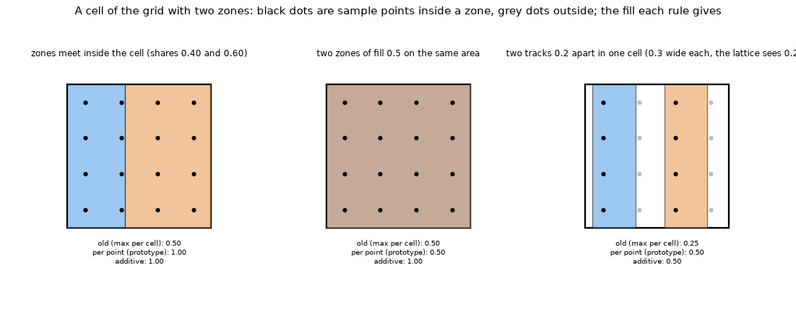

*Figure 1 (`figures/fig_01_cell_two_zones.png`): one cell with 4 x 4 sample points, three drawings, and the fill that each rule gives. Left: two zones meet inside the cell (shares 0.40 and 0.60); the old rule keeps 0.60 (it loses the copper of the smaller zone), the per-point union gives 1.00. Middle: two zones of fill 0.5 on the same area; the old rule and the union give 0.50, the additive rule 1.00 (it double counts). Right: two tracks 0.2 mm apart in one cell; the lattice sees 0.25 of each, the old rule keeps 0.25, the union 0.50.*

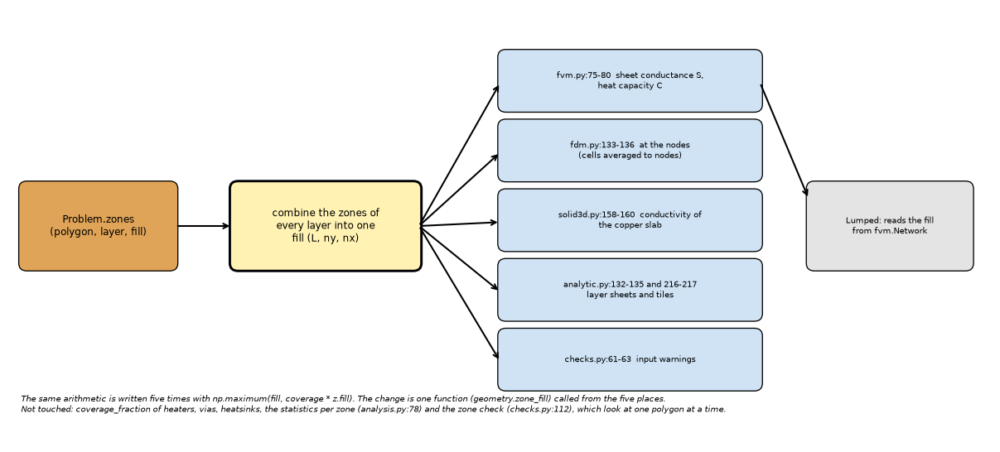

*Figure 6 (`figures/fig_06_where_the_fill_enters.png`): where the fill of the zones enters the program: one loop written six times in five files, then every model that reads the fill. The change is one function called from those six places.*

* **Q1, what the sources mean (section 2).** Gerber: the copper is the union of the dark objects, order and overlap do not matter within a level, and a region is "the union of the filled areas of each individual contour" (revision 2026.05, read). KiCad and Altium (the review read the text of their pages and of KiCad's zone filler, section 2): overlapping zones of the same net and the same priority are one copper; priority or pour order decides who owns the area where nets differ, **and in KiCad also between zones of one net with different priorities** (the higher one keeps its own fill type and pattern inside its outline); a hatched zone is a **pattern** of tracks (width, gap, orientation; track width below the grid size), not a density. So overlapping **solid** copper is the geometric union in every case, and the program's `fill` is a share of the area whose pattern is not stored.
* **Q2, the rule (section 3).** Where every fill is 1 the union is a **fact**: the maximum per sample point is exact and the old rule is wrong. Where a fill is below 1 the combined fill depends on the patterns, which the program does not hold: identical patterns give the larger fill, complementary ones the sum, crossed ones about the independent union; **no rule is right for all three** (4.6: the zones look identical to the models, the independent solver differs by 0 / -46 / -40 % between them, converged estimate of the review). The maximum per sample point is the choice with the properties that matter: exact for solid copper and for nested or identical patterns, the least copper of the union rules (so the least favourable of them, never an invention of copper), it commutes with the scaling of the fills that the power calculator does (`inverse.py`), and it needs no new input. The probabilistic union, the clipped sum and the priority rule are wrong in at least one common case (4.5, 4.6).
* **Q3, measurement (section 4).** The cases of gerber-models 4.39 are reproduced to the digit (4.2). On solid copper drawn as pieces and compared with an independent 3D solver on the resolved copper (0.125 mm), the old rule is too hot by 0.4 to 1.1 % (FVM, one seam, a T or a corner, 1 mm cells) and by **10 % (FVM) and 28 % (FDM)** on 40 abutting strips; the per-point union is back at the one-zone value in every case, in every model (4.3). The FDM of `develop` is much worse than the others on seams because it averages each zone over the four cells around a node before taking the maximum, so a zone's share of a node is at most half of its share of a cell (0.25 instead of 0.5 on the strips; a seam on a grid line cuts the node volumes; review, 4.1).
* **Q4, sampling (section 5).** With a clearance of 0.25 mm between two zones, the peak rise error of the 4 x 4 lattice against 64 x 64 is 0.20 / 0.30 / 0.51 % of the rise for cells of 0.5 / 1 / 2 mm; 8 x 8 gives 0.09 / 0.16 / 0.21 %. 4 x 4 is enough against an old error of up to 10 % (FVM) and 28 % (FDM); 8 x 8 halves the sampling error and quadruples the lattice (memory and point-in-polygon work). The old rule loses 0.3 / 1.2 / 3.1 % on the same board. On abutting strips the old-rule error depends on the strip width in cells and the joint phase, between 0 and 28 % (FVM) (5.2).
* **Q5, cost (section 6).** Time equal to the old loop on one big zone (0.235 s against 0.243 s at 25 million points), 1.7 to 14 times faster on 2000 small zones; memory 0.4 to 0.6 GB more at 25 million points (1.46 against 1.07 GB for one zone over the board; 0.63 against 0.04 GB with 100 zones) because the lattice of the layer is held at once. An exact polygon union (shapely, GEOS) is 2 times slower for one zone and 19 to 61 times slower for 100 or more zones at these sizes, and is a new dependency: not recommended.
* **Q6, edge cases (section 7).** Zones partly or wholly outside the board, a T board, a via array and a metal block under split copper, the heat capacity and the input check all behave: the pieces equal the one-zone drawing to 0.000 K in every model under the union. The old rule also gives a false warning ("a copper edge or hatching crosses its footprint (copper fill 0.50)") on 40 abutting strips, which disappears. Self-intersecting polygons are filled by the even-odd rule (pentagram 61.9 cells against 90.0 under non-zero winding); Gerber forbids them and the program has no check.
* **Q7, the program (sections 8 and 9, `INTEGRATION.md`).** The three example boards move by 0.0000 K in every model. On a real board drawn as polygons the union raises the copper fraction (0.531 to 0.591 against 0.596 resolved at 1 mm cells) and **makes the peak rise lower by 0.1 to 1.6 percentage points (FVM; up to 4.4 for the FDM), away from the independent solver, not toward it**, because the scalar fill at the size of the cell already overstates the conduction of patterned copper (gerber-models 4.10, 4.11) and the old rule's loss of copper partly cancelled that. The union is the correct copper; the remaining error belongs to the mapping of copper to conductances. The review (8.3) split the error: the reference of the table is itself not converged (0.125 mm puts the peak 5 to 14 % higher, so every error is larger), the scalar fill at the cell size costs 5 to 19 % of the peak, and where the hottest point under the part is bare laminate the layered models (FVM, FDM, Lumped, Analytic) lose another 12.5 to 14.4 points of the peak that the 3D solid does not (the temperature of a layer node is the mean through the laminate), which is not a matter of zones. Recommendation in `INTEGRATION.md`: adopt the per-point union with the changes listed there, state the hatched-overlap limit in the documents, and keep the pattern attribute (gerber-models 5) as the real answer for hatched pours.

## 2. What the CAD tools and the formats mean by overlapping copper (Q1)

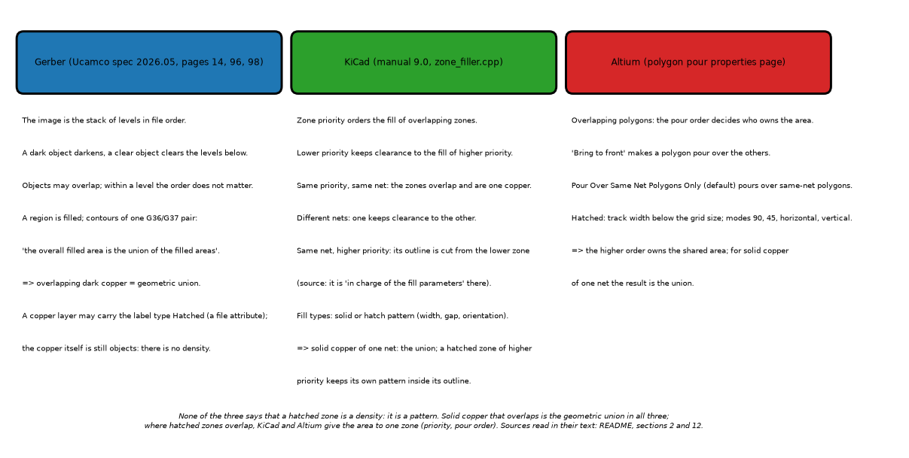

*Figure 5 (`figures/fig_05_cad_semantics.png`): what the Gerber specification, KiCad and Altium say, as the three sources were read (reading status in section 12; redrawn by the review after reading the KiCad and Altium texts).*

**Gerber** (Ucamco, revision 2026.05, downloaded from Ucamco, extracted to text locally, the passages below read; revision 2016.01 from a mirror says the same, section 2.9 and 4.6; the review downloaded the same file and found every quotation on the page given: Polarity on page 14, the region overview of 4.10 on page 96, the valid contours of 4.10.3 on page 98):

* The image is the result of superimposing the graphics objects in the order of creation. Objects have a polarity, dark or clear; "Objects can overlap"; a clear object clears its image in all objects beneath it, a later dark object may darken the cleared area again; "An object is totally dark or totally clear" (section "Polarity", page 14).
* A region is filled from its contours: "Each contour is filled individually. The overall filled area is the union of the filled areas of each individual contour"; two overlapping contours may be merged into one region object; the number of region objects is intentionally unspecified (page 96). Holes are made with cut-ins; self-intersecting contours are not allowed (4.10.3, page 98: the two classes of valid contours are simple contours, which "do not self-intersect or self-touch", and simple cut-in contours). The section "Copper Pours, Power and Ground Planes" (page 117) makes a plane as a dark region with clear clearances, and calls sloppy cut-ins that self-intersect "the most frequent cause of scrap".
* So overlapping dark copper **is** the geometric union of the objects; there is no notion of "density" or "fill below 1" in a Gerber copper layer. The file attribute `.FileFunction` has a Copper layer type of Plane, Signal, Mixed or Hatched: it labels the layer, the copper is still objects.

**KiCad** (zone documentation, KiCad 9: the researcher had a summary of two windows of the page; the review downloaded the page and read the passages below in its text. The zone filler `pcbnew/zone_filler.cpp`, master branch as downloaded by the review, read at the lines cited):

* "Zone priority level determines the order in which multiple zones on a single layer are filled"; "Lower-priority zones will keep clearance to the filled areas of higher-priority zones"; two zones on the same layer with the same priority "will overlap (short-circuit) with each other unless they are assigned different nets"; with different nets, one zone keeps clearance to the other so that they do not short.
* Fill types are solid or a **hatch pattern**: orientation, hatch width, hatch gap, smoothing. The pattern "will fill the area with a pattern that contains less copper". In the source, hatching is applied by subtracting hole patterns from the fill (`knockoutThermalReliefs` ends with `aFill.BooleanSubtract( holes )`), and "same-net zones always use outlines to produce determinate results".
* Same net, different priorities (source, read by the review): `subtractHigherPriorityZones` "Removes the outlines of higher-proirity [sic] zones with the same net. These zones should be in charge of the fill parameters within their own outlines", and the lower zones are refilled to "reclaim any notch the higher zone left unfilled". The manual also says that lower-priority zones keep clearance to the fill of higher-priority zones, without restricting it to other nets.
* Reading: same net and same priority, overlapping: both are filled, one copper, the union; same net, different priorities: the higher zone owns its outline with its own fill type and pattern, the lower one fills the rest (for solid copper the result is again the union; for a hatched zone of higher priority over a solid one the area is **hatched**, the `priority` rule); different nets: the lower priority is cut back with a clearance (a knock-out, not a union). A hatched zone is geometry (lines), not a fraction. The manual adds that zones fill only inside the board outline (as the program does, 7.1).

**Altium** (polygon pour properties: the researcher had the fetch tool's summary of version 19 of the page; the review downloaded `https://www.altium.com/documentation/altium-designer/pcb-polygon-pour-properties`, which answered, and read the passages below in its text):

* Hatched pours: Track Width and Grid Size ("a width below the grid size gives a hatched pour, above it a solid one"), modes 90 Degree, 45 Degree, Horizontal, Vertical. "When two polygons overlap, Altium Designer needs to know which one should occupy the shared area": higher pour order wins, "Bring to front" changes it, the change shows after a repour. The default "Pour Over Same Net Polygons Only" pours over same-net polygons.
* Reading: overlap is resolved by pour order: the higher polygon owns the shared area. The page says nothing more about two hatched polygons of one net; for solid copper of one net the result is the union whatever the order.

**What the three agree on.** (1) **Solid** copper that overlaps and belongs to the same net is one copper: the geometric union. (2) Where the nets differ, one zone is cut back by the other (priority, pour order): **there is no overlap left in the fabricated copper**; in KiCad a same-net zone of higher priority also keeps its own fill type and pattern inside its outline. (3) A hatched zone is a pattern of lines. The program has no nets and no priorities, so a user who draws overlapping solid zones means (1); for a hatched zone over a solid one the CAD answer depends on a priority the program does not hold (solid at equal priority, hatched when the hatched zone is higher in KiCad); where the zones meet without overlap (a clearance, or none) the geometry is exact copper and the cell must hold all of it. Not found: any statement of IPC on a "copper area of a hatched pour" (not obtained, section 12).

## 3. Which rule is right (Q2)

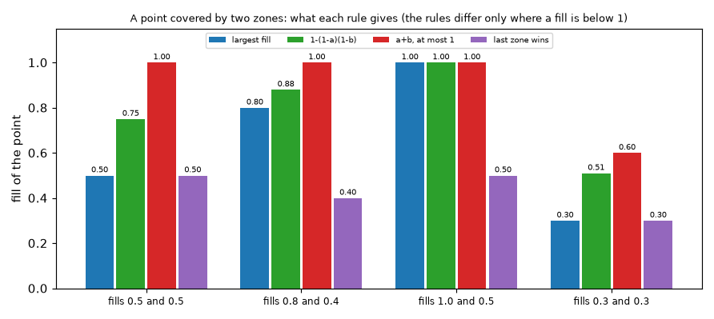

*Figure 2 (`figures/fig_02_rules_at_a_point.png`): one sample point covered by two zones, and the fill of the point under each rule. The rules agree when one of the fills is 1 and when the zones do not overlap; they differ for overlapping partial fills.*

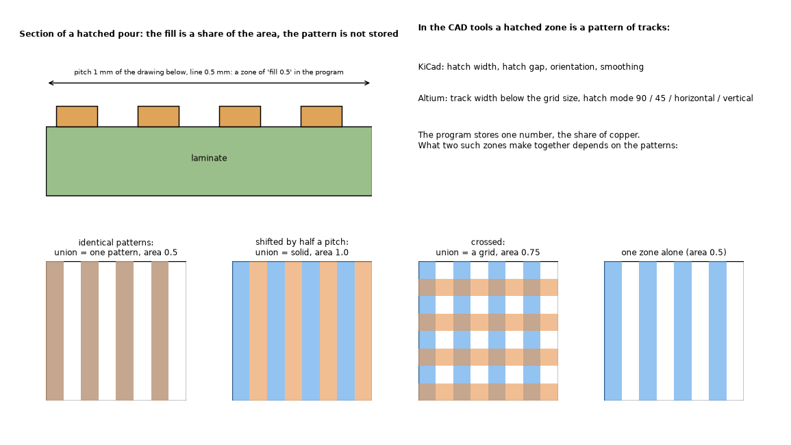

*Figure 3 (`figures/fig_03_hatched_pour.png`): top left, the section of a hatched pour (lines on the laminate, a share of the area as the fill); top right, what the tools say; bottom, three ways two hatched zones of fill 0.5 can combine: the same pattern (union is the pattern, area 0.5), shifted by half a pitch (solid, area 1.0), crossed (a grid, area 0.75). The program stores only the fill 0.5 of each, so it cannot tell the three apart.*

The rules compared (`lib/zone_rules.py`):

| Rule | Definition | Where it is right |
| :-- | :-- | :-- |
| `max_cell` (today) | per cell, the largest of the zones' shares: max(cov_i fill_i) | one zone per cell, or zones that share no cell; wrong where two zones meet inside a cell (loses the copper of the smaller) |
| `max_point` (prototype) | the largest fill at every sample point, then the mean | solid zones always (it is the union); identical or nested hatched zones |
| `prob` | 1 - prod(1 - fill_i) at every point | independent random patterns, and solid copper; wrong for identical patterns (0.75 instead of 0.5) |
| `sum_clip` | min(1, sum fill_i) at every point | patterns that never coincide; wrong for identical ones (1.0 instead of 0.5) |
| `priority` | the zone later in the list wins where it has copper | different nets (the knock-out of KiCad and Altium), and in KiCad a same-net zone of higher priority; wrong for solid copper under a hatched zone of the same net and the same priority (+9.2 % in 4.5) |
| `additive` | per cell, min(1, sum of cov_i fill_i) | rejected in gerber-models 4.39: double counts overlap |

**Facts.** (a) Solid copper that overlaps or abuts is the geometric union (Gerber, KiCad, Altium agree); the per-cell maximum is wrong and every point rule above gives the union for fills of 1 (4.3). (b) A hatched zone in the tools is a pattern; the program's fill is its share of the area (gerber-models 4.10, 4.11: the same share can be a grid, stripes or islands, and no scalar function of the share is right for all). (c) A point rule needs no neighbour information, so it is exact in the limit of the lattice (5, 6 and `lib/zone_shapely.py` give the exact area).

**Modelling choices.** (a) What the combined fill of two zones of fill below 1 is: depends on the patterns (4.6). The maximum is the choice that is exact for nested patterns and gives the least copper of the union rules. (b) The sample lattice (4 x 4) and its error (5). (c) That `fill` stays a density; the alternative, a pattern attribute that synthesises the mask (gerber-models 5), makes the question moot for hatched pours.

**Why the maximum per point.** It is the union for solid copper; it never creates copper that the zones do not have (it gives the least copper of the union rules, `max <= prob <= sum`, so the highest rise of them); it commutes with multiplying every fill by a factor, which `inverse.py` does for the copper-error band of the power calculator (the probabilistic union and the sum do not); it equals the old rule on disjoint zones that fill their cells (a test of this folder); it needs no input that the user does not give.

## 4. Measurement against an independent solver (Q3)

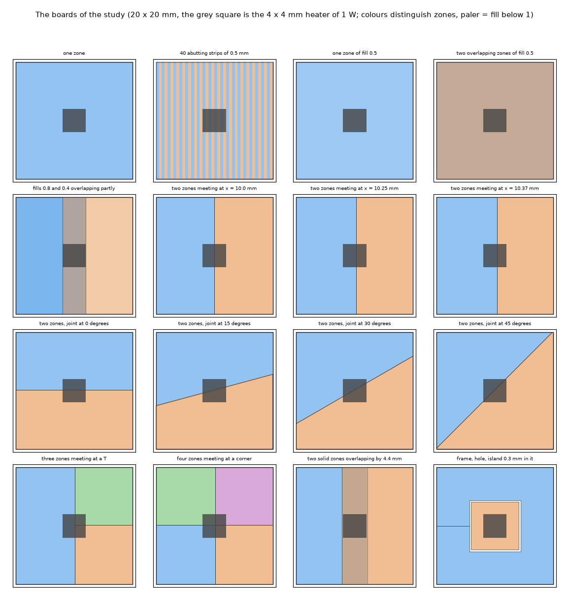

*Figure 4 (`figures/fig_04_cases_compared.png`): the boards of the study (20 x 20 mm, the grey square is the 4 x 4 mm heater of 1 W; colours distinguish zones, paler means a fill below 1).*

### 4.1 Method

* **Reference** (`lib/reference.py`, `study_cases.py reference`): the resolved copper (the polygons rasterised on a fine grid by matplotlib's point-in-polygon, 4 x 4 samples per fine cell, the union by OR) solved by `tests/helpers/layered3d.py`, the independent 3D conduction solver of the repository (imports nothing from the program; checked against a closed form and an energy balance in `tests/test_zone_union_research.py`). Same boundary conditions as the program (film on both faces and under the part, adiabatic sides), laminate isotropic 0.3 W/mK, copper 385 W/mK, 35 um, board 1.6 mm. The number compared is the hottest cell of the part (K above the ambient).
* **Convergence of the reference** (solid copper, peak rise of the one-zone board): 143.769 K at 0.5 mm, 143.790 K at 0.25 mm, 143.800 K at 0.25 mm with 2 laminate slabs instead of 8, 143.805 K at 0.125 mm with 2 slabs: the reference is good to 0.03 %. For the seams the finest grid is used (0.125 mm); the stripes and the gap of 4.7 are **not** converged (4.6, 4.7).
* **Models**: the five models of the program, 1 mm and 0.5 mm cells, the rule `max_cell` of the variant (checked identical to the unmodified program for FVM, Lumped, Analytic and the 3D solid to 0.0000 K; the FDM of `develop` differs by up to 26 K, so the **old column of every table is the unmodified program**). Why the FDM differs (review, measured on the 40 strips at 1 mm): in its default area sampling `develop` averages **each zone** over the four cells around a node and then takes the maximum over the zones, so a 0.5 mm strip has 0.25 of a node (half of its share of a cell) and the node fill is 0.25 instead of 0.5; a seam on a grid line (x = 10.0 mm) cuts the node volumes and leaves 0.5 on that line of nodes. The variant takes the maximum on the cells and then averages, which gives 0.5. The earlier text said that the FDM samples its nodes by points: that is the `point` sampling, not the default, and was wrong, the prototype (`max_point`) and the other rules.

### 4.2 The cases of gerber-models 4.39, reproduced (`study_program.py`)

20 x 20 mm, one layer, the default (anisotropic) materials, 1 mm cells, peak rise (K) of the program as it is, FVM / FDM / Lumped / Analytic / 3D solid, then the change under each rule:

| Case | Program as it is | additive | per-point union | prob | sum_clip | priority |
| :-- | :-- | :-- | :-- | :-- | :-- | :-- |
| one zone | 143.08 / 143.08 / 144.42 / 142.22 / 143.14 | 0 | 0 | 0 | 0 | 0 |
| 40 abutting strips of 0.5 mm | 155.89 / 176.84 / 158.33 / 153.62 / 156.11 | -8.2 / -19.1 / -8.8 / -7.4 / -8.3 % | same as additive (back to the one-zone value) | same | same | same |
| two overlapping zones of fill 0.5 | 155.89 / 155.89 / 158.33 / 153.62 / 156.11 | -8.2 / -8.2 / -8.8 / -7.4 / -8.3 % (wrong) | 0 | -5.3 / -5.3 / -5.7 / -4.8 / -5.4 % | -8.2 / -8.2 / -8.8 / -7.4 / -8.3 % | 0 |
| fills 0.8 and 0.4 overlapping partly | 149.43 / 149.71 / 151.05 / 148.61 / 149.56 | -1.5 / -2.0 / -1.4 / -0.9 / -1.5 % | 0 / -0.5 / 0 / 0 / 0 % | -0.7 / -1.2 / -0.6 / -0.4 / -0.7 % | -1.5 / -2.0 / -1.4 / -0.9 / -1.5 % | +6.0 / +5.2 / +4.7 / +2.1 / +6.1 % |

(`out/study_program.txt`.) These agree with gerber-models 4.39 to the digit (143.1, 155.9, 176.8, 158.3, 153.6, 156.1, -8.2, -19.1, -8.8, -7.4, -8.3 %), with one difference: the additive rule on the partly overlapping pair gives -2.0 % for the FDM here against -2.3 % there (the other columns agree). Traced by the review: gerber-models applied the additive rule inside the FDM loop, on each zone's share already averaged to the nodes (`min(1, fill + cover)` at the nodes), where this folder clips the sum on the cells and then averages; the program's FDM with the additive rule written at the nodes (a copy made in memory, nothing edited) gives -2.30 %. Both are implementations of a rejected rule; nothing else depends on it. The additive rule is wrong for overlapping zones, as 4.39 said; the new rules **prob**, **sum_clip** and **priority** are wrong on the overlapping pair too (-5.3 %, -8.2 %, +6.0 % on the partial pair), only the per-point maximum is right on both.

### 4.3 Solid copper drawn as pieces (`study_cases.py`)

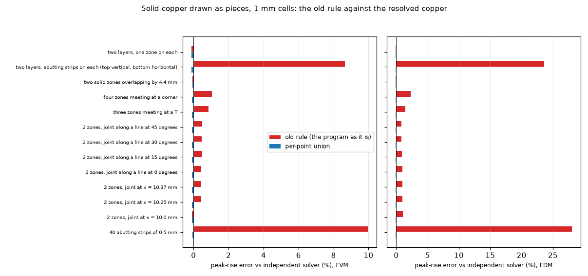

*Figure 7 (`figures/fig_07_cases_error.png`): error of the peak rise against the independent solver for the old rule (the program as it is) and the per-point union, FVM and FDM, 1 mm cells, on solid copper drawn as pieces.*

Error of the peak rise against the independent solver (%), 1 mm cells. The model's own error on the one-zone board is the baseline (FVM -0.08, FDM -0.08, Lumped +0.91, Analytic -0.44, 3D solid -0.07); the union returns every case to it. Old = the program as it is.

| Case | reference (K) | FVM old / union | FDM old / union | Lumped old / union | Analytic old / union | 3D solid old / union |
| :-- | --: | :-- | :-- | :-- | :-- | :-- |
| one zone | 143.79 | -0.08 / -0.08 | -0.08 / -0.08 | +0.91 / +0.91 | -0.44 / -0.44 | -0.07 / -0.07 |
| 40 abutting strips of 0.5 mm | 143.79 | **+9.95** / -0.08 | **+28.01** / -0.08 | +11.83 / +0.91 | +9.13 / -0.44 | +9.97 / -0.07 |
| two zones meeting at x = 10.0 mm (a grid line) | 143.80 | -0.09 / -0.09 | +1.09 / -0.09 | +0.90 / +0.90 | -0.45 / -0.45 | -0.08 / -0.08 |
| at x = 10.25 mm (inside a cell) | 143.80 | +0.45 / -0.09 | +0.96 / -0.09 | +1.22 / +0.90 | -0.29 / -0.45 | +0.46 / -0.08 |
| at x = 10.37 mm | 143.80 | +0.45 / -0.09 | +0.96 / -0.09 | +1.22 / +0.90 | -0.29 / -0.45 | +0.46 / -0.08 |
| a line at 0 degrees | 143.80 | +0.45 / -0.09 | +0.96 / -0.09 | +1.22 / +0.90 | -0.29 / -0.45 | +0.46 / -0.08 |
| a line at 15 degrees | 143.80 | +0.50 / -0.09 | +0.93 / -0.09 | +1.22 / +0.90 | -0.30 / -0.45 | +0.51 / -0.08 |
| a line at 30 degrees | 143.80 | +0.47 / -0.09 | +0.83 / -0.09 | +1.23 / +0.90 | -0.29 / -0.45 | +0.48 / -0.08 |
| a line at 45 degrees | 143.80 | +0.51 / -0.09 | +0.83 / -0.09 | +1.38 / +0.90 | -0.24 / -0.45 | +0.52 / -0.08 |
| three zones meeting at a T | 143.80 | +0.86 / -0.09 | +1.43 / -0.09 | +1.39 / +0.90 | -0.21 / -0.45 | +0.87 / -0.08 |
| four zones meeting at a corner | 143.80 | +1.06 / -0.09 | +2.29 / -0.09 | +1.56 / +0.90 | -0.13 / -0.45 | +1.07 / -0.08 |
| two solid zones overlapping by 4.4 mm | 143.79 | -0.08 / -0.08 | -0.08 / -0.08 | +0.91 / +0.91 | -0.44 / -0.44 | -0.07 / -0.07 |
| two layers, abutting strips on each (top vertical, bottom horizontal) | 142.92 | **+8.65** / -0.13 | **+23.60** / -0.13 | +10.15 / +0.73 | +8.13 / -0.41 | +8.82 / -0.08 |
| two layers, one zone on each | 142.92 | -0.13 / -0.13 | -0.13 / -0.13 | +0.73 / +0.73 | -0.41 / -0.41 | -0.08 / -0.08 |

At 0.5 mm cells (`out/study_cases.txt`) the strips are aligned with the cells and the old rule is exact for the FVM (-0.02 %; the FDM is +10.05 %); a joint inside a cell costs +0.13 to +0.52 % (FVM), a T +0.38 %, a corner of four +0.48 %. **Every pair of pieces that is the same copper gives, with the union, the one-zone value to the rounding of the table, in every model; the old rule departs by what the seams lose.** The effect of one seam is small (0.5 % on a 20 mm board, where the lost copper is one cell in twenty); the effect is large where there are many seams inside the cells: 10 % (FVM) and 28 % (FDM) on the 0.5 mm strips. Overlap alone (the 4.4 mm overlap, fills of 1) is exact in the old rule too.

### 4.4 Hatching and overlap: the fills between 0 and 1 (`study_cases.py`)

Peak rise (K), 1 mm cells, FVM / Lumped / Analytic / 3D solid (the FDM column follows the FVM except where noted in `out/study_cases.txt`):

| Case | old | per-point union | prob | sum_clip | priority | additive |
| :-- | :-- | :-- | :-- | :-- | :-- | :-- |
| one zone of fill 0.5 | 158.10 / 160.80 / 156.91 / 158.13 | same | same | same | same | same |
| two zones of fill 0.5 on the same area | 158.10 / 160.80 / 156.91 / 158.13 | same | 148.60 / 150.47 / 147.87 / 148.62 | 143.68 / 145.10 / 143.16 / 143.69 | same as union | 143.68 / 145.10 / 143.16 / 143.69 |
| fills 0.8 and 0.4 overlapping partly | 150.81 / 152.48 / 150.66 / 150.83 | same | 149.71 / 151.44 / 150.02 / 149.73 | 148.34 / 150.07 / 149.12 / 148.35 | 160.99 / 160.49 / 154.58 / 161.05 | 148.34 / 150.07 / 149.12 / 148.35 |

(The materials are isotropic here; 4.2 has the default ones.) The first two rows are the same board only if the two zones carry the same pattern; the table cannot say which rule is right, only that the old rule and the union agree with each other where one fill dominates.

### 4.5 A hatched zone over a solid zone

A solid zone with a hatched zone of fill 0.5 drawn over a part of it (4 to 16 mm). The union is solid: reference 143.80 K. The old rule, the union, `prob` and `sum_clip` give 143.68 K (FVM, -0.09 %); `priority` (the later, hatched zone wins) gives 156.96 K (+9.15 %, 0.5 mm cells +9.28 %): it removes the copper of the solid zone under the hatched one. This is the rule of the CAD tools for **different nets**, and (review, section 2) also what KiCad does when the hatched zone has a higher priority than a solid zone of the same net; at equal priority KiCad fills both and the area is solid. The program has neither nets nor priorities, so it cannot tell; the union (solid) is the choice that does not remove copper the user drew.

### 4.6 Hatched overlap: no rule is right for all patterns (`study_cases.py hatch`)

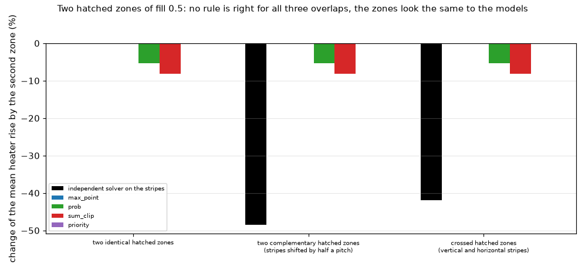

*Figure 12 (`figures/fig_12_hatched_union.png`): the change that a second hatched zone brings to the mean rise of the part: the independent solver on the real stripes (black) against the FVM under each rule. The three drawings are the same two zones of fill 0.5 for the models.*

Stripes of 0.5 mm at a pitch of 1 mm (fill 0.5) over the whole 20 mm board, the part at the centre, 1 mm cells, mean rise over the part (the maximum depends on where the stripes fall under the part). Change (%) when the second hatched zone is added to the first one:

| Second zone | independent solver (stripes resolved at 0.125 mm, 2 laminate slabs) | converged estimate (review) | max_cell / per-point union | prob | sum_clip | priority |
| :-- | --: | --: | --: | --: | --: | --: |
| identical stripes | 0.0 | 0.0 | 0.0 | -5.3 | -8.1 | 0.0 |
| stripes shifted by half a pitch (together: solid) | -48.4 | -46.1 | 0.0 | -5.3 | -8.1 | 0.0 |
| crossed stripes (a grid) | -41.8 | -40.5 | 0.0 | -5.3 | -8.1 | 0.0 |

The single hatched zone is 273.3 K in the solver and 154.1 K in the FVM: the stripe pattern is not a scalar fill (gerber-models 4.11; here -44 % on the mean over the part and -52 % on the peak, 158.1 against 330.6 K, for one-way stripes). The rules cannot follow the combination because the three drawings are the same input; **a rule that is right for the shifted stripes (sum) is wrong for the identical ones, and the reverse**. The solver's stripes are not converged: the mean moves by 4 % with the laminate slabs (267.7 and 279.1 K at 0.25 mm with 8 and 2 slabs), so the changes above are good to a few percent, not to the digit. **Review** (`study_cases.py converge`): the mean over the part of the single hatched zone is 279.1 / 271.5 / 267.7 / 266.3 K at 0.25 mm with 2 / 4 / 8 / 16 slabs (265.95 K with 32, a run of 7 GB not kept in the script) and 273.3 / 266.5 K at 0.125 mm with 2 / 4 slabs; taking the cell and slab effects as independent, the converged value is about 261.5 K (crossed stripes 155.5 K, solid 141.0 K), which gives the third column: -46.1 % and -40.5 % instead of -48.4 % and -41.8 %, good to about one point (a further halving of the cell was not run: memory). The solid case is converged (141.0 K at every grid). **What survives**: the identical case is 0 by construction; the shifted and crossed cases move by 2.3 and 1.3 points, so the spread between the three drawings that are the same input to the models (0 / -46 / -40 %) and the conclusion that no scalar rule can follow it are unchanged; the digits of the second column are not. The single hatched zone against the FVM (154.1 K) is -41 % on the mean with the estimate (-44 % with the 0.125 mm / 2 slab value). What the numbers support is the qualitative statement: for hatched pours that overlap, only a pattern attribute (gerber-models 5) can give the right answer. Figure 12 plots the second column.

### 4.7 A copper gap that a cell cannot hold: the frame with an island, and where the sampling stops being the issue

A frame with a square hole and an island 0.3 mm inside it (the heater on the island): the union rules all give 145.09 K (FVM, 1 mm cells), the independent solver at 0.125 mm gives 207.16 K (-29.96 %). The solver at 0.5 and 0.25 mm, where the gap is a fraction of a cell, gives 144.6 K, so the gap is only seen at 0.125 mm and the reference is not converged below that. **Review** (`study_cases.py converge`): with 4 laminate slabs instead of 2 the peak at 0.125 mm is 200.14 K (mean 204.45 to 197.42 K), and at 0.1 mm the mean is 206.97 / 202.24 K with 2 / 3 slabs (1.2 % above 0.125 mm at 2 slabs): the reference is about 200 K give or take 2 %, and the error of the models about -27 to -28 %, not -29.96 %. The point stands. The point is the same as gerber-models 4.10: a clearance narrower than the cell is a barrier that a scalar fill (0.7 of a cell) spreads into a partial conductor; no zone rule changes that, all six rules give the same number. Likewise the program with 64 x 64 points per cell, two zones with a gap of 0.25 mm and 0.5 mm cells, is -17.6, -18.3, -11.6, -5.7 % from the solver (the gap of 0.25 mm at 0 degrees with its centre line shifted by 0.25 and 0.50 mm, at 30 degrees by 0.37 mm, at 45 degrees by 0.62 mm; `study_sampling.py`; the solver at 0.125 mm with 2 slabs, which by the frame above is a few percent hot): the error is the mapping, not the sampling.

## 5. Sampling and where the edges fall (Q4)

### 5.1 How many sub-samples (`study_sampling.py`)

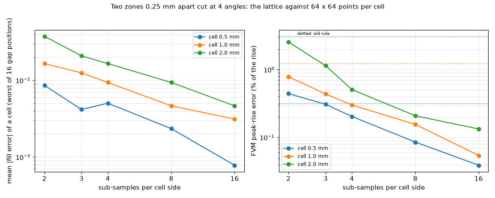

*Figure 9 (`figures/fig_09_sampling.png`): two zones 0.25 mm apart, cut at 0, 15, 30 and 45 degrees with the gap shifted over one cell in four steps; left, the mean absolute error of the cell fill against 64 x 64 points; right, the error of the FVM peak rise (% of the rise); dotted, the old rule against the same reference.*

The union of two zones that tile the board has no edge of its own (full copper for any lattice, error 0 for every s: the first version of this study measured that and had to be redone with a gap). With a clearance of 0.25 mm:

| cell (mm) | s | max fill error of a cell | mean fill error | copper area error (cells, worst of 16) | FVM peak error (% of the rise) |
| --: | --: | --: | --: | --: | --: |
| 0.5 | 2 | 0.233 | 0.0086 | 11.7 | 0.442 |
| 0.5 | 3 | 0.167 | 0.0042 | 6.7 | 0.308 |
| 0.5 | **4** | 0.130 | 0.0050 | 8.1 | **0.204** |
| 0.5 | 8 | 0.052 | 0.0023 | 3.1 | 0.086 |
| 0.5 | 16 | 0.023 | 0.0008 | 1.2 | 0.039 |
| 1.0 | 2 | 0.261 | 0.0165 | 6.6 | 0.784 |
| 1.0 | 3 | 0.156 | 0.0125 | 5.0 | 0.437 |
| 1.0 | **4** | 0.122 | 0.0094 | 2.8 | **0.301** |
| 1.0 | 8 | 0.077 | 0.0047 | 1.9 | 0.156 |
| 1.0 | 16 | 0.031 | 0.0031 | 0.6 | 0.055 |
| 2.0 | 2 | 0.375 | 0.0375 | 3.8 | 2.547 |
| 2.0 | 3 | 0.208 | 0.0208 | 2.1 | 1.139 |
| 2.0 | **4** | 0.125 | 0.0165 | 1.7 | **0.508** |
| 2.0 | 8 | 0.063 | 0.0094 | 0.6 | 0.209 |
| 2.0 | 16 | 0.043 | 0.0046 | 0.5 | 0.134 |
| old rule against the same 64-point reference | | | | | 0.320 (0.5 mm), 1.226 (1 mm), 3.090 (2 mm) |

The error falls about as 1/s. 4 x 4 is better than the old rule at all three cells (0.20 against 0.32, 0.30 against 1.23, 0.51 against 3.09 %), by little at 0.5 mm, where the gap and the cell are of the same size. It is within 0.3 to 0.5 % of the rise for cells of 1 to 2 mm, an order of magnitude below the mapping error of 4.7. **4 x 4 is enough**; 8 x 8 halves the error and quadruples the lattice (6). Against the **exact** union (shapely, 250 x 250 cells, 100 random rectangles of fills 1, 0.8, 0.5) the mean fill error is 0.0066 / 0.0048 / 0.0036 / 0.0018 / 0.0009 for s = 2, 3, 4, 8, 16 (max 0.34 / 0.23 / 0.17 / 0.075 / 0.051) and the total copper area error is -0.03 % for s = 4, against -0.49 % for the old rule (`study_cost.py`).

### 5.2 Where the zone edges fall: strips of every width and phase (`study_strips.py`)

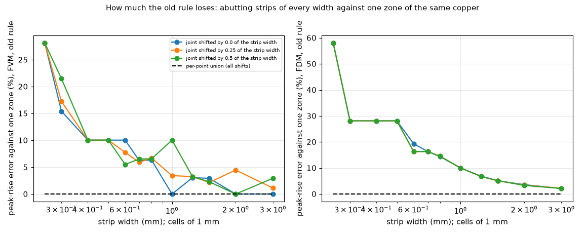

*Figure 8 (`figures/fig_08_strip_sweep.png`): peak-rise error of the old rule against one zone of the same copper, for abutting strips of width 0.25 to 3 mm over cells of 1 mm, three phases of the joints; the per-point union is on the zero line for all (dashed).*

The old rule loses copper in every cell that holds a joint: the error is 28 % (FVM) and 58 % (FDM) for strips of 0.25 mm (four strips per cell, each a quarter), 10 % for 0.4 and 0.5 mm strips, 5.5 to 10 % for 0.6 to 0.8 mm, 2 to 3.3 % for 1.25 and 1.5 mm, and depends on the phase when the width and the cell are commensurable (1.0 mm: 0, 3.4 and 10.0 % for the three shifts; 2.0 mm: 0, 4.5, 0 %). It is zero only when every joint falls on a cell edge. The per-point union is at 0.00 % for every width and phase in the FVM and the FDM. The sweep shows why a single seam on a board looks harmless (0.5 %) while a board of many pieces does not.

## 6. Cost (Q5)

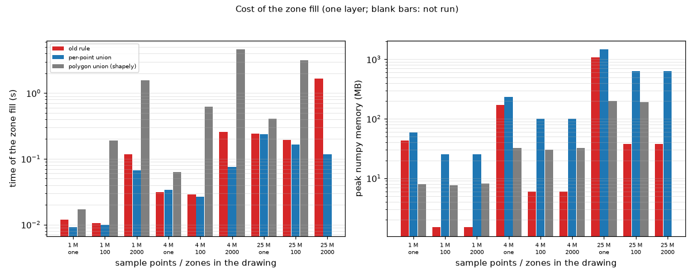

*Figure 10 (`figures/fig_10_cost.png`): time and peak memory of the zone fill of one layer: the old loop, the per-point union and the exact polygon union (shapely), on boards of 1, 4 and 25 million sample points with one zone, 100 rectangles and 2000 small rectangles; blank bars were not run.*

`study_cost.py`: one layer, 16 sample points per cell (so 1 M = 250 x 250 cells, 4 M = 500 x 500, 25 M = 1250 x 1250 cells; **all three sizes were measured**, none extrapolated; the 25 M case with one zone ran because the projection from the 4 M run, 1463 MB, was under the limit of 2 GB of the study). Time in seconds (best of 3; one run for 25 M), memory = peak of numpy allocations (tracemalloc):

| Board | Drawing | old loop | per-point union | exact (shapely) |
| :-- | :-- | :-- | :-- | :-- |
| 1 M | one zone | 0.012 s, 43 MB | 0.009 s, 59 MB | 0.017 s, 8 MB |
| 1 M | 100 rectangles | 0.011 s, 2 MB | 0.010 s, 25 MB | 0.190 s, 8 MB |
| 1 M | 2000 small | 0.117 s, 2 MB | 0.067 s, 25 MB | 1.554 s, 8 MB |
| 4 M | one zone | 0.031 s, 172 MB | 0.034 s, 234 MB | 0.063 s, 32 MB |
| 4 M | 100 | 0.029 s, 6 MB | 0.027 s, 100 MB | 0.619 s, 30 MB |
| 4 M | 2000 | 0.256 s, 6 MB | 0.075 s, 100 MB | 4.610 s, 32 MB |
| 25 M | one zone | 0.243 s, 1075 MB | 0.235 s, 1463 MB | 0.404 s, 200 MB |
| 25 M | 100 | 0.193 s, 38 MB | 0.165 s, 626 MB | 3.161 s, 192 MB |
| 25 M | 2000 | 1.651 s, 38 MB | 0.116 s, 625 MB | not run |

* **Time**: the same as the old loop for a zone as large as the board (both are dominated by the point-in-polygon test), 1.1 to 14 times faster for 100 to 2000 small zones (the old loop adds a full-size array per zone; the union works on the window of the zone). A solve of the same board takes seconds to minutes (the 25 M board is 1.6 million cells), so the fill is not the cost.
* **Memory**: the lattice of the layer, (ny, 4, nx, 4) float64, is held at once: 8 bytes x 16 x cells = 200 MB at 1.56 million cells; with 100 zones the peak is 0.63 GB (the old rule 0.04 GB), with one zone over the board the temporaries of the point-in-polygon test make it 1.46 GB (the old rule 1.07 GB). On boards of that size the matrix of the FVM is far larger; the cost is acceptable. If wanted, float32 or a per-row-band loop halves or removes it (not measured).
* **The exact union** (`lib/zone_shapely.py`: unary union by GEOS, then the exact area of the cells crossed by the boundary): 2 times slower than the lattice for one zone and 19 to 61 times slower for 100 or more zones, exact where the lattice has an error of 0.0036 on average; it is a new dependency (BSD-3-Clause) and would also need a layer cake for zones of different fills; it is **not recommended** for the program. Other polygon boolean algorithms exist (Vatti, Weiler-Atherton, Greiner-Hormann, Clipper2); they were read about (section 12), not run, and would all need the same exact-area step per cell. A union done once as polygons then rasterised with the present point-in-polygon would cost O(points x vertices of the union), worse than the per-zone window (reasoning from the loop of `points_in_polygon`, not measured).

## 7. Edge cases (Q6) (`study_edge_cases.py`)

Every comparison: the copper drawn as pieces against the same copper as one zone, 1 mm cells, peak rise (K) of FVM / FDM / Lumped / Analytic / 3D solid.

**7.1 Zones partly or wholly outside the board.** Two pieces that reach 5 mm beyond the board on every side, and a third zone wholly outside: one zone 143.681 / 143.681 / 145.102 / 143.157 / 143.691; pieces, old rule 144.448 / 144.311 / 145.566 / 143.388 / 144.460; pieces, union: identical to the one zone to 0.000 K in all models. The part of a zone outside the board is cut by the window of the lattice (the bounding box is clipped to the board) and a zone entirely outside returns no samples.

**7.2 A board with an outline** (T of 20 x 20 mm, copper cut at x = 10.37 mm, part in the stem): one zone 273.667 / 271.687 / 234.171 / 236.499 / 273.674; old rule 275.824 / 273.612 / 234.559 / 236.800 / 275.834; union equal to the one zone (0.000 K). The cover of the outline multiplies the fill afterwards, so it is independent of the rule. (Lumped and Analytic use the rectangle of the same area, where the zones are scaled together.)

**7.3 Degenerate and self-intersecting polygons** (area of the field of a 20 x 20 grid of 1 mm cells, in cells, even-odd as the program against non-zero winding computed here):

| Polygon | even-odd (program) | non-zero winding |
| :-- | --: | --: |
| zero area (three collinear points) | 0.00 | 0.00 |
| degenerate triangle (two coincident vertices) | 0.19 | 0.00 |
| bow tie | 40.56 | 40.31 |
| pentagram | 61.88 | 90.00 |

A zero-area polygon adds nothing and does not fail. The even-odd rule of `points_in_polygon` leaves the central pentagon of the pentagram empty, non-zero winding (the rule of PostScript and SVG) fills it. Valid input is not affected: Gerber forbids self-intersecting contours (2026.05, 4.10.3) and KiCad and Altium do not make them; the program has no check (a proposal in `INTEGRATION.md`).

**7.4 Vias and a metal block on split copper** (two layers, 3 x 3 vias under the part, an aluminium block 2 mm thick on the top copper, pieces cut at x = 10.37 mm on both layers): one zone per layer 103.552 / 102.425 / 103.277 / 106.881 / 102.850; pieces, old rule 103.850 / 102.736 / 103.529 / 107.080 / 103.019; union equal to the one zone. The vias and the block read their own geometry; only the copper fill under them changes, and the union gives the same as the one-zone drawing.

**7.5 Time simulation.** The heat capacity of a cell uses the same fill (`fvm.py`, `C = fill rho cp t + ...`). On 40 abutting strips at 1 mm cells the old rule gives a mean fill of 0.5000 and a total capacity of 1.0781 J/K, a time constant of 134.76 s; the union gives 1.0000, 1.0906 J/K and 136.32 s, equal to the one zone (1.0906, 136.32). The copper is a small part of the capacity of the laminate board, so the change is 1.1 %. The step responses of the Lumped and the Analytic read their fills the same way (through the network of the FVM and `analytic._effective_sheet`), so they move with the rule.

**7.6 The input check.** `checks.check_problem` builds the same fill: on 40 abutting strips at 1 mm cells the old rule makes the fill under the part 0.50 and warns "a copper edge or hatching crosses its footprint (copper fill 0.50); the Lumped and Analytic models are unreliable here, use the FVM"; the union gives no warning, as for one zone. A false warning that the change removes.

## 8. A real board drawn as polygons, and the example boards (Q7)

### 8.1 The example boards

`study_program.py`: `examples/example_board`, `profile_board` (4 layers, 4 zones each) and `reference_board` (2 layers, 2 zones), 1.0 and 0.5 mm cells, five models (the 3D solid is refused at 0.5 mm on the 4-layer boards: 512 000 unknowns against the limit of 250 000): the largest change of any peak rise under the per-point union is **0.0000 K**. For example, `example_board` at 1 mm: 60.814 / 59.383 / 59.659 / 59.652 / 60.975 K. The example boards have disjoint zones that fill their cells, as the invariant test says; they cannot show the effect, and the change leaves them untouched.

### 8.2 The Stormduino as polygons (`study_real_board.py`)

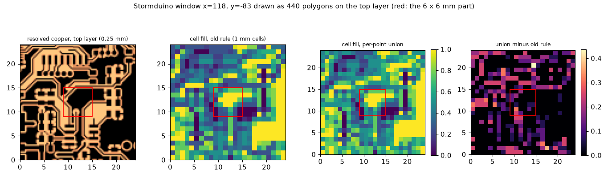

*Figure 11 (`figures/fig_11_real_board.png`): a 24 mm window of the Stormduino (from its KiCad file) drawn as 440 polygons on the top layer (every track with round ends, pad and zone fill is a zone); from the left, the resolved copper at 0.25 mm, the cell fill at 1 mm under the old rule, under the per-point union, and their difference (red square: the 6 x 6 mm part of 1 W).*

The board is the Stormduino of gerber-import, from its `.kicad_pcb` (git-ignored data; found in this worktree or the main checkout): tracks as rectangles with 10-sided discs at the ends, pads as rectangles, 16-gon capsules and discs, the filled polygons of the zones, vias left out; the way an import of CAD polygons would hand them to the program. Three 24 x 24 mm windows (the densest copper, the middle and a sparser one), two copper layers, 1.6 mm, 35 um, laminate isotropic 0.3 W/mK, a 6 x 6 mm part of 1 W on the top layer. Reference: the independent solver at 0.25 mm on the same polygons. Mean copper fraction (top / bottom layer) and peak-rise error (%) against the solver:

| Window (objects top / bottom) | cell | copper fraction: resolved; old; union (top) | FVM old / union | FDM old / union | Lumped old / union | Analytic old / union | 3D solid old / union |
| :-- | --: | :-- | :-- | :-- | :-- | :-- | :-- |
| x = 142, y = -91 (137 / 115), solver 128.39 K | 1.0 | 0.823; 0.780; 0.828 | -17.28 / -18.89 | -17.42 / -19.51 | -18.85 / -19.47 | -19.41 / -19.99 | -17.12 / -18.80 |
| | 0.5 | 0.823; 0.815; 0.824 | -17.71 / -17.98 | -18.08 / -19.16 | -19.08 / -19.20 | -19.67 / -19.77 | -5.23 / -5.43 |
| x = 134, y = -83 (167 / 115), solver 115.76 K | 1.0 | 0.728; 0.688; 0.733 | -10.02 / -10.90 | -10.38 / -11.49 | -10.56 / -11.01 | -10.32 / -10.82 | -9.82 / -10.73 |
| | 0.5 | 0.728; 0.722; 0.730 | -10.17 / -10.28 | -10.54 / -11.19 | -11.02 / -11.06 | -10.52 / -10.60 | -9.83 / -9.96 |
| x = 118, y = -83 (440 / 148), solver 168.19 K | 1.0 | 0.596; 0.531; 0.591 | -22.41 / -23.99 | -29.32 / -33.74 | -31.57 / -32.99 | -34.29 / -35.44 | -8.50 / -9.72 |
| | 0.5 | 0.596; 0.583; 0.598 | -19.74 / -20.16 | -26.90 / -28.55 | -33.15 / -33.44 | -35.15 / -35.41 | -5.41 / -5.73 |

(The resolved fraction is the solver's raster at 0.25 mm; the old and union fractions are the cell fields of the two rules at 4 x 4 samples, `study_real_board.py fills`.) What this says:

* **The old rule loses copper on a real board**: at 1 mm cells 5 to 11 % of the copper of the top layer (0.531 against 0.596 in the densest window, 0.688 against 0.728, 0.780 against 0.823); at 0.5 mm 1 to 2 %. The union recovers it to within 1 % of the resolved copper (0.591, 0.733, 0.828).
* **The result moves away from the independent solver**: the models are 10 to 35 % too cool on this board, and with more copper they are cooler by 0.1 to 1.6 percentage points (FVM), up to 4.4 points for the FDM. The reason is not in the union: the scalar fill (the arithmetic share of the copper) overstates the conduction of tracks and patterned copper, a known optimistic limit (gerber-models 4.10, 4.11: 7 to 43 % too cool on patterns), and the old rule's loss of copper had been cancelling part of it. **Fixing the copper area uncovers the error of the mapping; it does not create it.** The 3D solid is closer at 0.5 mm cells (-5.2 to -9.8 %) and as far as the others in the first window at 1 mm (-17.1 %); the review explains it in 8.3 (the layered models, not the 3D solid, lose the peak where the part sits on bare laminate). The sizes of the errors in this table are **lower bounds**: the reference at 0.25 mm is not converged (8.3).
* The prob, sum_clip and priority rules give the same fields as the union here: the polygons are solid.

### 8.3 Where the error on the real board comes from (review, `study_real_board.py decompose`)

The reading of 8.2 rests on an explanation that the researcher did not measure; the review measured its parts. Three quantities per window: the reference itself at a finer cell; the independent solver run on the **program's own cell fill** (the 4 x 4 sample field of 1 or 0.5 mm cells, old rule and union, laminate resolved in 4 slabs; it has the scalar fill of the program but not its one-node-per-layer idealisation); and the FVM. Errors (%) of the peak against the reference of 8.2 (0.25 mm, 4 slabs per gap), old / union:

| Window | reference at 0.25 / 0.125 mm, 2 slabs (peak K; mean over the part K) | cell | solver on the cell fill | FVM | fill of the hottest cell |
| :-- | :-- | --: | :-- | :-- | --: |
| x = 142, y = -91 | 133.1 / 151.2; 107.3 / 117.8 | 1.0 | -17.1 / -18.8 | -17.3 / -18.9 | 0.19 / 0.31 |
| | | 0.5 | -5.2 / -5.4 | -17.7 / -18.0 | 0.00 |
| x = 134, y = -83 | 118.6 / 124.3; 106.6 / 112.9 | 1.0 | -9.8 / -10.7 | -10.0 / -10.9 | 1.00 |
| | | 0.5 | -9.8 / -10.0 | -10.2 / -10.3 | 1.00 |
| x = 118, y = -83 | 173.8 / 182.0; 141.2 / 155.8 | 1.0 | -8.5 / -9.7 | -22.4 / -24.0 | 0.00 |
| | | 0.5 | -5.4 / -5.8 | -19.7 / -20.2 | 0.00 |

* **The reference is not converged.** From 0.25 to 0.125 mm (both with 2 slabs per gap) the peak rises by 13.5, 4.8 and 4.7 % and the mean over the part by 9.8, 5.9 and 10.4 %: clearances of about 0.2 mm are bridged by the partly covered cells of 0.25 mm (as the gap of the frame in 4.7). A 0.125 mm run with 4 slabs per gap was not made (more than 3 GB). Every error of 8.2 is therefore an underestimate; the direction of every conclusion is unchanged.
* **The scalar fill at the size of the cell** (reference -> solver on the cell fill): -5 to -19 % of the peak, -4 to -16 % of the mean. This is the part the union makes larger (old -> union: 0.2 to 1.7 points of the peak, 0.2 to 2.6 of the mean), as 8.2 says. The 3D solid of the program follows this column (-8.50 / -9.72 % against -8.5 / -9.7 % in the third window at 1 mm).
* **The layered idealisation** (solver on the cell fill -> FVM): under 0.4 points where the hottest cell under the part is copper (second window), 12.5 to 14.4 points where it is bare laminate (fill 0.00: first window at 0.5 mm, third window). One node per copper layer holds half the laminate and its temperature is the mean through that thickness, so a bare spot under a source is not resolved (the bound `q'' t / (2 k)` of `docs/theory.md` is about 35 K here for 1 W over 36 mm2 and 0.77 mm of laminate at 0.3 W/mK). It is a limit of the FVM, FDM, Lumped and Analytic on a part placed partly on bare laminate, not of the zone rule, and it is what made the FVM look much worse than the 3D solid in 8.2. It was not studied further here.

So the central reading of 8.2 is right in direction (the union adds copper the board has, the models get cooler, the reference is hotter still) and right in cause for the part that the zone rule touches (the scalar fill at the cell size); the sizes "10 to 35 % too cool" mix that with the layered idealisation and with an unconverged reference.

**Not measured**: any board that the program is actually used on with zones overlapping, since the program has none today (hand-drawn zones rarely abut inside cells; an import of CAD polygons would be the first source of such boards), no time simulation on the real board, no vias.

## 9. What would change in the program (Q7)

Details, files and lines, tests, documents and the open decisions are in [`INTEGRATION.md`](INTEGRATION.md). In short: `geometry.zone_fill` and its helper replace the six loops (the patch of the prototype is kept in `lib/zone_union_prototype.patch`), the same tests as the prototype plus the invariants of this folder, no example board moves, boards whose zones meet or abut inside cells get **more copper** (10 % less rise in the FVM and 28 % in the FDM on 0.5 mm strips over 1 mm cells; 0.5 to 1 % for a seam, a T or a corner), real boards drawn as many polygons get 0.1 to 1.6 points cooler against a reference that is already cooler, and the documents must say that a hatched pour is a density and that overlapping hatched zones take the larger fill.

## 10. Limits of the study

* **One board size and one heater**: 20 x 20 mm, 4 x 4 mm, 1 W; the cases of 4.39 on purpose. Seams close to the heater matter more; the old rule on a larger board with the same seam would show a smaller percentage. The real-board part uses 24 mm windows of one board.
* **The reference is not exact**: 0.03 % on solid copper, about 2 % on the stripes after the review's estimate (4.6), about 2 % on the frame with an island (4.7), and **5 to 14 % low on the real board at 0.25 mm** (8.3). The stripes are one pitch and one width; the hatched table is qualitative.
* **Real boards were not available as zones**: the Stormduino was converted by hand (tracks with caps, pads, zone fills); vias, thermal reliefs and solder mask are not modelled; every layer is 35 um and the laminate isotropic.
* **The FDM** of the prototype takes the cells' fill and averages it to the nodes, as the area sampling does; the point-sampling path of the FDM (`fdm.Network(..., sampling="point")`, reachable only from the API) keeps the per-node maximum, which there is exact: a node is inside a zone or not, so the maximum at a node is the union at that point.
* **The layered idealisation on bare laminate** (8.3): where the hottest point under a part is bare laminate, the FVM, FDM, Lumped and Analytic lose 12 to 14 points of the peak that the 3D solid keeps; not a matter of zones, not studied here.
* **Memory** was measured with tracemalloc (numpy allocations), not with the operating system's resident size.
* **Nets** do not exist in the program; the `priority` rule is only evaluated as a knock-out, not as a net-aware fill.
* No test of the whole battery was run (research branch); the tests of this folder and `tests/test_docs.py` are in section 11.

## 11. How to run

From the repository root, with the virtual environment (the independent solver and the program are imported; the variant is built in `out/variant/`; shapely is installed once in `out/pylib/` by `pip install --no-deps --target research/zone-union/out/pylib shapely`):

```sh
.venv/bin/python research/zone-union/scripts/study_cases.py develop      # the program as it is (old rule) on every case
.venv/bin/python research/zone-union/scripts/study_cases.py variant      # every rule
.venv/bin/python research/zone-union/scripts/study_cases.py reference    # the independent solver (a few minutes)
.venv/bin/python research/zone-union/scripts/study_cases.py hatch
.venv/bin/python research/zone-union/scripts/study_cases.py report       # tables 4.3 to 4.6
.venv/bin/python research/zone-union/scripts/study_cases.py converge     # review: convergence of the stripes and the frame (4.6, 4.7; --heavy adds the 4 GB runs)
.venv/bin/python research/zone-union/scripts/study_program.py develop && ... variant && ... report   # 4.2 and 8.1
.venv/bin/python research/zone-union/scripts/study_program.py fdm-additive  # review: the -2.3 % of gerber-models 4.39 (4.2)
.venv/bin/python research/zone-union/scripts/study_strips.py develop && ... variant && ... report    # 5.2
.venv/bin/python research/zone-union/scripts/study_sampling.py           # 5.1
.venv/bin/python research/zone-union/scripts/study_cost.py               # 6
.venv/bin/python research/zone-union/scripts/study_edge_cases.py         # 7
.venv/bin/python research/zone-union/scripts/study_real_board.py develop | variant | reference | fills | report   # 8.2 (needs the fetched Stormduino)
.venv/bin/python research/zone-union/scripts/study_real_board.py decompose   # review: 8.3 (about 1.6 GB)
.venv/bin/python research/zone-union/scripts/make_diagrams.py && .venv/bin/python research/zone-union/scripts/make_figures.py
.venv/bin/python -m pytest -q research/zone-union/tests
```

| Script | Section |
| :-- | :-- |
| `lib/zone_rules.py` | the six rules in one function (`combine`) |
| `lib/variant.py` | the copy of the program with a choosable rule |
| `lib/reference.py`, `lib/cases.py` | the independent reference on resolved copper, the cases |
| `lib/zone_shapely.py` | the exact union and cell area by polygon boolean union (research tool) |
| `lib/real_board.py` | the Stormduino as polygons |
| `scripts/study_cases.py` | 4.3 to 4.7 |
| `scripts/study_program.py` | 4.2, 8.1 |
| `scripts/study_strips.py`, `study_sampling.py` | 5 |
| `scripts/study_cost.py` | 6 |
| `scripts/study_edge_cases.py` | 7 |
| `scripts/study_real_board.py` | 8.2, 8.3 |
| `scripts/make_diagrams.py`, `make_figures.py` | figures 1 to 6 and 7 to 12 |

## 12. What was read and what was not verified

**Read in full** (for the points used; the rest of each document was not read):

* Ucamco, *The Gerber Layer Format Specification*, revision 2026.05, from Ucamco's download page: the section Polarity (page 14), the region statement (page 96), the rule on self-intersecting contours (4.10.3), the `.FileFunction` copper types. Revision 2016.01 from a third-party mirror: sections 2.9 and 4.6 (the same statements).
* The independent solver and the program's source (`geometry.py`, the six loops, the prototype's patch), the earlier research documents cited (gerber-models 4.10, 4.11, 4.27, 4.39).

**Read in their text by the review** (downloaded, the passages searched and read; status R for those passages): the Gerber specification 2026.05 (the same file; every quotation found on pages 14, 96 and 98, and the section on copper pours, page 117); the KiCad 9 manual (the zone properties: priority, same priority and nets, hatch fill, zones only inside the outline); KiCad's `pcbnew/zone_filler.cpp` on the master branch (`subtractHigherPriorityZones`, the same-net overlap refill, `findHighestPriorityZone`, the hatch processing); the Altium polygon pour properties page at its current address (pour order, Pour Over Same Net Polygons Only as the default, hatched track width and grid size). The researcher had these three only as summaries; what changed is section 2 (same-net zones of different priority in KiCad).

**From a summary of the fetch tool, not the page** (status S in `research/theory/BIBLIOGRAPHY.md`): the Clipper2 overview, and search results on Vatti (1992), Weiler and Atherton (1977) and Greiner and Hormann (1998). **From memory**: the citation details of Vatti (1992); nothing about the algorithms of the three papers was read.

**Not obtained**: any IPC document on copper area, hatching or balance (no search found one that could be opened); how Altium combines two hatched polygons of one net (the page does not say); which KiCad versions behave as the master branch read (the refill of same-net notches cites recent issues); the Gerber specification chapters outside the cited ones (aperture macros, attributes).

**Reproduced**: the four cases of gerber-models 4.39 for the old rule, the additive rule and the per-point union, in the five models, to the digit (4.2), with one cell (-2.0 % against -2.3 %, FDM, additive on the partial overlap) traced by the review to where the additive rule was clipped (4.2). The published numbers of any external paper are not involved: this investigation has no published numerical case; its independent reference is an own 3D solver checked against a closed form and against the program on a solid board (0.03 %, 0.1 %). The review re-ran every study except the heavy ones listed in section 13 and got the printed tables to the digit (timings within noise).

**Not verified**: that the maintainer's CAD users draw overlapping zones the way the cases do (the program has no import today); the behaviour of the whole battery with the union (the prototype's own test file was run by its author, not here); the model of a hatched pour by pattern (a proposal of gerber-models, not part of this folder); the transient response of any case beyond the time constant (7.5); any hardware measurement (none exists for this program). Numbers read from a plot: none.

## 13. Review

* **Status**: reviewed; ready to merge after `develop` is merged into the branch (the branch predates the top-path fix, so `research/REVIEW.md` and other folders differ from `develop` in lines this folder did not write). The investigation proposes; nothing of the program was edited.
* **Independent checks**: every study re-run (cases, program, reference, hatch, strips, sampling, cost, edge cases): the tables reproduce to the digit; the variant with the old rule equals the program to 0.0000 K except the FDM (26 K, now explained, 4.1); the stored patch is the diff of `fix/zone-union` against its base `98bae17`, byte for byte; the whole battery on the prototype branch (merged with `develop` at the time) gave 681 passed (maintainer). Gerber 2026.05, the KiCad 9 manual, KiCad's zone filler and the Altium page were downloaded and read in their text (section 2). New studies: `study_cases.py converge`, `study_program.py fdm-additive`, `study_real_board.py decompose`.
* **Corrected**: the cause of the FDM's error on seams (it averages each zone to the nodes before the maximum, not point sampling); KiCad gives the outline of a same-net zone of higher priority to that zone (so `priority` is a CAD rule for one net too, figure 5 redrawn); the hatched table (-46.1 / -40.5 % converged estimate against -48.4 / -41.8 %); the frame with an island (about -28 %, not -30 %); the -2.3 % of gerber-models 4.39 traced; the real-board reading split into reference, scalar fill and layered idealisation (8.3).
* **Limits**: the real-board reference is 5 to 14 % low at 0.25 mm and was not converged (more than 3 GB); the 32-slab stripe run (7 GB) is outside the script; no hardware; the six decisions are commented in `INTEGRATION.md` section 4.
* **Defects of the program found**: the zone rule (known, the proposal of this folder); a limit not about zones: the layered models lose 12 to 14 points of the peak where a part sits on bare laminate (8.3), for the maintainer to place in `research/ROADMAP.md`.
* **Text for the project documents**: `docs/for-the-project-documents.md`, corrected by the review (the KiCad priority, the real-board sentence).
